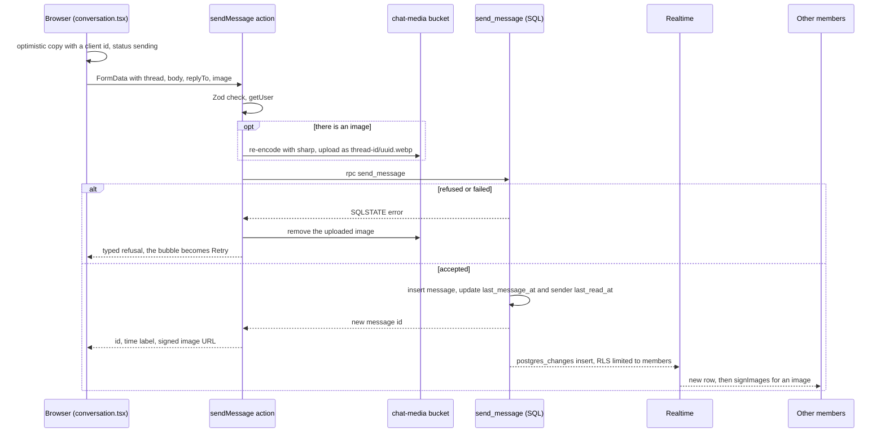

Commit: bc74f6a
Covers: supabase/migrations/20260929050000_chat.sql, supabase/migrations/20260929060000_chat_extras_explore.sql, lib/actions/chat.ts, lib/data/chat.ts, lib/chat/, components/chat/, app/(app)/chat/, app/(app)/settings/chat/, app/(app)/ventures/[id]/chat/

# Chat

## Purpose

Chat is private messaging between two people (a DM) and one group chat per venture; the group's members are the venture's members.
Messages are text and at most one image each; they can be replied to, edited, deleted, reacted to (one of six emoji) and searched; venture owners can pin three messages.
No table accepts a direct insert from a client: threads, members and messages are written only by SQL functions, and every read checks thread membership.

The Explore half of `chat_extras_explore.sql` (`search_people`, `search_ventures`, the prefix tsquery) is described in [people-and-profiles](people-and-profiles.md). Blocks and friendships are from the same doc. Notification wording and email delivery for new messages are in notifications-and-email.

## Data model

Generated schema: [chat](../reference/schema/chat.md), [chat_extras_explore](../reference/schema/chat_extras_explore.md), [buckets](../reference/schema/buckets.md).

| Table | One row is | Notes |
|---|---|---|
| `chat_threads` | A conversation, `dm` or `group` | A group has a `venture_id` (unique per venture), a DM has a `dm_key` of `least(user):greatest(user)` (unique, so one DM per pair); two check constraints tie the type to those columns [src: supabase/migrations/20260929050000_chat.sql#create table public.chat_threads] [src: supabase/migrations/20260929050000_chat.sql#create unique index chat_threads_dm_key_idx]. Later migrations add `org_id` and `closed_at` for recruiter conversations and `fair_id` for job-fair conversations [src: supabase/migrations/20261014000000_recruiter_talent.sql#add column org_id uuid references public.organizations] [src: supabase/migrations/20261020000000_uni_fairs.sql#alter table public.chat_threads add column fair_id] |
| `chat_thread_members` | One person in one thread | `last_read_at` drives unread counts and read receipts; `muted_until` is the mute [src: supabase/migrations/20260929050000_chat.sql#create table public.chat_thread_members] |
| `chat_messages` | One message | `body` up to 10,000 characters; `media_path` must match `<thread-uuid>/<uuid>.webp`; soft-deleted by `deleted_at`, with body and image cleared; `reply_to_id`, `link_url` and a generated `search` tsvector come from the extras migration [src: supabase/migrations/20260929050000_chat.sql#create table public.chat_messages] [src: supabase/migrations/20260929060000_chat_extras_explore.sql#add column reply_to_id] |
| `message_reactions` | One person's reaction on one message | The key is `(message_id, user_id)`: one reaction per person, a different emoji replaces the old one [src: supabase/migrations/20260930000000_phase3_answers.sql#add primary key (message_id, user_id)] |
| `chat_pins` | One pinned message | Written only by `pin_message` [src: supabase/migrations/20260929060000_chat_extras_explore.sql#create table public.chat_pins] |
| `profiles.chat_read_receipts` | A person's receipts setting | Default on [src: supabase/migrations/20260929060000_chat_extras_explore.sql#add column chat_read_receipts] |

Images live in the private `chat-media` bucket (WebP only, 5 MB), in a folder named for the thread [src: supabase/migrations/20260929050000_chat.sql#insert into storage.buckets (id, name, public, file_size_limit, allowed_mime_types)]. Of these tables only `chat_messages` is in the Realtime publication [src: supabase/migrations/20260929050000_chat.sql#alter publication supabase_realtime add table public.chat_messages].

## Flows

### 1. Starting a DM

The Message button on a friend's profile calls `openDm`, which calls `get_or_create_dm` and redirects to `/chat/<thread>` [src: lib/actions/chat.ts#export async function openDm]. The function:

1. refuses without a session, for a missing username or a block in either direction (the same "no one has that username"), and for yourself;
2. requires that you are friends, or that the two of you are the candidate and owner of an accepted application; otherwise it raises "you can message friends, or the people on an application you share" (`42501`);
3. takes an advisory lock on the pair, finds the thread by `dm_key` or creates it, and writes both memberships with the thread [src: supabase/migrations/20260929050000_chat.sql#create function private.get_or_create_dm].

Friendship is checked only here. Nothing in `send_message` re-checks it, and nothing in the friend functions touches chat, so a DM that exists keeps working after an unfriend; only a block (or a recruiter conversation being closed) shuts it [src: supabase/migrations/20260928230000_friends_blocks.sql#create function private.clear_pair]. Recruiter and job-fair conversations are created by their own functions in the recruiting and university docs, as DM rows with an `org_id` (and `fair_id`) [src: supabase/migrations/20261014000000_recruiter_talent.sql#insert into public.chat_threads (type, dm_key, org_id)] [src: supabase/migrations/20261020000000_uni_fairs.sql#insert into public.chat_threads (type, dm_key, org_id, fair_id)].

### 2. Venture group chats

A trigger on `ventures` inserts the group thread, and a trigger on `venture_members` adds a member on insert and removes the thread membership on delete, so the chat follows the team. The migration also back-filled a thread and its members for every venture that existed then [src: supabase/migrations/20260929050000_chat.sql#create trigger ventures_chat] [src: supabase/migrations/20260929050000_chat.sql#create trigger venture_members_chat] [src: supabase/migrations/20260929050000_chat.sql#Backfill: a group chat for every existing venture]. A person who leaves the venture loses access at once because every read checks the membership row; their old messages stay. Non-members get the empty state "The team's chat is for members" from `/ventures/[id]/chat`, which redirects members straight to `/chat/<thread>` using `venture_chat` [src: app/(app)/ventures/[id]/chat/page.tsx#The team's chat is for members].

### 3. Sending a message

In the browser, `send` adds an optimistic bubble with a client id, calls `sendMessage`, and on failure keeps the draft with a Retry that resends with the same client id. If Realtime delivered the row before the action returned, the optimistic copy is dropped so there is one copy [src: components/chat/conversation.tsx#async function send(body: string] [src: components/chat/conversation.tsx#Realtime may already have delivered the row: keep one copy.].

`sendMessage` validates thread id, body (at most 10,000), and reply target as UUIDs; refuses an empty message with no image; then stores the image first when there is one (`storeContentImages`: at most 1 image, 5 MB, re-encoded to WebP with the longest side at most 2,000 px, EXIF dropped, uploaded under the thread folder with the user's own session so the storage policies apply) [src: lib/actions/chat.ts#export async function sendMessage] [src: lib/images/content-images.ts#export async function storeContentImages]. If the SQL call is then refused, the action deletes the uploaded file and logs `orphan_left`.

`send_message` (final definition in the extras migration) raises, in order: not a member (`42501`), DM closed by block (`42501`), body over 10,000 (`23514`), empty with no image (`23514`), reply target not in this thread or deleted (`22023`), image path outside the thread's folder or not an object this user uploaded to `chat-media` (`22023`), and more than 30 messages a minute (`54000`). It then inserts the message, sets the thread's `last_message_at`, and sets the sender's own `last_read_at` [src: supabase/migrations/20260929060000_chat_extras_explore.sql#create function private.send_message].

On insert, `notify_chat_message` runs for every other member who has not muted the thread and is not blocked with the sender. It refreshes the member's one unread `chat_message` notification for that thread (new excerpt and time) instead of adding another, and creates it only if none is unread [src: supabase/migrations/20260929050000_chat.sql#create function private.notify_chat_message]. The `messages` category defaults to the digest channel and does not allow instant email [src: supabase/migrations/20260929050000_chat.sql#('messages', 'Messages', 'New messages in your chats while you''re away.']. A trigger also picks the first link out of the body for a preview (the same rule and queue as posts) [src: supabase/migrations/20260929060000_chat_extras_explore.sql#create trigger chat_messages_link_url].

### 4. Opening and reading a thread

`/chat` is a layout that lists the caller's threads (`my_threads`) beside the open thread. `/chat/[threadId]` calls `getThread`, which returns nothing when the caller is not in the thread or the DM is blocked or closed, and the page then says "This chat isn't available" [src: app/(app)/chat/layout.tsx#getThreads] [src: app/(app)/chat/[threadId]/page.tsx#This chat isn't available].

`getThread` reads the people (`thread_people`), the newest 50 messages (`thread_messages`), the DM receipt and the caller's receipts setting in parallel, signs image URLs for an hour, and for a group chat also reads pins and the venture owner [src: lib/data/chat.ts#export async function getThread] [src: lib/data/chat.ts#createSignedUrls(paths, 3600)]. `thread_messages` takes `p_before` and a limit of at most 100, and returns each message with its reply excerpt, reactions, pinned flag and link preview [src: supabase/migrations/20260929060000_chat_extras_explore.sql#create function private.thread_messages]. The page passes no `before`, and when exactly 50 messages came back the conversation shows "Older messages aren't shown." There is no control for loading earlier messages; search jumps only to a message already on the page and otherwise says "That message is older than what's loaded here." [src: components/chat/conversation.tsx#Older messages aren] [src: components/chat/conversation.tsx#That message is older than what's loaded here.]

Opening, focusing the tab and receiving a message while the tab is visible all call `markThreadRead`, which sets the member's `last_read_at` and marks that thread's `chat_message` notification read; with receipts on in a DM the client also pings the other side to re-read the mark [src: components/chat/conversation.tsx#const markRead = useCallback] [src: supabase/migrations/20260929050000_chat.sql#create function private.mark_thread_read].

### 5. Live updates

The open conversation uses two Realtime channels, created after `realtime.setAuth()` so the channel carries the user's JWT [src: components/chat/conversation.tsx#void supabase.realtime.setAuth().then]:

- `chat:<thread>` listens to `postgres_changes` (all events) on `chat_messages` filtered by thread. The stream is filtered by RLS, so only a member who can read the row receives it. An insert or update merges into the list; for an image the client calls `signImages`, which signs only paths matching the `<uuid>/<uuid>.webp` shape and only succeeds for members through the storage policy [src: components/chat/conversation.tsx#table: "chat_messages", filter: `thread_id=eq.${thread.id}`] [src: lib/actions/chat.ts#export async function signImages].
- `thread:<thread>` is a private broadcast channel with `broadcast.self = false`. It carries four events: `typing` (sent at most every 3 seconds, shown for 4), and `reactions`, `pins`, `read`, which carry no data beyond a message id and make the receiver re-read through `loadReactions`, `loadPins` or `loadReceipt`, so SQL (with its block and receipts rules) is always the source of the data [src: components/chat/conversation.tsx#TYPING_EVERY_MS] [src: components/chat/conversation.tsx#.on("broadcast", { event: "reactions" }]. Joining and sending on that topic is allowed by two `realtime.messages` policies that call `thread_topic_member`, which accepts only `thread:<uuid>` topics for members of an open thread [src: supabase/migrations/20260929060000_chat_extras_explore.sql#create policy thread_broadcast_receive on realtime.messages] [src: supabase/migrations/20260929060000_chat_extras_explore.sql#create function private.thread_topic_member].

If a message is missed, nothing re-reads it. The component sets "online" from the first channel's subscription status and the browser's online and offline events, and shows "Reconnecting… new messages will appear when you're back" while it is false; the subscribe callback does nothing else, so a message sent during a gap appears only when the page is loaded again [src: components/chat/conversation.tsx#.subscribe((status) => {] [src: components/chat/conversation.tsx#Reconnecting… new messages will appear when you].

The header badge (`ChatNavLink`) calls `unread_chat_count` on load and on window focus, and re-reads 1.5 seconds after any `chat_messages` insert from someone else that Realtime delivers [src: components/chat/chat-nav-link.tsx#event: "INSERT", schema: "public", table: "chat_messages"].

### 6. Replies, reactions, pins, edits, deletes, mutes

- **Reply.** `reply_to_id` must name a non-deleted message in the same thread. The list shows the quoted sender and a 140-character excerpt ("Message deleted" or "Image" where the quote has no text) [src: supabase/migrations/20260929060000_chat_extras_explore.sql#when r.deleted_at is not null then 'Message deleted'].
- **Reactions.** Six emoji: 👍 ❤️ 😂 🎉 😮 🙏, mirrored in `lib/chat/constants.ts`. `toggle_reaction` (final definition in `phase3_answers`) removes your reaction if it is the same emoji; otherwise it adds it or replaces your earlier one. Adding costs one of 60 reaction tokens a minute [src: supabase/migrations/20260930000000_phase3_answers.sql#create or replace function private.toggle_reaction] [src: lib/chat/constants.ts#export const REACTIONS]. `reaction_summary` returns counts in the fixed emoji order with a `mine` flag, omitting reactions by people the caller has blocked or been blocked by [src: supabase/migrations/20260929060000_chat_extras_explore.sql#create function private.reaction_summary].
- **Pins.** Only the owner of the venture can pin, only in that venture's group chat, at most 3. The function locks the thread row so two parallel pins cannot make a fourth; pinning a pinned message changes nothing [src: supabase/migrations/20260929060000_chat_extras_explore.sql#create function private.pin_message].
- **Edit.** The sender edits their own, undeleted message to non-empty text (or keeps the image); it sets `edited_at`. There is no time limit, and an edit is refused in a closed DM [src: supabase/migrations/20260929050000_chat.sql#create function private.edit_message].
- **Delete.** The sender's delete blanks the body, clears the image columns and returns the old image path; the action then removes the file, and a trigger queues the same path for the storage-cleanup worker [src: supabase/migrations/20260929050000_chat.sql#create function private.delete_message] [src: lib/actions/chat.ts#export async function deleteMessage] [src: supabase/migrations/20260930000000_phase3_answers.sql#create trigger chat_messages_media_cleanup].
- **Mute.** `mute_thread(hours)` stores `muted_until`: zero or less clears it, 8,760 or more stores `infinity`. The button always sends 8,760 or 0. Muted threads send no new `chat_message` notifications and are left out of the badge count [src: supabase/migrations/20260929050000_chat.sql#create function private.mute_thread] [src: supabase/migrations/20260929050000_chat.sql#create function private.unread_chat_count].
- **Report.** Each message from someone else has a Report button that passes up to ten earlier messages as context; the case handling is in moderation-and-appeals [src: components/chat/conversation.tsx#<ReportButton targetType="message"].

### 7. Search

`search_chats(q, thread?)` needs a session and a query with at least 2 characters of letters or digits (single letters are dropped). The query becomes a prefix tsquery of at most 8 words built from letters and digits only, so search syntax in the input is just words. It searches the caller's own threads (or one), skips closed and blocked DMs and deleted messages and messages from blocked people, and returns at most 30 hits, newest first, each with a 200-character excerpt, the thread title (the venture title, or the other person's name) and the sender [src: supabase/migrations/20260929060000_chat_extras_explore.sql#create function private.search_chats] [src: supabase/migrations/20260929060000_chat_extras_explore.sql#create function private.prefix_tsquery]. `search_chats` takes no rate-limit token. The thread list's search box calls it without a thread and links each hit to `/chat/<thread>#m-<message>` [src: components/chat/thread-list.tsx#h.messageId].

## Entry points

All functions are `security invoker` wrappers over private definer functions, granted to `authenticated` only [src: supabase/migrations/20260929060000_chat_extras_explore.sql#grant execute on function public.send_message]. Every one that touches a thread starts from `auth.uid()` and the membership check.

| Entry | Called by | Who may call it |
|---|---|---|
| `get_or_create_dm` | `openDm` | A user who is a friend of, or in an accepted application with, the other person, and not blocked |
| `send_message` | `sendMessage` | A thread member, with the DM not blocked or closed |
| `thread_messages`, `thread_people`, `thread_pins`, `my_threads`, `dm_receipt`, `reaction_summary` | `lib/data/chat.ts`, `loadReactions`, `loadPins`, `loadReceipt` | Members; each returns nothing for others |
| `mark_thread_read`, `mute_thread` | `markThreadRead`, `muteThread` | Members of the thread; a non-member gets `42501` |
| `edit_message`, `delete_message` | `editMessage`, `deleteMessage` | The sender of the message |
| `toggle_reaction` | `toggleReaction` | A thread member in an open thread |
| `pin_message`, `thread_pins` | `pinMessage`, `loadPins` | The venture owner pins; members read |
| `set_read_receipts`, `my_chat_settings` | `/settings/chat` (`ReadReceiptsToggle`) | The signed-in user, for their own row |
| `search_chats` | `searchChats` | The signed-in user, over their own threads |
| `venture_chat` | `/ventures/[id]/chat` | Returns the thread id only to a member |
| `unread_chat_count` | The header badge | The signed-in user |
| Realtime: `postgres_changes` on `chat_messages`, broadcast on `thread:<id>` | `components/chat/conversation.tsx` | Members, by RLS and the `realtime.messages` policies |
| `/chat`, `/chat/[threadId]`, `/ventures/[id]/chat`, `/settings/chat` | Browser | Signed-in, onboarded accounts (the gate) |

## Permissions

**There are no insert, update or delete policies.** The three core tables and the two extra tables have RLS on, `anon` and `authenticated` lose every grant, and `authenticated` gets `select` only [src: supabase/migrations/20260929050000_chat.sql#grant select on table public.chat_threads, public.chat_thread_members, public.chat_messages to authenticated] [src: supabase/migrations/20260929060000_chat_extras_explore.sql#grant select on table public.message_reactions, public.chat_pins to authenticated]. That is why every write is a function: with no write grant, a thread, a membership or a message cannot be created from the API, and a raw client cannot add itself to a thread.

**Read policies.** A thread and its member list are readable by its members. A message is readable by a member unless the thread is a blocked or closed DM. Reactions follow the message rule; pins need only membership [src: supabase/migrations/20260929050000_chat.sql#create policy chat_messages_member_read] [src: supabase/migrations/20260929060000_chat_extras_explore.sql#create policy message_reactions_member_read]. `is_thread_member` is a definer function so the policies do not recurse into themselves.

**`dm_blocked` is the "DM is shut" test.** It is true when the thread is a DM and the other member is blocked with the caller in either direction, and (after the recruiter migration) also when `closed_at` is set. Despite the name, the closed case is included [src: supabase/migrations/20261014000000_recruiter_talent.sql#create or replace function private.dm_blocked]. Reading messages, sending, editing, reacting, searching, the thread list, storage and the broadcast channel all use it, so a block removes the thread from both people's lists, empties it, stops new messages and image reads, and ends the Realtime stream. Nothing is deleted: the block deletes only the friendship and requests, so an unblock makes the old DM visible again [src: supabase/migrations/20260929050000_chat.sql#create function private.storage_thread_member]. In a group chat a teammate blocked either way appears in the people list as "Blocked member" with no link or photo; their reactions are left out of the counts, and their messages are skipped in the thread list's last-message preview, the unread count and search, but `thread_messages` still returns them [src: supabase/migrations/20261014000000_recruiter_talent.sql#create or replace function private.thread_people].

**Storage.** Members read and write `chat-media/<thread>/…` through `storage_thread_member`, which also applies `dm_blocked`; only the uploader can delete a file [src: supabase/migrations/20260929050000_chat.sql#create policy chat_media_member_read] [src: supabase/migrations/20260929050000_chat.sql#create policy chat_media_owner_delete]. `send_message` additionally requires that the path is in this thread's folder and was uploaded by the sender.

**Restrictions.** A suspended or banned account cannot insert messages, reactions or pins: `refuse_if_restricted` is installed as an insert trigger on `chat_messages`, `message_reactions` and `chat_pins`. It checks `auth.uid()`, so it does not stop edits or deletes by that user [src: supabase/migrations/20261027000000_sanctions_appeals.sql#'posts', 'post_comments', 'chat_messages', 'message_reactions', 'chat_pins'].

**Read receipts.** In a DM, `dm_receipt` returns the other member's `last_read_at` only when both people's profiles have receipts on, and nothing in a group [src: supabase/migrations/20260929060000_chat_extras_explore.sql#create function private.dm_receipt]. The setting is `set_read_receipts`.

## Failure modes

| Situation | What happens | Where it shows |
|---|---|---|
| Message sent too fast (over 30 a minute) | `rate_limited`: "You're sending messages too fast"; the uploaded image is removed | `chat.send` refused, `orphan_left` |
| Reaction too fast (over 60 a minute) | `rate_limited` | `chat.react` refused |
| DM blocked or closed | Send is refused ("this conversation is closed"); edit and react are refused with their own messages; the page says "This chat isn't available" | `chat.send` refused `forbidden` |
| Not a member | `forbidden`, "you're not in this chat" | Refused |
| Send fails after the image was stored | The action deletes the file; if that fails, the log line says `orphan_left: true` | `chat.send` refused or error [src: lib/actions/chat.ts#orphan_left] |
| Image over 5 MB, larger than 6,000 px, or unreadable | `too_large` or `not_an_image` before any SQL | `chat.send` refused |
| Image upload fails | "Couldn't send the image. Try again."; outcome `error` | `chat.send` error with `upload_failed` |
| Any SQL error not in the known list | "Couldn't send your message. Try again." with the request id | `chat.send` error with the SQLSTATE |
| Send action throws or the network drops | The bubble turns to failed with Retry; the draft and image stay in memory | Browser only |
| Realtime drops | "Reconnecting…" banner; messages sent meanwhile are not fetched on return | Browser only; no server log |
| A deleted message's image | Removed by the action and queued by the trigger; a failure is retried by the worker up to 5 times, then dropped and logged | `storage-cleanup` job log and `pgmq` `storage_cleanup` [src: supabase/functions/_shared/storage/cleanup.ts#const MAX_TRIES = 5] |
| Pin a fourth message | `limit` ("up to 3 messages can be pinned; unpin one first") | `chat.pin` refused |
| Pin by anyone but the venture owner, or in a DM | `forbidden` | `chat.pin` refused |
| Search shorter than 2 letters | The action refuses before SQL; SQL returns no rows | `chat.search` refused |
| A reply to a message that was deleted meanwhile | `invalid_input`, "that message is no longer here to reply to" | `chat.send` refused |
| Suspended sender | `forbidden`: "your account is suspended…" | `chat.send` refused |

## Tests

- pgTAP `23_chat` (36 assertions): threads and messages cannot be inserted directly, a person cannot add themself to a thread, friends get one reused DM, empty and over-long messages are refused, the 31st message in a minute is refused, one refreshed notification per thread, open marks read, a deleted message keeps its place, a blocked DM takes no messages and leaves the list, no new DM can start across a block, an accepted application opens a DM, an outsider gets no group chat, leaving the venture leaves the chat [src: supabase/tests/23_chat.test.sql#select plan(36)].
- pgTAP `24_chat_extras` (42): replies and cross-thread quotes, reactions (six only, one per person, toggle), pins (three, outsiders see none), receipts on both sides, search across chats and in a thread, one letter finds nothing, query syntax is just words, link capture [src: supabase/tests/24_chat_extras.test.sql#select plan(42)]. `27_phase3_answers` covers the one-reaction rule and the chat image cleanup queue [src: supabase/tests/27_phase3_answers.test.sql#deleting a chat image''s message queues the image].
- E2E `chat.spec.ts` (DM live both ways, image, edit, delete, unread, outsiders refused, venture group chat) and `chat-extras.spec.ts` (typing, reply, reactions, read receipts, search, pins) [src: tests/e2e/chat.spec.ts#DM live both ways, image, edit, delete, unread; outsiders refused; venture group chat] [src: tests/e2e/chat-extras.spec.ts#typing, reply, reactions, read receipts, search, pins].
- No test covers the reconnecting state, a message missed during a Realtime gap, or a DM continuing after an unfriend.

## Change guide

1. **Change a message limit or the attachment rules.** Body length is in three places: the table check, `send_message`/`edit_message`, and the Zod schemas in `lib/actions/chat.ts`. Image rules are in `CONTENT_IMAGE` and `reencodeToFit` (size, side), the bucket row (5 MB, WebP only), the `media_path` check on `chat_messages`, and `send_message`'s path check. A new attachment type needs a new column or bucket policy, a change to `send_message`, `thread_messages` and the Realtime row mapping in `conversation.tsx` [src: supabase/migrations/20260929050000_chat.sql#media_path text check] [src: lib/images/reencode.ts#export const CONTENT_IMAGE].
2. **Change the reactions.** The set is written in four places that must agree: the `emoji in (…)` check on `message_reactions`, the list in `toggle_reaction`, the `array_position(array[…])` ordering in `reaction_summary`, and `REACTIONS` in `lib/chat/constants.ts`. Change the SQL in a new migration that re-creates the functions; the pgTAP test `24` pins the six [src: supabase/migrations/20260929060000_chat_extras_explore.sql#emoji text not null check] [src: supabase/migrations/20260929060000_chat_extras_explore.sql#array_position(array[].
3. **Change who may start or keep a DM.** Start: the friend-or-accepted-application test in `get_or_create_dm`. Keep: nothing checks friendship afterwards, so to close DMs on unfriend, add the rule to `dm_blocked` (which every read and write uses) rather than to `send_message` alone. Recruiter and fair conversations create their own rows and need the same thought [src: supabase/migrations/20260929050000_chat.sql#you can message friends, or the people on an application you share].

Also likely: **loading older messages.** `thread_messages` already takes `p_before`; the page and the conversation component do not use it (flow 4).

## Answers to the planned questions

**1. Why no insert policies, and which functions write.** Clients cannot be trusted to name a thread or a sender, and a policy that checked membership on insert would let anyone with a thread id write rows directly. With no write grants at all, the only writers are `get_or_create_dm`, the venture triggers, `send_message`, `edit_message`, `delete_message`, `mark_thread_read`, `mute_thread`, `toggle_reaction`, `pin_message`, `set_read_receipts`, plus the recruiter and fair functions that open their own DM threads. pgTAP asserts that direct inserts into threads, messages and reactions are refused [src: supabase/tests/24_chat_extras.test.sql#reactions are not inserted directly].

**2. Group chats and the venture.** Flow 2: a trigger on `ventures` creates the thread, a trigger on `venture_members` adds and removes members.

**3. How the client receives messages.** Flow 5. `postgres_changes` on `chat_messages` is the delivery path; the private broadcast channel carries typing and change pings only; `setAuth` runs before either subscription. A missed message is not recovered until the page loads again.

**4. Read receipts, unread, mutes.** `last_read_at` per member; unread is the count of others' undeleted, non-blocked messages after it, summed over unmuted threads for the badge; receipts show only in DMs when both people's setting is on; mutes stop notifications and badge counts [src: supabase/migrations/20261014000000_recruiter_talent.sql#create or replace function private.my_threads].

**5. Chat images.** Re-encoded and uploaded by the server action into the private `chat-media/<thread>/<uuid>.webp`, read as one-hour signed URLs by members, removed by the action and by a trigger-queued cleanup job when the message is deleted or removed by a moderator (which clears `media_path`) [src: lib/data/chat.ts#export async function signChatImages].

**6. Reactions, replies, pins, edits and limits.** Flow 6. Limits: 10,000 characters, 30 messages a minute, 60 reactions a minute, three pins, six emoji.

**7. Search.** Flow 7: your own threads only, prefix words, 30 hits, closed and blocked DMs excluded, no deleted messages.

**8. Blocks and restrictions.** A block shuts a DM for both people everywhere (reads, sends, storage, search, Realtime) without deleting anything; unblocking reopens it. In a group chat the blocked teammate shows as "Blocked member" and their messages stay in the thread. A suspended or banned account can read but not post, react or pin. Unfriending alone changes nothing about an existing DM.
