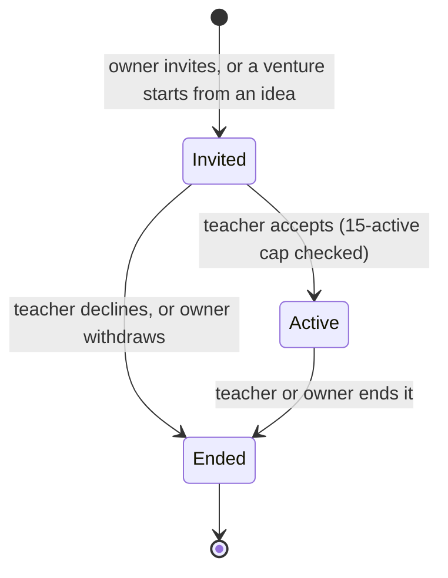
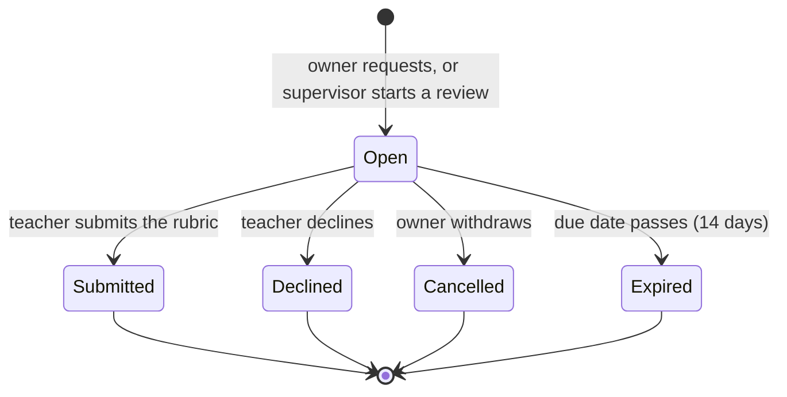
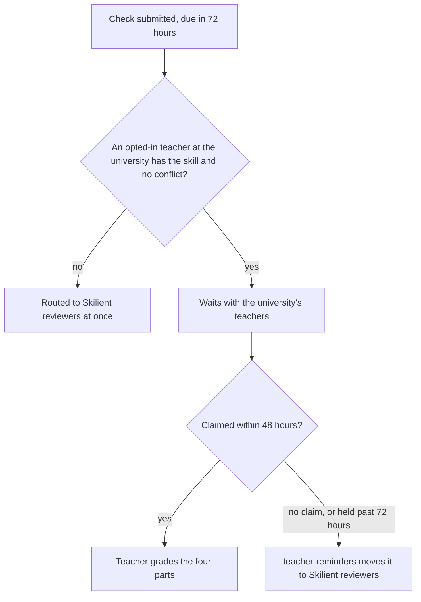

Commit: 1f210f1
Covers: supabase/migrations/20261012000000_teacher_portal.sql, lib/actions/teach.ts, lib/data/teach.ts, lib/teach/constants.ts, lib/actions/ops/teachers.ts, components/teach/, components/ops/teacher-forms.tsx, app/(app)/teach/, app/(app)/ideas/[id]/, app/(app)/ventures/[id]/reviews/, app/(app)/ops/teachers/

# Faculty

## Purpose

The teacher portal (PRD 5.21): faculty ask for the teacher role, get approved, post project ideas, supervise and review ventures, endorse students and grade code checks.
Approval comes from a faculty CSV, the university admin or Skilient accounts staff; a removed teacher keeps past reviews and endorsements, marked "former faculty".
SQL makes every rule and refuses bad input, the app reads one jsonb document per page and calls one function per action, and two cron jobs run the clocks.

Generated schema: [teacher_portal](../reference/schema/teacher_portal.md).

## Data model

- `teacher_profiles`: one row per faculty account, with university, department, title, `status` (`pending`, `approved`, `revoked`), `approval_source` and who approved or removed the teacher. Clients read their own row only [src: supabase/migrations/20261012000000_teacher_portal.sql#create table public.teacher_profiles] [src: supabase/migrations/20261012000000_teacher_portal.sql#create type public.teacher_status] [src: supabase/migrations/20261012000000_teacher_portal.sql#approval_source = case when v_staff].
- `teacher_settings`: code-check opt-in, weekly cap (1 to 50, default 10), chosen grading skills and the digest switch [src: supabase/migrations/20261012000000_teacher_portal.sql#weekly_grading_cap smallint not null default 10].
- `faculty_csv_entries`: emails pre-approved for one university. Neither `anon` nor `authenticated` has a grant [src: supabase/migrations/20261012000000_teacher_portal.sql#revoke all on table public.teacher_profiles].
- `project_ideas`: title, brief, skills, difficulty, team size, duration, deliverables, max teams, optional deadline and course label, audience (`university` or `global`) and status. `ventures.idea_id` links a venture to its idea [src: supabase/migrations/20261012000000_teacher_portal.sql#create table public.project_ideas] [src: supabase/migrations/20261012000000_teacher_portal.sql#alter table public.ventures add column idea_id].
- `venture_supervisors`: status `invited`, `active` or `ended`, with start and end times. A partial unique index allows one invited or active supervisor per venture [src: supabase/migrations/20261012000000_teacher_portal.sql#create unique index venture_supervisors_one_current].
- `supervisor_comments`: the supervisor thread, plain text [src: supabase/migrations/20261012000000_teacher_portal.sql#create table public.supervisor_comments].
- `review_requests`: status `open`, `submitted`, `declined`, `expired` or `cancelled`, with a due date and reminder marks. A partial unique index allows one open request per venture and teacher [src: supabase/migrations/20261012000000_teacher_portal.sql#create unique index review_requests_one_open] [src: supabase/migrations/20261012000000_teacher_portal.sql#create type public.review_request_status].
- `venture_reviews`: one row per submitted review, with the rubric as jsonb, the overall comment and the average [src: supabase/migrations/20261012000000_teacher_portal.sql#create table public.venture_reviews].
- `teacher_concentration_flags`: one open flag per teacher and student, decided by a trust reviewer [src: supabase/migrations/20261012000000_teacher_portal.sql#create unique index teacher_concentration_flags_one_open].
- Columns added to other tables: `contribution_confirmations.confirmer_role` (`peer` or `supervisor`), `endorsements.endorser_kind` (`peer` or `teacher`) and `code_checks.due_at` and `routed_to_staff_at` [src: supabase/migrations/20261012000000_teacher_portal.sql#add column confirmer_role] [src: supabase/migrations/20261012000000_teacher_portal.sql#add column endorser_kind] [src: supabase/migrations/20261012000000_teacher_portal.sql#add column due_at].
- Limits: the `teacher.limits` key of `platform_config` holds the numbers, read through `private.teacher_limit`. The launch values are 15 active supervisions, 40 endorsements a month, weight 1.5, 5 skills per student per venture, a flag above 30% over 90 days with at least 10 endorsements, review due in 14 days with reminders at 7 and 12, 3 open requests per venture, a grading cap of 10 and 10 ideas a day [src: supabase/migrations/20261012000000_teacher_portal.sql#create function private.teacher_limit] [src: supabase/migrations/20261012000000_teacher_portal.sql#supervisions_max] [src: supabase/migrations/20261029000000_config_metrics.sql#teacher.limits]. `TEACHER_LIMITS` repeats some of them for display [src: lib/teach/constants.ts#TEACHER_LIMITS].
- Code-check pass rule: a check passes with 3 of 4 rubric parts, from the `pass_parts` key of the code-check config [src: supabase/migrations/20261004000000_code_checks.sql#pass_parts].
- Notification types: nine `faculty` types, all in-app only [src: supabase/migrations/20261012000000_teacher_portal.sql#insert into public.notification_types].

## Flows

### 1. Asking for the role and approval

The apply page shows the role to faculty and sends approved teachers to `/teach` [src: app/(app)/teach/apply/page.tsx#ApplyPage]. The form calls `requestTeacherRole`, which calls `request_teacher_role` [src: lib/actions/teach.ts#requestTeacherRole]. The SQL accepts faculty accounts with a university only, requires a department and title of 2 to 80 characters, and allows 5 requests a day [src: supabase/migrations/20261012000000_teacher_portal.sql#create function private.request_teacher_role]. An email on the university's CSV is approved at once and the teacher is told; any other request is `pending`.

Approval is by the university admin or accounts staff. `approve_teacher` accepts either and writes a `teacher.approve` row to the audit log [src: supabase/migrations/20261012000000_teacher_portal.sql#create function private.approve_teacher] [src: supabase/migrations/20261012000000_teacher_portal.sql#'teacher.approve']. The university admin's button calls `uni_approve_teacher`, which delegates to the same function [src: supabase/migrations/20261017000000_uni_core.sql#create function private.uni_approve_teacher]. Accounts staff use `/ops/teachers`: `approveTeacher` [src: lib/actions/ops/teachers.ts#approveTeacher], `revokeTeacher` [src: lib/actions/ops/teachers.ts#revokeTeacher] and `importFacultyCsv` [src: lib/actions/ops/teachers.ts#importFacultyCsv]. The CSV import takes up to 2,000 rows, checks every email, and approves matching pending requests at that university in the same call [src: supabase/migrations/20261012000000_teacher_portal.sql#create function private.import_faculty_csv].

Removal needs a reason of at least 3 characters. `revoke_teacher` sets the teacher to `revoked`, ends their open supervisions, cancels their open review requests, releases their claimed checks and closes their open ideas. Past reviews and endorsements stay [src: supabase/migrations/20261012000000_teacher_portal.sql#create function private.revoke_teacher].

### 2. Ideas and starting a venture

A teacher saves an idea with `saveIdea`, which calls `save_idea` [src: lib/actions/teach.ts#saveIdea]. The SQL checks the field lengths, 1 to 10 skills, a team size of 2 to 6, a duration of 1 to 52 weeks, a team limit of 1 to 50 (default 3) and a deadline that is not in the past by Pakistan date [src: supabase/migrations/20261012000000_teacher_portal.sql#create function private.save_idea]. Once a team has started from an idea, only the limit, deadline, label and audience can change, and the limit can't go below the number of teams started.

An idea is open while its status is `open`, its deadline has not passed by Pakistan date and fewer than `max_teams` non-abandoned ventures started from it [src: supabase/migrations/20261012000000_teacher_portal.sql#create function private.idea_is_open] [src: supabase/migrations/20261012000000_teacher_portal.sql#create function private.idea_teams]. `setIdeaOpen` calls `set_idea_status`, which refuses a reopen when the deadline has passed [src: lib/actions/teach.ts#setIdeaOpen].

A student opens `/ideas/[id]` [src: app/(app)/ideas/[id]/page.tsx#IdeaPage]. `idea_get` returns the idea only to its teacher, to anyone for a global idea, and to the university the idea belongs to [src: supabase/migrations/20261012000000_teacher_portal.sql#create function private.idea_get]. For an open idea the page links to `/ventures/new?idea=`, and `startVentureFromIdea` calls `start_venture_from_idea` [src: lib/actions/teach.ts#startVentureFromIdea]. That function accepts active students only, locks the idea row, refuses a closed idea, creates the venture with `idea_id` set and, when the idea's teacher is approved, invites that teacher to supervise [src: supabase/migrations/20261012000000_teacher_portal.sql#create function private.start_venture_from_idea].

### 3. Supervision

The owner calls `inviteSupervisor`, which calls `invite_supervisor`. The venture must be recruiting or in progress, the teacher must be approved at the venture's university, must not be a team member, and the venture must have no invited or active supervisor. Owners can send 10 invites a day [src: lib/actions/teach.ts#inviteSupervisor] [src: supabase/migrations/20261012000000_teacher_portal.sql#create function private.invite_supervisor].

The teacher answers with `respondSupervision`, which calls `respond_supervision`. The function takes a per-teacher advisory lock, so parallel accepts can't pass the cap, then refuses an accept while the teacher already has 15 active supervisions [src: lib/actions/teach.ts#respondSupervision] [src: supabase/migrations/20261012000000_teacher_portal.sql#create function private.respond_supervision]. A decline sets the row to `ended`. `endSupervision` calls `end_supervision`, which lets the supervisor or the owner end an invited or active supervision [src: lib/actions/teach.ts#endSupervision] [src: supabase/migrations/20261012000000_teacher_portal.sql#create function private.end_supervision].

An active supervisor reads the venture's full data. `is_venture_teacher` is true for an active supervisor or a teacher with an open review request [src: supabase/migrations/20261012000000_teacher_portal.sql#create function private.is_venture_teacher]. `can_view_venture` and the deliverables policy both use it [src: supabase/migrations/20261012000000_teacher_portal.sql#create or replace function private.can_view_venture] [src: supabase/migrations/20261012000000_teacher_portal.sql#create policy venture_deliverables_read]. The teacher's venture page reads `teacher_venture`, which sets `can_read` and `can_endorse` [src: supabase/migrations/20261012000000_teacher_portal.sql#create function private.teacher_venture] [src: lib/data/teach.ts#getTeacherVenture].

The supervisor thread is plain text. `postSupervisorComment` calls `post_supervisor_comment`, which accepts 1 to 2,000 characters from members or the active supervisor [src: lib/actions/teach.ts#postSupervisorComment] [src: supabase/migrations/20261012000000_teacher_portal.sql#create function private.post_supervisor_comment]. `supervisor_thread` returns the newest 200 comments to members and the active supervisor [src: supabase/migrations/20261012000000_teacher_portal.sql#create function private.supervisor_thread]. A supervisor confirms a team entry with `confirmAsSupervisor`, which calls `supervisor_confirm_contribution`. That writes a confirmation with `confirmer_role` `supervisor`, and GitHub entries are refused [src: lib/actions/teach.ts#confirmAsSupervisor] [src: supabase/migrations/20261012000000_teacher_portal.sql#create function private.supervisor_confirm_contribution].

### 4. Review requests

The owner calls `requestReview`, which calls `request_review`. The venture must be in progress or completed, the teacher must be approved at the same university and not on the team, and the teacher can't already hold an open request. A venture can have 3 open requests at once. The due date is 14 days out and the teacher is notified [src: lib/actions/teach.ts#requestReview] [src: supabase/migrations/20261012000000_teacher_portal.sql#create function private.request_review]. A supervisor starts a review on their own with `startReview` and `start_review`, which returns the open request if there is one [src: lib/actions/teach.ts#startReview] [src: supabase/migrations/20261012000000_teacher_portal.sql#create function private.start_review].

The teacher scores the five parts of the rubric, each 1 to 5 with a comment, and may add an overall comment of up to 2,000 characters. `submitReview` calls `submit_review`, which stores the rubric and the average, marks the request `submitted` and tells the team [src: lib/actions/teach.ts#submitReview] [src: supabase/migrations/20261012000000_teacher_portal.sql#create function private.submit_review]. The five keys are in `REVIEW_RUBRIC` [src: lib/teach/constants.ts#REVIEW_RUBRIC].

`closeReviewRequest` covers two cases: the teacher declines (the owner is told), or the owner withdraws. Anyone else is refused as not found [src: lib/actions/teach.ts#closeReviewRequest] [src: supabase/migrations/20261012000000_teacher_portal.sql#create function private.close_review_request].

The hourly `teacher-reminders` job sends reminders at 7 and 12 days, once each, and expires open requests at their due time [src: supabase/migrations/20261012000000_teacher_portal.sql#create function private.teacher_reminders] [src: supabase/migrations/20261012000000_teacher_portal.sql#cron.schedule('teacher-reminders'].

Scores show only to the team and the reviewing teacher. Everyone else who can see the venture sees "Reviewed by faculty", the teacher and the date [src: supabase/migrations/20261012000000_teacher_portal.sql#create function private.venture_reviews_for]. The CV snapshot adds `faculty_reviewed` to each project and never a score [src: supabase/migrations/20261012000000_teacher_portal.sql#create function private.cv_snapshot].

### 5. Teacher endorsements

`teacherEndorse` calls `teacher_endorse` [src: lib/actions/teach.ts#teacherEndorse]. The function first runs `teacher_may_endorse`: the teacher must have reviewed the venture, or have supervised it with a started supervision, including one that has ended [src: supabase/migrations/20261012000000_teacher_portal.sql#create function private.teacher_may_endorse]. Each item must be a skill tagged in the venture. The teacher can endorse up to 5 skills per student per venture and 40 endorsements a month, counted by Pakistan month [src: supabase/migrations/20261012000000_teacher_portal.sql#create function private.teacher_endorse] [src: supabase/migrations/20261001000000_endorsements.sql#create function private.pk_month_start]. Evidence is optional, and when given it must be one of that teammate's entries in this venture.

Scoring gives a teacher endorsement a weight from `endorsement_weight`, 1.5 [src: supabase/migrations/20261012000000_teacher_portal.sql#create or replace function private.score_endorsements]. For L4, an endorsement counts only when tied to evidence. Two distinct endorsers [src: supabase/migrations/20261001000000_endorsements.sql#peer_verified_min] or one teacher endorsement is enough [src: supabase/migrations/20261012000000_teacher_portal.sql#create or replace function private.l4_skills]. For peer-verified, one teacher endorsement is enough without evidence [src: supabase/migrations/20261012000000_teacher_portal.sql#create or replace function private.refresh_peer_verified].

### 6. Code-check routing and grading

The trigger `code_checks_route` runs on submission. It sets `due_at` from the code-check config and sets `routed_to_staff_at` at once when `teachers_available` is false [src: supabase/migrations/20261012000000_teacher_portal.sql#create function private.code_checks_route] [src: supabase/migrations/20261012000000_teacher_portal.sql#create function private.teachers_available]. The same trigger refuses a staff member's claim on a check that is not routed [src: supabase/migrations/20261012000000_teacher_portal.sql#this code check is with the university''s teachers for now].

The queue, `teacher_code_check_queue`, lists checks still with teachers (not yet routed to staff) from the teacher's university for their chosen skills, oldest first, and hides checks claimed by someone else [src: supabase/migrations/20261012000000_teacher_portal.sql#create function private.teacher_code_check_queue]. `claimTeacherCheck` calls `teacher_claim_code_check`, which takes a per-teacher advisory lock and locks the row with `FOR UPDATE SKIP LOCKED`. It refuses when grading is off, when the check is routed, when the student is at another university, when the skill was not chosen, on a conflict and at the weekly cap [src: lib/actions/teach.ts#claimTeacherCheck] [src: supabase/migrations/20261012000000_teacher_portal.sql#create function private.teacher_claim_code_check]. The weekly count is the checks held plus those graded since Monday, Pakistan time [src: supabase/migrations/20261012000000_teacher_portal.sql#create function private.teacher_week_grading].

`gradeTeacherCheck` calls `teacher_grade_code_check`. The feedback must be at least 3 characters, the rubric must have exactly the four keys `behaviour`, `design`, `change` and `accuracy` with a boolean each, and the check passes when at least `pass_parts` of them pass. The claim is cleared on grading [src: lib/actions/teach.ts#gradeTeacherCheck] [src: supabase/migrations/20261012000000_teacher_portal.sql#create function private.teacher_grade_code_check].

The teacher reads the code through `getTeacherSnippet`, which is the same snippet read the student uses [src: lib/data/teach.ts#getTeacherSnippet]. `code_check_snippet_access` gives the code only to the teacher who holds the claim [src: supabase/migrations/20261012000000_teacher_portal.sql#create or replace function private.code_check_snippet_access].

### 7. Endorsement concentration

`detect_teacher_concentration` runs inside `detect_rings`, the anti-gaming check of the nightly ranking run [src: supabase/migrations/20261012000000_teacher_portal.sql#create function private.detect_rings]. It flags a teacher's pair with one student when that student has more than 30% of the teacher's endorsements over 90 days, with at least 10 in total, and when no open flag already exists for the pair [src: supabase/migrations/20261012000000_teacher_portal.sql#create function private.detect_teacher_concentration].

Trust reviewers see the open flags in `teacher_flag_queue` [src: supabase/migrations/20261012000000_teacher_portal.sql#create function private.teacher_flag_queue]. `reviewTeacherFlag` calls `review_teacher_flag`, which needs a reason of at least 3 characters and records the decision [src: lib/actions/ops/teachers.ts#reviewTeacherFlag] [src: supabase/migrations/20261012000000_teacher_portal.sql#create function private.review_teacher_flag]. The UI is `TeacherFlagForm` [src: components/ops/teacher-forms.tsx#TeacherFlagForm]. Nothing is removed automatically.

### 8. Reminders and the weekly digest

`teacher-reminders` runs at minute 7 of every hour [src: supabase/migrations/20261012000000_teacher_portal.sql#cron.schedule('teacher-reminders']. Besides the review clock in flow 4, it moves unclaimed checks and checks held past their due time to staff, and closes ideas whose deadline has passed by Pakistan date [src: supabase/migrations/20261012000000_teacher_portal.sql#create function private.teacher_reminders]. The job records a run, and an error marks the run `failed`, returns 0 and rolls the batch back [src: supabase/migrations/20261012000000_teacher_portal.sql#exception when others then].

`teacher-digest` runs on Mondays at 04:00 UTC, which is 09:00 Pakistan time [src: supabase/migrations/20261012000000_teacher_portal.sql#cron.schedule('teacher-digest']. `queue_teacher_digests` checks each approved teacher who has the digest on, and queues a `teacher_digest` message only when the counts from `teacher_digest_data` are above zero [src: supabase/migrations/20261012000000_teacher_portal.sql#create function private.queue_teacher_digests] [src: supabase/migrations/20261012000000_teacher_portal.sql#create function private.teacher_digest_data]. The notify worker builds the email from the counts alone, and an empty digest is skipped [src: supabase/functions/_shared/notify/worker.ts#teacher_digest] [src: supabase/functions/_shared/notify/email.ts#teacherDigestEmail].

## Entry points

| Caller | Action or read | SQL | Who may call |
|---|---|---|---|
| Apply page form | `requestTeacherRole` | `request_teacher_role` | Faculty accounts with a university |
| `/ops/teachers` approve | `approveTeacher` | `approve_teacher` | Accounts staff with two-factor, or the university admin |
| `/ops/teachers` remove | `revokeTeacher` | `revoke_teacher` | Same as approve |
| `/ops/teachers` CSV | `importFacultyCsv` | `import_faculty_csv` | Same as approve |
| `/ops/teachers` flags | `reviewTeacherFlag` | `review_teacher_flag` | Trust reviewers |
| `/teach` home | `getTeacherHome` | `teacher_home` | Approved teachers |
| `/teach/settings` | `saveTeacherSettings` | `save_teacher_settings` | Approved teachers |
| `/teach/ideas/new`, `/teach/ideas/[id]` | `saveIdea`, `setIdeaOpen` | `save_idea`, `set_idea_status` | Approved teacher, own ideas |
| `/ideas/[id]` | `startVentureFromIdea` | `start_venture_from_idea` | Active students |
| Venture supervisor card | `inviteSupervisor` | `invite_supervisor` | Venture owner |
| `/teach` invites | `respondSupervision` | `respond_supervision` | Teacher holding the invite |
| Venture supervisor card | `endSupervision` | `end_supervision` | Supervisor or owner |
| Supervisor thread | `postSupervisorComment` | `post_supervisor_comment` | Members and the active supervisor |
| Venture contributions | `confirmAsSupervisor` | `supervisor_confirm_contribution` | Active supervisor |
| Venture Reviews tab | `requestReview` | `request_review` | Venture owner |
| Teacher venture page | `startReview` | `start_review` | Active supervisor |
| `/teach/reviews/[requestId]` | `submitReview`, `closeReviewRequest` | `submit_review`, `close_review_request` | Requested teacher; the owner may withdraw |
| Teacher venture page | `teacherEndorse` | `teacher_endorse` | Teacher who reviewed or supervised the venture |
| `/teach/code-checks` | `claimTeacherCheck` | `teacher_claim_code_check` | Approved teacher with grading on |
| `/teach/code-checks/[id]` | `gradeTeacherCheck` | `teacher_grade_code_check` | The teacher holding the claim |
| Cron | `teacher-reminders`, `teacher-digest` | `teacher_reminders`, `queue_teacher_digests` | The database only |

Each action opens an action context named `teach.*` [src: lib/actions/teach.ts#actionContext("teach.apply")] [src: lib/actions/teach.ts#actionContext("teach.respond_supervision")]. The `public` wrappers are security invoker and take the caller from the session [src: supabase/migrations/20261012000000_teacher_portal.sql#create function public.request_teacher_role]. The `teacher_*` reads that build pages return one jsonb document each [src: lib/data/teach.ts#getTeacherVenture].

## Permissions

- **Approved teachers only.** `require_teacher` raises 42501 "approved teachers only" for anyone else [src: supabase/migrations/20261012000000_teacher_portal.sql#create function private.require_teacher] [src: supabase/migrations/20261012000000_teacher_portal.sql#approved teachers only]. `teacher_state` is the one exception: it returns the caller's own state or nothing, so the apply page and the portal layout can read it [src: supabase/migrations/20261012000000_teacher_portal.sql#create function private.teacher_state]. The portal layout sends everyone else to the apply page [src: app/(app)/teach/(portal)/layout.tsx#TeachLayout].
- **Staff and admins.** Approval, removal and CSV import accept accounts staff or a university admin of that university [src: supabase/migrations/20261012000000_teacher_portal.sql#create function private.approve_teacher]. Staff need two-factor on the session [src: supabase/migrations/20261012000000_teacher_portal.sql#accounts staff only, with two-factor on].
- **Row policies.** A teacher reads their own profile and settings [src: supabase/migrations/20261012000000_teacher_portal.sql#create policy teacher_profiles_read_own]. An idea is visible to its teacher, to global ideas and to the teacher's university [src: supabase/migrations/20261012000000_teacher_portal.sql#create policy project_ideas_read]. Supervisions and review requests are visible to the team and the teacher [src: supabase/migrations/20261012000000_teacher_portal.sql#create policy venture_supervisors_read] [src: supabase/migrations/20261012000000_teacher_portal.sql#create policy review_requests_read]. Reviews are visible to the team and the teacher [src: supabase/migrations/20261012000000_teacher_portal.sql#create policy venture_reviews_read]. The supervisor thread is readable by the team and the active supervisor [src: supabase/migrations/20261012000000_teacher_portal.sql#create policy supervisor_comments_read].
- **No client writes.** The teacher tables have grants for `select` only, and every write goes through a function [src: supabase/migrations/20261012000000_teacher_portal.sql#grant select on table public.teacher_profiles].
- **Conflicts.** `teacher_conflict` blocks a claim or a grade when the student is a friend, a teammate, or a member of a venture the teacher supervises or supervised [src: supabase/migrations/20261012000000_teacher_portal.sql#create function private.teacher_conflict]. The intent is recorded in the 2026-10-03 decision; the declined-invite case is in [prd-mismatches](../reference/prd-mismatches.md) row 51.
- **Endorsements.** Only for members of ventures the teacher reviewed or supervised [src: supabase/migrations/20261012000000_teacher_portal.sql#you can endorse members of ventures you reviewed or supervised].

## Failure modes and logs

- **Refusals.** The SQL uses a fixed set of codes: 42501 for role and ownership, 22023 for bad input, 55000 for the wrong state or a race, 23514 for a cap, 23505 for a duplicate and 54000 for a rate limit [src: supabase/migrations/20261012000000_teacher_portal.sql#someone else is claiming this code check right now]. Rate limits cover requests (5 a day), ideas (10 a day), supervision invites (10 a day) and supervisor comments [src: supabase/migrations/20261012000000_teacher_portal.sql#'teacher_request:'].
- **Declined and withdrawn invites keep a conflict.** A decline or a withdrawal sets the supervision to `ended` without a start time [src: supabase/migrations/20261012000000_teacher_portal.sql#create function private.respond_supervision] [src: supabase/migrations/20261012000000_teacher_portal.sql#create function private.end_supervision]. `teacher_conflict` counts every `ended` supervision, so the teacher loses the right to grade those students. `teacher_venture` also sets `can_endorse` from the status alone, so the endorse form shows, and `teacher_endorse` then refuses. Logged as [prd-mismatches](../reference/prd-mismatches.md) row 51.
- **The thread is capped.** `supervisor_thread` returns the newest 200 comments. The spec does not mention a limit [src: supabase/migrations/20261012000000_teacher_portal.sql#limit 200].
- **Copy about the code.** When GitHub no longer shows the code, the page says so and offers to grade from the answers or release the check [src: app/(app)/teach/(portal)/code-checks/[id]/page.tsx#GitHub no longer shows this code].
- **Digest.** A teacher with nothing waiting gets no message; the worker logs a skip instead [src: supabase/functions/_shared/notify/worker.ts#notify.skipped].
- **Audit.** Approval, removal, CSV import and flag decisions write to `ops_audit_log` [src: supabase/migrations/20261012000000_teacher_portal.sql#'teacher.revoke'] [src: supabase/migrations/20261012000000_teacher_portal.sql#'teacher.import_csv'].

## Tests

- pgTAP: `supabase/tests/40_teacher_portal.test.sql` runs 96 assertions. Its fixtures are two teachers at NUTECH, a teacher on the CSV, a venture owned by one student with two members, a student on another domain and an accounts staff user on two-factor [src: supabase/tests/40_teacher_portal.test.sql#select plan(96)].
- Concurrency: `tests/worker/teacher-concurrency.test.ts` runs real parallel sessions. Its cases are the teachers-first routing, one check never going to two teachers, the weekly limit under racing claims and the supervision cap under parallel accepts [src: tests/worker/teacher-concurrency.test.ts#describe("teachers under parallel requests"].
- E2E: `tests/e2e/teacher.spec.ts` takes a faculty account from the request, through approval, an idea, a started venture, supervision, the thread, a confirmation and a review. It also checks that an unapproved teacher has student permissions only [src: tests/e2e/teacher.spec.ts#test.describe("Teacher portal"].

## Change guide

**1. Change a limit.** Put the new number in a new version of `teacher.limits` in a migration, since `private.teacher_limit` reads the latest effective version. Update `TEACHER_LIMITS` in `lib/teach/constants.ts` so the display matches [src: supabase/migrations/20261012000000_teacher_portal.sql#create function private.teacher_limit] [src: lib/teach/constants.ts#TEACHER_LIMITS]. Run pgTAP 40 and the concurrency test, since the cap tests use the number.

**2. Add a teacher notification.** Insert a row in `notification_types` with category `faculty`, and set `emailed` to false for in-app only [src: supabase/migrations/20261012000000_teacher_portal.sql#insert into public.notification_types]. Add its wording to `supabase/functions/_shared/notify/describe.ts`, which the notifications page shares [src: supabase/functions/_shared/notify/describe.ts#teacher_decided].

**3. Add a teacher action.** Write a `private` function that starts with `require_teacher()` (or `require_accounts_or_admin` for staff), add its `public` security-invoker wrapper to the grant block, and call it from a server action in `lib/actions/teach.ts` with Zod input and an `ActionResult`. Add a read in `lib/data/teach.ts` if the page needs one, and add a case to pgTAP 40 [src: supabase/migrations/20261012000000_teacher_portal.sql#create function private.require_teacher] [src: supabase/migrations/20261012000000_teacher_portal.sql#revoke all on function] [src: lib/actions/teach.ts#saveTeacherSettings].

## Answers to the planned questions

1. **How does a faculty account become an approved teacher, and who can revoke it?** Faculty ask with a department and title. An email on the university's CSV is approved at once; any other request waits for the university admin (`uni_approve_teacher`) or accounts staff in `/ops/teachers` [src: supabase/migrations/20261012000000_teacher_portal.sql#create function private.request_teacher_role] [src: supabase/migrations/20261017000000_uni_core.sql#create function private.uni_approve_teacher]. The university admin or accounts staff can revoke with a reason; past reviews and endorsements stay, marked as former faculty [src: supabase/migrations/20261012000000_teacher_portal.sql#create function private.revoke_teacher].

2. **How do ideas become ventures, and what does an idea's state allow?** A student starts a venture from an open idea, which links the venture to the idea and invites its teacher if approved [src: supabase/migrations/20261012000000_teacher_portal.sql#create function private.start_venture_from_idea]. An idea is open until it is closed, its deadline passes or its teams reach the limit [src: supabase/migrations/20261012000000_teacher_portal.sql#create function private.idea_is_open]. After a team starts, the teacher can change only the limit, deadline, label and audience [src: supabase/migrations/20261012000000_teacher_portal.sql#a team has started from this idea].

3. **How does supervision start and end, and what does a supervisor see and do?** The owner invites, or the idea's teacher is invited at start; the teacher accepts within the 15-active cap, declines, or either side ends it [src: supabase/migrations/20261012000000_teacher_portal.sql#create function private.respond_supervision]. A supervisor reads the full venture and posts in the supervisor thread, confirms team entries and can start a review and endorse members. A supervisor is not a team member, so cannot log work or use team chat (decision of 2026-10-03) [src: supabase/migrations/20261012000000_teacher_portal.sql#create function private.is_venture_teacher].

4. **How do review requests flow from a team to a teacher and back?** The owner asks for a review of a venture in progress or completed, at most 3 open at a time, due in 14 days [src: supabase/migrations/20261012000000_teacher_portal.sql#create function private.request_review]. The teacher scores five parts and submits, and the team is told [src: supabase/migrations/20261012000000_teacher_portal.sql#create function private.submit_review]. A teacher can decline and an owner can withdraw. Reminders go out at 7 and 12 days and the request expires at 14 [src: supabase/migrations/20261012000000_teacher_portal.sql#create function private.teacher_reminders].

5. **How do teacher endorsements and contribution confirmations differ from student ones?** A teacher endorsement is marked `teacher`, weighs 1.5, and needs a reviewed or supervised venture and a tagged skill. One teacher endorsement makes a skill peer-verified without evidence; for L4 the endorsement must be tied to evidence, and one such endorsement then counts alone [src: supabase/migrations/20261012000000_teacher_portal.sql#create or replace function private.l4_skills]. A supervisor confirmation is stored with `confirmer_role` `supervisor` and marks the entry as faculty-confirmed on the CV [src: supabase/migrations/20261012000000_teacher_portal.sql#create function private.cv_snapshot].

6. **How are code checks routed to teachers, and when do they fall back to staff?** On submission the check waits with opted-in teachers at the university for its skill, unless no one is eligible, in which case it goes to Skilient reviewers at once [src: supabase/migrations/20261012000000_teacher_portal.sql#create function private.code_checks_route]. Teachers have 48 hours to claim; a check unclaimed after that, or held past its 72-hour due time, moves to reviewers in the hourly job [src: supabase/migrations/20261012000000_teacher_portal.sql#create function private.teacher_reminders].

7. **What does the concentration flag detect, and who reviews it?** It flags a teacher who gives more than 30% of their teacher endorsements in 90 days to one student, with at least 10 in total [src: supabase/migrations/20261012000000_teacher_portal.sql#create function private.detect_teacher_concentration]. A trust reviewer clears or upholds it with a reason, and the decision is audited [src: supabase/migrations/20261012000000_teacher_portal.sql#create function private.review_teacher_flag]. Nothing is removed automatically.

8. **What do the reminders and the weekly digest send, and when?** The hourly job sends review reminders at 7 and 12 days, expires requests at their due time, moves checks and closes ideas past their deadline. The Monday digest at 09:00 Pakistan time sends each approved teacher with something waiting a counts-only email [src: supabase/migrations/20261012000000_teacher_portal.sql#create function private.queue_teacher_digests]. The PRD says the reminders run daily; the 2026-10-03 decision says hourly, and the code follows the decision.
