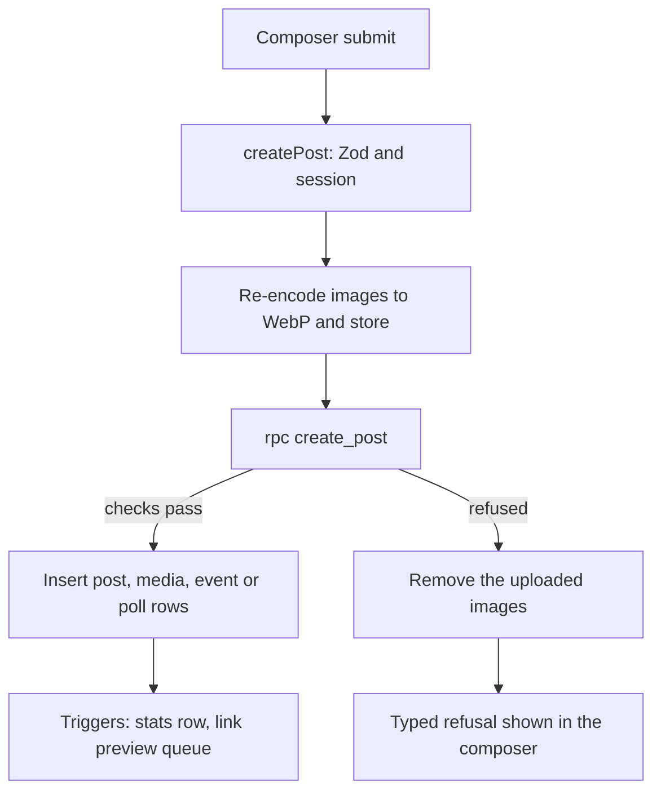
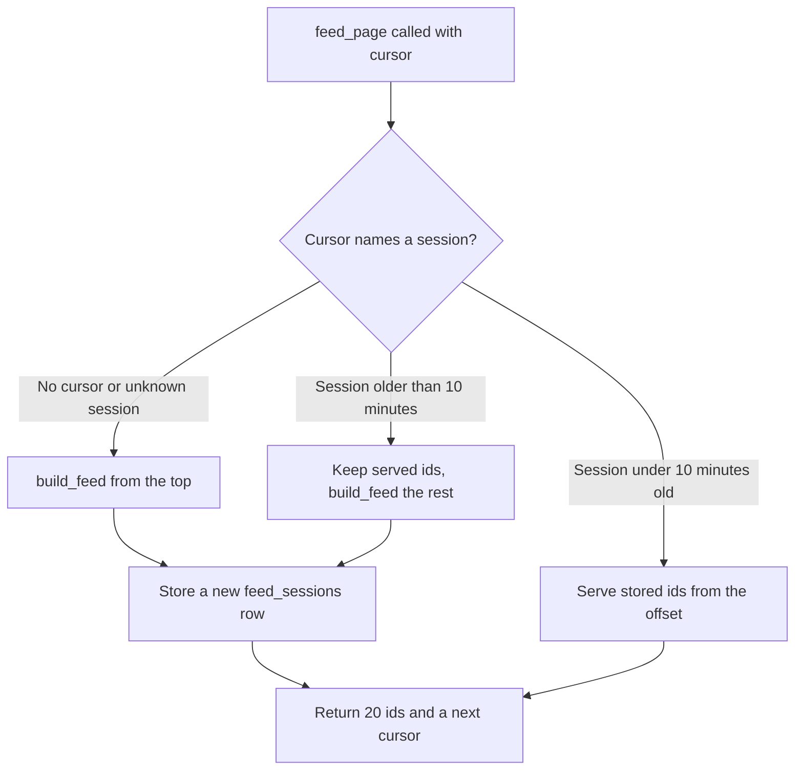
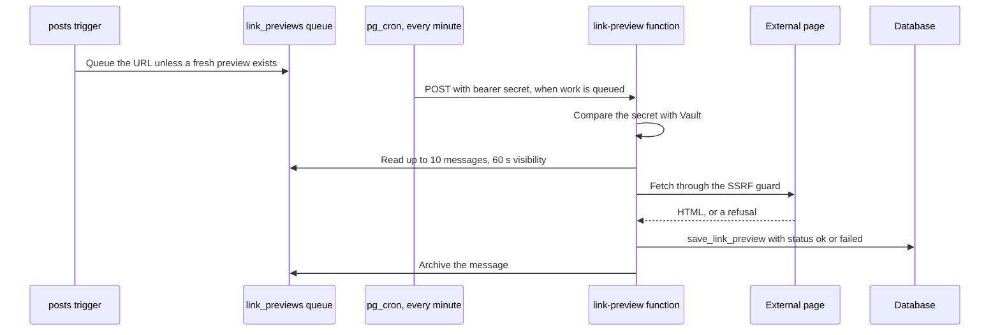

Commit: 4ac756e
Covers: supabase/migrations/20260929010000_posts.sql, supabase/migrations/20260929020000_comments_links.sql, supabase/migrations/20260929030000_micro_survey.sql, supabase/migrations/20260929040000_feed_ranking.sql, lib/actions/posts.ts, lib/data/posts.ts, lib/posts/, components/posts/, app/(app)/feed/, app/(app)/post/, supabase/functions/link-preview/, supabase/functions/_shared/links/

# Feed and posts

## Purpose

Posts are the platform's shared stream. Six types (general, venture invite, announcement, event, poll, Shipped) are written into one of two feeds: the University Feed, which is the author's university, and the Global Feed, which is every signed-in user [src: supabase/migrations/20260929010000_posts.sql#create type public.post_audience]. The feed is ranked in SQL from micro-survey answers, comments, relationships, views and age, and there are no likes, reactions, saves or shares [src: supabase/migrations/20260929040000_feed_ranking.sql#private.feed_page].

Under each card sit comments (one level of replies), "Not for me" hides, mutes, a link preview and the micro-survey strip. The strip is the only public signal on a post: each reader answers one question about it, and the answers feed the ranking and a public line [src: components/posts/post-card.tsx#PostCard] [src: supabase/migrations/20260929030000_micro_survey.sql#private.assign_survey_question].

Every write is a function in the `private` schema; no table accepts a direct insert from a client [src: supabase/migrations/20260929010000_posts.sql#revoke all on table public.posts]. Reports and the moderation queue are in [moderation-and-appeals](moderation-and-appeals.md). University hides, announcement reach and the university pin are in university-events-and-fairs. The formula's quality term is owned by [ranking](ranking.md).

Generated schema: [posts](../reference/schema/posts.md), [comments_links](../reference/schema/comments_links.md), [micro_survey](../reference/schema/micro_survey.md), [feed_ranking](../reference/schema/feed_ranking.md).

## Data model

Posts and their attachments (`posts.sql`):

- `create table public.posts`: one row per post. `type`, `audience` (university or global), `stage` (seed, limited, full, global_boost, demoted, held), `university_id` (the author's university at posting), `venture_id` (invites and Shipped only) and `pinned_until` (announcements only). Check constraints enforce those pairings [src: supabase/migrations/20260929010000_posts.sql#check (pinned_until is null or type = 'announcement')].
- `post_media`: up to four WebP paths per post, each under the author's folder in the `post-media` bucket [src: supabase/migrations/20260929010000_posts.sql#create table public.post_media].
- `post_events` and `event_rsvps`: a start time, a place or link, and Going or Interested per reader [src: supabase/migrations/20260929010000_posts.sql#create table public.post_events].
- `post_polls`, `poll_options` and `poll_votes`: two to four options and one vote per reader [src: supabase/migrations/20260929010000_posts.sql#create table public.poll_votes].
- `venture_update_media`: images on venture updates, written by `post_venture_update_media` [src: supabase/migrations/20260929010000_posts.sql#create table public.venture_update_media].

Comments, hides, mutes and previews (`comments_links.sql`):

- `post_comments`: body up to 1,000 characters, `parent_id` for one reply level, `pinned` (at most one per post by a unique index) and `deleted_at` (a deleted comment keeps its row) [src: supabase/migrations/20260929020000_comments_links.sql#create table public.post_comments] [src: supabase/migrations/20260929020000_comments_links.sql#post_comments_one_pin_idx].
- `post_hides` and `user_mutes`: one row per reader and post, or per reader and muted person [src: supabase/migrations/20260929020000_comments_links.sql#create table public.post_hides].
- `link_previews`: a cache keyed by the SHA-256 of the URL, written only by the worker [src: supabase/migrations/20260929020000_comments_links.sql#create table public.link_previews]. `posts.link_url` holds the first http(s) link in the body [src: supabase/migrations/20260929020000_comments_links.sql#add column link_url].

Settings and the survey (`micro_survey.sql`):

- `platform_config`: versioned settings, read through `private.config(key)`. Rows are never updated; a trigger refuses it [src: supabase/migrations/20260929030000_micro_survey.sql#platform_config_no_update]. The feed reads the keys `feed.score`, `feed.relevance`, `feed.diversity`, `feed.stages`, `feed.placement` and `feed.window` [src: supabase/migrations/20260929040000_feed_ranking.sql#feed.window]; the survey reads `survey.*` [src: supabase/migrations/20260929030000_micro_survey.sql#survey.shares].
- `micro_survey_dimensions` (12 rows: dimension, public phrase, eligible post types, tie priority) and `micro_survey_questions` (25 wordings) [src: supabase/migrations/20260929030000_micro_survey.sql#create table public.micro_survey_dimensions].
- `micro_survey_assignments`: the one question a reader was given for a post. `micro_survey_responses`: the answer, its latency, its anti-gaming weight and the time after which it is locked [src: supabase/migrations/20260929030000_micro_survey.sql#create table public.micro_survey_responses].
- `post_views`: one row per reader and post, written when a view qualifies [src: supabase/migrations/20260929030000_micro_survey.sql#create table public.post_views].
- `post_survey_counts` (per post and dimension) and `post_stats` (per post: views, hides, answers, positives, commenters, commenter universities, appropriate flags, reports) are kept by triggers. Neither is readable by clients [src: supabase/migrations/20260929030000_micro_survey.sql#create table public.post_stats].

The feed (`feed_ranking.sql`):

- `feed_sessions`: a reader's ordered list of post ids for one open feed, kept ten minutes. One reader keeps at most ten sessions [src: supabase/migrations/20260929040000_feed_ranking.sql#create table public.feed_sessions].

Two later migrations change objects this doc describes. `ranking.sql` redefines `feed_score` and moves its quality term into `post_quality` [src: supabase/migrations/20261005000000_ranking.sql#private.post_quality]. `uni_comms.sql` redefines `can_view_post`, the post and comment policies, `post_comment_list`, and `pinned_announcement` [src: supabase/migrations/20261019000000_uni_comms.sql#private.can_view_post]. Where this doc describes those objects, it describes the last definition.

## Flows

### 1. Creating a post

The composer builds one JSON document and a list of images, then calls `createPost` [src: components/posts/composer.tsx#ComposerForm] [src: lib/actions/posts.ts#createPost]. The action validates the document with a discriminated union on `type` [src: lib/actions/posts.ts#postInput], refuses images on any type except general, invite and event, and needs a session. It re-encodes each image to WebP and stores it before the post is written [src: lib/actions/posts.ts#storeContentImages] [src: lib/images/content-images.ts#storeContentImages]. The browser has already shrunk the images to about 2,000 pixels [src: lib/images/downscale.ts#prepareImages].

It then calls `create_post` with the type, body, audience, media paths and the type's own fields [src: lib/actions/posts.ts#media: stored.images]. `private.create_post` runs these checks, in order [src: supabase/migrations/20260929010000_posts.sql#private.create_post]:

1. The caller has a profile with onboarding complete. The profile's university becomes `university_id`.
2. Shipped is refused; the body is 1 to 2,000 characters.
3. `check_media` accepts at most four paths, each under the caller's own folder and present in `storage.objects`.
4. An announcement needs staff. It is forced to the global audience, and a pin of up to seven days replaces any other pin.
5. An invite needs the venture owner, a venture that is recruiting or in progress, and a visibility other than unlisted. A university-only venture cannot be posted to the Global Feed.
6. An event starts within one hour in the past and one year ahead. A poll has two to four options and closes in one to seven days.
7. A 30-second limit per author applies, through `private.rate_limit` [src: supabase/migrations/20260927210238_identity.sql#create function private.rate_limit].

Then it inserts the post, its media rows and, for events and polls, their rows. Triggers do the rest: `posts_stats` creates the `post_stats` row [src: supabase/migrations/20260929030000_micro_survey.sql#posts_stats], `posts_link_url` sets `link_url` and queues a preview [src: supabase/migrations/20260929020000_comments_links.sql#posts_link_url], and `posts_graduate_guard` refuses a university-audience post from a graduate [src: supabase/migrations/20261010000000_student_portal.sql#private.graduate_post_guard].

If the RPC fails, the action removes the images it stored and logs `orphan_left` with the count of files it could not remove [src: lib/actions/posts.ts#removeContentImages]. A `rate_limited` code is shown as "Wait 30 seconds between posts" [src: lib/actions/posts.ts#Wait 30 seconds between posts].

### 2. Reading the ranked feed

`/feed` is a server page. It reads the university's feed settings, the pinned items and the reader's progress card, then calls `getFeed` for the first page [src: app/(app)/feed/page.tsx#FeedPage] [src: lib/data/posts.ts#getFeed]. `getFeed` calls `feed_page` with the scope, the filter and a cursor. It then loads the cards for the returned ids in one call to `post_cards` [src: lib/data/posts.ts#getPostCards].

`private.feed_page` decides which list the reader gets [src: supabase/migrations/20260929040000_feed_ranking.sql#private.feed_page]:

The cursor is `<session>:<offset>`. A session that is still fresh returns the stored list from the offset, so paging neither repeats nor skips. A session older than ten minutes is re-ranked without the posts already served, and the served prefix keeps its positions. A cursor for a session that no longer exists restarts at offset 0 under a new session [src: supabase/migrations/20260929040000_feed_ranking.sql#v_offset := 0]. The client removes ids it already shows, so a restart does not duplicate cards [src: components/posts/feed-list.tsx#FeedList].

`build_feed` ranks at most 300 candidates [src: supabase/migrations/20260929040000_feed_ranking.sql#feed.window]. A candidate is excluded when it is held, pinned (pinned posts are returned separately), older than the window (seven days, or 14 for Shipped), hidden by the reader, written by a muted author, or outside the reader's audience and filter. A Seed post is a candidate only for its seed audience [src: supabase/migrations/20260929040000_feed_ranking.sql#private.build_feed]. Each slot takes the best score that does not repeat the previous author. A second post by the same author on one page is scored at half [src: supabase/migrations/20260929040000_feed_ranking.sql#v_same]. Every fifth slot is an exploration slot for a Seed post under two hours old that the reader has not seen [src: supabase/migrations/20260929040000_feed_ranking.sql#exploration_every].

`feed_page` checks `can_view_post` again on the rows it returns, so a post blocked or removed after ranking drops out of the page [src: supabase/migrations/20260929040000_feed_ranking.sql#where private.can_view_post(x.id)]. The pinned announcement is returned by `pinned_announcement`, which is global-only in the last definition [src: supabase/migrations/20261019000000_uni_comms.sql#private.pinned_announcement]. Followed venture updates are unscored and come after the ranked list [src: supabase/migrations/20260929040000_feed_ranking.sql#private.followed_venture_updates].

`loadMorePosts` serves the next page for the infinite list. It calls `getFeed` for the university and global scopes and `listPosts` for a profile's Activity tab [src: lib/actions/posts.ts#loadMorePosts]. The "new posts" pill subscribes to `INSERT` events on `posts` over Realtime; RLS applies to the stream, and the client filters by scope [src: components/posts/new-posts-pill.tsx#NewPostsPill].

### 3. Qualified views

`useQualifiedView` watches each card that is not the reader's own. A post qualifies when at least 60% of the card, or a part at least 60% of the window's height, has been on screen for 1.5 s [src: components/posts/view-tracker.ts#useQualifiedView]. Qualified ids wait in a set. The set is flushed every 10 seconds, when the tab is hidden, or before an answer is sent [src: components/posts/view-tracker.ts#FLUSH_MS] [src: components/posts/view-tracker.ts#ensureViewRecorded]. `recordViews` sends at most 100 ids [src: lib/actions/posts.ts#recordViews]. `record_views` inserts a `post_views` row for each visible post, once per reader [src: supabase/migrations/20260929030000_micro_survey.sql#private.record_views]. The insert runs the trigger that counts a view [src: supabase/migrations/20260929030000_micro_survey.sql#post_views_stats].

### 4. The micro-survey

`getPostCards` calls `survey_for_posts` with the page's ids; the function reads at most 50 of them [src: lib/data/posts.ts#getPostCards]. For each post the reader can see and did not write, `assign_survey_question` picks the dimension furthest below its target share, with ties going to Credible and Appropriate first and then random. The wording is random [src: supabase/migrations/20260929030000_micro_survey.sql#private.assign_survey_question]. The assignment is stored, so the same question comes back after a refresh or on another device. Authors get no strip, and neither do announcements or polls [src: supabase/migrations/20260929030000_micro_survey.sql#v_post.type not in ('general', 'invite', 'event', 'shipped')].

`survey_for_posts` also returns the public line: the count of ticks for each public dimension, shown only when it reaches `survey.public_min` (3) [src: supabase/migrations/20260929030000_micro_survey.sql#survey.public_min]. The card shows only Informative and Interesting in that line [src: lib/data/posts.ts#getPostCards].

`SurveyStrip` sends the answer after `ensureViewRecorded` and passes the time since the post came on screen as latency [src: components/posts/survey-strip.tsx#SurveyStrip]. `answer_survey` refuses unless the reader was assigned the post, has a view row, and took at least 800 ms [src: supabase/migrations/20260929030000_micro_survey.sql#survey.min_latency_ms]. The first answer gets a weight: 0.5 when the reader is a friend or teammate of the author, 0.5 when the account is under three days old, and 0.3 on a straight-liner after 20 answers with no variation [src: supabase/migrations/20260929030000_micro_survey.sql#private.answer_survey]. The answer is locked ten minutes later; before then it can change [src: supabase/migrations/20260929030000_micro_survey.sql#survey.change_minutes]. After the lock, a changed answer is refused with a duplicate code, and the strip stops offering Change [src: components/posts/survey-strip.tsx#setCanChange].

Triggers keep the counts. `micro_survey_responses_stats` moves the tick and cross totals, weighted and raw, and `post_stats.positives` [src: supabase/migrations/20260929030000_micro_survey.sql#micro_survey_responses_stats]. For the Appropriate dimension it recounts non-friend crosses into `appropriate_flags`, and the reports migration opens a signal case once three are reached [src: supabase/migrations/20260929070000_reports.sql#post_stats_appropriate_signal].

### 5. Stages

A job runs every five minutes and sets each recent post's stage [src: supabase/migrations/20260929040000_feed_ranking.sql#feed-stage]. `feed_stage_job` scans posts created in the last 14 days, computes each stage and writes only the posts whose stage changed. It records its run through `job_run_start` and `job_run_finish`, and on an error it records `failed` and stops [src: supabase/migrations/20260929040000_feed_ranking.sql#private.feed_stage_job].

`compute_stage` returns, in order [src: supabase/migrations/20260929040000_feed_ranking.sql#private.compute_stage]:

- `held` when reports reach three. A trigger on `post_stats.reports` sets `held` at once, before the job runs [src: supabase/migrations/20260929040000_feed_ranking.sql#post_stats_held].
- `demoted` when at least ten Credible answers have 30% or more crosses, or when at least 10 views have 30% or more hides.
- `global_boost` for a global post with ten answers and 50% positive, or five commenters from two universities.
- `full` once a post is full or boosted (sticky), and for every Shipped post.
- `full` for five answers with 40% positive, or three distinct commenters who are not friends of the author.
- `seed` for a post under two hours old with fewer than 30 views.
- `limited` otherwise.

Commenters are counted only when their comment is at least 10 characters and they are not the author or a friend [src: supabase/migrations/20260929040000_feed_ranking.sql#private.nonfriend_commenters].

### 6. Scoring

`feed_score` returns the score of one post for one reader [src: supabase/migrations/20261005000000_ranking.sql#private.feed_score]. It is:

`score = (0.15 + Q) × (1 + E) × R × D ÷ (age_hours + 2)^1.5`

- **Q** is `private.post_quality`: a Bayesian average of the weighted positive answers on Informative and Interesting (ten prior votes at the platform mean of 0.6), reduced by the Credible cross rate [src: supabase/migrations/20261005000000_ranking.sql#private.post_quality].
- **E** is 0.5 × ln(1 + commenters), with each friend counting half and comments under 10 characters ignored [src: supabase/migrations/20261005000000_ranking.sql#private.feed_score].
- **R** multiplies the relevance factors: friend 1.4, followed venture 1.4, same program 1.2, same batch 1.1, and skill overlap up to 1.3. The product is capped at 2.0 [src: supabase/migrations/20260929040000_feed_ranking.sql#feed.relevance].
- **D** is 0.3 when the reader has already viewed the post [src: supabase/migrations/20260929040000_feed_ranking.sql#private.feed_score].

Placement follows: a limited post outside its seed audience is multiplied by 0.4, global boost by 1.5, demoted by 0.3, and a Shipped post in its first 24 hours by 1.5 [src: supabase/migrations/20260929040000_feed_ranking.sql#feed.placement]. A muted author scores 0 [src: supabase/migrations/20261005000000_ranking.sql#private.feed_score].

The seed audience is the author's friends, people in the same program (same department and graduation year at the same university), followers of a linked venture, and, for global posts, the author's university [src: supabase/migrations/20260929040000_feed_ranking.sql#private.in_seed_audience].

### 7. Comments, hides and mutes

`addComment` takes an optional parent and the body, and calls `add_comment` [src: lib/actions/posts.ts#addComment]. The function requires a visible post the caller is not blocked from, a live parent that is top-level, 1 to 1,000 characters, and a 10-second limit per author [src: supabase/migrations/20260929020000_comments_links.sql#private.add_comment]. It notifies the post's author (`comment_received`), the parent's author (`comment_reply`) and up to five people @mentioned who can see the post (`comment_mention`) [src: supabase/migrations/20260929020000_comments_links.sql#comment_mention]. Those three categories are digest-only [src: supabase/migrations/20260929020000_comments_links.sql#allow_instant].

A reply to a reply is refused by `private.check_comment_parent` as well as by the function, so no path nests deeper [src: supabase/migrations/20260929020000_comments_links.sql#check_comment_parent]. The post's author pins one top-level comment with `pin_comment` [src: supabase/migrations/20260929020000_comments_links.sql#private.pin_comment]. `delete_comment` is open to the comment's author and the post's author. It blanks the body and keeps the row, so replies stay in place [src: supabase/migrations/20260929020000_comments_links.sql#private.delete_comment].

"Not for me" calls `hide_post`, which inserts a `post_hides` row and bumps the hide count [src: supabase/migrations/20260929020000_comments_links.sql#private.hide_post] [src: supabase/migrations/20260929030000_micro_survey.sql#post_hides_stats]. Mute calls `mute_user` by username. The viewer's card then folds to a notice with Undo [src: components/posts/viewer-actions.tsx#FoldedPost] [src: supabase/migrations/20260929020000_comments_links.sql#private.mute_user]. A muted author's posts leave the feed lists, but a profile's own Activity tab keeps them [src: supabase/migrations/20260929020000_comments_links.sql#private.list_posts].

### 8. Link previews

A trigger on insert or body update takes the first http(s) link from the body, trims trailing punctuation, stores it in `link_url`, and queues it on `link_previews` unless a preview fetched in the last seven days exists [src: supabase/migrations/20260929020000_comments_links.sql#private.post_link_url].

Each minute, `wake_link_preview_worker` returns at once when the queue is empty. Otherwise it posts to the `link-preview` function with the bearer secret held in Vault [src: supabase/migrations/20260929020000_comments_links.sql#private.wake_link_preview_worker] [src: supabase/migrations/20260929020000_comments_links.sql#link_preview_worker_secret].

The function compares the bearer header with the Vault secret through `safeEqual`, which XORs every character pair instead of stopping at the first mismatch [src: supabase/functions/link-preview/index.ts#Deno.serve] [src: supabase/functions/_shared/github/types.ts#safeEqual]. `runLinkPreviewWorker` reads up to ten messages with a 60-second visibility timeout and handles each one [src: supabase/functions/_shared/links/worker.ts#runLinkPreviewWorker]. A URL with a fresh preview is counted as cached and not fetched again [src: supabase/functions/_shared/links/worker.ts#fresh]. Otherwise `safeFetchHtml` fetches it. The guard allows only http and https, no credentials, ports 80 and 443, and no `localhost`, `.local` or `.internal` hosts [src: supabase/functions/_shared/links/ssrf.ts#checkUrl]. Every address the host resolves to must be public. The check uses DNS over HTTPS and also covers literal IP addresses [src: supabase/functions/_shared/links/ssrf.ts#checkHost] [src: supabase/functions/_shared/links/ssrf.ts#isPrivateAddress] [src: supabase/functions/_shared/links/ssrf.ts#dohResolver]. Redirects are followed by hand, at most three, and every hop is checked again [src: supabase/functions/_shared/links/ssrf.ts#MAX_REDIRECTS]. The whole fetch has a three-second budget and reads at most 256 KB of an HTML or XHTML body [src: supabase/functions/_shared/links/ssrf.ts#BUDGET_MS].

`parsePreview` reads the title, description, site name and image from Open Graph and Twitter tags, falling back to `<title>` and the description meta. The image is kept only when it is an https URL [src: supabase/functions/_shared/links/meta.ts#parsePreview]. The worker saves an `ok` row, or a `failed` row for a refusal, with `save_link_preview`, and archives the message in both cases [src: supabase/functions/_shared/links/worker.ts#save_link_preview] [src: supabase/migrations/20260929020000_comments_links.sql#private.save_link_preview]. A failed row counts as fresh for seven days, so the same URL is not retried in that time [src: supabase/functions/_shared/links/worker.ts#failed]. The card shows a preview only when its row is `ok` [src: supabase/migrations/20260929020000_comments_links.sql#lp.status = 'ok']. It never shows a third-party image: the card has no image element and the decision is recorded in the component [src: components/posts/post-card.tsx#LinkPreview]. A nightly job deletes rows older than 30 days [src: supabase/migrations/20260929020000_comments_links.sql#purge-link-previews].

### 9. Shipped posts, polls and events

When a venture's status becomes `completed` and it is not unlisted, `post_shipped` writes one Shipped post for it, authored by the owner, global for a public venture and university otherwise, at stage `full` [src: supabase/migrations/20260929010000_posts.sql#private.post_shipped]. Its text is "<name> shipped <title>." A unique index allows one Shipped post per venture [src: supabase/migrations/20260929010000_posts.sql#posts_shipped_once_idx]. The author cannot edit or delete a Shipped post [src: supabase/migrations/20260929010000_posts.sql#private.delete_post].

`vote_poll` takes one vote per reader while the poll is open, and refuses a second vote [src: supabase/migrations/20260929010000_posts.sql#private.vote_poll]. Results show after the reader has voted, after the close, or to the author [src: components/posts/poll-block.tsx#showResults]. `rsvp_event` sets or clears a Going or Interested status. It refuses an event that started more than six hours ago [src: supabase/migrations/20260929010000_posts.sql#private.rsvp_event]. A university event has its own `rsvp_event` with a different argument list, in the same schema [src: supabase/migrations/20261019000000_uni_comms.sql#private.rsvp_event].

### 10. Editing and deleting

`edit_post` lets the author change the body within 15 minutes of posting, and marks the post edited [src: supabase/migrations/20260929010000_posts.sql#private.edit_post]. `delete_post` removes the post and returns its image paths. The action then removes those files [src: lib/actions/posts.ts#deletePost] [src: supabase/migrations/20260929010000_posts.sql#private.delete_post]. Deleting a post cascades to its media, event, poll, comments, hides and stats rows.

## Entry points

| Caller | Action (`lib/actions/posts.ts`) | SQL it reaches | Who may call |
|---|---|---|---|
| Composer | `createPost` | `create_post` | Signed-in, onboarded users; announcements need staff |
| Post menu | `editPost`, `deletePost` | `edit_post`, `delete_post` | The author; edit within 15 minutes |
| Poll and event blocks | `votePoll`, `rsvpEvent` | `vote_poll`, `rsvp_event` | Anyone who can see the post |
| Feed and profile lists | `loadMorePosts` | `feed_page`, `list_posts` | Signed-in users |
| Comments | `addComment`, `deleteComment`, `pinComment` | `add_comment`, `delete_comment`, `pin_comment` | Visible-post readers; delete by author or post author; pin by post author |
| Viewer actions | `hidePost`, `muteUser` | `hide_post`, `mute_user` | Signed-in readers |
| View tracker | `recordViews` | `record_views` | Signed-in readers, at most 100 ids |
| Survey strip | `answerSurvey` | `answer_survey` | Assigned readers only |
| Insights button | `getPostInsights` | `post_insights` | The author, with the `insights.post_survey` entitlement |

Reads: `getPostCards`, `getFeed`, `listPosts`, `getPost`, `getComments`, `getMutes`, `getPinnedAnnouncement`, `getFollowedUpdates` and `getInvitableVentures` in `lib/data/posts.ts` [src: lib/data/posts.ts#getPostCards]. Pages call them as server code: `/feed` [src: app/(app)/feed/page.tsx#FeedPage] and `/post/[id]` [src: app/(app)/post/[id]/page.tsx#PostPage].

Entry points that bypass the actions: `link-preview` (woken by cron, not by a user) [src: supabase/functions/link-preview/index.ts#Deno.serve] and the nightly jobs `feed-stage`, `purge-feed-sessions` and `purge-link-previews` [src: supabase/migrations/20260929040000_feed_ranking.sql#purge-feed-sessions].

## Permissions

- **Who can see a post.** `private.can_view_post` is the rule. The last definition, in `uni_comms.sql`, lets the author see any post; any other signed-in reader sees a post when it is not removed, not held, not hidden by its university, not written by someone blocked with them, and either global or from their university. Announcements that are not global reach only the people they target [src: supabase/migrations/20261019000000_uni_comms.sql#private.can_view_post] [src: supabase/migrations/20260929070000_reports.sql#p.removed_at is null].
- **RLS.** `posts_read` and `post_comments_read` use `can_view_post`. Media, event, poll and option tables read through `can_view_post`. Votes and RSVPs read only the reader's own rows, and totals come from the card function [src: supabase/migrations/20260929010000_posts.sql#policy poll_votes_read_own] [src: supabase/migrations/20260929010000_posts.sql#policy post_media_read]. The survey's dimension and question lists are readable by every signed-in user. `post_views`, `micro_survey_assignments` and `micro_survey_responses` are readable only by their own reader. `post_survey_counts` and `post_stats` have no grants [src: supabase/migrations/20260929030000_micro_survey.sql#post_survey_counts and post_stats: no grants at all].
- **Storage.** `post-media` is a public bucket, so its URLs need no sign-in, and its paths are uuids. Objects can be inserted and deleted only in the caller's own folder, and listed only there [src: supabase/migrations/20260929010000_posts.sql#post_media_insert_own].
- **Writes.** Every write is a `private` security-definer function, wrapped by a `public` invoker function granted to `authenticated` [src: supabase/migrations/20260929010000_posts.sql#create function public.create_post]. The wrappers are revoked from `anon`.
- **Staff.** `platform_config` is readable by staff only [src: supabase/migrations/20260929030000_micro_survey.sql#platform_config_staff_read]. Announcements need `private.is_staff()` [src: supabase/migrations/20260929010000_posts.sql#private.is_staff].
- **Link previews.** `link_previews` is readable by every signed-in user. Only the worker writes it, through `save_link_preview`, and only after the bearer check [src: supabase/migrations/20260929020000_comments_links.sql#link_previews_read].
- **Insights.** Behind `private.has_entitlement(..., 'insights.post_survey')`, which billing defines [src: supabase/migrations/20261023000000_billing_core.sql#private.has_entitlement].

## Failure modes and logs

- **Refused post.** The SQL code maps to a typed refusal. Images stored for the failed post are removed, and the log line carries `orphan_left` with the number that could not be removed [src: lib/actions/posts.ts#orphan]. An unmapped error is logged as `error` and shown as "Couldn't publish your post" [src: lib/actions/posts.ts#no_row_written].
- **Rate limit.** Posts and comments are refused with code `rate_limited`, which the action shows as "Wait 30 seconds" or "Wait 10 seconds" [src: lib/actions/posts.ts#Wait 10 seconds between comments].
- **Image missing.** `check_media` refuses a path that is not in `storage.objects` or not under the caller's folder; the composer asks the user to upload it again [src: supabase/migrations/20260929010000_posts.sql#an image is missing; upload it again].
- **Survey answer refused.** A too-fast answer, or one with no view row, is refused with "take a moment to read the post first". A locked answer is refused with "your answer is final" [src: supabase/migrations/20260929030000_micro_survey.sql#your answer is final].
- **Feed.** A malformed cursor is refused with "bad cursor" [src: supabase/migrations/20260929040000_feed_ranking.sql#bad cursor]. A cursor for a missing session restarts from the top. A failing `feed_page` throws from `getFeed`, and the page does not catch it [src: lib/data/posts.ts#feed_page failed].
- **Stage job.** A failing run is recorded in `job_runs` as `failed` with the SQL error; the next run retries from scratch [src: supabase/migrations/20260929040000_feed_ranking.sql#job_run_finish].
- **Link preview.** Every refusal reason is logged as `links.preview` with outcome `refused` and a reason: `bad_url`, `scheme`, `credentials`, `port`, `host`, `dns`, `private_address`, `timeout`, `network`, `not_html`, `http_<status>`, `too_many_redirects`, `redirect_without_location`, or `error` for anything else [src: supabase/functions/_shared/links/worker.ts#links.preview]. If saving an `ok` row throws, the catch block writes a `failed` row for the same URL instead [src: supabase/functions/_shared/links/worker.ts#runLinkPreviewWorker]. A message that the worker reads and then fails on is archived anyway, so the queue does not hold it [src: supabase/functions/_shared/links/worker.ts#pgmq.archive].
- **Queue timing.** A message read but not archived returns after 60 seconds, the visibility timeout [src: supabase/functions/_shared/links/worker.ts#pgmq.read].
- **Monitoring.** The stage job writes its run to `job_runs`, which the alerts watchdog reads [src: supabase/migrations/20261105000000_alerts.sql#job_watchdog]. Action log lines carry the request id from `actionContext` [src: lib/actions/context.ts#actionContext].

## Tests

- pgTAP: `supabase/tests/19_posts.test.sql` (SQL limits, cross-university reads, blocks, polls, the 15-minute edit window, announcements, invites and Shipped posts), `20_comments.test.sql` (comments, hides, mutes and link previews), `21_micro_survey.test.sql` (question assignment, the answer window, weights, the public line and insights), `22_feed_ranking.test.sql` (hand-calculated scores, stage transitions, seed audience, exploration, paging under concurrent inserts, the pinned announcement).
- Unit: `tests/unit/links.test.ts` covers the address and URL checks, the redirect and time-budget limits, and preview parsing. `tests/unit/posts.test.ts` is the posts unit suite.
- Worker: `tests/worker/link-preview.test.ts` runs the whole path on the local database. A post with a link queues a fetch, a fake web and DNS feed the guard, and the preview is cached. A redirect into a private range is cached as failed.
- E2E: `tests/e2e/feed.spec.ts`, `tests/e2e/posts.spec.ts`, `tests/e2e/comments.spec.ts`, `tests/e2e/survey.spec.ts`.

## Change guide

**1. Change a feed weight or threshold.** Insert a new `platform_config` row with a higher version (or a later `effective_at`). Updating a row is refused by `platform_config_no_update` [src: supabase/migrations/20260929030000_micro_survey.sql#private.config_append_only]. The reads are `feed.score` in `feed_score`, `feed.stages` in `compute_stage`, `feed.window` and `feed.diversity` in `build_feed`, and `feed.placement` in `feed_score` [src: supabase/migrations/20261005000000_ranking.sql#private.feed_score]. Changing the score formula itself means redefining `feed_score` and `post_quality` in a new migration, and the ranking doc's reference must move with it.

**2. Add a survey dimension or wording.** Insert a `micro_survey_dimensions` row with its eligible post types, and insert questions for it [src: supabase/migrations/20260929030000_micro_survey.sql#create table public.micro_survey_dimensions]. A new public dimension also needs the card to show it: `getPostCards` keeps only Informative and Interesting for the public line [src: lib/data/posts.ts#getPostCards], and `PublicLine` renders what it is given [src: components/posts/post-card.tsx#PublicLine]. Only Informative and Interesting feed the quality term [src: supabase/migrations/20261005000000_ranking.sql#private.post_quality].

**3. Add a post type.** Add the value to the `post_type` enum, then change `private.create_post`'s checks, `private.list_posts` and `feed_page`'s filter branches, and `build_feed`'s filter [src: supabase/migrations/20260929010000_posts.sql#create type public.post_type] [src: supabase/migrations/20260929040000_feed_ranking.sql#private.build_feed]. In the app: the discriminated union in `postInput`, the `FEED_FILTERS` list, the composer's `KINDS`, the label in `TYPE_LABEL`, the survey's `SURVEYED_TYPES` in `lib/posts/constants.ts`, and `post_cards` if the card needs a new field [src: lib/actions/posts.ts#postInput] [src: components/posts/composer.tsx#KINDS] [src: components/posts/post-card.tsx#TYPE_LABEL] [src: lib/posts/constants.ts#SURVEYED_TYPES]. A type that takes survey answers also needs its `post_types` set in `micro_survey_dimensions`. Redefining a function means copying its whole last definition into the new migration, not only the changed branch.

## Answers to the planned questions

1. **Who can see a post, and where is that decided?** `private.can_view_post`, last defined in `uni_comms.sql`. It hides removed posts, held posts from everyone but the author, university-hidden posts from everyone but the university's owner and admins, posts from people the reader is blocked with, and posts outside the reader's audience. The `posts_read` and comment policies call it [src: supabase/migrations/20261019000000_uni_comms.sql#private.can_view_post] [src: supabase/migrations/20261019000000_uni_comms.sql#policy posts_read].
2. **How is a feed page built, and why might a post not appear?** `feed_page` serves a stored session or builds one with `build_feed`, as in flow 2 [src: supabase/migrations/20260929040000_feed_ranking.sql#private.feed_page]. A post does not appear when the reader hid it or muted its author; when it is held, removed, older than seven days (14 for Shipped), outside the reader's audience or filter, or a Seed post outside the seed audience; or when it is pinned (it is shown above the list instead). A post that was ranked and then blocked or removed drops out when the page is read [src: supabase/migrations/20260929040000_feed_ranking.sql#where private.can_view_post(x.id)].
3. **How are media uploaded and attached, and what limits apply?** The browser shrinks each image to about 2,000 pixels; the action re-encodes it to WebP with EXIF and GPS removed and stores it under the author's folder; `create_post` attaches up to four paths [src: lib/images/downscale.ts#prepareImages] [src: lib/actions/posts.ts#storeContentImages] [src: supabase/migrations/20260929010000_posts.sql#check_media]. The bucket accepts only WebP and 5 MB [src: supabase/migrations/20260929010000_posts.sql#post-media]. Images go on general, invite and event posts [src: lib/actions/posts.ts#files.length].
4. **How are link previews fetched safely, cached and purged?** Section 8. The cache is seven days for freshness and 30 days for deletion. The guard is `safeFetchHtml` with the checks listed there.
5. **How do micro-surveys get assigned, answered and counted, and who sees insights?** Section 4. Readers see the public line, which shows raw counts of at least three ticks on Informative and Interesting. The author sees the full breakdown only through `post_insights`, which needs the entitlement [src: supabase/migrations/20260929030000_micro_survey.sql#private.post_insights].
6. **What is a qualified view, and how is it recorded?** A card on screen for 1.5 s with at least 60% visible. The client batches the ids and `record_views` stores one `post_views` row per reader and post [src: components/posts/view-tracker.ts#QUALIFY_MS] [src: supabase/migrations/20260929030000_micro_survey.sql#private.record_views].
7. **How do comments, pins, hides and mutes work, and how deep can comments nest?** One reply level, enforced in two places (the function and the trigger). The post's author pins one top-level comment. Hides and mutes are per reader; a mute also removes the author from `feed_score` and from the lists [src: supabase/migrations/20260929020000_comments_links.sql#private.add_comment] [src: supabase/migrations/20260929020000_comments_links.sql#check_comment_parent].
8. **How do events and polls inside posts work?** An event takes Going or Interested, closes six hours after its start, and shows counts to everyone who can see it. A poll takes one vote, shows results after the vote, after the close or to the author, and closes after one to seven days [src: supabase/migrations/20260929010000_posts.sql#private.rsvp_event] [src: supabase/migrations/20260929010000_posts.sql#private.vote_poll] [src: components/posts/poll-block.tsx#showResults].
