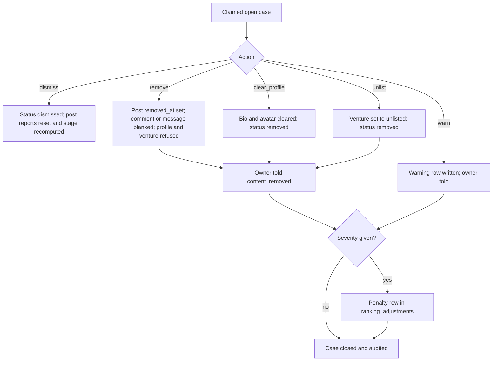
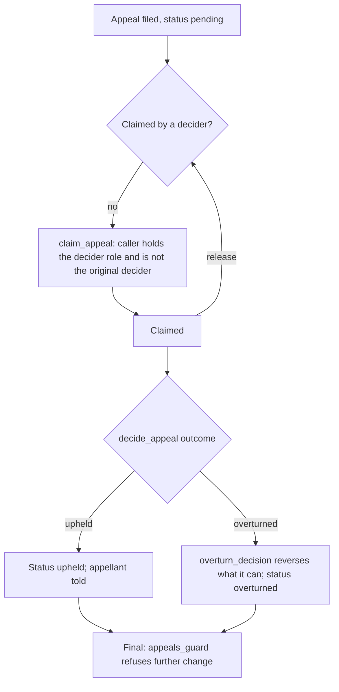

Commit: 4ac756e
Covers: supabase/migrations/20260929070000_reports.sql, supabase/migrations/20261007000000_penalty_rules.sql, supabase/migrations/20261027000000_sanctions_appeals.sql, lib/actions/reports.ts, lib/actions/appeals.ts, lib/actions/ops/moderation.ts, lib/actions/ops/sanctions.ts, lib/data/ops.ts, lib/data/sanctions.ts, lib/ops/appeals.ts, components/reports/, components/appeals/, components/ops/resolve-form.tsx, components/ops/sanction-forms.tsx, components/ops/appeal-forms.tsx, components/shell/restriction-banner.tsx, app/(app)/appeals/, app/(app)/moderation/, app/(app)/ops/reports/, app/(app)/ops/sanctions/, app/(app)/ops/appeals/

# Moderation and appeals

## Purpose

Reports on posts, comments, chat messages, profiles and ventures become one case per target in a staff queue. A moderator claims a case and then dismisses it, removes the content, clears a profile's bio and photo, unlists a venture, or warns the owner. An upheld report can also cost the owner ranking points, by severity [src: supabase/migrations/20260929070000_reports.sql#private.resolve_case] [src: supabase/migrations/20261007000000_penalty_rules.sql#create or replace function private.resolve_case].

Accounts and organisations can be sanctioned. Moderators warn and suspend a person for at most seven days; super admins ban and suspend for longer; accounts staff throttle or suspend an organisation. While a person is suspended or banned, triggers refuse their writes on 29 tables [src: supabase/migrations/20261027000000_sanctions_appeals.sql#private.sanction_user] [src: supabase/migrations/20261027000000_sanctions_appeals.sql#refuse_if_restricted before insert].

Each decision can be appealed once, within 30 days. A staff member who holds the deciding role decides it, never the person who made the original decision, and the decision is final. An overturn undoes what can be undone [src: supabase/migrations/20261027000000_sanctions_appeals.sql#private.decide_appeal] [src: supabase/migrations/20261027000000_sanctions_appeals.sql#private.overturn_decision].

The posts a report can point at, and the `post_stats` counters that hold a post, belong to [feed-and-posts](feed-and-posts.md). The ranking points belong to [ranking](ranking.md). University hides are in university-events-and-fairs, and the staff shell, roles and audit log in ops-console.

Generated schema: [reports](../reference/schema/reports.md), [penalty_rules](../reference/schema/penalty_rules.md), [sanctions_appeals](../reference/schema/sanctions_appeals.md).

## Data model

- `report_cases`: one row per reported target, with `target_type` (post, comment, message, profile, venture), `owner_id`, a `snapshot` of what was reported, a `reports` count, `soft_signal`, `status` (open, dismissed, removed, warned), the claim fields and the resolution fields [src: supabase/migrations/20260929070000_reports.sql#create table public.report_cases]. The unique key is (target_type, target_id).
- `reports`: one row per reporter and target, with reason, detail and case. A unique key on (reporter, target type, target) stops a second report [src: supabase/migrations/20260929070000_reports.sql#create table public.reports].
- `report_messages`: copies of the reported chat message and the earlier messages the reporter chose, so later edits or deletes don't erase them [src: supabase/migrations/20260929070000_reports.sql#create table public.report_messages].
- `sanctions`: one row per warning, suspension, ban or throttle, against either a user or an organisation (a check requires exactly one). The lift fields are the only columns that can change after insert [src: supabase/migrations/20261027000000_sanctions_appeals.sql#sanctions_one_subject] [src: supabase/migrations/20261027000000_sanctions_appeals.sql#private.sanctions_role_limits].
- `appeals`: one row per decision (unique on decision type and id), with the appellant, the original decider (`original_staff_id`), the role that decides (`decider_role`), a summary copied at filing, the claim and the decision [src: supabase/migrations/20261027000000_sanctions_appeals.sql#create table public.appeals].
- `ranking_adjustments`: the penalty rows that `resolve_case` writes, with severity and case. The ranking doc owns the table [src: supabase/migrations/20261005000000_ranking.sql#create table public.ranking_adjustments].
- `post_stats.reports` and `posts.removed_at`: counters and the removed marker, written here [src: supabase/migrations/20260929070000_reports.sql#removed_at].

The notification types this area sends are `content_removed`, `moderation_warning`, `account_restricted`, `restriction_lifted`, `org_sanctioned` and `appeal_decided` [src: supabase/migrations/20260929070000_reports.sql#content_removed] [src: supabase/migrations/20261027000000_sanctions_appeals.sql#org_sanctioned].

## Flows

### 1. A report becomes a case

`ReportButton` sends the target, a reason from six options, optional detail (up to 500 characters) and, for a message, up to ten earlier messages the reporter ticks [src: components/reports/report-button.tsx#ReportButton]. `submitReport` validates these with Zod and calls `submit_report` [src: lib/actions/reports.ts#submitReport].

`private.submit_report` checks, in order: a signed-in caller, a reason, detail length, that the target is visible to the caller (`can_report`), that the caller is not the owner, that at most ten earlier messages come from the same chat, and that the caller has not already reported this target. The per-reporter limit is 60 seconds through `private.rate_limit` [src: supabase/migrations/20260929070000_reports.sql#private.submit_report] [src: supabase/migrations/20260929070000_reports.sql#private.can_report]. It then opens the case, inserts the report and, for a message, copies the chat context. A post report adds one to `post_stats.reports` [src: supabase/migrations/20260929070000_reports.sql#update public.post_stats set reports = reports + 1].

`open_case` upserts on the target. A new report adds one to the count and keeps the earliest opening time. A resolved case reopens, and its snapshot is replaced when the new report carries one [src: supabase/migrations/20260929070000_reports.sql#private.open_case]. The snapshot is what the reporter saw, copied at report time, so removed content stays reviewable [src: supabase/migrations/20260929070000_reports.sql#private.report_snapshot].

Two other paths open cases. A post that collects three Appropriate crosses from people who are not friends opens a soft-signal case [src: supabase/migrations/20260929070000_reports.sql#private.appropriate_signal]. Three reports hold a post at once through the trigger in the feed doc.

The reporter sees only "Thanks, we'll review this" [src: components/reports/report-button.tsx#Thanks, we&apos;ll review this]. No read policy gives a reporter anything back [src: supabase/migrations/20260929070000_reports.sql#report_cases_staff_read].

### 2. The staff queue and the claim

`/ops/reports` requires the moderator role, or it answers 404. It lists open or resolved cases from `ops_queue` [src: app/(app)/ops/reports/page.tsx#OpsReportsPage] [src: lib/data/ops.ts#getQueue]. `/ops/reports/[id]` loads one case with `ops_case`: the snapshot, the attached messages (only those, never the rest of the chat), the reports with each reporter's history, and the owner's history [src: app/(app)/ops/reports/[id]/page.tsx#OpsCasePage] [src: supabase/migrations/20260929070000_reports.sql#private.ops_case].

A moderator must claim a case before deciding it. `claimCase` calls `claim_case`, which refuses a case someone else holds and audits the claim [src: lib/actions/ops/moderation.ts#claimCase] [src: supabase/migrations/20260929070000_reports.sql#private.claim_case].

### 3. Deciding a case

`ResolveForm` lists the actions that fit the target type. A reason of at least three characters is required. Remove and warn require a severity [src: components/ops/resolve-form.tsx#ACTIONS] [src: lib/actions/ops/moderation.ts#resolveCase]. `private.resolve_case` is the last definition, in `penalty_rules.sql`; it replaces the earlier ones in `reports.sql`, `phase3_answers.sql` and `ranking.sql` [src: supabase/migrations/20261007000000_penalty_rules.sql#create or replace function private.resolve_case].

Each action's effect is in the function. `dismiss` on a post resets its count and recomputes its stage, so a held post returns to the feed [src: supabase/migrations/20261007000000_penalty_rules.sql#update public.post_stats set reports = 0]. `remove` sets `removed_at` on a post, deletes a comment's text and pins, and clears a message's body and image and its pins [src: supabase/migrations/20261007000000_penalty_rules.sql#update public.posts set removed_at = now()]. It refuses profiles and ventures [src: supabase/migrations/20261007000000_penalty_rules.sql#use "clear bio and photo" for a profile or "unlist" for a venture]. `clear_profile` and `unlist` are the two actions for those targets [src: supabase/migrations/20261007000000_penalty_rules.sql#elsif p_action = 'clear_profile' then]. `warn` writes a warning row and tells the owner [src: supabase/migrations/20261007000000_penalty_rules.sql#kind, reason, staff_id, case_id) values (c.owner_id, 'warn'].

A severity on clear or unlist adds a warning alongside, and a severity on any action with an owner writes a penalty row with that severity [src: supabase/migrations/20261007000000_penalty_rules.sql#if p_action in ('clear_profile', 'unlist') and v_severity is not null]. The points for each severity come from the ranking formula, not from this code [src: supabase/migrations/20261005000000_ranking.sql#private.score_adjustments]. The resolve form shows low, medium and high as 50, 150 and 300 points for 12 months [src: components/ops/resolve-form.tsx#SEVERITIES]. Those numbers are UI text; the formula holds the values that count.

The case is then closed with `resolved_by`, `resolved_at` and the reason, and one audit row is written in the same function [src: supabase/migrations/20261007000000_penalty_rules.sql#insert into public.ops_audit_log (staff_id, action, target_type, target_id, reason, before, after)].

### 4. What the owner sees

After a removal, clear or unlist, the owner gets a `content_removed` notification with the target type, the action and an excerpt. A warning gets `moderation_warning` [src: supabase/migrations/20261007000000_penalty_rules.sql#v_notice]. Both types are marked as emailed [src: supabase/migrations/20260929070000_reports.sql#insert into public.notification_types]. The notification links to `/moderation/[id]` [src: supabase/functions/_shared/notify/describe.ts#/moderation/]. That page reads `my_moderation_notice`, which returns only the target type, a short excerpt, the status and the moderator's reason, and only for a removed or warned case [src: app/(app)/moderation/[id]/page.tsx#ModerationNoticePage] [src: supabase/migrations/20260929070000_reports.sql#private.my_moderation_notice]. No function returns the reporter's or the moderator's name to the owner.

### 5. Sanctions on accounts

`SanctionUserForm` offers warn, suspend and ban. Moderators see suspensions of 1, 2, 3, 5 or 7 days; super admins see 1, 3, 7, 14, 30 and 90 days, and bans with an optional end date [src: components/ops/sanction-forms.tsx#MOD_DAYS] [src: components/ops/sanction-forms.tsx#SUPER_DAYS]. `sanctionUser` turns the days into an end time (just under the full span, so the seven-day limit holds) and converts a ban's date to the end of that day in Pakistan time [src: lib/actions/ops/sanctions.ts#sanctionUser].

`private.sanction_user` checks the role and the reason, refuses a second active suspension or ban, and locks the account row. It inserts the sanction, deletes every `auth.sessions` row for a suspension or a ban, and sets `banned_until` for a ban. It then notifies the account and audits the change [src: supabase/migrations/20261027000000_sanctions_appeals.sql#private.sanction_user]. A trigger on `sanctions` enforces the role limits again: bans need a super admin, and a moderator's suspension is at most seven days [src: supabase/migrations/20261027000000_sanctions_appeals.sql#private.sanctions_role_limits]. Setting `banned_until` makes the CV trigger revoke the account's CVs [src: supabase/migrations/20261009000000_cv_control.sql#new.banned_until].

While a restriction is active, `refuse_if_restricted` stops the account's inserts. It checks only the acting user (`auth.uid()`), so jobs and other people's actions pass [src: supabase/migrations/20261027000000_sanctions_appeals.sql#private.refuse_if_restricted]. The trigger is installed on 29 tables, listed in the migration [src: supabase/migrations/20261027000000_sanctions_appeals.sql#create trigger refuse_if_restricted before insert on public.%I]. Every signed-in page shows `RestrictionBanner` with a link to `/appeals` [src: app/(app)/layout.tsx#RestrictionBanner] [src: components/shell/restriction-banner.tsx#RestrictionBanner] [src: lib/data/sanctions.ts#getMyRestriction]. `getMyRestriction` returns null when the call fails, so a failed read hides the banner [src: lib/data/sanctions.ts#getMyRestriction].

Lifting goes through `lift_sanction`. Moderators lift warnings and user suspensions, super admins lift bans, and accounts staff lift organisation sanctions [src: supabase/migrations/20261027000000_sanctions_appeals.sql#private.lift_sanction]. `lift_sanction_row` clears `banned_until` when no active ban remains, restores a suspended organisation to verified, and notifies the person [src: supabase/migrations/20261027000000_sanctions_appeals.sql#private.lift_sanction_row].

Organisations use `sanction_org`: a warning, a throttle of one to 50 contact requests a day for up to 90 days, or a suspension of a verified organisation. A throttle is enforced by `org_throttle_check` on contact requests [src: supabase/migrations/20261027000000_sanctions_appeals.sql#private.sanction_org] [src: supabase/migrations/20261027000000_sanctions_appeals.sql#private.org_throttle_check].

### 6. Appeals

The owner sees decisions they can still appeal on `/appeals`. `my_appealable` lists sanctions on their account or on an organisation they administer, moderation decisions on their content, CV revocations, rejected credentials and failed code checks. It excludes decisions decided more than 30 days ago and decisions already appealed [src: lib/data/sanctions.ts#getMyAppealable] [src: supabase/migrations/20261027000000_sanctions_appeals.sql#private.my_appealable]. A warning that came from a report case is appealed through that case, not directly [src: supabase/migrations/20261027000000_sanctions_appeals.sql#not (s.kind = 'warn' and s.case_id is not null)].

`AppealButton` sends the explanation (10 to 2,000 characters) through `submitAppeal` to `submit_appeal` [src: components/appeals/appeal-button.tsx#AppealButton] [src: lib/actions/appeals.ts#submitAppeal]. `private.file_appeal` takes the decision's owner, original decider, decider role and summary from `appeal_subject`. It refuses a decision that is not decided, one older than 30 days, or one already appealed [src: supabase/migrations/20261027000000_sanctions_appeals.sql#private.file_appeal] [src: supabase/migrations/20261027000000_sanctions_appeals.sql#private.appeal_subject]. An organisation admin can appeal for the organisation.

A banned account cannot sign in, so staff file its emailed appeal with `ops_file_appeal`. The filing is audited under `appeal.file_for_user` [src: components/ops/appeal-forms.tsx#FileAppealForm] [src: supabase/migrations/20261027000000_sanctions_appeals.sql#private.ops_file_appeal].

Staff see waiting appeals on `/ops/appeals`. `ops_appeals` returns those the caller's roles can decide, and marks one "stuck" when no other staff member holds the decider role [src: app/(app)/ops/appeals/page.tsx#OpsAppealsPage] [src: supabase/migrations/20261027000000_sanctions_appeals.sql#private.ops_appeals]. `claim_appeal` checks that the caller holds the decider role and is not the original decider [src: supabase/migrations/20261027000000_sanctions_appeals.sql#private.require_appeal_decider]. `decide_appeal` requires a claim by the caller. Upholding changes only the status. Overturning calls `overturn_decision` first [src: supabase/migrations/20261027000000_sanctions_appeals.sql#private.decide_appeal]. The appellant is told with `appeal_decided` [src: supabase/migrations/20261027000000_sanctions_appeals.sql#appeal_decided].

`overturn_decision` undoes each type where it can [src: supabase/migrations/20261027000000_sanctions_appeals.sql#private.overturn_decision]:

- A sanction is lifted.
- A removed post is restored (`removed_at` cleared). A venture is restored to the visibility recorded in the unlist audit row. A removed comment or message stays removed, and a cleared photo stays cleared; the function notes both.
- A report case's sanctions are lifted, and its penalty rows are deleted.
- A rejected credential becomes approved. A failed code check becomes passed, and the student's skills are recomputed.
- A CV revocation stands; the student may issue a new CV.

The `appeals_guard` trigger makes a decided appeal final, and refuses changes to its decision and text [src: supabase/migrations/20261027000000_sanctions_appeals.sql#private.appeals_guard]. The check constraints stop the original decider from deciding or claiming an appeal [src: supabase/migrations/20261027000000_sanctions_appeals.sql#check (decided_by is null or decided_by <> original_staff_id)].

The inbox counts reports (24-hour target) and appeals (72-hour target) with their own queues [src: supabase/migrations/20261027000000_sanctions_appeals.sql#private.ops_inbox].

## Entry points

| Caller | Action | SQL | Who may call |
|---|---|---|---|
| Report button | `submitReport` | `submit_report` | Any signed-in user who can see the target and does not own it |
| `/ops/reports/[id]` | `claimCase` | `claim_case` | Moderator, two-factor |
| `/ops/reports/[id]` | `resolveCase` | `resolve_case` | The moderator who claimed the case |
| `/ops/reports/[id]`, `/ops/sanctions`, `/ops/users/[id]` | `sanctionUser` | `sanction_user` | Moderator (suspend up to 7 days, warn); super admin (ban, longer suspension) |
| `/ops/orgs/[id]` | `sanctionOrg` | `sanction_org` | Accounts staff |
| `/ops/sanctions` | `liftSanction` | `lift_sanction` | Moderator for user warnings and suspensions; super admin for bans; accounts staff for organisations |
| `/appeals` | `submitAppeal` | `submit_appeal` | The owner of the decision, or an organisation admin |
| `/ops/appeals` | `fileAppealForUser` | `ops_file_appeal` | Any staff member |
| `/ops/appeals/[id]` | `claimAppeal`, `decideAppeal` | `claim_appeal`, `decide_appeal` | A staff member holding the decider role, who is not the original decider |

Reads: `getQueue` (`ops_queue`), `getCase` (`ops_case`), `getMyModerationNotice` (`my_moderation_notice`), `getMyRestriction` (`my_restriction`), `getMyAppealable` (`my_appealable`), `getMyAppeals` (`my_appeals`), `getOpsSanctions` (`ops_sanctions`), `findAccount` (`ops_find_account`), `getOpsAppeals` (`ops_appeals`) and `getOpsAppeal` (`ops_appeal_case`) [src: lib/data/ops.ts#getQueue] [src: lib/data/sanctions.ts#getOpsAppeal].

The `public` functions for sanctions and appeals are invoker wrappers that `pg_temp.expose` generates [src: supabase/migrations/20261027000000_sanctions_appeals.sql#pg_temp.expose]. Their `private` bodies re-check every role.

## Permissions

- **Reading cases.** `report_cases_staff_read`, `reports_staff_read` and `report_messages_staff_read` allow moderators only, with two-factor on [src: supabase/migrations/20260929070000_reports.sql#report_messages_staff_read]. Reporters have no read policy. `sanctions_read` allows the subject and moderators [src: supabase/migrations/20260929070000_reports.sql#sanctions_read]. Each table has anon access revoked and no insert policy.
- **Appeals.** `appeals_read` allows the appellant and staff holding the decider role [src: supabase/migrations/20261027000000_sanctions_appeals.sql#appeals_read].
- **Role checks.** `private.require_moderator` checks `is_staff('moderator')` [src: supabase/migrations/20260929070000_reports.sql#private.require_moderator]. Accounts actions check accounts staff; bans check the super admin role in the function and in `sanctions_role_limits`. Pages check roles first and answer 404 otherwise [src: app/(app)/ops/sanctions/page.tsx#OpsSanctionsPage].
- **Chat.** Staff see the messages a reporter attached, and nothing else from the thread [src: app/(app)/ops/reports/[id]/page.tsx#OpsCasePage] [src: supabase/migrations/20260929070000_reports.sql#create table public.report_messages].
- **Audit.** Every write function writes `ops_audit_log` in the same transaction, with the before and after state [src: supabase/migrations/20260929070000_reports.sql#insert into public.ops_audit_log (staff_id, action, target_type, target_id, reason, before, after)] [src: supabase/migrations/20261027000000_sanctions_appeals.sql#private.lift_sanction].

## Failure modes and logs

- **Duplicate report.** Refused with SQLSTATE 23505, "you've already reported this" [src: supabase/migrations/20260929070000_reports.sql#you''ve already reported this].
- **Rate limit.** A second report within 60 seconds is refused with 54000 [src: supabase/migrations/20260929070000_reports.sql#wait a minute before sending another report].
- **Not visible or own content.** `can_report` refuses a target the caller cannot see (P0002). A caller reporting their own content is refused with 22023 [src: supabase/migrations/20260929070000_reports.sql#you can''t report your own content].
- **Resolving.** A case that is not claimed by the caller, or is closed, is refused with 55000. A missing severity is refused with 22023 [src: supabase/migrations/20261007000000_penalty_rules.sql#choose a severity: low, medium or high].
- **Sanction limits.** A moderator's suspension longer than seven days is refused (42501). A second active suspension or ban is refused until the first is lifted (55000) [src: supabase/migrations/20261027000000_sanctions_appeals.sql#moderators can suspend for at most 7 days].
- **Writes while restricted.** `refuse_if_restricted` refuses with 42501, "your account is suspended, so you can only read, appeal or delete your account" [src: supabase/migrations/20261027000000_sanctions_appeals.sql#your account is suspended, so you can only read, appeal or delete your account].
- **Throttle.** A throttled organisation's contact request beyond its daily limit is refused with 54000 [src: supabase/migrations/20261027000000_sanctions_appeals.sql#Skilient has limited your organisation].
- **Appeals.** A second appeal on the same decision is refused with 23505. An appeal after 30 days is refused with 55000 [src: supabase/migrations/20261027000000_sanctions_appeals.sql#this decision has already been appealed]. Deciding someone else's original decision is refused with 42501 [src: supabase/migrations/20261027000000_sanctions_appeals.sql#you made the original decision, so another staff member must decide this appeal].
- **Actions.** Each action opens an action context, which writes one log line named for the action, such as `report.submit`, `ops.resolve` or `ops.sanction_user` [src: lib/actions/reports.ts#report.submit] [src: lib/actions/ops/moderation.ts#ops.resolve] [src: lib/actions/ops/sanctions.ts#ops.sanction_user]. SQL refusals map to typed results through `call` [src: lib/actions/rpc.ts#REFUSALS].
- **Reads.** `getCase` throws when `ops_case` fails, and the page does not catch it [src: lib/data/ops.ts#ops_case failed]. `getOpsAppeal` treats a refusal as not found [src: lib/data/sanctions.ts#isRefusal].

## Tests

- pgTAP: `supabase/tests/26_reports.test.sql` (one report per reporter and target, the 60-second limit, reporters seeing nothing back, the ten-message limit, three reports holding a post, the soft signal), `supabase/tests/36_penalty_rules.test.sql` (clear and unlist cost nothing by themselves, a severity adds a warning, remove and warn need one), and `supabase/tests/46_sanctions_appeals.test.sql` (sanction role limits and appeals).
- E2E: `tests/e2e/reports.spec.ts`, `tests/e2e/sanctions-appeals.spec.ts`, and the `/ops` shell in `tests/e2e/ops-shell.spec.ts`.

## Change guide

**1. Add a report target.** Add the value to `report_target`, then add a branch to `can_report` and `report_snapshot` [src: supabase/migrations/20260929070000_reports.sql#create type public.report_target]. Add the decision branch to `resolve_case` in a new migration that copies the whole last body [src: supabase/migrations/20261007000000_penalty_rules.sql#create or replace function private.resolve_case]. Update the target lists in `ReportButton`, `ResolveForm` and the report action. If users can create the target, add its table to the `refuse_if_restricted` list.

**2. Change a sanction limit.** The limit is checked in two places: `sanction_user` and `sanctions_role_limits`. Change both, in a new migration. The form's day list (`MOD_DAYS`) and the action's end-time arithmetic must match [src: components/ops/sanction-forms.tsx#MOD_DAYS] [src: lib/actions/ops/sanctions.ts#sanctionUser]. Check the decision log first: the seven-day rule is a recorded decision.

**3. Add a resolve action or a severity.** `resolve_case` is defined in four migrations, and the last one wins. Copy its full body into a new migration with the new branch, and add the action to `CaseAction` and the Zod enum in `resolveCase`, and to `ACTIONS` in `ResolveForm` [src: lib/actions/ops/moderation.ts#CaseAction] [src: components/ops/resolve-form.tsx#ACTIONS]. A severity's points belong to the ranking formula, not to this code.

## Answers to the planned questions

1. **How do many reports on one target become one case, and what is copied from chat?** `open_case` upserts on the target and adds one to the count. Each new report's non-empty snapshot replaces the stored one. For a message, the reported message and the earlier ones the reporter ticked are copied into `report_messages` [src: supabase/migrations/20260929070000_reports.sql#private.open_case] [src: supabase/migrations/20260929070000_reports.sql#insert into public.report_messages].
2. **What can a moderator decide, and what does each decision do to the content, the owner and their score?** Section 3. Dismiss changes nothing for the owner. Remove hides content from everyone. Clear and unlist change a profile or venture. Warn adds a warning. A severity adds a penalty to the owner's ranking [src: supabase/migrations/20261007000000_penalty_rules.sql#private.resolve_case].
3. **What limits apply to moderators versus super admins?** A moderator may suspend for up to seven days and warn. Only a super admin bans, and only a super admin lifts a ban or suspends for longer [src: supabase/migrations/20261027000000_sanctions_appeals.sql#private.sanctions_role_limits].
4. **How does an active restriction stop writes, and on which tables is the trigger installed?** `refuse_if_restricted` refuses inserts on the 29 tables its migration lists, only for the acting user [src: supabase/migrations/20261027000000_sanctions_appeals.sql#private.refuse_if_restricted].
5. **Who may decide an appeal, and what does an overturn undo?** Someone holding the appeal's decider role who is not the original decider. Overturning lifts sanctions, restores removed posts and unlisted ventures, removes case penalties, and approves credentials or passes code checks [src: supabase/migrations/20261027000000_sanctions_appeals.sql#private.overturn_decision].
6. **What does the owner see and get emailed after a decision?** A notification with the content type, the action and a short excerpt, and the notice page with the moderator's reason. The types `content_removed` and `moderation_warning` are emailed; no reporter or staff name is shown [src: supabase/migrations/20260929070000_reports.sql#my_moderation_notice].
7. **How do you lift a sanction or fix a wrong decision, and what is audited?** Lift with `lift_sanction` (the role depends on the kind). Fix a wrong decision with an overturned appeal. Both write `ops_audit_log` with the before and after state [src: supabase/migrations/20261027000000_sanctions_appeals.sql#private.lift_sanction].
