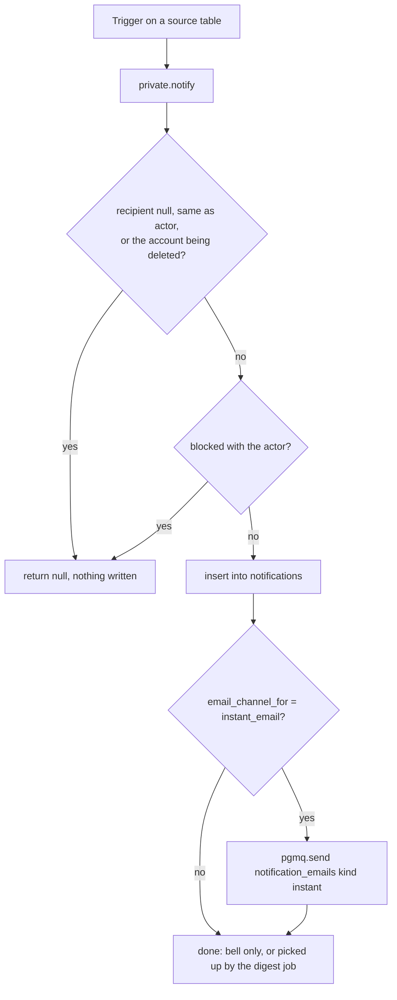
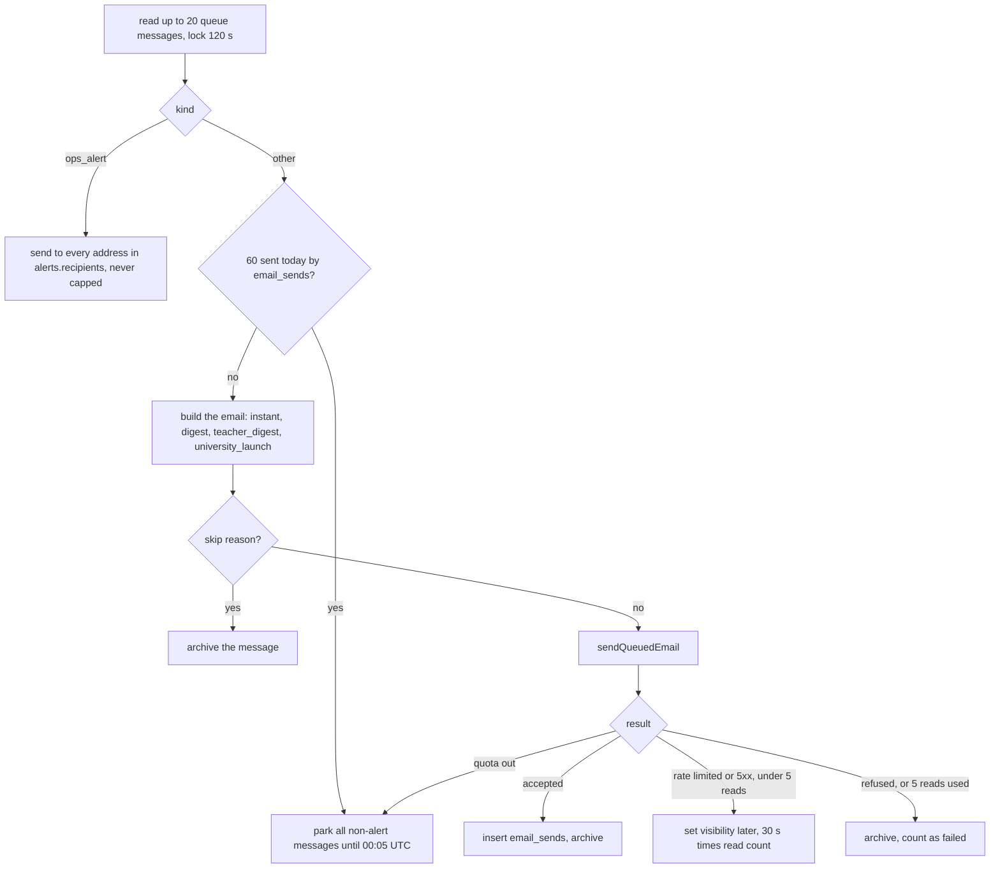

Commit: bc74f6a
Covers: supabase/migrations/20260929000000_notifications.sql, supabase/migrations/20261105000001_brevo_email_delivery.sql, lib/actions/notifications.ts, lib/data/notifications.ts, lib/email/, components/notifications/, app/(app)/notifications/, app/(app)/settings/notifications/, supabase/functions/notify-worker/, supabase/functions/_shared/notify/, supabase/functions/_shared/email/

# Notifications and email

## Purpose

A notification is a row written only by a database trigger through `private.notify()`; the user sees it under the bell and, depending on a per-category preference, also gets it by instant email or in one daily digest.
The `notify-worker` Edge Function drains the pgmq queue `notification_emails` and sends through Brevo, with a 60-emails-a-day cap and a database ledger that stops a replayed queue message from sending twice.
The wording of a notification is one TypeScript module shared by the page and the emails; emails that a server action sends on the spot (invites, security notices) go through the same Brevo sender without the queue.

Email provider: the code sends through Brevo. The older PRD text and some migration comments say Resend; see the end of this doc and `reference/prd-mismatches.md`. The Brevo webhook that records delivered and bounced counts belongs to the observability doc (the alert side); `docs/email-brevo-migration.md` is a lead for the cutover plan, not evidence here.

## Data model

Generated schema: [notifications](../reference/schema/notifications.md).

| Table | One row is | Notes |
|---|---|---|
| `notification_categories` | A group of types with a default email channel | `default_channel` is `instant_email`, `digest` or `off`; `allow_instant` says whether instant email may be chosen, and a check refuses a default of instant where it is not allowed [src: supabase/migrations/20260929000000_notifications.sql#check (default_channel <> 'instant_email' or allow_instant)] |
| `notification_types` | One kind of event, in a category | `emailed` false means the type is never emailed, whatever the preference [src: supabase/migrations/20260929000000_notifications.sql#create table public.notification_types] |
| `notifications` | One notice to one user | `actor_id` (null for system events), `entity_type` and `entity_id`, a `data` jsonb snapshot for rendering, `read_at`; a check forbids notifying yourself [src: supabase/migrations/20260929000000_notifications.sql#check (actor_id is null or actor_id <> user_id)] |
| `notification_prefs` | One user's channel for one category | A missing row means the category default [src: supabase/migrations/20260929000000_notifications.sql#create table public.notification_prefs] |
| `private.user_activity` | Last time the user was active, and last digest | Written at most once an hour by `touch_activity` from the signed-in layout; the digest goes only to people not active for 24 hours [src: supabase/migrations/20260929000000_notifications.sql#create function private.touch_activity] [src: app/(app)/layout.tsx#touch_activity] |
| `private.email_sends` | One email the worker sent | Counts toward the daily cap; has `notification_id`, `provider_message_id` and a unique `send_key`; the older `resend_id` column is kept for history [src: supabase/migrations/20261105000001_brevo_email_delivery.sql#add column send_key text unique] |
| `private.brevo_email_attempts` | One delivery attempt ledger row, keyed by a hash | States `pending`, `retryable`, `accepted`, `failed`, `uncertain`; holds hashes and provider ids, never addresses or content [src: supabase/migrations/20261105000001_brevo_email_delivery.sql#create table private.brevo_email_attempts] |
| `private.brevo_webhook_receipts` | One webhook event seen | Lets the webhook record a delivered or bounced signal once per event [src: supabase/migrations/20261105000001_brevo_email_delivery.sql#create table private.brevo_webhook_receipts] |

**Categories.** Added by the migration that introduces each feature, so the full list is spread over the migrations. Defaults after all of them:

| Category | Default | Instant allowed | Added in |
|---|---|---|---|
| `friend_requests`, `applications`, `invites`, `ownership` | instant email | yes | notifications [src: supabase/migrations/20260929000000_notifications.sql#('friend_requests', 'Friend requests'] |
| `team` | off | no | notifications |
| `comments`, `mentions` | digest | no | comments_links [src: supabase/migrations/20260929020000_comments_links.sql#('comments', 'Comments'] |
| `messages` | digest | no | chat [src: supabase/migrations/20260929050000_chat.sql#('messages', 'Messages'] |
| `account` | instant email (set to instant after creation) | yes | reports, then phase3_answers [src: supabase/migrations/20260929070000_reports.sql#('account', 'Account and safety'] [src: supabase/migrations/20260930000000_phase3_answers.sql#update public.notification_categories set default_channel] |
| `trust` | off | no | endorsements [src: supabase/migrations/20261001000000_endorsements.sql#('trust', 'Trust and ranking'] |
| `feedback` | digest | no | student_portal [src: supabase/migrations/20261010000000_student_portal.sql#('feedback', 'Feedback replies'] |
| `faculty` | off | no | teacher_portal [src: supabase/migrations/20261012000000_teacher_portal.sql#('faculty', 'Faculty supervision and reviews'] |
| `contact_requests`, `job_updates`, `recruiting` | digest | yes | recruiter_orgs [src: supabase/migrations/20261013000000_recruiter_orgs.sql#('contact_requests', 'Recruiter contact requests'] |
| `university` | digest | no | uni_core [src: supabase/migrations/20261017000000_uni_core.sql#('university', 'Your university'] |
| `billing` | instant email, always | yes | billing_lifecycle [src: supabase/migrations/20261024000000_billing_lifecycle.sql#('billing', 'Billing'] |

## Flows

### 1. A notification is created

Every trigger in every subsystem calls `private.notify(user, actor, type, entity_type, entity_id, data)`; nothing else inserts into `notifications`, and users hold only `select` on it, so a user cannot create a notice for anyone [src: supabase/migrations/20260929000000_notifications.sql#grant select on table public.notification_categories, public.notification_types, public.notifications] [src: supabase/migrations/20260929000000_notifications.sql#create policy notifications_read_own]. The final definition (student portal) returns without writing when the recipient is null, is the actor, or is the account currently being deleted (the `skilient.deleting_user` setting), turns a deleting actor into "no actor", and returns when the recipient and actor are blocked with each other [src: supabase/migrations/20261010000000_student_portal.sql#create or replace function private.notify]. Only the notification and the queue message are written in the trigger's own transaction; sending happens later.

`email_channel_for(user, type)` decides the channel. Final definition (billing_lifecycle): a type with `emailed = false` is `off`; any `billing` type is always `instant_email`; a stored or default instant choice on a category that no longer allows instant falls back to `digest`; otherwise the user's preference, else the category default [src: supabase/migrations/20261024000000_billing_lifecycle.sql#create or replace function private.email_channel_for].

The triggers themselves live with each subsystem. Phase-3 ones are in the notifications migration: a friend request (sent and accepted; a cancelled one removes its unread notice), applications (received, decided, withdrawn), invites (received, answered; revoked removes the unread notice), ownership transfer and venture completion or abandonment, and a member leaving or being removed [src: supabase/migrations/20260929000000_notifications.sql#create function private.notify_applications] [src: supabase/migrations/20260929000000_notifications.sql#create function private.notify_venture_changes] [src: supabase/migrations/20260929000000_notifications.sql#create function private.notify_member_removed]. The many others (comments, chat, reports, endorsements, credentials, code checks, CV, recruiting, university, billing, sanctions) are in their own migrations and docs.

### 2. Reading and managing in the app

- **Bell.** `NotificationBell` reads `unread_notification_count()` once and again whenever a Realtime `postgres_changes` event on the user's own `notifications` rows arrives; the table is in the Realtime publication [src: components/notifications/notification-bell.tsx#table: "notifications", filter: `user_id=eq.${userId}`] [src: supabase/migrations/20260929000000_notifications.sql#alter publication supabase_realtime add table public.notifications].
- **List.** `/notifications` calls `my_notifications` for the newest 50 (cursor `before`), groups them into Today and Earlier using Pakistan time, and offers "Show older" while a full page comes back. Notices from an actor who is now blocked either way are left out of both the list and the count; an avatar and username appear only where `can_view_profile` holds [src: app/(app)/notifications/page.tsx#Show older] [src: supabase/migrations/20260929000000_notifications.sql#create function private.my_notifications].
- **Mark read.** Clicking a row calls `markNotificationRead`; "Mark all read" calls `markAllNotificationsRead`. Both update only the caller's rows, and a single id that is not the caller's raises "that notification doesn't exist" [src: lib/actions/notifications.ts#export async function markNotificationRead] [src: supabase/migrations/20260929000000_notifications.sql#create function private.mark_notification_read]. Chat also marks its own thread notification read when the thread is opened (see [chat](chat.md)).
- **Preferences.** `/settings/notifications` lists every category with the caller's effective channel (`my_notification_settings`) and a picker that omits "instant email" where the category does not allow it. `set_notification_pref` refuses an unknown category and an instant choice the category does not allow. The page shows the billing category as plain text because billing notices are always emailed [src: supabase/migrations/20260929000000_notifications.sql#create function private.set_notification_pref] [src: app/(app)/settings/notifications/page.tsx#s.category === "billing"].

### 3. Instant email and the digest

Two producers fill the queue:

- **Instant.** `notify()` queues `{kind: "instant", notification_id}` when the channel is `instant_email`.
- **Digest.** A daily job (`notification-digest`, 13:07 UTC, 18:07 in Pakistan) queues `{kind: "digest", user_id}` for each person who has an unread notification of a digest-channel type created since their last digest and has not been active for 24 hours [src: supabase/migrations/20260929000000_notifications.sql#select cron.schedule('notification-digest', '7 13 * * *'] [src: supabase/migrations/20260929000000_notifications.sql#create function private.queue_notification_digests].
- Three other kinds use the same queue: `teacher_digest` (weekly, queued by the teacher portal), `university_launch` (queued when a requested university goes live) and `ops_alert` (queued by the alert watchdog) [src: supabase/migrations/20261012000000_teacher_portal.sql#jsonb_build_object('kind', 'teacher_digest'] [src: supabase/migrations/20261102000000_university_launch.sql#jsonb_build_object('kind', 'university_launch'] [src: supabase/migrations/20261105000000_alerts.sql#'kind', 'ops_alert'] [src: supabase/functions/_shared/notify/worker.ts#kind === "ops_alert"].

A cron job, `notify-worker`, runs every minute and does nothing unless the queue has a visible message; otherwise it POSTs to the Edge Function with a bearer secret generated in the database and stored in Vault (`notify_worker_secret`) [src: supabase/migrations/20260929000000_notifications.sql#create function private.wake_notify_worker] [src: supabase/migrations/20260929000000_notifications.sql#select cron.schedule('notify-worker', '* * * * *']. The function accepts only `POST` with that exact bearer, refuses with 503 if `BREVO_API_KEY` or `APP_URL` is missing, and otherwise runs `runNotifyWorker` [src: supabase/functions/notify-worker/index.ts#safeEqual] [src: supabase/functions/_shared/notify/worker.ts#export function notifyConfigFromEnv].

Details, from the worker:

- **Cap.** The count is rows in `private.email_sends` since 00:00 UTC; at `DAILY_CAP = 60` all queued messages except `ops_alert` are pushed to the next day at 00:05 UTC. Operational alerts neither wait for the cap nor count toward it [src: supabase/functions/_shared/notify/worker.ts#export const DAILY_CAP = 60] [src: supabase/functions/_shared/notify/worker.ts#const parkUntilTomorrow].
- **Instant checks (`buildInstant`).** The notification must still exist, not already be emailed (a row in `email_sends`), not be read, not involve a block, still resolve to the instant channel, belong to a user with an address, and be less than 12 hours old. Each failed check archives the message with a logged reason (`gone`, `already_emailed`, `already_read`, `blocked`, `not_instant`, `no_address`, `stale`) [src: supabase/functions/_shared/notify/worker.ts#async function buildInstant] [src: supabase/functions/_shared/notify/worker.ts#const STALE_MS].
- **Digest checks (`buildDigest`).** Skipped if the user has no address, a digest already covered this message, they were active in the last 24 hours, or a digest went out in the last 20 hours; the body lists at most 20 unread digest-channel notifications created before the message was queued and not from blocked actors, then "And N more". Items are grouped by sender category, so security-type notices and ordinary ones arrive as separate digest emails. After sending, `last_digest_at` is advanced [src: supabase/functions/_shared/notify/worker.ts#async function buildDigest] [src: supabase/functions/_shared/notify/worker.ts#const DIGEST_ITEMS = 20].
- **Spacing.** The worker waits 600 ms between sends (`sendGapMs`) [src: supabase/functions/_shared/notify/worker.ts#sendGapMs: 600].
- **Retry.** A message is read with a 120-second lock. Rate limiting or a server error defers it by at least 30 seconds times its read count (longer if the provider sent a wait time) until it has been read five times; then it is archived as failed. A "no credits" refusal parks everything until tomorrow [src: supabase/functions/_shared/notify/worker.ts#const MAX_ATTEMPTS = 5] [src: supabase/functions/_shared/notify/worker.ts#notify.quota].

### 4. Sending through Brevo, and why a replay cannot double-send

`sendQueuedEmail(db, cfg, fetch, email, key)` is the one path from the worker to the provider:

1. It derives a stable UUID and an opaque SHA-256 key from the send key (for example `notification-<id>-notification`), and a fingerprint of the exact request body [src: supabase/functions/_shared/email/delivery.ts#export async function deliveryIdentity].
2. `claim_brevo_email` inserts a `pending` row in `brevo_email_attempts`, or reads the existing one under a lock. An already `accepted` attempt returns the earlier message id and sends nothing; a `failed` or `uncertain` one is refused; a live 120-second lease means "busy" (retry later); a `pending` attempt older than 25 minutes, or whose payload hash changed, is turned into `uncertain` and needs manual reconciliation [src: supabase/migrations/20261105000001_brevo_email_delivery.sql#create function private.claim_brevo_email].
3. Only a claimed attempt calls `sendViaBrevo`: `POST /smtp/email` with the stable UUID as the idempotency key, a 10-second timeout and no redirects, no retry inside the call [src: supabase/functions/_shared/email/brevo.ts#export async function sendViaBrevo].
4. `finish_brevo_email` records `accepted` (with the message id), `failed` (definitive refusal), `retryable`, or leaves `pending` for an ambiguous result (network error, missing id, 5xx) [src: supabase/functions/_shared/email/delivery.ts#digest, sent.ok ? "accepted"].
5. On success the worker writes the `email_sends` row with `provider_message_id` and the hashed `send_key` (`on conflict do nothing`).

Mapping of Brevo responses in `sendViaBrevo`: HTTP 2xx with a message id is accepted; a duplicate-idempotency error is also treated as success; `not_enough_credits` means "retry tomorrow"; 429 means "retry later" with the provider's wait time; 5xx and network errors are "retry later" and marked uncertain; any other 4xx is final. Provider error text is never logged, only a short code [src: supabase/functions/_shared/email/brevo.ts#not_enough_credits].

**Sender and category.** Each email has a category, `security` (sent from `security@skilient.com`) or `notification` (`notify@skilient.com`). A queued notification is `security` when its type is in `SECURITY_NOTIFICATION_TYPES`: content removed, moderation warning, deletion requested or cancelled, content hidden or restored by a university, account restricted, restriction lifted, organisation sanctioned, appeal decided, account viewed, MFA reset [src: supabase/functions/_shared/email/brevo.ts#export function senderFor] [src: supabase/functions/_shared/email/brevo.ts#export const SECURITY_NOTIFICATION_TYPES]. These still obey the daily cap.

### 5. Wording shared by the page and the email

`describeNotification` (one file, plain TypeScript with relative imports) maps a notification type to `{text, href, subject}`. The Next page imports it with the `@/supabase/functions/...` alias; the Deno worker imports it relatively, so a notice reads the same in the bell and in the inbox [src: supabase/functions/_shared/notify/describe.ts#export function describeNotification] [src: lib/data/notifications.ts#import { describeNotification }]. A type with no `case` falls back to "You have a new notification." linking to `/notifications`, with the subject "New activity on Skilient". The email builders (`instantEmail`, `digestEmail`, `teacherDigestEmail`, `universityLaunchEmail`, `opsAlertEmail`) live in `_shared/notify/email.ts`, which rebuilds the app's email layout because Edge Functions bundle only their own folder; every dynamic string is HTML-escaped, and the footer links to `/settings/notifications` [src: supabase/functions/_shared/notify/email.ts#export function escapeHtml] [src: supabase/functions/_shared/notify/email.ts#function footerFor].

### 6. Emails sent by the Next server

Some emails are sent by a server action or the sign-in recorder, directly, not through the queue. They call `sendEmail` (`lib/email/send.ts`), which imports the same `sendViaBrevo` and uses a fresh UUID per send; there is no queue, no retry and no ledger, and a failure only returns `false` and logs `email.failed` [src: lib/email/send.ts#export async function sendEmail]. They are not counted in `email_sends`, so they are outside the 60-a-day cap (the worker's header says direct application security emails and Supabase Auth's SMTP are separate). The templates are in `lib/email/templates.ts`:

| Template | Sent by |
|---|---|
| `newDeviceEmail` | The sign-in recorder, after the response [src: lib/auth/sign-in-record.ts#newDeviceEmail] |
| `signInAttemptsEmail` | The sign-in action, after repeated failures [src: lib/actions/auth.ts#signInAttemptsEmail] |
| `backupCodeUsedEmail` | The MFA actions [src: lib/actions/mfa.ts#sendEmail] |
| `mfaResetEmail` | Staff reset of two-factor in `/ops/users` [src: lib/actions/ops/users.ts#sendEmail] |
| `orgInviteEmail`, `uniAdminInviteEmail`, `fairInviteEmail` | Organisation invites, university-admin invites and job-fair invites [src: lib/features/organizations/actions.ts#orgInviteEmail] [src: lib/actions/uni.ts#uniAdminInviteEmail] [src: lib/actions/uni.ts#fairInviteEmail] |
| `universityRequestEmail` | The "tell me when my university joins" confirmation [src: lib/actions/marketing.ts#sendEmail] |

Sign-up confirmation, password reset and magic-link emails belong to Supabase Auth's own SMTP path, not to this code (see [auth-and-rls](auth-and-rls.md)).

### 7. Housekeeping

`purge-notifications` runs daily at 03:23 UTC: read notifications older than 90 days and any older than 365 days are deleted, and `email_sends` rows older than 60 days [src: supabase/migrations/20260929000000_notifications.sql#create function private.purge_notifications]. The two Brevo ledgers (`brevo_email_attempts`, `brevo_webhook_receipts`) are not deleted by any migration in the repo; the table comment says the attempts are kept to prevent delayed queue replays [src: supabase/migrations/20261105000001_brevo_email_delivery.sql#Retain to prevent delayed queue replays].

## Entry points

| Entry | Called by | Who may call it |
|---|---|---|
| `private.notify` | Triggers across the schema | Definer code only; not granted to API roles [src: supabase/migrations/20260929000000_notifications.sql#revoke all on function private.notify] |
| `notification_types`, `notification_categories` | Inserts in each feature migration, read by `email_channel_for` and the settings page | Readable by `authenticated`; written by migrations only |
| `my_notifications`, `unread_notification_count`, `mark_notification_read`, `mark_all_notifications_read`, `my_notification_settings`, `set_notification_pref`, `touch_activity` | `lib/data/notifications.ts`, `lib/actions/notifications.ts`, the bell, the layout | `authenticated` only; each acts on `auth.uid()` [src: supabase/migrations/20260929000000_notifications.sql#to authenticated;] |
| `private.queue_notification_digests`, `private.wake_notify_worker`, `private.purge_notifications` | pg_cron (`notification-digest`, `notify-worker`, `purge-notifications`) | pg_cron |
| `notify-worker/index.ts` | The cron wake-up | A `POST` with the Vault bearer secret; anyone else gets 401 |
| `claim_brevo_email`, `finish_brevo_email` | `sendQueuedEmail` over the Edge Function's direct database connection | Not granted to API roles [src: supabase/migrations/20261105000001_brevo_email_delivery.sql#revoke all on function private.claim_brevo_email] |
| `sendEmail` | Server actions (flow 6) | Server code only (`server-only`) |
| `/notifications`, `/settings/notifications` | Browser | Signed-in, onboarded accounts |

## Permissions

All four notification tables have RLS on, `authenticated` holds only `select`, and the policies are: categories and types readable by every signed-in user, notifications and preferences readable by their owner only. There are no insert, update or delete policies; writes are the definer functions above. `private.user_activity`, `private.email_sends` and the two Brevo ledgers have RLS enabled with no policy and no API grant [src: supabase/migrations/20260929000000_notifications.sql#alter table private.email_sends enable row level security] [src: supabase/migrations/20261105000001_brevo_email_delivery.sql#revoke all on private.brevo_email_attempts from public, anon, authenticated]. The worker uses a direct database connection (`SUPABASE_DB_URL`), not the service role key, and reads its bearer secret from Vault. `record_brevo_email_signal` is granted to `service_role` only [src: supabase/migrations/20261105000001_brevo_email_delivery.sql#grant execute on function private.record_brevo_email_signal].

Privacy rules held in SQL: a block drops the notification at creation, hides it from the list and count, and the worker skips it again at send time. An instant email carries the one-sentence description and a link; a digest carries up to 20 such lines.

## Failure modes

| Situation | What happens | Where it shows |
|---|---|---|
| `BREVO_API_KEY` or `APP_URL` missing in the function | 503 `not_configured`; the queue is not read | `notify.worker` error line with the variable name [src: supabase/functions/notify-worker/index.ts#not_configured] |
| Vault `notify_worker_secret` or `project_url` missing | The cron wake-up does nothing; mail waits in the queue | No log line; the queue grows |
| Brevo credits out | Everything except alerts parks until 00:05 UTC | `notify.quota` error line |
| 60 sent today | Everything except alerts parks until 00:05 UTC | `notify.daily_cap` warning with the count |
| Brevo rate limit or 5xx | Deferred with a growing delay; after 5 reads the message is archived as failed | `notify.deferred`, then `notify.failed` |
| Brevo refuses a message (other 4xx) | Archived as failed immediately | `notify.failed` with Brevo's short code and status |
| Ambiguous send (network error, missing id) | The attempt stays `pending`; retried within 25 minutes with the same key; after that `uncertain` and never retried automatically | `delivery_needs_reconciliation` as the failure name |
| Queue message replayed after success | `claim_brevo_email` returns `accepted`; nothing is sent | No send; the `email_sends` insert is `on conflict do nothing` |
| Instant message older than 12 hours | Skipped as `stale`; the notice stays in the bell | `notify.skipped`, reason `stale` |
| Recipient read the notice before the email went out | Skipped as `already_read` | `notify.skipped` |
| Digest with nothing unread | Skipped as `empty`; never an empty email | `notify.skipped` |
| Unknown queue message kind | Archived as `bad_message` | `notify.skipped`, outcome `refused` |
| `ops_alert` with no recipients configured | Skipped; the alert state stays in `private.alert_state` | `notify.skipped`, reason `no_recipients` |
| A direct `sendEmail` fails | Returns false; the action decides what to tell the user | `email.failed` with a short code |
| `BREVO_API_KEY` missing in the Next server | Returns false without sending | `email.skipped`, `not_configured` |
| Mark-read for a notification that isn't yours | `not_found` | `notifications.read` refused |

## Tests

- pgTAP `18_notifications` (51 assertions) [src: supabase/tests/18_notifications.test.sql#select plan(51)].
- Worker test `tests/worker/notify-worker.test.ts`: an instant email is sent once with an idempotency key and recorded; a read notice is skipped; Brevo's daily quota parks the queue; invalid messages are dropped and rate-limited ones deferred; the cap of 60 stops notification emails; digests go only to inactive people and never empty; the teacher weekly summary; the university launch email; alerts bypass the cap [src: tests/worker/notify-worker.test.ts#stops notification emails for the day at 60 and parks the rest until tomorrow].
- Unit `tests/unit/notifications.test.ts` (wording of the types, no staff names, escaped HTML, digest remainder) and `tests/unit/email-senders.test.ts` (which sender each category uses) [src: tests/unit/notifications.test.ts#words every phase 3 slice 2 type and links somewhere real].
- E2E `notifications.spec.ts`: bell, list, open to mark read, mark all read; email settings per category and direct writes refused [src: tests/e2e/notifications.spec.ts#email settings per category; direct writes refused].
- No test of the claim/lease path against a concurrent second worker, or of `purge_notifications`.

## Change guide

1. **Add a notification type end to end.** In the feature migration: insert the type into `notification_types` (category, `emailed`) and create a trigger that calls `private.notify(...)`; add a `case` to `describeNotification` for its text, link and subject (or the user sees the generic fallback); if it protects access or account state, add it to `SECURITY_NOTIFICATION_TYPES` so it sends from the security address; if it needs its own category, insert the category with its default channel and whether instant is allowed. Then add a wording test to `notifications.test.ts` [src: supabase/migrations/20260929000000_notifications.sql#insert into public.notification_types] [src: supabase/functions/_shared/notify/describe.ts#default:] [src: supabase/functions/_shared/email/brevo.ts#export const SECURITY_NOTIFICATION_TYPES].
2. **Change the daily cap or the digest rules.** `DAILY_CAP` and `STALE_MS` are constants in `worker.ts`; the digest windows (24 hours inactive, 20 hours since the last digest, 20 items) are in `buildDigest` and `queue_notification_digests`; the digest hour is the cron expression. The worker test pins the cap [src: supabase/functions/_shared/notify/worker.ts#const STALE_MS] [src: tests/worker/notify-worker.test.ts#stops notification emails for the day at 60].
3. **Change a category's default or make it instant-capable.** Update `notification_categories` in a new migration (`default_channel`, `allow_instant`; the check refuses an instant default without permission). People who stored an instant preference on a category that stops allowing it fall back to the digest by `email_channel_for`; for a category like `billing` that must always email, add a rule in `email_channel_for` as billing did.

Also likely: a new queue kind (add a branch in `runNotifyWorker`, a builder in `email.ts`, and a producer that sends the message), or a second email provider (the transport is `sendViaBrevo`; `delivery.ts` and the two ledger tables are provider-specific).

## Answers to the planned questions

**1. How is a notification created, and why only through `private.notify()`?** Flow 1. One function skips self-notifications, deleting accounts and blocked pairs, writes the row and queues an instant email, so those rules cannot be forgotten by a trigger; users have no insert grant, so there is no other path.

**2. How do types, categories and preferences decide in-app versus email versus digest?** Every notice appears in the bell. `email_channel_for` returns the channel: `off` when the type is not emailed, `instant_email` for billing, otherwise the user's per-category preference or the category default, with instant falling back to digest where the category no longer allows it.

**3. How does the worker send, batch and cap?** Flows 3 and 4. 20 messages per run, a 120-second lock, 600 ms between sends, a cap of 60 a day by `email_sends` rows, a Brevo ledger for idempotency. Operational alerts (`ops_alert`) bypass and do not count toward the cap; account and security notices obey it.

**4. Where does the wording come from?** `describeNotification`, shared by `lib/data/notifications.ts` and the worker's builders (flow 5).

**5. How do you add a type?** Change guide 1.

**6. Which emails are sent from the Next server, and why?** Flow 6: sign-in security notices, backup-code and MFA-reset notices, and invites. They are triggered by a server action or the sign-in recorder rather than a database event, return a boolean to the caller, and are outside the queue, the ledger and the cap.

**7. Purge and a live bell count?** Flow 7 for purge (90 days read, 365 days any, `email_sends` 60 days); flow 2 for the live count (Realtime event, then `unread_notification_count`).
