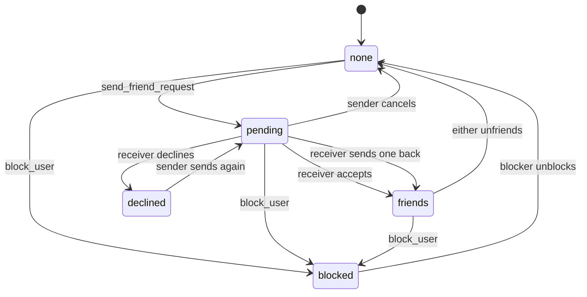
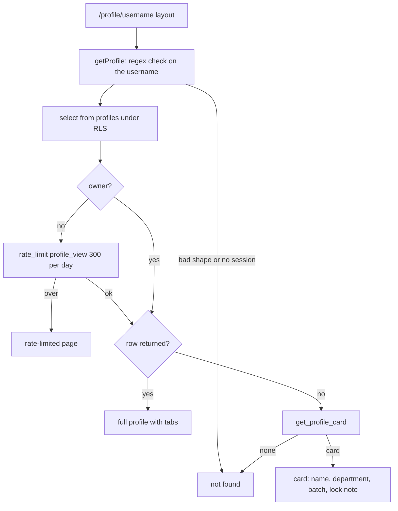

Commit: bc74f6a
Covers: supabase/migrations/20260928230000_friends_blocks.sql, lib/actions/friends.ts, lib/actions/profile.ts, lib/actions/onboarding.ts, lib/data/friends.ts, lib/data/profiles.ts, lib/data/explore.ts, lib/profile/, lib/explore/, components/friends/, components/profile/, components/onboarding/, components/explore/, app/(app)/friends/, app/(app)/explore/, app/(app)/onboarding/, app/(app)/profile/, app/(app)/settings/profile/

# People and profiles

## Purpose

A student's profile is one row that RLS shows in full or as a three-field card, depending on the viewer's university, friendships and blocks.
The six-step onboarding wizard fills the profile in; friend requests, friendships and blocks (the relationships the profile rules read) live in `friends_blocks.sql`; Explore finds people and ventures by prefix search.
Every relationship check is made in SQL; the pages and actions only ask and render.

Other docs this one leans on: sign-up, the gate and the base RLS model are in [auth-and-rls](auth-and-rls.md); skills, endorsements and credentials on the profile are in [github-skills](github-skills.md) and trust-evidence; the ranking tier badge is in [ranking](ranking.md); chat is in chat.

## Data model

Generated schema: [friends_blocks](../reference/schema/friends_blocks.md), [identity](../reference/schema/identity.md) (`profiles`, `profiles_public_card`, `onboarding_state`), [chat_extras_explore](../reference/schema/chat_extras_explore.md) (search columns), [buckets](../reference/schema/buckets.md).

| Table | One row is | Notes |
|---|---|---|
| `profiles` | One account (all roles) | `visibility` is `friends`, `university` or `global`, default `university`; `looking_for` is an enum array; `onboarding_complete` defaults to false [src: supabase/migrations/20260927210238_identity.sql#visibility public.profile_visibility not null default 'university'] [src: supabase/migrations/20260927210238_identity.sql#onboarding_complete boolean not null default false]. The owner may update only the listed columns; role, university and `onboarding_complete` change through checked functions [src: supabase/migrations/20260927210238_identity.sql#create policy profiles_update_own]. `chat_read_receipts` is added by chat [src: supabase/migrations/20260929060000_chat_extras_explore.sql#add column chat_read_receipts] |
| `profiles_public_card` | The restricted card: username, name, department, batch | Kept in step with `profiles` by a trigger; no direct access, read through `get_profile_card` [src: supabase/migrations/20260927210238_identity.sql#create trigger profiles_sync_public_card]. Carries a generated `search` column and trigram indexes for Explore [src: supabase/migrations/20260929060000_chat_extras_explore.sql#alter table public.profiles_public_card] |
| `onboarding_state` | Wizard progress for one account | `step` 1 to 6 is the furthest step reached; `data` is a jsonb note capped at 16 KB; `completed_at` is set only by `complete_onboarding` [src: supabase/migrations/20260927210238_identity.sql#create table public.onboarding_state] |
| `friend_requests` | One request, status `pending`, `accepted` or `declined` | A unique index allows one `pending` or `accepted` request per unordered pair, so parallel sends in both directions cannot both succeed [src: supabase/migrations/20260928230000_friends_blocks.sql#create unique index friend_requests_live_pair_idx] |
| `friendships` | One friendship, stored once with `user_id_a < user_id_b` | [src: supabase/migrations/20260928230000_friends_blocks.sql#constraint friendships_ordered check] |
| `blocks` | One block, blocker to blocked | Readable by the blocker only, so the blocked person never learns of it [src: supabase/migrations/20260928230000_friends_blocks.sql#create policy blocks_read] |
| `ops_audit_log` | Created in this migration; owned by the ops console | Append-only through triggers that raise on update, delete and truncate [src: supabase/migrations/20260928230000_friends_blocks.sql#create trigger ops_audit_log_no_update] |

Tables that people pages read but other docs own: `user_skills`, `skills` (github-skills), `universities` and `university_domains` (auth-and-rls), `departments` (university-portal).

## Flows

### 1. Onboarding

The wizard is six pages under `/onboarding/[step]`, in the order university, profile, github, skills, looking-for, people [src: lib/auth/gate.ts#export const ONBOARDING_STEPS]. Each page is a server component that reads the current profile under RLS and renders one step form; the frame shows "Step n of 6" and a Back link on every step after the first [src: app/(app)/onboarding/[step]/page.tsx#export default async function OnboardingStepPage] [src: components/onboarding/wizard-frame.tsx#Back always works]. Each form submits to its own server action, which validates with Zod, saves its slice, moves the saved step forward, and redirects to the next page [src: lib/actions/onboarding.ts#async function advance].

| Step | Action | What it saves |
|---|---|---|
| 1 university | `saveUniversityStep` | If a university was picked, `set_my_university` (only a university that owns the email domain, only before onboarding completes); then `department`, `programme`, `graduation_year`, `campus` on `profiles`. Refuses with `university_missing` if the profile still has no university [src: lib/actions/onboarding.ts#export async function saveUniversityStep] [src: supabase/migrations/20260927210238_identity.sql#create function private.set_my_university] |
| 2 profile | `saveProfileStep` | `username` and `bio` on `profiles`. The photo is uploaded separately by `setProfileImage` [src: lib/actions/onboarding.ts#export async function saveProfileStep] |
| 3 github | `saveGithubStep` | Only a note in `onboarding_state.data`: `connected`, `later` or `skipped`. The account link itself is written by the GitHub flow [src: lib/actions/onboarding.ts#export async function saveGithubStep] |
| 4 skills | `saveSkillsStep` | Only `skills_seen: true` in `onboarding_state.data`; the step is read-only [src: lib/actions/onboarding.ts#export async function saveSkillsStep] |
| 5 looking-for | `saveLookingForStep` | `looking_for` and `recruiter_visible` on `profiles` [src: lib/actions/onboarding.ts#export async function saveLookingForStep] |
| 6 people | `finishOnboarding` | Calls `complete_onboarding`, then redirects to `/onboarding/done`. The page lists classmates (same university, department and batch, onboarded, RLS-visible) with an Add friend button each [src: lib/actions/onboarding.ts#export async function finishOnboarding] [src: lib/data/profiles.ts#export async function getClassmates] |

`advance` reads the saved step and sets it to the larger of the saved step and the completed step plus one, never above 6, so going Back and saving again does not move progress backwards [src: lib/actions/onboarding.ts#const nextStep = Math.min]. It writes with `{ count: "exact" }` and treats anything other than one row as a failure [src: lib/actions/onboarding.ts#count !== 1].

A trigger on `onboarding_state` reports each step reached and the completion to analytics [src: supabase/migrations/20261104000000_analytics.sql#create trigger onboarding_state_analytics]. The gate does the rest. While `onboarding_complete` is false, a visit to `/onboarding/<step>` is allowed when that step is at or before the saved step; any other path, or a step ahead of the saved one, redirects to the saved step. After completion every `/onboarding` path except `/onboarding/done` redirects home [src: lib/auth/gate.ts#Back always works; skipping ahead of the saved step does not.] [src: lib/auth/gate.ts#pathname !== "/onboarding/done"]. Faculty, recruiters and officials are created with `onboarding_complete = true`, so they never see the wizard [src: supabase/migrations/20261012000000_teacher_portal.sql#insert into public.profiles (user_id, role, university_id, full_name, onboarding_complete)] [src: supabase/migrations/20261017000000_uni_core.sql#insert into public.profiles (user_id, role, university_id, full_name, onboarding_complete, visibility)].

### 2. Friend requests

`pending`, `declined` and `friends` are `friend_requests.status` plus a `friendships` row; `none` and `blocked` have no live request. The functions:

- **Send** takes a username. It looks the person up with `user_id_for`; a missing username and a block in either direction both raise "no one has that username" (SQLSTATE `P0002`), so a block is not revealed. It refuses yourself (`22023`) and existing friends (`23505`). If the other person already has a pending request to you, that request is accepted and the friendship written instead. Otherwise it takes a rate-limit token (one send per 5 seconds, key `friend_request:<user>`), then inserts; a unique violation becomes "there's already a request between you" [src: supabase/migrations/20260928230000_friends_blocks.sql#create function private.send_friend_request] [src: supabase/migrations/20260928230000_friends_blocks.sql#private.rate_limit('friend_request:']. The reverse-request shortcut runs before the rate limit.
- **Respond** is receiver-only and locks the request row. Declining just sets the status. Accepting is refused (shown as no longer pending) if either side blocked the other, and otherwise inserts the ordered friendship in the same transaction [src: supabase/migrations/20260928230000_friends_blocks.sql#create function private.respond_friend_request].
- **Cancel** deletes a pending request, sender only [src: supabase/migrations/20260928230000_friends_blocks.sql#create function private.cancel_friend_request].
- **Unfriend** deletes this pair's friendship and this pair's requests through `clear_pair`, and raises if there was no friendship [src: supabase/migrations/20260928230000_friends_blocks.sql#create function private.clear_pair] [src: supabase/migrations/20260928230000_friends_blocks.sql#create function private.unfriend].
- **Block** clears the pair, then inserts the block; it works even when the other person has already blocked you. **Unblock** deletes only your own block and leaves the pair as strangers [src: supabase/migrations/20260928230000_friends_blocks.sql#create function private.block_user] [src: supabase/migrations/20260928230000_friends_blocks.sql#create function private.unblock_user].

A trigger on `friend_requests` writes the notices: an insert as `pending` notifies the receiver (`friend_request`), a `pending` to `accepted` update notifies the original sender (`friend_accepted`), and deleting a pending request removes its unread notice. Declines notify nobody [src: supabase/migrations/20260929000000_notifications.sql#create function private.notify_friend_requests]. Wording and email handling are in notifications-and-email.

`friend_requests` also carries the `refuse_if_restricted` insert trigger, so an account under a sanction cannot send requests [src: supabase/migrations/20261027000000_sanctions_appeals.sql#'contribution_confirmations', 'friend_requests', 'credentials']. The header badge counts unanswered received requests through `pending_friend_request_count`, refreshed over a Realtime channel on the receiver's own `friend_requests` rows [src: components/friends/friends-nav-link.tsx#table: "friend_requests"] [src: supabase/migrations/20260928230000_friends_blocks.sql#alter publication supabase_realtime add table public.friend_requests].

### 3. Reading a profile

`getProfile` is wrapped in React `cache`, so the layout, `generateMetadata` and every tab share one read per request [src: lib/data/profiles.ts#export const getProfile = cache]. It rejects a username that does not match `^[a-z0-9_]{3,30}$`, reads the row from `profiles` (RLS decides whether a row comes back), spends one of the viewer's 300 daily profile opens unless the viewer is the owner, then falls back to the card [src: lib/data/profiles.ts#DAILY_PROFILE_VIEWS] [src: lib/data/profiles.ts#get_profile_card]. The budget is spent before the result is known, so a lookup that ends in "not found" also uses one. Profile pages set `robots: noindex` [src: app/(app)/profile/[username]/layout.tsx#robots: { index: false, follow: false }].

The layout renders the header with the friend actions and a Report button; only a full profile gets the tabs [src: app/(app)/profile/[username]/layout.tsx#export default async function ProfileLayout]. The four tabs are nested routes, and each tab page renders nothing unless the lookup is a full profile:

| Tab | Reads | Owned by |
|---|---|---|
| Overview | Bio, top 8 skills, endorsements, credentials, awards, programme, campus, "open to", and the visibility line for the owner | skills: github-skills; endorsements and credentials: trust-evidence; awards: university-portal [src: app/(app)/profile/[username]/page.tsx#getProfileSkills] [src: app/(app)/profile/[username]/page.tsx#getAwards] |
| Ventures | `getProfileVentures`, `getContributionSummary` | ventures [src: app/(app)/profile/[username]/ventures/page.tsx#getProfileVentures] |
| Skills | `getProfileSkills`, `getHeldCount`, `getGithubOverview` | github-skills [src: app/(app)/profile/[username]/skills/page.tsx#getHeldCount] |
| Activity | `listPosts` for the person | feed-and-posts [src: app/(app)/profile/[username]/activity/page.tsx#listPosts] |

The header also takes the GitHub login (`getGithubLogin`) and the tier badge (`getTiers`) from those subsystems [src: app/(app)/profile/[username]/layout.tsx#getGithubLogin] [src: app/(app)/profile/[username]/layout.tsx#getTiers].

### 4. Editing a profile and photos

Settings → Profile (`/settings/profile`, also reached by the permanent redirect from `/profile/edit`) loads the owner's row and, when the university has its own department list, the list [src: next.config.ts#"/profile/edit"] [src: app/(app)/settings/profile/page.tsx#from("departments")]. `updateProfile` validates with `profileSchema` (name 2 to 60, bio at most 280, batch 1980 to 2100, visibility enum), then updates the owner's row with a `count: "exact"` check [src: lib/actions/profile.ts#export async function updateProfile] [src: lib/profile/schema.ts#export const profileSchema]. A unique violation (`23505`) becomes `username_taken` with a field message.

The live username check (`checkUsername`, debounced in the field) calls `username_available`, which needs a session, rejects reserved names, and allows 120 checks an hour [src: components/profile/username-field.tsx#window.setTimeout] [src: supabase/migrations/20260927210238_identity.sql#private.rate_limit('username_check:'].

`setProfileImage` handles both avatar and cover:

1. The browser crops to 512×512 (avatar) or 1500×500 (cover) with a cropper and sends a JPEG blob [src: components/profile/image-upload.tsx#cropToBlob].
2. The action refuses files over 5 MB (avatar) or 8 MB (cover), a missing session, and more than 30 uploads an hour [src: lib/actions/profile.ts#export async function setProfileImage] [src: lib/images/reencode.ts#export const IMAGE_SPECS].
3. `reencodeImage` re-encodes with sharp to WebP and drops metadata; input over 6,000 px on a side or unreadable is rejected [src: lib/images/reencode.ts#export async function reencodeImage].
4. The file is uploaded to `<user-id>/<uuid>.webp` in the `avatars` or `covers` bucket, then the profile row is updated with a count check. If the row update fails, the new file is removed. After success the previous file is removed too [src: lib/actions/profile.ts#await bucket.remove([path])] [src: lib/actions/profile.ts#orphan_left].
5. The database enforces the same rules independently: the buckets accept only `image/webp` at 5 MB and 8 MB, storage policies let a user write only inside their own folder, and `profiles` checks that a path starts with the owner's id [src: supabase/migrations/20260927210238_identity.sql#('avatars', 'avatars', true, 5242880] [src: supabase/migrations/20260927210238_identity.sql#create policy profile_images_insert_own] [src: supabase/migrations/20260927210238_identity.sql#avatar_path text check].

`removeProfileImage` clears the path first and then deletes the file.

### 5. Explore

Explore keeps its state in the URL: `q`, `tab`, `department`, `batch`, `skill`, `university` and `from` [src: lib/explore/href.ts#export function exploreHref]. The page validates each parameter (batch 19xx or 20xx, slug shapes, `from` capped at 200), shows four tabs (People, Projects, Startups, Project ideas), and streams the results behind `Suspense` [src: app/(app)/explore/page.tsx#export default async function ExplorePage]. The controls debounce typing before pushing the URL [src: components/explore/explore-controls.tsx#setTimeout].

- **People** needs at least 2 characters in the page and in SQL; below that the page shows "Search for someone" without calling the database [src: app/(app)/explore/page.tsx#Search for someone]. `searchPeople` calls `search_people` and adds tier badges with `getTiers`; code `54000` becomes a "searching very fast" notice [src: lib/data/explore.ts#export async function searchPeople].
- **Projects and Startups** call `search_ventures` with the venture type; the result rows are the same shape as the venture list [src: lib/data/explore.ts#export async function searchVentures].
- **Project ideas** is filtered in the page from `getIdeas`, not in SQL; it belongs to faculty [src: app/(app)/explore/page.tsx#async function IdeasResults].

Each result's friendship label (`friends`, `request_sent`, `request_received`, `none`) comes from the same SQL call as the row, and the Add friend button calls `sendFriendRequest` [src: components/explore/add-friend-button.tsx#sendFriendRequest].

## Entry points

All are callable only by signed-in users; the public wrappers revoke `anon`, grant `authenticated`, and are `security invoker` over the private definer function of the same name [src: supabase/migrations/20260928230000_friends_blocks.sql#from public, anon;]. Every function starts from `auth.uid()` and raises `42501` ("sign in first") without one.

| Entry | Caller | Who may call it |
|---|---|---|
| `/onboarding/[step]`, `/onboarding/done` | Browser | A signed-in account that accepted the agreement; the gate restricts steps (flow 1) |
| `saveUniversityStep` … `finishOnboarding` | Onboarding forms | The signed-in student; each writes only its own rows |
| `complete_onboarding` | `finishOnboarding` | Any signed-in account; returns false until username, university, department and batch are set [src: supabase/migrations/20260927210238_identity.sql#create function private.complete_onboarding] |
| `updateProfile`, `checkUsername`, `setProfileImage`, `removeProfileImage` | Settings → Profile, onboarding step 2 | The owner |
| `sendFriendRequest`, `respondFriendRequest`, `cancelFriendRequest`, `unfriend`, `blockUser`, `unblockUser` | Profile buttons, `/friends`, Explore, onboarding step 6 | The signed-in user; the SQL checks the sender, receiver or blocker role |
| `my_friends`, `my_friend_requests`, `my_blocks`, `friendship_state`, `pending_friend_request_count` | `lib/data/friends.ts` | Return only the caller's own relationships [src: lib/data/friends.ts#export async function getFriends] |
| `get_profile_card` | `getProfile` | Any signed-in user, by exact username; not blocked in either direction [src: supabase/migrations/20260929070000_reports.sql#create function private.get_profile_card] |
| `search_people`, `search_ventures` | `lib/data/explore.ts` | Any signed-in user |
| `/friends`, `/explore`, `/profile/[username]/*`, `/settings/profile` | Browser | Signed-in, onboarded accounts (gate) |

`blockUser` redirects to `/friends?tab=blocked` after success, because the blocked person's profile is no longer visible to the blocker either [src: lib/actions/friends.ts#redirect("/friends?tab=blocked")]. `/friends` has four tabs (Friends, Received, Sent, Blocked) and the Muted list from feed-and-posts under Blocked [src: app/(app)/friends/page.tsx#const TABS].

## Permissions

**Tables.** `friend_requests`, `friendships`, `blocks` and `ops_audit_log` have RLS on and no insert, update or delete grant for `authenticated`; the only grant is `select`, so every write goes through a definer function [src: supabase/migrations/20260928230000_friends_blocks.sql#grant select on table public.friend_requests]. Read policies: a request to its sender and receiver, a friendship to its two members, a block to the blocker, the audit log to staff [src: supabase/migrations/20260928230000_friends_blocks.sql#create policy friend_requests_read] [src: supabase/migrations/20260928230000_friends_blocks.sql#create policy friendships_read] [src: supabase/migrations/20260928230000_friends_blocks.sql#create policy ops_audit_log_read].

**The profile rule.** `profiles_select_visible` lets a user read their own row, and any other row when neither has blocked the other and one of these holds: the profile is `global`; it is `university` and in the reader's university; or the reader is the person's friend, whatever the profile's visibility. Friends therefore read `friends` and `university` profiles anywhere, so "friends" is the narrowest rung of one ladder rather than a separate view [src: supabase/migrations/20260928230000_friends_blocks.sql#create policy profiles_select_visible on public.profiles]. `can_view_profile(user)` is the same rule as a function for definer code that builds cards (team lists, search, friends lists, chat) [src: supabase/migrations/20260928230000_friends_blocks.sql#create or replace function private.can_view_profile]. `is_friend_of` and `is_blocked_with` read the caller from `auth.uid()`; `are_friends` and `is_blocked` take two ids, for definer code acting between two users, and are not granted to API roles [src: supabase/migrations/20260928230000_friends_blocks.sql#create function private.are_friends].

**The card.** `get_profile_card` returns the card for an exact username to any signed-in, non-blocked viewer; it is never a listing. The card holds the user id, username, name, department and batch [src: supabase/migrations/20260929070000_reports.sql#create function private.get_profile_card].

**Photos.** Both image buckets are public-read; the files sit at uuid paths. The path is shown to a viewer only where `can_view_profile` holds (friends list, request list, search) or the row is readable, but anyone who holds a URL can fetch the file [src: supabase/migrations/20260927210238_identity.sql#('covers', 'covers', true, 8388608] [src: supabase/migrations/20260928230000_friends_blocks.sql#case when private.can_view_profile(p.user_id) then p.avatar_path end].

**Who else checks blocks.** The same two helpers are called from: ventures, venture views and decisions [src: supabase/migrations/20260928190000_ventures.sql#is_blocked_with], posts, comments and the ranked feed [src: supabase/migrations/20260929010000_posts.sql#is_blocked_with] [src: supabase/migrations/20260929020000_comments_links.sql#is_blocked_with] [src: supabase/migrations/20260929040000_feed_ranking.sql#is_blocked_with], chat (closes a DM, hides a blocked member's name and messages) [src: supabase/migrations/20260929050000_chat.sql#Blocked member], notifications (the worker drops notices from a blocked actor) [src: supabase/functions/_shared/notify/worker.ts#private.is_blocked(n.user_id, n.actor_id)], reports, endorsements, skill levels, the leaderboard, the student portal, teacher portal, recruiter talent search and university comms [src: supabase/migrations/20260929070000_reports.sql#is_blocked_with] [src: supabase/migrations/20261001000000_endorsements.sql#is_blocked_with] [src: supabase/migrations/20261006000000_leaderboard.sql#is_blocked_with] [src: supabase/migrations/20261014000000_recruiter_talent.sql#is_blocked_with] [src: supabase/migrations/20261019000000_uni_comms.sql#is_blocked_with]. Each of those docs says what the check hides there.

## Failure modes

| Situation | What happens | Where it shows |
|---|---|---|
| Send to a missing or blocking username | Same refusal either way: "No one has that username." (`not_found`) | Action log `friends.send`, outcome `refused`, `error_code: not_found` |
| Two sends within 5 seconds | `rate_limited` ("You're doing that too often") | `friends.send` refused, `rate_limited` |
| Send when a request or friendship exists | `duplicate` | `friends.send` refused |
| Accept after the sender blocked you, or after a cancel | "That request is no longer pending" (`not_found`) | `friends.accept` refused |
| Unauthenticated call | `no_session` ("Your session expired") | Refused, `no_session` |
| Any SQL error not in the known list | Generic "Something went wrong on our side" with the request id, outcome `error` | `error` line with `error_code` = the SQLSTATE [src: lib/actions/rpc.ts#export const REFUSALS] |
| Username taken in onboarding or settings | `username_taken` with a field message | `onboarding.profile` or `profile.update` refused |
| Finish onboarding with a field missing | `incomplete` ("a few details are still missing") | `onboarding.finish` refused [src: lib/actions/onboarding.ts#error_code: "incomplete"] |
| A university with its own department list and a department outside it | The database raises `22023`, "choose one of your university's departments" | Onboarding step 1 or `profile.update` shows the generic save error [src: supabase/migrations/20261017000000_uni_core.sql#create function private.check_profile_department] |
| Onboarding step saved but `onboarding_state` unreadable | "Couldn't save this step"; outcome `error` with `no_state` | `onboarding.*` error line |
| Cover or avatar replaced and the old file cannot be removed | The new image is saved; the log line carries `orphan_left: true` | `profile.set_image` / `profile.remove_image` |
| Avatar replaced | A trigger also queues the old avatar path for the cleanup worker | `pgmq` queue `storage_cleanup` [src: supabase/migrations/20260930000000_phase3_answers.sql#create trigger profiles_avatar_cleanup] |
| A cover replaced and the action's own removal fails | No trigger covers the `covers` bucket, so the file stays | `orphan_left: true` [src: supabase/migrations/20260930000000_phase3_answers.sql#p_bucket in ('post-media', 'chat-media', 'avatars')] |
| 300 profile opens in a day | The profile layout shows "That's a lot of profiles for one day" | No action log; the budget is `rate_limit_events` |
| More than 60 searches a minute (people and ventures share the key) | `54000`; Explore shows "You're searching very fast" | Page notice, no log line |
| Image over 6,000 px, unreadable, or over the size cap | `too_large` or `not_an_image` with a message | `profile.set_image` refused |
| The rate-limit check itself errors | Treated as over the limit (fails closed) and logged | `rate_limit.failed` line [src: lib/security/rate-limit.ts#rate_limit.failed] |

Read paths (`getFriends`, `searchPeople`, …) throw on a database error, so a failure surfaces through the route's error boundary instead of an action result [src: lib/data/friends.ts#my_friends failed].

## Tests

- pgTAP `05_profiles_rls` (30 assertions: who reads which profile, no self-service change of role, university or onboarding completion, reserved and taken usernames, anonymous access refused), `06_agreements_onboarding` (22: agreement acceptance, onboarding steps limited to 1 to 6, completion refused until the fields are set, the university fixed once onboarding is complete), `08_profile_images_storage` (8: bucket and folder rules), `17_friends_blocks` (71: direct writes refused, send, accept, decline, resend, cancel, unfriend, block both ways, friends reading profiles), `25_explore` (25: minimum length, university scope, friendship state, filters, blocks both ways) [src: supabase/tests/17_friends_blocks.test.sql#select plan(71)] [src: supabase/tests/25_explore.test.sql#select plan(25)].
- E2E `friends.spec.ts` (request, live badge, accept, unfriend; block hides both ways; direct writes refused), `explore.spec.ts` (people and ventures, friendship state, blocks, filters), `onboarding.spec.ts` (sign-up to onboarding with two universities, resume at the saved step, visibility decides who reads the full profile, no orphan photo files, taken username) [src: tests/e2e/friends.spec.ts#Friends and blocks] [src: tests/e2e/onboarding.spec.ts#onboarding and profiles].
- Unit: `gate.test.ts` covers `onboardingPath` and the gate's onboarding rule [src: tests/unit/gate.test.ts#onboardingPath].
- No test of its own: the 300-a-day profile-open limit in `getProfile`, the profile-image upload limit, and the 60-a-minute search limit.

## Change guide

1. **Add a profile field.** Add the column to `profiles` in a new migration (and to `profiles_public_card` only if the restricted card should show it, updating `sync_public_card`). Add it to the owner's `grant update (…)` list, or the update is refused. Then add it to `profileSchema`, `updateProfile`, the settings form and page select, and the profile view in `lib/data/profiles.ts`. Re-run the type generation. Check the Explore SQL if it should be searchable [src: supabase/migrations/20260927210238_identity.sql#grant update (] [src: lib/profile/schema.ts#export const profileSchema] [src: supabase/migrations/20260927210238_identity.sql#create function private.sync_public_card].
2. **Change who can see a profile or a person.** Change `profiles_select_visible` and `can_view_profile` together; they must stay identical. Definer functions that build cards use `can_view_profile`, so they follow automatically; any new definer function that returns profile data must call it. Update the `VISIBILITY` copy in `lib/profile/options.ts` and the pgTAP suites `05` and `17` [src: lib/profile/options.ts#export const VISIBILITY].
3. **Add or reorder an onboarding step.** Steps are positional: `ONBOARDING_STEPS` in `lib/auth/gate.ts`, the `STEPS` copy and step component in `app/(app)/onboarding/[step]`, a save action in `lib/actions/onboarding.ts`, and the `1 to 6` check on `onboarding_state.step` in the database. The gate and the unit tests read the length of `ONBOARDING_STEPS`; `onboarding_state.step` is limited to 6 in SQL and `complete_onboarding` sets it to 6, so both change with the count [src: supabase/migrations/20260927210238_identity.sql#step smallint not null default 1 check (step between 1 and 6)] [src: app/(app)/onboarding/[step]/page.tsx#const STEPS].

Also likely: **a new look-up filter in Explore** (extend `search_people`'s argument list in a new migration that drops and recreates the function, as `phase3_answers` did, then `ExploreFilters`, `exploreHref` and the page's validation).

## Answers to the planned questions

**1. Onboarding steps and completion.** Six steps, saved as in flow 1. A step's progress is `onboarding_state.step`; the gate reads it through `my_gate_state`. Onboarding is complete when `profiles.onboarding_complete` is true, which only `complete_onboarding` sets, after username, university, department and graduation year are all present [src: supabase/migrations/20260927210238_identity.sql#select p.username is not null and p.university_id is not null] [src: lib/auth/gate.ts#if (!state.onboarding_complete) return onboardingPath(state.onboarding_step)].

**2. What visibility allows.** See "The profile rule": `global` to every signed-in non-blocked user, `university` to the same university, friends to everything. Anyone else signed in gets the card, and a blocked pair sees nothing. Enforced by `profiles_select_visible` (and `can_view_profile`), not by the app [src: supabase/migrations/20260928230000_friends_blocks.sql#create policy profiles_select_visible on public.profiles].

**3. Friend request states and notifications.** See the state diagram. Notifications: `friend_request` to the receiver on a new pending request, `friend_accepted` to the sender on acceptance (including the auto-accept when both sides asked), and a cancelled pending request removes its unread notice [src: supabase/migrations/20260929000000_notifications.sql#create function private.notify_friend_requests].

**4. What a block hides.** A block row exists for the blocker only. Both directions are checked by `is_blocked_with` / `is_blocked`: the pair stops reading each other's profile (policy and card), cannot find each other in search, and any friendship and requests between them are deleted when the block is made. The blocked person is not told: sends to a blocker read as "no one has that username", and `friendship_state` returns no row for them [src: supabase/migrations/20260928230000_friends_blocks.sql#create or replace function private.is_blocked_with] [src: supabase/migrations/20260928230000_friends_blocks.sql#create function private.friendship_state]. Other subsystems that check it are listed under Permissions.

**5. People search.** `search_people` needs a session, at least 2 characters, and a rate-limit token (60 a minute per user, shared with venture search). It matches a name or username that contains the text, or a prefix match over the name and username; department words match only for people in the searcher's own university or on Global profiles. It excludes the searcher, blocked people, people without a username, and accounts that have not finished onboarding. The `department` and `batch` filters likewise reach only the searcher's own university and Global profiles. Results sort by exact username first, then name similarity; 20 a page, offset capped at 200. Photo and top skills (level 1 or higher, five at most) come back only where `can_view_profile` is true [src: supabase/migrations/20260930000000_phase3_answers.sql#create function private.search_people] [src: supabase/migrations/20260929060000_chat_extras_explore.sql#create function private.prefix_tsquery].

**6. Avatars and covers.** Flow 4: crop in the browser, re-encode to WebP in the server action, upload to the user's own folder, update the row, delete the old file; avatars also get a database trigger that queues the old path for the `storage-cleanup` worker (its mechanics are in [background-jobs](../architecture/background-jobs.md)).

**7. Where the profile page gets its data.** The layout and the header come from `getProfile`, `getFriendshipState`, `getGithubLogin` and `getTiers`; each tab's reads are in the flow 3 table, and the tabs for skills, endorsements, credentials, ventures and activity belong to the docs named there.
