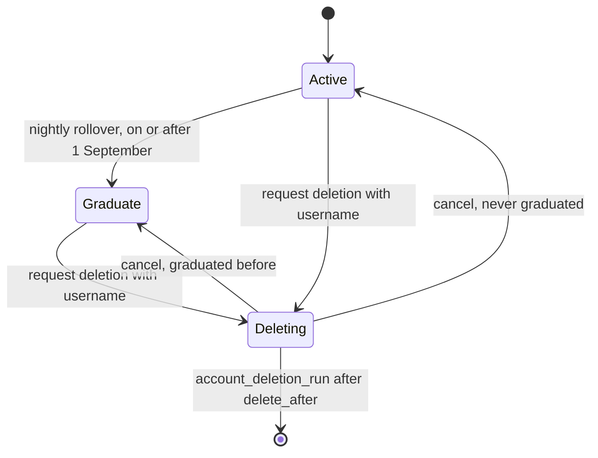
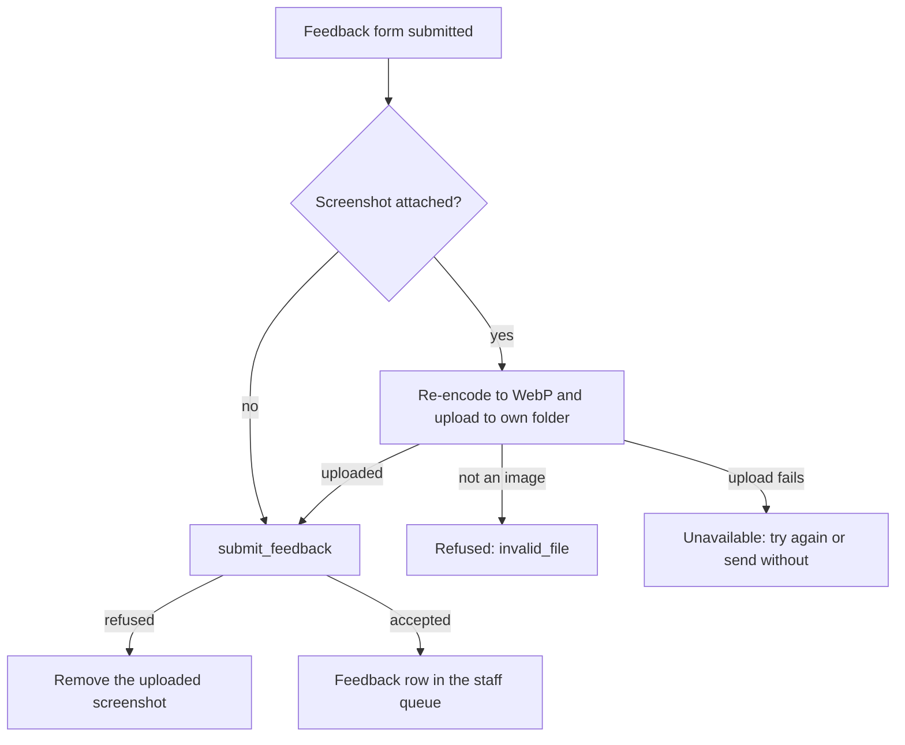

Commit: 1f210f1
Covers: supabase/migrations/20261010000000_student_portal.sql, supabase/migrations/20261011000000_graduate_rule.sql, lib/nav.ts, lib/tours/, lib/tips.ts, lib/feedback/, lib/data/portal.ts, lib/data/me.ts, lib/data/feedback.ts, lib/actions/learn.ts, lib/actions/account.ts, lib/actions/feedback.ts, lib/actions/ops/feedback.ts, lib/actions/ops/batches.ts, components/shell/ (except restriction-banner.tsx), components/tour/, components/learn/, components/home/, components/feedback/, components/account/, components/ops/feedback-forms.tsx, app/(app)/layout.tsx, app/(app)/error.tsx, app/(app)/loading.tsx, app/(app)/me/ (page, loading, work/), app/(app)/settings/ (page, privacy/, account/), app/(app)/feedback/, app/(app)/ops/feedback/, app/(app)/ops/graduation/

# Student portal

## Purpose

The signed-in student's space: the five-area shell with live nav counts, the Home progress card (next step, to-do count and a getting-started checklist), the Me hub with My work, the privacy centre, account deletion with a 14-day cooling-off, the learning layer (guided tour and first-visit tips), the feedback centre with staff triage, and the graduate state [src: components/shell/app-shell.tsx#AppShell] [src: supabase/migrations/20261010000000_student_portal.sql#account_status].

A student becomes a graduate on 1 September of their graduation year, for every university, at the nightly rollover. A university can set its own final-year batch as an exception [src: supabase/migrations/20261011000000_graduate_rule.sql#graduates.rule] [src: supabase/migrations/20261011000000_graduate_rule.sql#private.graduate_rollover]. Graduates can no longer post to the University Feed or join university-only ventures, because triggers refuse those writes [src: supabase/migrations/20261010000000_student_portal.sql#private.graduate_post_guard] [src: supabase/migrations/20261010000000_student_portal.sql#private.graduate_venture_guard].

The Opportunities hub reads one SQL function, `opportunities(tab)`. The student-portal migration created it as a stub, and the recruiter migration defines the filled version [src: supabase/migrations/20261010000000_student_portal.sql#private.opportunities] [src: supabase/migrations/20261015000000_recruiter_jobs.sql#create or replace function private.opportunities]. Teacher and organisation pages are in [faculty](faculty.md) and recruiting; the sign-in gate is in auth-and-rls; notification delivery is in notifications-and-email.

Generated schema: [student_portal](../reference/schema/student_portal.md), [graduate_rule](../reference/schema/graduate_rule.md).

## Data model

- `profiles.status`: `active`, `graduate` or `deleting`, with `graduated_at` and `delete_after`. A check ties `deleting` to a deletion date. The client never writes these columns [src: supabase/migrations/20261010000000_student_portal.sql#profiles_deleting_has_date] [src: supabase/migrations/20261010000000_student_portal.sql#comment on column public.profiles.status].
- `universities.final_year_batch`: the optional exception year. Null for almost every university [src: supabase/migrations/20261011000000_graduate_rule.sql#comment on column public.universities.final_year_batch].
- `ui_state`: per-user key and value. Only `progress_card_dismissed_on` and `checklist_dismissed` are accepted [src: supabase/migrations/20261010000000_student_portal.sql#create table public.ui_state] [src: supabase/migrations/20261010000000_student_portal.sql#private.set_ui_state].
- `tour_progress`: one row per user and tour, with step, completed and skipped times. A row means the tour has started [src: supabase/migrations/20261010000000_student_portal.sql#create table public.tour_progress].
- `tips_seen`: one row per user and dismissed tip [src: supabase/migrations/20261010000000_student_portal.sql#create table public.tips_seen].
- `feedback`: type, body, screenshot path, page, device, app version, status, staff reply, claim and reply times. The screenshot sits in the private `feedback` bucket [src: supabase/migrations/20261010000000_student_portal.sql#create table public.feedback] [src: supabase/migrations/20261010000000_student_portal.sql#values ('feedback', 'feedback', false, 5242880, array['image/webp'])].
- `platform_config` key `graduates.rule` (month 9, day 1) [src: supabase/migrations/20261011000000_graduate_rule.sql#insert into public.platform_config (key, version, value, reason)].
- Notification types `deletion_requested`, `deletion_cancelled` and `feedback_update` [src: supabase/migrations/20261010000000_student_portal.sql#deletion_requested].

Nothing stores the badge counts, the to-do count, the next step or the checklist. Each is computed on request [src: supabase/migrations/20261010000000_student_portal.sql#private.getting_started].

## Flows

### 1. The shell and the nav

The root layout of the signed-in area loads the user and tour state, then renders `AppShell` [src: app/(app)/layout.tsx#AppLayout] [src: app/(app)/layout.tsx#getTourState]. `AppShell` gives the student shell only to an onboarded student who is not deleting. Onboarding, the agreement, the staff console, and every other role keep the plain header [src: components/shell/app-shell.tsx#AppHeader] [src: components/shell/app-shell.tsx#user.status === "deleting"].

The shell reads one config, `lib/nav.ts`. `PRIMARY_NAV` holds the five areas (Home, Opportunities, Ventures, Chat, Me) and `SECONDARY_NAV` the rest [src: lib/nav.ts#PRIMARY_NAV] [src: lib/nav.ts#SECONDARY_NAV]. The same items drive `Sidebar` (desktop, and a rail on tablets), `BottomTabs` (phones) and the tooltips [src: components/shell/sidebar.tsx#Sidebar] [src: components/shell/bottom-tabs.tsx#BottomTabs]. `TopBar` carries Explore, Feedback and the notification bell on phones and tablets [src: components/shell/top-bar.tsx#TopBar]. `isActive` treats Feedback as its own item, so it is not also active under Me [src: lib/nav.ts#isActive].

Badge counts come from one `nav_badges` call. `NavBadgesSync` fills a small external store, not a React context, so a count arriving late cannot re-hydrate the page [src: components/shell/nav-badges.tsx#NavBadgesSync] [src: components/shell/nav-badges.tsx#useNavBadges]. The call refreshes on every navigation, on window focus, on any change to the user's notifications, and on a chat message from someone else (after 1.5 seconds) [src: components/shell/nav-badges.tsx#postgres_changes]. The store is cleared when the user changes [src: components/shell/nav-badges.tsx#useEffect]. `nav_badges` returns chat, notification, friend, venture (pending applications to own ventures plus pending invites) and opportunity counts [src: supabase/migrations/20261010000000_student_portal.sql#private.nav_badges]. Counts above 99 show as "99+" [src: lib/nav.ts#badgeLabel].

### 2. The Home progress card

`/feed` renders `ProgressCard` from `getProgressCard`. The read fans out to four sources: `next_best_action`, `todo_counts`, `getting_started` and `ui_state`, plus the ranking score [src: lib/data/portal.ts#getProgressCard]. The card hides for the day when `progress_card_dismissed_on` equals today in Pakistan time [src: lib/data/portal.ts#dismissed]. A failing `next_best_action` throws and the page shows its error state [src: lib/data/portal.ts#next_best_action:].

`next_best_action` takes the first unmet requirement of the next tier from the ranking's requirement list, in a fixed order, and returns a template: join a venture, log a contribution, get it confirmed, earn points, reach a number of active ventures, gather endorsements, complete a venture, or reach a level-3 skill. If nothing is unmet, it returns the pending to-do count, or a generic step [src: supabase/migrations/20261010000000_student_portal.sql#private.next_best_action]. The step is text the database writes, never a model's output. The PRD's fixed rule list differs from this (pending requests sit in the to-do count instead); see [prd-mismatches](../reference/prd-mismatches.md) row 49.

`todo_counts` totals pending friend requests, pending applications to own ventures, pending invites, contributions teammates logged that the student has not confirmed, and completed ventures where the student has not endorsed anyone [src: supabase/migrations/20261010000000_student_portal.sql#private.todo_counts]. `ProgressCard` renders each count as a line [src: components/home/progress-card.tsx#todoLine].

`getting_started` lists six items: finish the profile (bio and photo), connect GitHub, reach an L2 skill, join or start a venture, get a first endorsement, and build a CV. Points come from the ranking formula, and only three items have them [src: supabase/migrations/20261010000000_student_portal.sql#private.getting_started]. The checklist hides when done, and it can be dismissed for good [src: components/home/progress-card.tsx#showChecklist] [src: components/home/progress-card-controls.tsx#DismissChecklistButton].

Dismissing the card calls `set_ui_state`, which accepts two keys and values of up to 100 characters [src: lib/actions/learn.ts#dismissProgressCard] [src: supabase/migrations/20261010000000_student_portal.sql#unknown setting].

### 3. The guided tour

`TourHost` starts the student tour by itself the first time the student lands on `/feed`. It starts only when at least one anchor is on screen. Anchors are `data-tour` ids on nav items. Steps whose anchor is hidden, such as Leaderboard on a phone, are skipped [src: components/tour/tour-host.tsx#TourHost] [src: components/tour/tour-host.tsx#visibleSteps] [src: lib/tours/student.ts#studentTour]. A `?tour=1` query forces a start from step one, and the replay button sends the student there [src: components/tour/tour-host.tsx#forced] [src: lib/actions/learn.ts#replayTour]. Replay deletes the tour row and redirects to `/feed?tour=1` [src: lib/actions/learn.ts#restart_tour].

Each Next, Back, Skip or Done saves the step and an outcome. Finishing or skipping sets `completed_at` or `skipped_at`, after which the tour does not start by itself [src: components/tour/tour-host.tsx#finish] [src: lib/actions/learn.ts#saveTourProgress] [src: supabase/migrations/20261010000000_student_portal.sql#private.save_tour]. The tour host calls `saveTourProgress` without awaiting it, so a failed save is silent [src: components/tour/tour-host.tsx#void saveTourProgress].

The other three tours (faculty, recruiter and university admin) are defined with no steps [src: lib/tours/faculty.ts#facultyTour] [src: lib/tours/recruiter.ts#recruiterTour] [src: lib/tours/uni-admin.ts#uniadminTour].

### 4. First-visit tips

A tip shows on a page until its id is in `tips_seen`. The page renders `FirstVisitTip`, which checks the table and renders `TipCard` [src: components/learn/first-visit-tip.tsx#FirstVisitTip] [src: lib/data/portal.ts#tipSeen] [src: components/learn/tip-card.tsx#TipCard]. Dismissing calls `dismissTip`, which `see_tip` checks against the five ids [src: lib/actions/learn.ts#dismissTip] [src: supabase/migrations/20261010000000_student_portal.sql#private.see_tip]. The card hides before the server answers, and a failed save is not reported [src: components/learn/tip-card.tsx#setGone]. The copy is in `TIPS` [src: lib/tips.ts#TIPS].

### 5. The Me hub and My work

`/me` lists the areas: profile, skills, my work, CV, score, credentials, leaderboard, friends, feedback and settings [src: app/(app)/me/page.tsx#MePage]. `/me/work` has five tabs: ventures, contributions, reviews, endorsements (given and received) and credentials [src: app/(app)/me/work/page.tsx#MyWorkPage]. Contributions read `contributions_with_status` for the student's own rows, newest first, up to 50 [src: lib/data/me.ts#getMyContributions]. Endorsements given read `endorsements` for the student as endorser [src: lib/data/me.ts#getEndorsementsGiven]. The reviews tab is a fixed empty state, and it reads nothing [src: app/(app)/me/work/page.tsx#Reviews].

`/settings` lists the account areas and the replay button. Recruiter accounts see only four of them [src: app/(app)/settings/page.tsx#recruiterSections]. Student Pro billing appears only for students [src: app/(app)/settings/page.tsx#user?.role === "student"].

### 6. The privacy centre

`/settings/privacy` is the one place that shows who sees the student. The page reads each setting where it lives: profile visibility and the recruiter switch and looking-for line from `profiles`, CV visibility and active share links from `cv_settings` and `cv_share_links`, company views, blocked companies and blocked people from their helpers, the leaderboard switch, and the record viewers [src: app/(app)/settings/privacy/page.tsx#PrivacyCentrePage] [src: app/(app)/settings/privacy/page.tsx#getBlockedCompanies] [src: app/(app)/settings/privacy/page.tsx#getMyRecordViewers]. Where a control has its own page, the centre shows the current value and links there. Unblocking and the leaderboard switch are controls on this page [src: app/(app)/settings/privacy/page.tsx#ConfirmAction] [src: app/(app)/settings/privacy/page.tsx#LeaderboardToggle]. The first-visit tip for privacy shows here [src: app/(app)/settings/privacy/page.tsx#FirstVisitTip].

### 7. Account deletion

The delete page shows what deleting removes and the cooling-off [src: app/(app)/settings/account/delete/page.tsx#DeleteAccountPage]. The form asks the student to type their username. The server compares the typed value with the stored username, and never with anything the browser sends [src: lib/actions/account.ts#requestAccountDeletion] [src: lib/actions/account.ts#confirmation_mismatch]. Staff accounts are refused [src: supabase/migrations/20261010000000_student_portal.sql#staff accounts are removed by a super admin]. The account becomes `deleting` with `delete_after` 14 days ahead, and the student is notified [src: supabase/migrations/20261010000000_student_portal.sql#private.request_account_deletion].

While deleting, the shell keeps the plain header and the gate keeps the student on the cancel page [src: components/shell/app-shell.tsx#user.status === "deleting"] [src: app/(app)/settings/account/delete/page.tsx#pending]. Cancelling restores the previous status and notifies the student [src: supabase/migrations/20261010000000_student_portal.sql#private.cancel_account_deletion]. Inside `notify`, nothing is written for a deleting account as the recipient, and its own actions are recorded without an actor [src: supabase/migrations/20261010000000_student_portal.sql#skilient.deleting_user].

The hourly `account-deletion` job calls `account_deletion_run`, which takes up to 20 due accounts and skips any row another run has locked [src: supabase/migrations/20261010000000_student_portal.sql#private.account_deletion_run]. `delete_account` hands each owned venture to the longest-standing other member, or deletes it when no one else is on the team. It queues storage cleanup for avatars, credentials, CV exports, feedback screenshots and the student's chat media. Then it deletes the auth user, and the cascade removes the rest [src: supabase/migrations/20261010000000_student_portal.sql#private.delete_account]. A failing account is logged with a warning and retried the next hour [src: supabase/migrations/20261010000000_student_portal.sql#raise warning 'account deletion failed].

### 8. Graduation

The nightly `graduate-rollover` job calls `graduate_rollover`, which sets `graduate` on active students whose graduation year is at or before the newest year already past 1 September in Pakistan time, or the university's exception year when one is set [src: supabase/migrations/20261011000000_graduate_rule.sql#private.graduate_rollover] [src: supabase/migrations/20261010000000_student_portal.sql#graduate-rollover]. The gate reads the status, so a graduate's account state is in `my_gate_state` [src: supabase/migrations/20261010000000_student_portal.sql#public.my_gate_state]. Leaderboards keep graduates on the global board, and on a university board for 12 months after graduating [src: supabase/migrations/20261010000000_student_portal.sql#interval '12 months']. Cancelling a deletion returns a graduate to graduate [src: supabase/migrations/20261010000000_student_portal.sql#graduated_at is not null].

Accounts staff set an exception with `setFinalYearBatch`, which requires a reason of 3 to 500 characters and writes an audit row [src: lib/actions/ops/batches.ts#setFinalYearBatch] [src: supabase/migrations/20261010000000_student_portal.sql#university.final_year_batch]. `/ops/graduation` lists every university's students and graduates, and the exceptions [src: app/(app)/ops/graduation/page.tsx#OpsBatchesPage] [src: lib/data/feedback.ts#getBatches].

The 12-month leaderboard rule from the 2026-10-02 decision is not built: graduates stay on their university board. See [prd-mismatches](../reference/prd-mismatches.md) row 50.

### 9. Feedback

`FeedbackForm` sends the type, the text, the page path and an optional screenshot. The page is the `from` query, else the referrer, else the current page [src: components/feedback/feedback-form.tsx#FeedbackForm]. The browser shrinks the screenshot first [src: components/feedback/feedback-form.tsx#downscaleForUpload].

`submitFeedback` re-encodes the image, which strips EXIF and GPS, and stores it at `<user>/<uuid>.webp` [src: lib/actions/feedback.ts#reencodeToFit] [src: lib/actions/feedback.ts#path]. The browser's user-agent and the app version are sent as the device and version, and the page path is cut at any query or hash [src: lib/actions/feedback.ts#cleanPage]. `submit_feedback` checks the body length, allows 10 submissions a day, and accepts a screenshot only when it is the caller's own, exists and is unused [src: supabase/migrations/20261010000000_student_portal.sql#private.submit_feedback]. Storage policies allow inserts into one's own folder, up to 30 files, and deletes of unused files only [src: supabase/migrations/20261010000000_student_portal.sql#private.feedback_upload_allowed] [src: supabase/migrations/20261010000000_student_portal.sql#feedback_files_delete].

Staff with any role (`require_any_staff`, two-factor on) see the open queue, which is received, reviewing or planned, or the closed list, which is shipped or won't do [src: supabase/migrations/20261010000000_student_portal.sql#private.feedback_queue]. A claim is required before a reply, and every claim and reply is audited [src: lib/actions/ops/feedback.ts#respondFeedback] [src: supabase/migrations/20261010000000_student_portal.sql#private.respond_feedback]. A reply or status change notifies the student [src: supabase/migrations/20261010000000_student_portal.sql#feedback_update]. The staff view gets the screenshot through a link that lasts 300 seconds [src: lib/data/feedback.ts#createSignedUrl].

`/feedback` shows the student's own submissions with their status steps, and any reply [src: app/(app)/feedback/page.tsx#Timeline] [src: lib/data/feedback.ts#getMyFeedback].

### 10. Opportunities reads

`opportunities(tab)` checks the tab name against seven tabs (`for_you`, `jobs`, `contact_requests`, `applications`, `competitions`, `job_fairs`, `ideas`) and returns that tab's rows [src: supabase/migrations/20261015000000_recruiter_jobs.sql#create or replace function private.opportunities]. "For you" and "Jobs" order by how many of a job's skill requirements the student meets at level 2 or above, and sponsorship is never an input. pgTAP 39 checks that the function text has no sponsorship ordering [src: supabase/migrations/20261015000000_recruiter_jobs.sql#jsonb_array_elements(j.min_skill_levels)] [src: supabase/tests/39_student_portal.test.sql#prosrc !~* 'order by]. Sponsored posts carry a label only on the Jobs tab [src: lib/data/portal.ts#sponsored]. `getOpportunities` throws on an error [src: lib/data/portal.ts#opportunities:].

## Entry points

| Caller | Action or read | SQL | Who may call |
|---|---|---|---|
| Shell | `nav_badges` read (`NavBadgesSync`) | `nav_badges` | Signed-in student |
| `/feed` card | `getProgressCard` | `next_best_action`, `todo_counts`, `getting_started` | The student, for their own data |
| Card dismiss | `dismissProgressCard`, `dismissChecklist` | `set_ui_state` | The student |
| Tour | `saveTourProgress`, `replayTour` | `save_tour`, `restart_tour` | The student |
| Tip card | `dismissTip` | `see_tip` | The student |
| Account deletion | `requestAccountDeletion`, `cancelAccountDeletion` | `request_account_deletion`, `cancel_account_deletion` | The student; staff refused |
| `/feedback` | `submitFeedback` | `submit_feedback` | The student, 10 a day |
| `/ops/feedback` | `claimFeedback`, `respondFeedback` | `claim_feedback`, `respond_feedback` | Any staff role, two-factor |
| `/ops/graduation` | `setFinalYearBatch` | `ops_set_final_year_batch` | Accounts staff, two-factor |

Jobs: `graduate-rollover` (daily, 00:10 Pakistan time) and `account-deletion` (hourly) [src: supabase/migrations/20261010000000_student_portal.sql#account-deletion]. Pages: `/me`, `/me/work`, `/settings`, `/settings/privacy`, `/settings/account/delete`, `/feedback`, `/ops/feedback`, `/ops/feedback/[id]`, `/ops/graduation`.

## Permissions

- **Own rows only.** `ui_state`, `tour_progress`, `tips_seen`, and `feedback` allow reads of the student's own rows and no client writes. Writes go through functions that call `require_user` [src: supabase/migrations/20261010000000_student_portal.sql#ui_state_read_own] [src: supabase/migrations/20261010000000_student_portal.sql#feedback_read_own].
- **Staff.** Feedback triage needs any staff role on a two-factor session. Claim and respond require the claim, and the batch exception needs accounts staff on two-factor [src: supabase/migrations/20261010000000_student_portal.sql#private.require_any_staff] [src: supabase/migrations/20261010000000_student_portal.sql#private.ops_batches].
- **Screenshots.** The `feedback` bucket is private. Its files are readable by the owner and by staff, and inserted only in the owner's folder [src: supabase/migrations/20261010000000_student_portal.sql#feedback_files_read] [src: supabase/migrations/20261010000000_student_portal.sql#feedback_files_insert].
- **Graduate limits.** Enforced by triggers before insert on posts, venture members and application threads, not by row policies [src: supabase/migrations/20261010000000_student_portal.sql#posts_graduate_guard].
- **Deleting accounts.** Their notifications are not written, and the shell and the gate keep them to the cancel page [src: supabase/migrations/20261010000000_student_portal.sql#private.notify].
- **Public wrappers.** Every `public` wrapper is revoked from `anon` and granted to `authenticated` [src: supabase/migrations/20261010000000_student_portal.sql#revoke all on function].

## Failure modes and logs

- **Refused feedback.** Duplicate or unusable screenshots are refused as "that screenshot isn't available" (22023). The tenth submission in a day is refused as "you've sent 10 today" (54000). An unreadable image is refused as `not_an_image`, and an upload failure is `upload_failed` with the request id [src: lib/actions/feedback.ts#not_an_image] [src: lib/actions/feedback.ts#upload_failed].
- **Deletion.** Staff accounts are refused (55000). A wrong username is refused and logged as `confirmation_mismatch`. Cancelling with nothing pending is refused (55000) [src: supabase/migrations/20261010000000_student_portal.sql#no deletion is pending].
- **Deletion job.** One failing account does not stop the batch. Its error is logged by Postgres as a warning and it is retried hourly [src: supabase/migrations/20261010000000_student_portal.sql#raise warning 'account deletion failed].
- **Silent client writes.** The tour and the tip card do not report a failed save, so the state can differ from the server until the next visit [src: components/tour/tour-host.tsx#void saveTourProgress] [src: components/learn/tip-card.tsx#setGone].
- **Badges.** A dropped Realtime subscription leaves counts stale until the next navigation or focus [src: components/shell/nav-badges.tsx#onFocus].
- **Read errors.** `getProgressCard` throws on a `next_best_action` error [src: lib/data/portal.ts#next_best_action:]. `getMyFeedback`, `getFeedbackQueue` and `getBatches` throw on RPC errors [src: lib/data/feedback.ts#my_feedback:] [src: lib/data/feedback.ts#ops_batches:].
- **Logs.** Each action writes one log line with its name: `learn.save_tour`, `account.request_deletion`, `feedback.submit`, `ops.feedback_respond`, `ops.final_year_batch` and others [src: lib/actions/learn.ts#learn.save_tour] [src: lib/actions/account.ts#account.request_deletion] [src: lib/actions/feedback.ts#feedback.submit] [src: lib/actions/ops/feedback.ts#ops.feedback_respond] [src: lib/actions/ops/batches.ts#ops.final_year_batch].

## Tests

- pgTAP: `supabase/tests/39_student_portal.test.sql` covers the account states and the graduate rules, deletion and cancellation, tours, tips, the progress reads, the Opportunities reads, and the feedback centre and its triage.
- Unit: `tests/unit/portal.test.ts` covers the nav order, the active item, the 99+ cap, the tour's anchors and ids, the tip ids and copy, and the Pakistan-time date.
- E2E: `tests/e2e/student-portal.spec.ts`. The CSP sweep also visits the student routes listed in `tests/e2e/sweep-routes.ts`.

## Change guide

**1. Add a nav item.** Add it to `PRIMARY_NAV` or `SECONDARY_NAV` with a description and a match list, and it appears in the sidebar, the rail, the tab bar and the tooltips [src: lib/nav.ts#NavItem]. If it has a count, add a `BadgeKey`, a field in `nav_badges` and the zero default in `NO_BADGES` [src: lib/nav.ts#NO_BADGES] [src: supabase/migrations/20261010000000_student_portal.sql#private.nav_badges]. Add a tour step with the same `data-tour` anchor in `lib/tours/student.ts`, which the unit test checks. Add the route to the sweep list.

**2. Add a feedback type or status.** Add the value to the enum in a migration. Then update `FEEDBACK_TYPES` or `FEEDBACK_STATUSES`, the labels and `STATUS_STEPS` in `lib/feedback/constants.ts`, and the status list in `respondFeedback`. Then decide which queue the status belongs to in `feedback_queue` [src: lib/feedback/constants.ts#STATUS_STEPS] [src: lib/actions/ops/feedback.ts#respondFeedback] [src: supabase/migrations/20261010000000_student_portal.sql#private.feedback_queue].

**3. Add a checklist item or a next step.** A checklist item is one more entry in `getting_started`, with a `done` test and an optional points value from the ranking formula. The card renders the list as it arrives [src: supabase/migrations/20261010000000_student_portal.sql#private.getting_started] [src: components/home/progress-card.tsx#checklist.items]. A new next step is a branch in `next_best_action`. Its `key` must be the requirement key the ranking returns.

## Answers to the planned questions

1. **How is the navigation built for each role and screen size from one config?** `lib/nav.ts` is the one config. The student shell renders it: the sidebar from the medium breakpoint up, the tab bar below it, and the top bar below the large breakpoint. Other roles keep the plain header, and each has its own shell in its portal doc [src: components/shell/app-shell.tsx#AppShell] [src: components/shell/sidebar.tsx#Sidebar] [src: components/shell/bottom-tabs.tsx#BottomTabs].
2. **How are badge counts computed and kept live?** `nav_badges` counts them in one call. The store refreshes on navigation, focus, notification changes and incoming chat messages [src: supabase/migrations/20261010000000_student_portal.sql#private.nav_badges] [src: components/shell/nav-badges.tsx#NavBadgesSync].
3. **How does the progress card choose the next step and the to-do count?** `next_best_action` takes the first unmet requirement of the next tier, in a fixed order, and `todo_counts` counts what waits on the student [src: supabase/migrations/20261010000000_student_portal.sql#private.next_best_action] [src: supabase/migrations/20261010000000_student_portal.sql#private.todo_counts].
4. **How do tours and first-visit tips start, persist and replay?** The tour starts on Home when an anchor is on screen, saves each step in `tour_progress`, and replays by deleting that row. Tips are rows in `tips_seen` [src: components/tour/tour-host.tsx#TourHost] [src: supabase/migrations/20261010000000_student_portal.sql#private.restart_tour].
5. **What does account deletion do, on what timeline, and what does the gate allow meanwhile?** It starts a 14-day cooling-off, after which the hourly job hands owned ventures to other members (or deletes them) and removes the account. Meanwhile the student sees only the cancel page and can cancel [src: supabase/migrations/20261010000000_student_portal.sql#private.delete_account] [src: app/(app)/settings/account/delete/page.tsx#DeleteAccountPage].
6. **How does graduation work, and what changes for a graduate?** The platform rule sets graduates on 1 September of the graduation year, with a per-university exception. A graduate posts globally only and cannot join university-only ventures. Leaderboards drop them from the university board after 12 months [src: supabase/migrations/20261011000000_graduate_rule.sql#private.graduate_rollover] [src: supabase/migrations/20261010000000_student_portal.sql#private.graduate_post_guard].
7. **How is feedback submitted with files, and how do staff answer it?** The screenshot is re-encoded and uploaded to the student's folder, then attached by `submit_feedback`. Staff claim the item, set a status and reply, and the student is notified [src: lib/actions/feedback.ts#submitFeedback] [src: supabase/migrations/20261010000000_student_portal.sql#private.respond_feedback].
8. **What does the privacy centre control, and where is each setting read?** Section 6 lists each setting and the table or helper it reads from [src: app/(app)/settings/privacy/page.tsx#PrivacyCentrePage].
