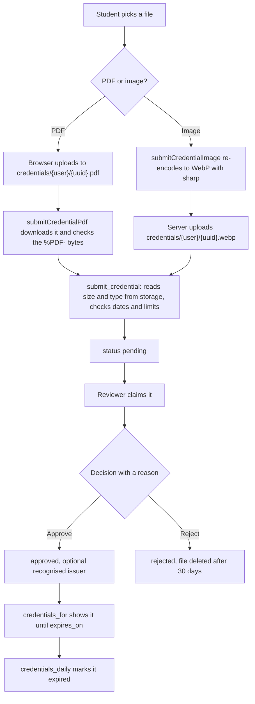
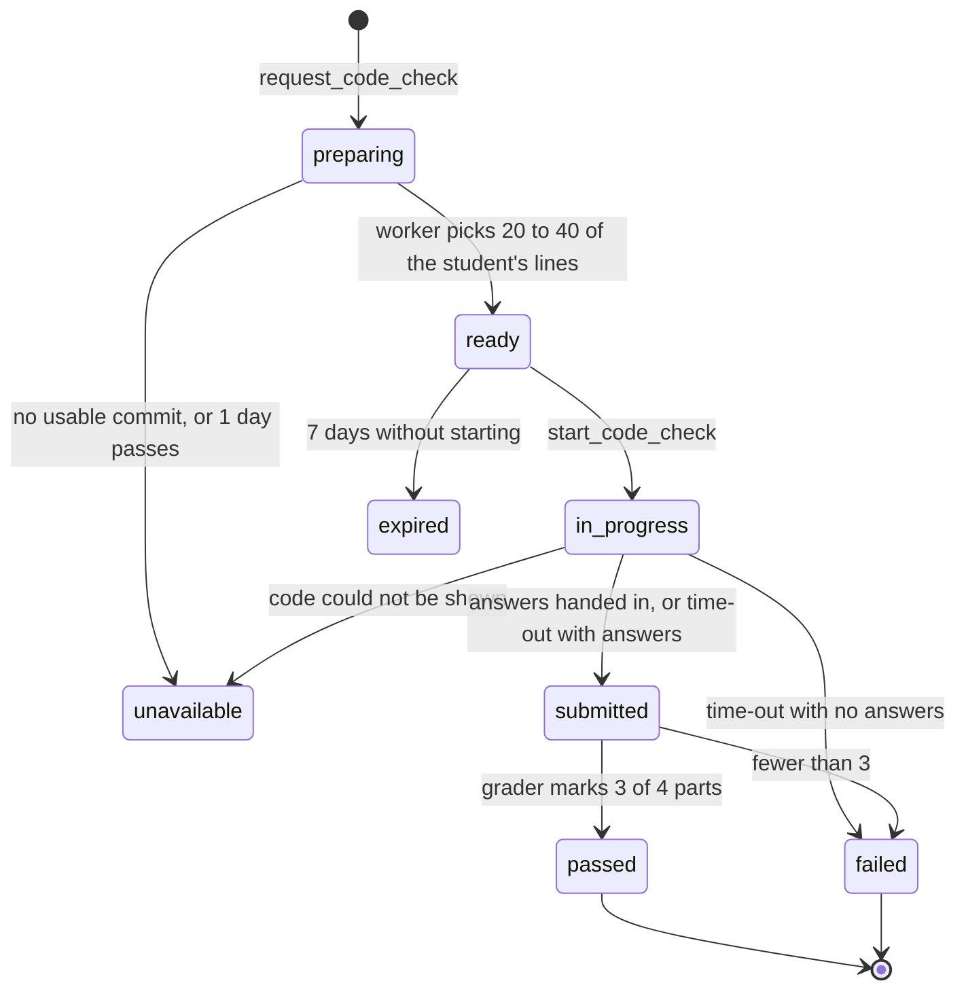

Commit: 64cef52
Covers: supabase/migrations/20261001000000_endorsements.sql, supabase/migrations/20261003000000_credentials.sql, supabase/migrations/20261004000000_code_checks.sql, lib/actions/endorsements.ts, lib/actions/credentials.ts, lib/actions/code-checks.ts, lib/actions/ops/trust.ts, lib/data/endorsements.ts, lib/data/credentials.ts, lib/data/code-checks.ts, lib/data/ops-trust.ts, lib/credentials/, lib/code-checks/, components/endorsements/, components/credentials/, components/code-checks/, components/ops/trust-forms.tsx, components/ops/code-check-grade-form.tsx, app/(app)/me/credentials/, app/(app)/me/code-checks/, app/(app)/ops/evidence/ (except ranking), supabase/functions/code-check/, supabase/functions/_shared/codecheck/

# Trust evidence

## Purpose

Three kinds of proof sit beside GitHub commits: endorsements from teammates (and teachers), certificates a staff reviewer approves, and a ten-minute code check on a student's own code that a human grades.
Each is written only by a SQL function that re-checks the caller, the tables grant `select` only, and every staff decision is claimed first and recorded in `ops_audit_log` with a reason.
Endorsements and passed code checks feed the L4 level and the score; approved credentials feed the profile, the CV and the score; none of them calls an AI service.

Other docs this one leans on: how levels are computed from commits is in [github-skills](github-skills.md); how endorsements, credentials and checks are weighed in the score is in [ranking](ranking.md); the auth gate that keeps `/ops` on two-factor is in [auth-and-rls](auth-and-rls.md); notification delivery is in [notifications-and-email](notifications-and-email.md); the venture a team endorses inside is in [ventures](ventures.md). Teacher endorsements and teacher grading are summarised here only where they change the rules; the teacher portal has its own doc.

## Data model

Generated schema: [endorsements](../reference/schema/endorsements.md), [credentials](../reference/schema/credentials.md), [code_checks](../reference/schema/code_checks.md).

| Table | One row is | Notes |
|---|---|---|
| `endorsements` | One skill vouched for by one person on one venture | Unique on endorser, endorsee, skill and venture; `evidence_id` points at one of the endorsee's original contribution entries; note 1 to 280 characters; `hidden` and `hidden_at` are set together [src: supabase/migrations/20261001000000_endorsements.sql#create table public.endorsements] [src: supabase/migrations/20261001000000_endorsements.sql#check (hidden = (hidden_at is not null))]. The teacher migration adds `endorser_kind` (`peer` or `teacher`) [src: supabase/migrations/20261012000000_teacher_portal.sql#add column endorser_kind text not null default 'peer' check (endorser_kind in ('peer', 'teacher'))] |
| `user_skills.peer_verified` | A flag on the skill row | Kept by triggers, read by the skill chip [src: supabase/migrations/20261001000000_endorsements.sql#alter table public.user_skills add column peer_verified boolean not null default false] |
| `credentials` | One certificate | Status `pending`, `approved`, `rejected`, `expired`; the file path must be `{user}/{uuid}.pdf` or `.webp`; `file_bytes` and `file_type` come from storage; `recognised_issuer_id` may be set only on approved or expired rows; `reviewed_at` is null exactly while pending [src: supabase/migrations/20261003000000_credentials.sql#create table public.credentials] [src: supabase/migrations/20261003000000_credentials.sql#check ((status = 'pending') = (reviewed_at is null))] |
| `recognised_issuers` | An issuer whose certificates count 1.5 times | Seeded with 17 issuers; readable by any signed-in user; no screen edits it [src: supabase/migrations/20261003000000_credentials.sql#create table public.recognised_issuers] [src: supabase/migrations/20261003000000_credentials.sql#create policy recognised_issuers_read] |
| `code_checks` | One attempt on one skill | Holds where the snippet is (`repo_id`, `sha`, `path`, `start_line`, `end_line`), never the code; `answers`, `rubric`, `feedback`; timestamps for each step; `claimed_by` and `grader_id` [src: supabase/migrations/20261004000000_code_checks.sql#create table public.code_checks] [src: supabase/migrations/20261004000000_code_checks.sql#Where the snippet is. The code itself is never stored.]. The teacher migration adds `due_at` and `routed_to_staff_at` [src: supabase/migrations/20261012000000_teacher_portal.sql#add column due_at timestamptz,] |
| `code_check_prompts` | A change request ("how would you change this for...") | Per skill or per category; 48 are seeded by the migration; the table grants nothing to `authenticated` [src: supabase/migrations/20261004000000_code_checks.sql#create table public.code_check_prompts] [src: supabase/migrations/20261004000000_code_checks.sql#revoke all on table public.code_check_prompts from anon, authenticated;] |

Status enum for code checks: `preparing`, `ready`, `in_progress`, `submitted`, `passed`, `failed`, `unavailable`, `expired` [src: supabase/migrations/20261004000000_code_checks.sql#create type public.code_check_status as enum]. At most one check per user and skill is open (`preparing`, `ready`, `in_progress` or `submitted`) [src: supabase/migrations/20261004000000_code_checks.sql#create unique index code_checks_one_open_idx on public.code_checks (user_id, skill_id)].

Limits live in `platform_config` and have rows in `config_keys`, so `/ops/config` edits them with a schema check:

| Key | Value at launch | Used by |
|---|---|---|
| `endorsements.limits` | 5 per teammate per venture, 20 per month, 2 endorsers for peer-verified | `endorse`, `refresh_peer_verified`, `l4_skills` [src: supabase/migrations/20261001000000_endorsements.sql#('endorsements.limits', 1,] |
| `credentials.limits` | PDF and file size 5 MB, 20 active, 5 pending, rejected files kept 30 days | `submit_credential`, `credentials_daily` [src: supabase/migrations/20261003000000_credentials.sql#('credentials.limits', 1,] |
| `code_check.limits` | 10 minutes, 30 s grace, 30-day retry, 72 h due, 7 days ready, 2,000-character answers, 20 to 40 lines, 3 of 4 to pass | the code-check functions [src: supabase/migrations/20261004000000_code_checks.sql#('code_check.limits', 1,] |
| `storage.quota_bytes` | 1 GiB | `storage_usage` [src: supabase/migrations/20261003000000_credentials.sql#('storage.quota_bytes', 1, '1073741824'] |

[src: supabase/migrations/20261029000000_config_metrics.sql#('endorsements.limits', 'Endorsement limits (PRD 5.16).')]

## Flows

### 1. Endorsing a teammate

1. The venture Team tab opens the endorse sheet. `getEndorseOptions` calls `endorse_options`, which returns each teammate (except blocked ones) with the skills they can be endorsed for, what the caller already gave, the teammate's entries with the skills each shows, and how many endorsements are left this month [src: lib/data/endorsements.ts#getEndorseOptions] [src: supabase/migrations/20261002000000_skill_levels.sql#create or replace function private.endorse_options]. It returns nothing unless the caller is a member and the venture is `in_progress` or `completed` [src: supabase/migrations/20261002000000_skill_levels.sql#v.status not in ('in_progress', 'completed') then].
2. `endorse` (server action) validates with Zod (1 to 5 distinct skills, a note of at most 280 characters), refuses a self-endorsement, calls `endorse` in SQL, and treats a returned count different from the number sent as `unavailable` [src: lib/actions/endorsements.ts#const endorseInput = z.object] [src: lib/actions/endorsements.ts#if (result.data !== v.items.length)].
3. The SQL function `private.endorse` (final definition in the skill-levels migration) takes an advisory lock per endorser so parallel calls cannot slip past a limit, then checks in order: not self (`42501`), venture exists and caller is a member (`P0002`), endorsee is a member and not blocked with the caller (`P0002`), venture status (`55000`), a non-empty list of distinct skills (`22023`), a note of at most 280 characters (`23514`), at most 5 per teammate per venture (`23514`), at most 20 given since the start of the Pakistan calendar month (`23514`) [src: supabase/migrations/20261002000000_skill_levels.sql#perform pg_advisory_xact_lock(hashtextextended('endorse:' || v_me::text, 0));] [src: supabase/migrations/20261001000000_endorsements.sql#create function private.pk_month_start()].
4. For each skill it requires the skill to be in the venture's tags or one the endorsee holds at L1 or above (`endorsable_skill`), refuses a duplicate with `23505`, and, when evidence is named, requires an original entry of the endorsee in that venture that actually shows the skill (`entry_shows_skill`) [src: supabase/migrations/20261001000000_endorsements.sql#create function private.endorsable_skill] [src: supabase/migrations/20261002000000_skill_levels.sql#raise exception 'that entry doesn''t show %', (select name from public.skills where id = v_skill)].
5. After the inserts it sends one `endorsement_received` notification per call, naming all the skills [src: supabase/migrations/20261002000000_skill_levels.sql#perform private.notify(p_endorsee, v_me, 'endorsement_received', 'endorsement', v_first,].
6. Statement-level triggers on `endorsements` then refresh `peer_verified` for each endorsee and recompute their skill levels (flow 2).

When a venture is set to `completed`, a trigger notifies every member (owner included) with `endorse_teammates` [src: supabase/migrations/20261001000000_endorsements.sql#create trigger ventures_prompt_endorsements after update of status on public.ventures].

Teacher endorsements use a separate function, `teacher_endorse`: only a teacher who reviewed or supervised the venture, only skills tagged on the venture, with the limits in `teacher.limits` (5 per student per venture, 40 a month) and `endorser_kind = 'teacher'` [src: supabase/migrations/20261012000000_teacher_portal.sql#create function private.teacher_may_endorse] [src: supabase/migrations/20261012000000_teacher_portal.sql#create function private.teacher_endorse].

Hiding: the endorsee calls `hide_endorsement`; the update only matches rows where they are the endorsee, so anyone else gets `P0002` (`not_found`) [src: supabase/migrations/20261001000000_endorsements.sql#create function private.hide_endorsement] [src: lib/actions/endorsements.ts#export async function hideEndorsement]. Nobody edits an endorsement: no update grant exists.

Reading: `endorsements_for(user)` returns a profile's endorsements to anyone who may see that profile. The endorser's name is always shown; their username and photo only where the viewer may see their profile; the venture only where the viewer may see the venture; blocked endorsers are left out; hidden endorsements are shown only to the endorsee [src: supabase/migrations/20261012000000_teacher_portal.sql#create function private.endorsements_for(p_user uuid)] [src: supabase/migrations/20261001000000_endorsements.sql#and (not e.hidden or p_user = (select auth.uid()))].

### 2. What an endorsement changes

Two separate things come from the same rows, and they differ:

| Effect | Rule | Function |
|---|---|---|
| `peer_verified` chip on the skill | 2 distinct endorsers who are not hidden, or any one teacher endorsement. Evidence is not required | `refresh_peer_verified`, final in the teacher migration [src: supabase/migrations/20261012000000_teacher_portal.sql#create or replace function private.refresh_peer_verified(p_user uuid)] |
| Skill level L4 | An endorsement that names evidence showing the skill: from 2 distinct endorsers, or from one teacher; hidden ones do not count; a competition award counts as one of the endorsers | `l4_skills`, final in the recruiter-jobs migration [src: supabase/migrations/20261015000000_recruiter_jobs.sql#create or replace function private.l4_skills(p_user uuid)] |

`recompute_user_skills` takes the higher of the commit-based level and the best proof level, so a proof can raise a skill but never lowers one [src: supabase/migrations/20261002000000_skill_levels.sql#greatest(coalesce(g.level, 0), coalesce((select max(pr.level) from proofs pr where pr.skill_id = k.skill_id), 0))::smallint as level]. Triggers run it as soon as an endorsement is inserted or its `hidden` flag changes, so hiding or showing an endorsement changes the level at once [src: supabase/migrations/20261002000000_skill_levels.sql#create trigger endorsements_recompute_insert after insert on public.endorsements] [src: supabase/migrations/20261002000000_skill_levels.sql#create trigger endorsements_recompute_update after update on public.endorsements]. A new `user_skills` row picks up its `peer_verified` value on insert [src: supabase/migrations/20261012000000_teacher_portal.sql#create or replace function private.user_skills_peer_verified()]. The full level ladder is in [github-skills](github-skills.md).

The score weighs endorsements in the nightly run: 15 points times the endorser's tier weight (0.5 to 1.5), halved for a mutual pair, zero in an open or upheld ring, hidden ones skipped [src: supabase/migrations/20261005000000_ranking.sql#-- Endorsements: 15 x the endorser's tier weight (from the previous run) x 0.5 when the pair]. See [ranking](ranking.md).

### 3. Credentials: from upload to profile

1. `CredentialForm` decides by file type. A PDF is checked for size in the browser, uploaded straight to the private bucket under the signed-in user's id and a random UUID (Vercel refuses larger request bodies), then `submitCredentialPdf` is called [src: components/credentials/credential-form.tsx#crypto.randomUUID()}.pdf] [src: components/credentials/credential-form.tsx#result = await submitCredentialPdf({ ...text, path });].
2. `submitCredentialPdf` accepts only a path of the form `{userId}/{36 characters}.pdf`, downloads the stored file and requires it to be at most 5 MB and to start with `%PDF-`; otherwise it deletes the upload and answers `invalid_file` [src: lib/actions/credentials.ts#if (error || !blob || blob.size > CREDENTIAL_PDF_MAX_BYTES || head !== "%PDF-")].
3. `submitCredentialImage` receives the file in the request, rejects anything over 5 MB, re-encodes it with `reencodeToFit` (which strips EXIF and GPS data and caps pixel size), stores the WebP in the student's folder and submits [src: lib/actions/credentials.ts#image = (await reencodeToFit(Buffer.from(await file.arrayBuffer()))).data;] [src: lib/images/reencode.ts#.toBuffer(); // sharp drops all metadata unless asked to keep it] [src: lib/actions/credentials.ts#randomUUID()}.webp].
4. `submit_credential` is the check that does not depend on the app: the path pattern and folder must match the caller; the object must exist in `storage.objects`, owned by the caller; the declared type must match the extension; the stored size must be between 1 byte and 5 MB; the dates must be valid with the issue date not in the future and expiry after issue; no more than 20 pending or approved credentials and 5 pending; 10 submissions a day [src: supabase/migrations/20261003000000_credentials.sql#create function private.submit_credential(p jsonb)] [src: supabase/migrations/20261003000000_credentials.sql#if not private.rate_limit('credential:' || v_me::text, 10, interval '1 day') then]. If the SQL step refuses, both actions delete the uploaded file [src: lib/actions/credentials.ts#await session.supabase.storage.from(CREDENTIAL_BUCKET).remove([input.path]);].
5. Storage policies mean a student can only insert into their own folder with a fresh name while they hold fewer than `max_active + 5` objects, read their own folder, and delete only their own objects that no credential uses yet; trust reviewers on two-factor can read any file [src: supabase/migrations/20261003000000_credentials.sql#create function private.credential_upload_allowed(p_name text)] [src: supabase/migrations/20261003000000_credentials.sql#create policy credentials_files_read on storage.objects for select to authenticated].
6. The reviewer works the item in flow 5. On a decision `review_credential` stores status, reviewer, time and reason, and notifies the student (`credential_reviewed`) [src: supabase/migrations/20261003000000_credentials.sql#perform private.notify(c.user_id, null, 'credential_reviewed', 'credential', c.id,].
7. Others see a credential only through `credentials_for`: approved, not past `expires_on` (Pakistan date), and only where the viewer may see the profile. A recognised issuer shows its canonical name [src: supabase/migrations/20261003000000_credentials.sql#create function private.credentials_for(p_user uuid)] [src: lib/data/credentials.ts#export async function getProfileCredentials].
8. The owner can delete a credential at any time; a trigger queues the file for the storage cleanup worker [src: supabase/migrations/20261003000000_credentials.sql#create trigger credentials_file_cleanup after delete on public.credentials] [src: supabase/migrations/20261003000000_credentials.sql#create function private.delete_credential(p_id uuid)].
9. `credentials_daily` (00:13 Pakistan time) marks approved credentials past their expiry as `expired` and notifies the student, queues deletion of rejected files after `rejected_file_days`, and queues deletion of objects older than a day that no credential uses [src: supabase/migrations/20261003000000_credentials.sql#select cron.schedule('credentials-daily', '13 19 * * *', $$select private.credentials_daily()$$);].

Student view: `/me/credentials` lists the caller's rows with status, the reviewer's note on a rejection and the recognised-issuer line on an approved one [src: app/(app)/me/credentials/page.tsx#export default async function CredentialsPage].

### 4. Code checks

**Requesting.** The skill drawer shows `code_check_state` (latest check and, if none is open, the blocker). `request_code_check` refuses with `55000` and a plain reason when GitHub is not connected, when the skill is not at L2 from the student's own commits (3 active days and 150 lines for a language, 3 hits otherwise), when the skill already passed, when a check is open, or when an attempt was shown in the last 30 days [src: supabase/migrations/20261004000000_code_checks.sql#create function private.code_check_blocker(p_user uuid, p_skill text)] [src: supabase/migrations/20261004000000_code_checks.sql#create function private.has_authored_level]. It is limited to 5 requests a day, picks a change request (a skill's own, else its category's, at random), inserts the row and queues the worker stage `code_check` [src: supabase/migrations/20261004000000_code_checks.sql#perform private.enqueue_github(jsonb_build_object('stage', 'code_check', 'check_id', v_id));]. The server action then redirects to `/me/code-checks/{id}` [src: lib/actions/code-checks.ts#export async function requestCodeCheck].

**Choosing the code.** The worker asks `code_check_candidates` for up to 10 random commits that are `counted`, in repositories the student still shares and has not excluded, whose evidence for the skill has at least 20 lines or an import detector hit. For each it fetches the commit from GitHub, keeps files whose path is in the evidence, finds runs of consecutive added lines in the patch (`addedRuns`) and picks a 20 to 40 line window inside a long enough run (`pickWindow`). The first window found is recorded with `code_check_prepared` (repository, sha, path, line range) and the student is notified. If no commit gives a window, the check becomes `unavailable` and does not count as an attempt [src: supabase/functions/_shared/github/worker.ts#async code_check(ctx, msg) {] [src: supabase/migrations/20261004000000_code_checks.sql#create function private.code_check_candidates(p_check uuid)] [src: supabase/functions/_shared/codecheck/snippet.ts#export function addedRuns] [src: supabase/functions/_shared/codecheck/snippet.ts#export function pickWindow].

**Why the code is never stored.** The table has no column for it, and the worker passes only `repo_id`, `sha`, `path` and line numbers to the database. Each time the snippet is shown, the `code-check` function reads it from GitHub's contents API at that commit and returns the lines with `Cache-Control: no-store` [src: supabase/functions/_shared/codecheck/serve.ts#`/repositories/${access.repo_id}/contents/${access.path.split("/").map(encodeURIComponent).join("/")}?ref=${access.sha}`,] [src: supabase/functions/code-check/index.ts#headers: { "Cache-Control": "no-store" }].

**Serving and timing.** The student presses Start: `start_code_check` moves `ready` to `in_progress` but sets no deadline. The page then calls `getSnippet`, which invokes the Edge Function with the user's session. The first successful response calls `code_check_served`, which sets `snippet_served_at` and `deadline_at = now + 10 minutes`. A GitHub failure before the code has been shown therefore costs the student no time, and the 30-day retry clock also starts only then [src: supabase/migrations/20261004000000_code_checks.sql#create function private.start_code_check(p_id uuid)] [src: supabase/migrations/20261004000000_code_checks.sql#create function private.code_check_served(p_check uuid)] [src: lib/data/code-checks.ts#export async function getSnippet]. The change request is returned by `my_code_check` only after the code has been shown [src: supabase/migrations/20261004000000_code_checks.sql#case when c.snippet_served_at is not null then p.prompt end,].

**Answering.** `AttemptForm` shows a countdown from the server-computed `secondsLeft`, saves the three answers 1.5 s after the last keystroke, and submits automatically at zero [src: components/code-checks/attempt-form.tsx#timer.current = setTimeout(async () => {] [src: components/code-checks/attempt-form.tsx#if (left === 0 && !handedIn.current) {]. `save_code_check` accepts only the keys `what`, `why` and `change`, each a string of at most 2,000 characters, and refuses with `55000` once `now()` is past the deadline plus 30 seconds [src: supabase/migrations/20261004000000_code_checks.sql#raise exception 'time is up' using errcode = '55000';].

**Time-outs and clean-up.** `code-checks-tick` runs every 5 minutes: an `in_progress` check past deadline plus grace becomes `submitted` if any answer has text, otherwise `failed` with "No answers were given in time." (and the student is told); a `ready` check older than 7 days becomes `expired`; a `preparing` check older than a day, or an `in_progress` check whose code was never shown for a day, becomes `unavailable` [src: supabase/migrations/20261004000000_code_checks.sql#select cron.schedule('code-checks-tick', '*/5 * * * *', $$select private.code_checks_tick()$$);].

**Routing.** A `before insert or update` trigger runs when a check becomes `submitted`. It sets `due_at` to 72 hours ahead and sets `routed_to_staff_at` immediately when no approved teacher at the student's university has opted in for the skill and is free of conflict; otherwise the check stays with the teachers [src: supabase/migrations/20261012000000_teacher_portal.sql#create function private.code_checks_route()] [src: supabase/migrations/20261012000000_teacher_portal.sql#create function private.teachers_available]. The trigger also stops a Skilient reviewer from claiming a check that is still with teachers. `teacher_reminders` (hourly) moves a still-teacher check to Skilient reviewers when nobody claimed it within `grading_teacher_hours` (48 at launch) or a claimed one is past `due_at`, clearing the claim [src: supabase/migrations/20261012000000_teacher_portal.sql#select cron.schedule('teacher-reminders', '7 * * * *', $$select private.teacher_reminders()$$);]. The staff queue lists only checks that have been routed [src: supabase/migrations/20261012000000_teacher_portal.sql#where (p_status = 'submitted' and c.status = 'submitted' and c.routed_to_staff_at is not null)].

**Grading.** Staff use `grade_code_check`; teachers use `teacher_grade_code_check`. Both require the four rubric parts `behaviour`, `design`, `change` and `accuracy` each with a boolean `pass` and a comment of at most 500 characters, feedback of at least 3 characters, and a prior claim by the same person. The check passes when at least `pass_parts` (3) parts pass. A pass triggers `recompute_user_skills`, and `l4_skills` includes every skill with a passed check [src: supabase/migrations/20261004000000_code_checks.sql#v_pass := v_passed >= private.code_check_limit('pass_parts');] [src: supabase/migrations/20261012000000_teacher_portal.sql#create function private.teacher_grade_code_check]. The student sees the rubric and feedback, never the grader [src: supabase/migrations/20261004000000_code_checks.sql#case when c.status in ('passed', 'failed') then c.rubric end,].

### 5. The /ops evidence queues

`/ops/evidence` has eight tabs for trust reviewers: credentials, reviewed credentials, code checks, graded checks, GitHub flags, and three more (ranking flags, reviewed ranking flags, CVs) described in [ranking](ranking.md) and [cv-signing](cv-signing.md) [src: app/(app)/ops/evidence/page.tsx#{ key: "ranking_reviewed", label: "Reviewed ranking flags" },]. The page returns 404 unless `staffRoles()` contains `trust_reviewer`; every read function repeats the check with `require_trust_reviewer`, which needs the role on a two-factor session [src: app/(app)/ops/evidence/page.tsx#if (!(await staffRoles()).has("trust_reviewer")) notFound();] [src: supabase/migrations/20261003000000_credentials.sql#create function private.require_trust_reviewer()].

All three queues follow the same shape:

| Step | Credentials | GitHub flags | Code checks |
|---|---|---|---|
| List | `credential_queue` (pending oldest first; reviewed in the last 30 days) | `review_flag_queue` (open) | `code_check_queue` (submitted and routed; graded in the last 30 days) |
| Open one | `credential_case`, file through a 60 second signed URL | `review_flag_case` with the commits | `code_check_case`, snippet through `getSnippet` only when claimed by the viewer |
| Claim | `claim_credential` | `claim_review_flag` | `claim_code_check` |
| Decide | `review_credential` (approve with optional issuer, or reject; reason of 3 or more characters) | `resolve_review_flag` (uphold or clear, with a note) | `grade_code_check` |
| Audit actions | `credential.claim`, `.release`, `.approve`, `.reject` | `review_flag.claim`, `.release`, `.uphold`, `.clear` | `code_check.claim`, `.release`, `.pass`, `.fail` |

[src: lib/data/ops-trust.ts#createSignedUrl(c.file_path, 60)] [src: app/(app)/ops/evidence/code-checks/[id]/page.tsx#const snippet = open && c.claimedByMe ? await getSnippet(id) : null;]

Rules common to the three claim functions: the item row is locked `for update`; it must still be waiting; a second reviewer cannot take a claimed item; releasing needs to be the claimer; a decision requires the caller's own claim; and each step inserts an `ops_audit_log` row with `before` and `after` in the same transaction [src: supabase/migrations/20261003000000_credentials.sql#create function private.claim_credential(p_id uuid, p_claim boolean)] [src: supabase/migrations/20261003000000_credentials.sql#create function private.review_credential(p_id uuid, p_approve boolean, p_reason text, p_issuer text)] [src: supabase/migrations/20261004000000_code_checks.sql#create function private.claim_code_check(p_id uuid, p_claim boolean)].

Conflicts differ by queue. A reviewer cannot claim their own credential or flag (`42501`). For code checks the rule is wider: a reviewer who is the student, a friend of the student, or on a shared venture cannot claim the check (`code_check_conflict`) [src: supabase/migrations/20261004000000_code_checks.sql#create function private.code_check_conflict(p_grader uuid, p_student uuid)]. Credentials have no friend or teammate rule.

Upholding a GitHub flag excludes the flagged commits (`exclusion = 'review'`); clearing returns them to `counted` unless another open flag still holds them; both recompute the student's skills [src: supabase/migrations/20261003000000_credentials.sql#create or replace function private.resolve_review_flag(p_flag bigint, p_upheld boolean, p_note text)]. The flags themselves are created by the GitHub worker; see [github-skills](github-skills.md).

The ops inbox claims through the same functions: each queue name maps to its claim function [src: lib/actions/ops/inbox.ts#fn: "claim_credential", id: "p_id", uuid: true].

### 6. Storage use

`storage_usage()` is open to any staff role and returns, per bucket, the object count, the bytes (summed from each object's stored size) and the quota. The `/ops` layout shows the total against `storage.quota_bytes` and adds "Nearly full" from 80% [src: supabase/migrations/20261003000000_credentials.sql#create function private.storage_usage()] [src: app/(app)/ops/layout.tsx#{share >= 0.8 ? <strong className="ml-1 text-text-error">Nearly full</strong> : null}].

No counter exists per student. What bounds a student's credential storage is the rules above: 5 MB a file, 20 active credentials, and an upload policy that stops inserts at 25 objects in the folder [src: supabase/migrations/20261003000000_credentials.sql#< (private.config('credentials.limits') ->> 'max_active')::integer + 5;].

## Entry points

All are `security invoker` wrappers over private definer functions, granted to `authenticated` only [src: supabase/migrations/20261003000000_credentials.sql#create function public.submit_credential(p jsonb) returns uuid].

| Entry | Called by | Who may call it |
|---|---|---|
| `endorse` | `endorse` action, endorse sheet | A member of an in-progress or completed venture, for another non-blocked member |
| `hide_endorsement` | `hideEndorsement`, hide button | The endorsee |
| `endorsements_for`, `endorse_options` | `getEndorsements`, `getEndorseOptions` | Anyone who can see the profile; a member of the venture |
| `submit_credential`, `delete_credential` | `submitCredentialImage`, `submitCredentialPdf`, `deleteCredential` | A signed-in student, for their own files |
| `credentials_for` | `getProfileCredentials` | Anyone who can see the profile |
| `credential_queue`, `credential_case`, `claim_credential`, `review_credential` | `lib/data/ops-trust.ts`, `lib/actions/ops/trust.ts` | Trust reviewers on two-factor |
| `review_flag_queue`, `review_flag_case`, `claim_review_flag`, `resolve_review_flag` | same | Trust reviewers on two-factor |
| `request_code_check`, `start_code_check`, `save_code_check`, `my_code_check`, `code_check_state` | `lib/actions/code-checks.ts`, `lib/data/code-checks.ts`, `lib/actions/skills.ts` | The student who owns the check |
| `code_check_queue`, `code_check_case`, `claim_code_check`, `grade_code_check` | ops actions and data | Trust reviewers on two-factor |
| `storage_usage` | `/ops` layout | Any staff role |
| `code_check_candidates`, `code_check_prepared`, `code_check_unavailable`, `code_check_snippet_access`, `code_check_served` | `github-worker`, `code-check` function | Nobody over the API: `revoke all ... from public` and no grant to `authenticated`; the worker and the Edge Function call them over their own database connection [src: supabase/migrations/20261004000000_code_checks.sql#revoke all on function private.code_check_snippet_access(uuid, uuid, text) from public;] |
| `code-check` Edge Function (POST `{check_id}`) | `getSnippet` | Any caller with a valid access token; the database decides |

Server actions: `endorse`, `hideEndorsement` [src: lib/actions/endorsements.ts#export async function endorse]; `submitCredentialImage`, `submitCredentialPdf`, `deleteCredential` [src: lib/actions/credentials.ts#export async function submitCredentialImage]; `requestCodeCheck`, `startCodeCheck`, `saveCodeCheck` [src: lib/actions/code-checks.ts#export async function saveCodeCheck]; `claimCredential`, `reviewCredential`, `claimReviewFlag`, `resolveReviewFlag`, `claimCodeCheck`, `gradeCodeCheck` [src: lib/actions/ops/trust.ts#export async function gradeCodeCheck]. Each goes through `actionContext`, Zod, `signedIn` and `call`, as in [auth-and-rls](auth-and-rls.md).

## Permissions

**Endorsements.** The table grants `select` on named columns only (not `hidden`) and one policy: the endorser or the endorsee reads their own rows. Everyone else reads through `endorsements_for` [src: supabase/migrations/20261001000000_endorsements.sql#create policy endorsements_read_own on public.endorsements for select to authenticated]. There is no insert, update or delete policy, so every change goes through `endorse` or `hide_endorsement`.

**Credentials.** The owner reads their own rows through the policy `credentials_read_own`; the table has no write grant. Files sit in the private `credentials` bucket (5 MB limit, only `application/pdf` and `image/webp`); policies are in flow 3 [src: supabase/migrations/20261003000000_credentials.sql#create policy credentials_read_own on public.credentials for select to authenticated] [src: supabase/migrations/20261003000000_credentials.sql#values ('credentials', 'credentials', false, 5242880, array['application/pdf', 'image/webp'])].

**Code checks.** The student can read a column subset of their own rows (no answers, rubric, feedback, claim or grader columns); those come through `my_code_check`, which hides the change request until the code is shown and hides the rubric and feedback until graded [src: supabase/migrations/20261004000000_code_checks.sql#create policy code_checks_read_own on public.code_checks for select to authenticated]. `code_check_prompts` has no grant at all.

**Who may see the snippet.** `code_check_snippet_access(check, user, aal)` returns a row only in two cases: the owner while the check is `in_progress` and `now()` is within the deadline plus grace; or, when the check is `submitted` and claimed by the caller, who is not the student, and is either a trust reviewer or super admin on `aal2`, or an approved teacher [src: supabase/migrations/20261012000000_teacher_portal.sql#create or replace function private.code_check_snippet_access(p_check uuid, p_user uuid, p_aal text)]. Anything else gets a 404 from the function. The Edge Function never trusts a user id from the body: it verifies the bearer token with Supabase Auth (`/auth/v1/user`), and reads the two-factor level from the token's claims only after Auth accepted it [src: supabase/functions/_shared/codecheck/serve.ts#export function authVerifier] [src: supabase/functions/_shared/codecheck/serve.ts#export function tokenAal].

**Staff.** Every staff read and write starts with `require_trust_reviewer`, which checks `is_staff('trust_reviewer')` on a two-factor session. Teachers use `require_teacher` and see only their university's students and the skills they opted in to [src: supabase/migrations/20261012000000_teacher_portal.sql#create function private.teacher_claim_code_check].

## Failure modes

| Situation | What happens | Where it shows |
|---|---|---|
| Endorse over a limit, duplicate, wrong venture status, blocked teammate | The function raises (`23514`, `23505`, `55000`, `P0002`); the action returns `limit`, `duplicate`, `not_now` or `not_found` with the SQL message | `endorsements.endorse` refused, with the `request_id` |
| Credential upload accepted by storage but refused by `submit_credential` | The action deletes the object it just stored | `credentials.submit_pdf` or `submit_image` refused |
| PDF with the wrong first bytes | The stored file is removed and the student sees "That file isn't a PDF we can accept" | `credentials.submit_pdf`, `error_code: invalid_file` |
| Image that cannot be decoded or is over 6,000 by 6,000 pixels | `invalid_file`, no upload | `credentials.submit_image`, `error_code: not_an_image` |
| Upload never submitted | `credentials_daily` queues the object for deletion after a day | `job_runs` row `credentials-daily` |
| Reviewer decides without claiming | "claim the credential before deciding" (`55000`) | `ops.credential_review` refused |
| Two reviewers claim at once | The row lock makes the second see the first claim and get `55000` | `ops.*_claim` refused |
| GitHub no longer shows the code before the student has seen it | The function answers 410, marks the check `unavailable` (not an attempt); the page says so | log `code_check.snippet` with `outcome: gone`, `role: student` |
| GitHub rate limit while serving | 503 `busy` with `retry_after`; the clock has not started | log `code_check.snippet` |
| GitHub App secrets missing | 503 `not_configured` | Edge Function response |
| Network error to GitHub | The function catches it, logs `outcome: error`, answers 502 `unavailable`; the page offers a reload and "Your 10 minutes start only once the code is shown" | log `code_check.snippet` at level error |
| Student closes the tab mid-attempt | The countdown is server-set; `code-checks-tick` submits what was saved after the deadline | `job_runs` row `code-checks-tick` |
| Answers after the deadline plus 30 s | `time is up` (`55000`) | `code_checks.submit` refused |
| Worker finds no 20-line run | Check becomes `unavailable` with a reason; no attempt is used | No notification is sent; the check page shows the reason |

[src: supabase/functions/_shared/codecheck/serve.ts#if (access.role === "student") await deps.db.query("select private.code_check_unavailable($1, $2)", [checkId, reason]);] [src: supabase/functions/code-check/index.ts#jsonLog("code_check.snippet", { level: "error", outcome: "error", error: error instanceof Error ? error.message : "unknown" });] [src: supabase/migrations/20261004000000_code_checks.sql#where id = p_check and (status = 'preparing' or (status in ('ready', 'in_progress') and snippet_served_at is null))]

The unavailable update is guarded by `snippet_served_at is null`, so once a student has seen the code a later GitHub failure cannot cancel the attempt.

## Tests

- pgTAP `28_endorsements` (49 checks): every limit refused when the function is called directly, blocks, no direct writes, hide and show, peer-verified at two endorsers, notifications, the options sheet and the completion prompt [src: supabase/tests/28_endorsements.test.sql#select plan(49);].
- pgTAP `30_credentials` (55): storage policies, submission checks, queue and claim rules, two-factor, audit rows, daily expiry, 30-day deletion of rejected files, unused uploads, owner deletion, storage usage [src: supabase/tests/30_credentials.test.sql#select plan(55);].
- pgTAP `31_code_checks` (49): request and blocker rules, the clock waiting for the code, who may see the snippet, answer limits, conflicts, claim before grading, audit rows, L4 on a pass, time-outs, the 30-day rule [src: supabase/tests/31_code_checks.test.sql#select plan(49);]. Teacher routing and the 48-hour move are in pgTAP `40_teacher_portal` [src: supabase/tests/40_teacher_portal.test.sql#an unclaimed check moves to Skilient reviewers after 48 hours].
- Worker test `tests/worker/code-check.test.ts` runs the real worker and Edge Function logic against the local database with a fake GitHub: picking, showing only to the student, showing to the claiming reviewer on two-factor, unavailable cases [src: tests/worker/code-check.test.ts#shows the snippet only to the student during the attempt, read from GitHub each time].
- Unit `tests/unit/code-check.test.ts` covers `addedRuns`, `pickWindow`, base64 decoding and `tokenAal` [src: tests/unit/code-check.test.ts#describe("pickWindow", () => {].
- E2E: `endorsements.spec.ts`, `credentials.spec.ts`, `code-checks.spec.ts`, and `levels.spec.ts` (two evidence-tied endorsements from two ventures make L4) [src: tests/e2e/levels.spec.ts#a confirmed tagged entry makes L3; two evidence-tied endorsements from two ventures make L4].

Not covered by a test of its own: the magic-byte check in `submitCredentialPdf`, and the browser upload path in `CredentialForm` beyond the happy path in the E2E.

## Change guide

**1. Change an endorsement limit.** Edit `endorsements.limits` in `/ops/config` (super admin; schema-checked, versioned). Teacher limits are in `teacher.limits` and are separate. Nothing is hard-coded in the function; the Zod schema in the action caps a single call at 5 skills, so raising `per_teammate_per_venture` above 5 also needs `endorseInput` and the sheet changed [src: lib/actions/endorsements.ts#.max(5, "Choose up to 5 skills.")]. The same key sets how many endorsers make a skill peer-verified and L4, so changing `peer_verified_min` re-levels students at their next recompute (the nightly run or any endorsement change).

**2. Change what a credential or check needs.** Credential size, counts and the rejected-file retention are in `credentials.limits`; the bucket's own 5 MB limit and allowed types are set by a migration (`insert into storage.buckets ... on conflict do update`), as is the pattern in `submit_credential`. Code-check timing, line range and the pass mark are in `code_check.limits`; the rubric keys and question keys are fixed in the SQL functions (`grade_code_check`, `teacher_grade_code_check`, `save_code_check`) and mirrored in `lib/code-checks/constants.ts`, so changing the rubric means a migration that redefines both grade functions, plus `RUBRIC` and `gradeCodeCheck`'s Zod schema, plus the grade form [src: lib/code-checks/constants.ts#export const RUBRIC].

**3. Add a recognised issuer or a change request.** Insert a row in a new migration; no screen does it. For issuers, include lower-case aliases so `suggest_issuer` can propose it to the reviewer. For change requests, set `skill_id` or `category`; `request_code_check` prefers a skill's own prompts over its category's [src: supabase/migrations/20261003000000_credentials.sql#create function private.suggest_issuer(p_issuer text)].

When adding a new staff write in this area: claim first, check conflicts, insert the `ops_audit_log` row with `before` and `after`, and pgTAP `49` reads `pg_proc` and fails for any private staff write function that does not insert into `ops_audit_log` with both `before` and `after` [src: supabase/tests/49_ops_wrapup.test.sql#every staff write function audits with before and after].

## Answers to the planned questions

1. **Who may endorse whom, with what limits, where configured?** Members of the same venture while it is `in_progress` or `completed`, for another current member who is not blocked either way, never themselves. At most 5 skills per teammate per venture, 20 endorsements given per Pakistan calendar month, each skill from the venture's tags or one the endorsee has at L1 or above, a note of up to 280 characters, optional evidence that must be the endorsee's own original entry in that venture showing the skill. Limits are `endorsements.limits` in `platform_config`. Teachers endorse through `teacher_endorse` with `teacher.limits`, only for ventures they reviewed or supervised [src: supabase/migrations/20261001000000_endorsements.sql#insert into public.platform_config (key, version, value, reason) values].
2. **How does an endorsement change `peer_verified` and skill level?** Two distinct unhidden endorsers, or one teacher, set `peer_verified`. Level L4 additionally needs the endorsements to name evidence that shows the skill; `l4_skills` feeds `recompute_user_skills`, which keeps the higher of commit level and proof level. Hiding removes the endorsement from both. See flow 2.
3. **How is a credential uploaded and checked, and who reviews it?** Flow 3. PDFs: browser upload, then `%PDF-` check and 5 MB limit in the action. Images: re-encoded to WebP by the server. `submit_credential` re-checks path, owner, declared type, stored size, dates and limits. A trust reviewer on two-factor claims it, opens the file through a 60-second signed URL, and approves (optionally naming a recognised issuer) or rejects with a reason.
4. **How is a code check chosen, prepared, served and timed, and why is code never stored?** Flow 4. A student with the skill at L2 from their own commits requests it; the GitHub worker picks a 20 to 40 line run of lines they added in a counted commit and records only its location; the Edge Function reads it from GitHub when shown; the 10 minutes start at the first successful display. The code is not stored so that a stored copy cannot leak or outlive the student's consent to share the repository.
5. **How does `code-check` decide whether a student may see a snippet?** It verifies the bearer token with Auth, then calls `code_check_snippet_access` with the user id from that token and its `aal`. That function returns a row only for the owner during `in_progress` and the grace window, or for the person who claimed a `submitted` check (a trust reviewer on `aal2`, or an approved teacher). No row means a 404.
6. **How do staff claim and decide items in each queue, and what is audited?** Flow 5. Claim (row lock, not your own, not claimed by someone else), then decide with a reason; each claim, release and decision writes an `ops_audit_log` row with before and after. Code checks add a friend and teammate conflict rule.
7. **How do code checks route to teachers or staff, and what happens when overdue?** On submission a trigger sets `due_at` (72 hours) and routes straight to Skilient reviewers when no eligible opted-in teacher exists at the student's university. Otherwise the check waits for a teacher; `teacher_reminders` moves an unclaimed check after 48 hours, or a claimed one past `due_at`, to Skilient reviewers. The staff queue flags a submitted check older than `due_hours` as overdue; nothing else happens automatically to it.
8. **Storage use per student and how counted?** It is not counted per student. `storage_usage()` sums object sizes per bucket for staff, shown against the 1 GiB quota in the `/ops` header. A student's credential files are bounded by the per-file and per-count limits in flow 6.

## Unconfirmed

- Whether the `credentials` bucket's `allowed_mime_types` is enforced by Supabase Storage from the declared `Content-Type` or from the file bytes was not read in this repository; the code relies on the `%PDF-` check in the action for PDFs and does not repeat it in SQL.
