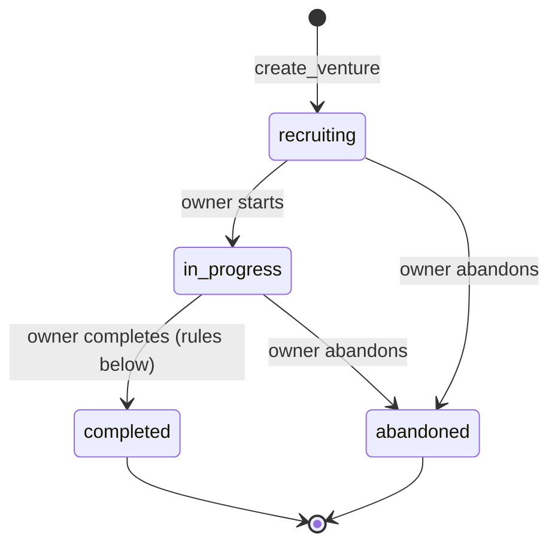
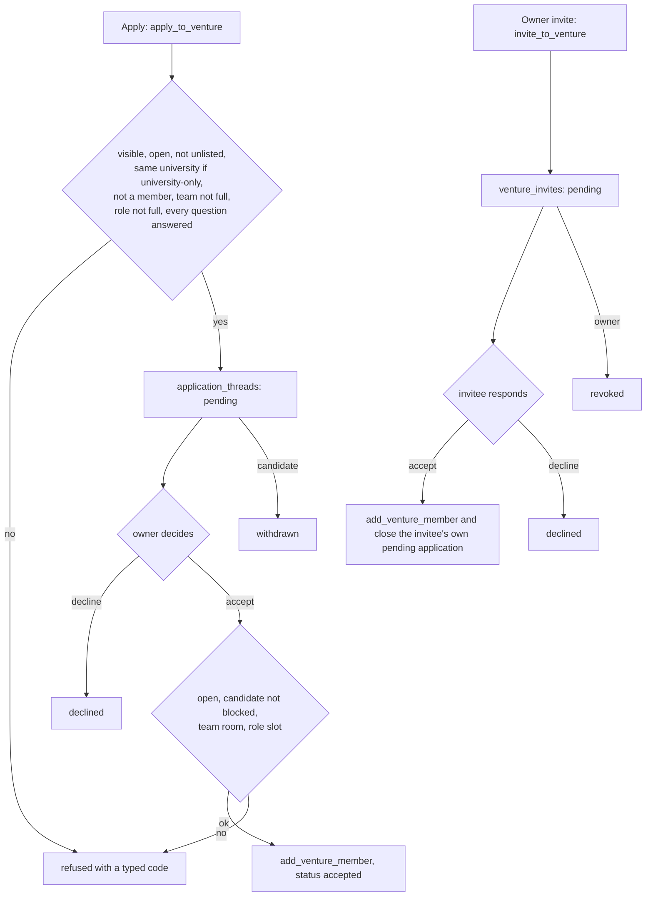

Commit: 64cef52
Covers: supabase/migrations/20260928190000_ventures.sql, supabase/migrations/20260928200000_venture_views.sql, supabase/migrations/20260928210000_contributions.sql, supabase/migrations/20260928220000_venture_decisions.sql, lib/actions/ventures.ts, lib/data/ventures.ts, lib/ventures/, components/ventures/, app/(app)/ventures/ (except chat and reviews), app/(app)/requests/

# Ventures

## Purpose

A venture is a student project or startup with an owner, a team of at most six, open roles, an application and invite flow, a follow list, updates, members-only deliverables, and a log of contributions that teammates confirm.
It moves through `recruiting`, `in_progress`, and `completed` or `abandoned`; completing it needs two members, a deliverable and two members with a peer-verified contribution, and freezes the team.
Every write is a SQL function that takes the user from `auth.uid()`, re-checks ownership or membership, and locks the venture row when membership changes; the tables grant `select` only.

Other docs this one leans on: the group chat that follows the team is in [chat](chat.md); profile visibility and blocks in [people-and-profiles](people-and-profiles.md); what completion freezes for the score is in [ranking](ranking.md); GitHub commits and skill levels in [github-skills](github-skills.md); endorsements, supervisors, ideas and reviews in trust-evidence and faculty.

## Data model

Generated schema: [ventures](../reference/schema/ventures.md), [venture_views](../reference/schema/venture_views.md), [contributions](../reference/schema/contributions.md), [venture_decisions](../reference/schema/venture_decisions.md).

| Table | One row is | Notes |
|---|---|---|
| `ventures` | A project or startup | `type`, `status`, `visibility` (`public`, `university`, `unlisted`), startup-only `stage` and `pitch_url` (a check refuses them on projects), `skill_ids` (at most 10), `team_size` 2 to 6, `repo_id`, `owner_id`, `university_id` (the owner's, when created); `completed_at` and `abandoned_at` must be set exactly when the status says so [src: supabase/migrations/20260928190000_ventures.sql#create table public.ventures] [src: supabase/migrations/20260928190000_ventures.sql#check ((status = 'completed') = (completed_at is not null))] |
| `venture_members` | One person on a team | `team_role` is `lead`, `developer`, `designer`, `researcher` or `other` [src: supabase/migrations/20260928190000_ventures.sql#create type public.venture_team_role] |
| `venture_roles` | A role the team recruits for | 1 to 5 `slots`, `filled <= slots`, at most 5 skill tags; at most 6 roles per venture [src: supabase/migrations/20260928190000_ventures.sql#create table public.venture_roles] [src: supabase/migrations/20260928190000_ventures.sql#at most 6 roles] |
| `venture_questions` | Up to three questions applicants answer | Position 1 to 3 [src: supabase/migrations/20260928190000_ventures.sql#create table public.venture_questions] |
| `application_threads` | One application | Status `pending`, `accepted`, `declined`, `withdrawn`, `closed`; one pending application per person and venture (partial unique index); `owner_id` is the owner when it was opened and follows an ownership transfer; the answers are stored with their questions [src: supabase/migrations/20260928190000_ventures.sql#create unique index application_threads_one_pending] |
| `application_messages` | A message in a pending application | 1 to 1,000 characters [src: supabase/migrations/20260928190000_ventures.sql#create table public.application_messages] |
| `venture_invites` | An owner's invite to one student | One pending invite per venture and invitee [src: supabase/migrations/20260928190000_ventures.sql#create unique index venture_invites_one_pending] |
| `venture_follows`, `venture_updates`, `venture_deliverables` | Follows, team updates (up to 2,000 characters), https links (label 2 to 80) | Updates and deliverables are described in flow 6 [src: supabase/migrations/20260928190000_ventures.sql#create table public.venture_deliverables] |
| `contributions` | One entry in the log | Insert-only; a correction is a new row with `corrects_id`; `source` is `manual` or `github`; a GitHub row carries the commit sha and, if the commit predates the venture, `before_venture`; `skill_ids` (at most three) and `ai_agent` come from later migrations [src: supabase/migrations/20260928210000_contributions.sql#create table public.contributions] [src: supabase/migrations/20260928220000_venture_decisions.sql#alter table public.contributions add column before_venture] [src: supabase/migrations/20261002000000_skill_levels.sql#alter table public.contributions add column skill_ids] |
| `contribution_confirmations` | A teammate's confirmation of one version of an entry | Key is `(contribution_id, confirmer_id)`; the teacher migration adds `confirmer_role` for supervisors [src: supabase/migrations/20260928210000_contributions.sql#create table public.contribution_confirmations] |
| `contributions_with_status` (view) | The timeline: one row per original entry showing its newest correction | Final definition in the AI-assisted-commits migration; runs with the caller's RLS (`security_invoker`) [src: supabase/migrations/20261103000000_ai_assisted_commits.sql#create or replace view public.contributions_with_status with (security_invoker = true)] |

## Flows

### 1. Lifecycle

`transition_venture` (final definition in the contributions migration) locks the venture, refuses an owner-only call from anyone else and any move not in the diagram, and for `completed` requires: at least 2 members, at least 1 deliverable, and at least 2 current members with a peer-verified contribution (`verified_contributors`). It sets `completed_at` or `abandoned_at`, and on completion or abandonment closes every pending application and revokes every pending invite [src: supabase/migrations/20260928210000_contributions.sql#create or replace function private.transition_venture] [src: supabase/migrations/20260928220000_venture_decisions.sql#create or replace function private.verified_contributors].

Other triggers fire on the same status change, each owned by another subsystem:

- a `Shipped` post by the owner, unless the venture is unlisted (feed-and-posts) [src: supabase/migrations/20260929010000_posts.sql#create function private.post_shipped];
- a notice to every member for completed or abandoned (notifications), and an "endorse your teammates" prompt to every member (trust-evidence) [src: supabase/migrations/20260929000000_notifications.sql#create function private.notify_venture_changes] [src: supabase/migrations/20261001000000_endorsements.sql#create function private.prompt_endorsements];
- the ranking freeze: `record_venture_completion` stores, once per venture, the members, each member's GitHub days and verified and unverified entries, and the inputs to the complexity score, so the score no longer depends on later edits (see [ranking](ranking.md)) [src: supabase/migrations/20261005000000_ranking.sql#create function private.ventures_record_completion];
- analytics events on create, join and completion [src: supabase/migrations/20261104000000_analytics.sql#create trigger ventures_analytics_completed].

What "locked" means after completion: `venture_members_guard` raises "a completed venture's team is locked" (`55000`) for any member insert or delete that is not an account-deletion cascade; `require_open` blocks edits, roles, questions, invites, member management, deliverable changes and repo links; `require_contributor` closes the contribution log to anyone once the venture is not `recruiting` or `in_progress`. Updates remain open on a completed venture and close only on an abandoned one [src: supabase/migrations/20260928190000_ventures.sql#create function private.venture_members_guard] [src: supabase/migrations/20260928190000_ventures.sql#create function private.require_open] [src: supabase/migrations/20260928210000_contributions.sql#so its log is locked] [src: supabase/migrations/20260928190000_ventures.sql#this venture is abandoned].

### 2. Create and edit

`/ventures/new` renders `VentureForm`; with `?idea=<id>` it prefills from a teacher's open project idea (faculty owns that flow) [src: app/(app)/ventures/new/page.tsx#idea?.isOpen]. `createVenture` validates with Zod (title 3 to 80, description at most 4,000, team size 2 to 6, at most 6 roles and 3 questions) and calls `create_venture`, which: requires a signed-in student who finished onboarding (`require_user`), takes a rate-limit token (5 ventures a day), reads the owner's university, validates that every skill id is a live taxonomy skill, inserts the venture, adds the owner as the first member with team role `lead`, and inserts the roles and questions [src: lib/actions/ventures.ts#export async function createVenture] [src: supabase/migrations/20260928190000_ventures.sql#create function private.create_venture]. For a project the action drops stage, pitch link and affiliation. The action then redirects to `/ventures/<id>`.

`update_venture` takes the same fields except the type; roles and questions are separate functions (`save_venture_role`, `delete_venture_role`, `set_venture_questions`), all owner-only and all refused once the venture is completed or abandoned [src: supabase/migrations/20260928190000_ventures.sql#create function private.update_venture]. A trigger creates the venture's group chat on insert (see [chat](chat.md)). The old `/projects` and `/startups` URLs redirect to `/ventures` [src: next.config.ts#"/projects", destination: "/ventures"].

### 3. Browsing and reading

`/ventures` has Projects and Startups tabs and the filters status, open roles and my university, all in the URL; `browse_ventures` returns listed ventures (never `unlisted`) that `can_view_venture` allows, newest first, 20 a page, with the owner's name, member count, team size and open slots, and pages with a `before` timestamp [src: app/(app)/ventures/page.tsx#export default async function VenturesPage] [src: supabase/migrations/20260928200000_venture_views.sql#create function private.browse_ventures].

`getVenture` loads one venture for the venture layout and every tab. It reads the row under RLS; if no row comes back it asks `venture_by_link`, which returns the public face (title, description, status, owner) of an unlisted venture to anyone who has the id, unless the owner is blocked with them. In that case the page shows only the header and "You opened this venture by its link. It takes new members by invite only" and no tabs [src: lib/data/ventures.ts#export const getVenture = cache] [src: supabase/migrations/20260928190000_ventures.sql#create function private.venture_by_link] [src: app/(app)/ventures/[id]/layout.tsx#You opened this venture by its link]. It also reads the team (`venture_team`), counts (`venture_counts`) and the viewer's follow, pending application and pending invite.

`venture_team` lists the team by name for anyone who can see the venture, but gives the username and photo only where `can_view_profile` holds, and leaves out a member who is blocked with the viewer in either direction [src: supabase/migrations/20260928220000_venture_decisions.sql#create function private.venture_team].

The tabs are About, Team, Contributions, Updates, Deliverables, Reviews, then Chat (members only) and Manage (owner only) [src: components/ventures/venture-tabs.tsx#label: "Manage"]. Reviews and the supervisor features belong to faculty; Chat to [chat](chat.md).

### 4. Applying, inviting, deciding

- **Apply.** `applyToVenture` sends role, message (1 to 1,000), and one answer per question (1 to 500 each). `apply_to_venture` takes a rate-limit token (20 a day), then refuses with a typed code: venture not visible (`P0002`), closed (`55000`), unlisted ("takes members by invite only"), university-only and a different university, already a member, team full, role full or missing, or answers that do not match the questions one for one. A second pending application hits the unique index and becomes "you already have a pending application" (`23505`) [src: supabase/migrations/20260928190000_ventures.sql#create function private.apply_to_venture].
- **Messages.** While an application is pending, either side may send messages (30 an hour per sender) [src: supabase/migrations/20260928190000_ventures.sql#create function private.add_application_message].
- **Decide.** `decide_application` is owner-only (it uses `lock_owned_venture`, which locks the venture row and raises `42501` for anyone else), then locks the thread and refuses one that is not pending. Decline works on any venture; accept additionally needs an open venture and a candidate not blocked with the owner, and calls `add_venture_member` [src: supabase/migrations/20260928190000_ventures.sql#create function private.decide_application].
- **Withdraw.** The candidate withdraws a pending application [src: supabase/migrations/20260928190000_ventures.sql#create function private.withdraw_application].
- **Invite.** `invite_to_venture` is owner-only, takes a rate-limit token per owner (30 a day), finds the invitee by username among accounts that finished onboarding, refuses a blocked person, someone outside the university on a university-only venture, an existing member, a full team and a repeat invite. `respond_invite` locks the venture; accepting adds the member and closes any pending application the invitee had to the same venture; the owner can revoke a pending invite [src: supabase/migrations/20260928190000_ventures.sql#create function private.invite_to_venture] [src: supabase/migrations/20260928190000_ventures.sql#create function private.respond_invite] [src: supabase/migrations/20260928190000_ventures.sql#create function private.revoke_invite].
- **Graduates.** A trigger refuses a graduate's application or membership on a university-only venture [src: supabase/migrations/20261010000000_student_portal.sql#create function private.graduate_venture_guard].
- **Requests page.** `/requests` lists received applications, sent applications and invites. `application_people` returns the name and username of only the people the caller shares an application thread or invite with [src: app/(app)/requests/page.tsx#getRequests] [src: supabase/migrations/20260928200000_venture_views.sql#create function private.application_people].

`add_venture_member` is the one place a member is added. Under the venture lock it refuses a repeat member (`23505`), claims a slot of the chosen role (`23514` if the role is full), and inserts the member with team role `other`; the six-member limit is enforced by `venture_members_guard`, which locks the venture row and counts members in the same transaction, so two accepts at once cannot make a seventh [src: supabase/migrations/20260928190000_ventures.sql#create function private.add_venture_member] [src: supabase/migrations/20260928190000_ventures.sql#this venture already has % members]. A trigger adds the new member to the group chat.

### 5. Roles on the team

- **Leave.** Any member except the owner; the owner must transfer first (`55000`). Refused once the venture is completed [src: supabase/migrations/20260928190000_ventures.sql#create function private.leave_venture].
- **Remove, set role, transfer.** Owner-only on an open venture. The owner cannot be removed; `transfer_venture_ownership` needs the target to be a member and moves the owner on the venture and on pending applications (both parties get an `ownership_transferred` notice) [src: supabase/migrations/20260928190000_ventures.sql#create function private.transfer_venture_ownership] [src: supabase/migrations/20260928190000_ventures.sql#create function private.set_member_role].
- **Link a repository.** Owner-only; the repository must be one the owner shared with the GitHub App and has not excluded. Linking triggers a sync of members' counted commits (flow 7) [src: supabase/migrations/20260928190000_ventures.sql#create function private.link_venture_repo] [src: supabase/migrations/20260928210000_contributions.sql#create trigger venture_repo_commits].
- **Teachers.** Under the teacher portal an approved teacher who supervises the venture or holds an open review request can read it, including deliverables; `can_view_venture`, `ventures_read` and `venture_deliverables_read` were rewritten for that (faculty owns the rest) [src: supabase/migrations/20261012000000_teacher_portal.sql#create or replace function private.can_view_venture].

### 6. Follows, updates, deliverables

- **Follow.** Public ventures only, by a signed-in student who can see them [src: supabase/migrations/20260928190000_ventures.sql#only public ventures can be followed].
- **Updates.** A member posts an update (rate limit 20 a day), allowed unless the venture is abandoned. `postVentureUpdate` re-encodes up to four images first, then calls `post_venture_update_media`; a refused update removes the images. The author or the owner can delete an update; the action then deletes only the files the caller uploaded themselves, so images from a teammate's update that the owner deletes stay in storage [src: lib/actions/ventures.ts#export async function postVentureUpdate] [src: supabase/migrations/20260929010000_posts.sql#create function private.post_venture_update_media] [src: lib/actions/ventures.ts#leaves that teammate's images].
- **Reaching the feed.** Updates are not posts. Followers see updates from the last seven days in a strip on the feed, read by `followed_venture_updates` (public venture, visible, author not blocked); followed ventures also raise their posts in feed scoring (feed-and-posts) [src: supabase/migrations/20260929040000_feed_ranking.sql#create function private.followed_venture_updates]. A completed venture reaches the feed as the one `Shipped` post.
- **Deliverables.** Members only. A member adds an https link with a label (at most 20 per venture) while the venture is open; the owner or the person who added it removes it. Non-members get a count from `venture_counts` instead of the list [src: supabase/migrations/20260928190000_ventures.sql#create function private.add_venture_deliverable] [src: app/(app)/ventures/[id]/deliverables/page.tsx#v.viewer.isMember].

### 7. The contribution log

- **Log.** `log_contribution` needs `require_contributor` (a member of an open venture), takes a token (20 a day shared with corrections), validates the skill tags with `entry_skills` (at most 3, each one of the venture's own tags) and inserts [src: supabase/migrations/20261002000000_skill_levels.sql#create function private.log_contribution] [src: supabase/migrations/20261002000000_skill_levels.sql#create function private.entry_skills]. The action validates description (1 to 500), an https link, hours (positive, at most 100, in quarters) and tags.
- **Correct.** Only the author of a manual original, within 24 hours (`CORRECTION_WINDOW_MS`), as a new row that points at the original. The timeline shows the newest version, which needs its own confirmation [src: supabase/migrations/20261002000000_skill_levels.sql#create function private.correct_contribution] [src: lib/ventures/labels.ts#export const CORRECTION_WINDOW_MS].
- **Confirm.** A current member other than the author confirms the version the timeline shows. GitHub entries made since the venture was created are verified already; pre-venture commits and manual entries need a teammate [src: supabase/migrations/20260928220000_venture_decisions.sql#create or replace function private.confirm_contribution].
- **Status.** An entry is peer-verified when it is a GitHub commit made after the venture started, or its shown version has a confirmation. The Contributions tab groups entries by week and offers Confirm and Correct where those rules allow [src: app/(app)/ventures/[id]/contributions/page.tsx#const canConfirm].
- **GitHub entries.** `sync_venture_commits` inserts one entry per counted commit by a member in the linked repository, back to six months before the venture was created, marking those older ones `before_venture` (shown as before Skilient). It runs on a link, when a member joins, and when a commit becomes counted [src: supabase/migrations/20260928220000_venture_decisions.sql#create or replace function private.sync_venture_commits] [src: supabase/migrations/20260928210000_contributions.sql#create trigger github_commit_contributions] [src: supabase/migrations/20260928210000_contributions.sql#create trigger venture_member_commits]. The commits themselves are github-skills.
- **Leaving.** An entry stays on the log after its author leaves, is marked "No longer on the team", and no longer counts toward completion; a former member's confirmed entries remain on their record and show on their profile [src: supabase/migrations/20260928210000_contributions.sql#Contributions by people who left or were removed stay on the log but don't count] [src: lib/data/ventures.ts#export async function getFormerVentures].
- **Downstream.** A new confirmation or correction triggers recomputation of the author's skill levels (github-skills) [src: supabase/migrations/20261002000000_skill_levels.sql#create trigger contribution_confirmations_recompute].

## Entry points

All are `security invoker` wrappers over private definer functions, granted to `authenticated` only [src: supabase/migrations/20260928190000_ventures.sql#create function public.create_venture]. Each function takes the caller from `auth.uid()`.

| Entry | Called by | Who may call it |
|---|---|---|
| `create_venture` | `createVenture` | A student who finished onboarding; 5 a day |
| `transition_venture` | `transitionVenture` | The owner, for the moves in the diagram |
| `apply_to_venture`, `withdraw_application`, `add_application_message` | Apply sheet, requests page | A student who can see the venture (apply); the candidate or the owner (messages) |
| `decide_application` | `decideApplication` | The owner of the venture |
| `invite_to_venture`, `revoke_invite` | Manage tab | The owner |
| `respond_invite` | Invite card | The invitee |
| `leave_venture` | Venture actions | A non-owner member |
| `remove_venture_member`, `set_member_role`, `transfer_venture_ownership`, `link_venture_repo`, `update_venture`, `save_venture_role`, `delete_venture_role`, `set_venture_questions` | Manage and Team tabs | The owner, while the venture is open |
| `follow_venture` | Follow button | A signed-in student; public ventures to follow |
| `post_venture_update_media`, `delete_venture_update` | Updates tab | A member (post); the author or the owner (delete) |
| `add_venture_deliverable`, `remove_venture_deliverable` | Deliverables tab | A member (add); the owner or who added it (remove) |
| `log_contribution`, `correct_contribution`, `confirm_contribution` | Contributions tab | A member of an open venture, with the author and confirmer rules above |
| `venture_verified_contributors` | Manage tab | Anyone who can see the venture |
| `browse_ventures`, `venture_team`, `venture_counts`, `venture_by_link`, `profile_ventures`, `application_people` | `lib/data/ventures.ts` | Signed-in users, each filtered by `can_view_venture` or by the shared-thread rule |
| `/ventures`, `/ventures/new`, `/ventures/[id]/*`, `/requests` | Browser | Signed-in, onboarded accounts (the gate); `/ventures/[id]/manage` answers 404 to anyone but the owner [src: app/(app)/ventures/[id]/manage/page.tsx#!v.viewer.isOwner] |

## Permissions

**Tables.** All venture tables have RLS on; `authenticated` holds `select` only. Reading is: a venture by `ventures_read` (not blocked with the owner, and public, or university-only in the reader's university, or the reader is a member or invitee, or an approved teacher supervising or reviewing it); members, roles, questions, updates, contributions and confirmations by `can_view_venture`; deliverables by membership (or a supervising teacher); an application thread and its messages by the candidate and the owner only; invites by the invitee, inviter or owner; follows by their owner [src: supabase/migrations/20261012000000_teacher_portal.sql#create policy ventures_read on public.ventures] [src: supabase/migrations/20260928190000_ventures.sql#create policy application_threads_read] [src: supabase/migrations/20260928190000_ventures.sql#create policy venture_invites_read] [src: supabase/migrations/20260928210000_contributions.sql#create policy contributions_read].

**No write path from the client.** There is no insert, update or delete policy anywhere in this subsystem. The contributions tables have no update or delete grant at all, so an entry can never be edited or removed through the API; the only change is a new correction row [src: supabase/migrations/20260928210000_contributions.sql#grant select on table public.contributions, public.contribution_confirmations to authenticated].

**Checks that live in the functions.** `require_user` (signed in and onboarded), `lock_owned_venture` (owner, with the row locked), `require_open` (not completed or abandoned), `require_contributor` (member of an open venture), and the membership guard trigger. The owner checks use `auth.uid()` inside the function; an owner id never comes from the browser [src: supabase/migrations/20260928190000_ventures.sql#create function private.lock_owned_venture].

**Blocks and privacy.** A venture is invisible to someone blocked with its owner; a blocked member is left off the team list; an accept is refused for a blocked candidate. The team list shows usernames and photos only for profiles the viewer may see.

## Failure modes

| Situation | What happens | Where it shows |
|---|---|---|
| Not signed in, or not onboarded | `no_session` (action) or "finish onboarding first" (`forbidden`) | `ventures.*` refused |
| Non-owner calls an owner function | "only the owner can do this", `forbidden` | `ventures.decide`, `ventures.transition`… refused |
| 7th member, parallel accepts | The venture row is locked and the count rechecked; the loser gets "this venture already has 6 members" (`limit`) | `ventures.decide` refused |
| Duplicate pending application | "you already have a pending application to this venture" (`duplicate`) | `ventures.apply` refused |
| Rate limit (5 creates, 20 applies, 30 invites, 30 messages an hour, 20 updates or contributions a day) | `rate_limited` | refused |
| Complete without 2 members, 1 deliverable or 2 verified members | `limit` with the rule named | `ventures.transition` refused |
| Change a completed venture | `not_now` ("this venture is completed") | refused |
| Log or confirm in a locked venture | `not_now` ("…so its log is locked") | refused |
| Correct after 24 hours, or someone else's entry | `not_now` / `forbidden` | `ventures.correct_contribution` refused |
| Confirm your own entry, or a GitHub entry already verified | `forbidden` / `invalid_input` | refused |
| Unknown or retired skill tag | `invalid_input` ("unknown skill") | refused |
| An image fails after its update was refused | The action removes the files; `orphan_left` if that fails | `ventures.post_update` |
| Owner deletes a teammate's update with images | The images stay in storage; the update row and its image rows are gone | None |
| Repository not shared with the GitHub App | `forbidden`: "share that repository with Skilient first" | `ventures.link_repo` refused |
| Any other SQL error | "Something went wrong on our side" with the request id | `error` line with the SQLSTATE |
| A role's places after someone leaves | A removed or departed member does not free their role slot (`filled` is never reduced), so the role can stay "filled" | No error; see `verification-log.md` |

## Tests

- pgTAP `14_ventures` (56 assertions): creation rules, visibility by university, applications, decisions, invites, team limits, lifecycle. `15_venture_views` (14): browse, team cards, profile ventures, request cards. `16_contributions` (38): insert-only, confirmation and correction rules, the 24-hour window, the GitHub link and pre-venture commits [src: supabase/tests/14_ventures.test.sql#select plan(56)] [src: supabase/tests/15_venture_views.test.sql#select plan(14)] [src: supabase/tests/16_contributions.test.sql#select plan(38)].
- E2E `ventures.spec.ts`: create, apply, accept, and the team shows the new member [src: tests/e2e/ventures.spec.ts#create, apply, accept, and the team shows the new member].
- Not covered by a test of their own: the follow strip, deliverable limits, the ownership-transfer notices, and a role's slot after a member leaves.

## Change guide

1. **Change the team limit.** The limit is in `venture_max_members()` (SQL), the `team_size` check (2 to 6) on `ventures`, `MAX_MEMBERS` in `lib/ventures/labels.ts`, the Zod `teamSize` bounds in `lib/actions/ventures.ts`, and a literal `6` in the venture layout (`teamFull`). Change all of them together in a new migration and update the pgTAP suite `14` [src: supabase/migrations/20260928190000_ventures.sql#create function private.venture_max_members] [src: lib/ventures/labels.ts#export const MAX_MEMBERS] [src: app/(app)/ventures/[id]/layout.tsx#teamFull={v.counts.members >= 6}].
2. **Change what completion needs.** Edit `transition_venture` in a new migration (re-create it with the full body, as the contributions migration did) and the "To complete it you need" list on the Manage tab, which repeats the three rules in the page and must agree with the function [src: app/(app)/ventures/[id]/manage/page.tsx#const canComplete].
3. **Add a venture field.** New column with a check in `ventures`; add it to `create_venture` and `update_venture` (they read a jsonb `p`), to the Zod schema and `createVenture`/`updateVenture`, to `VentureForm` and `getVenture`; if the browse card should show it, to `browse_ventures`, which is also what `search_ventures` mirrors (see [people-and-profiles](people-and-profiles.md)) [src: supabase/migrations/20260928190000_ventures.sql#create function private.update_venture].

## Answers to the planned questions

**1. States, transitions, who.** Flow 1: the owner makes every move; `recruiting` to `in_progress` or `abandoned`, `in_progress` to `completed` or `abandoned`; nothing leaves `completed` or `abandoned`.

**2. Applications and invites.** Flow 4. Accept adds the member (role slot claimed, group chat joined by trigger); decline and withdraw only change status; an accepted invite also closes the invitee's own pending application; completing or abandoning closes pending applications and revokes pending invites.

**3. Roles, ownership, owner leaving.** Team roles are `lead` (the creator), `developer`, `designer`, `researcher`, `other` (everyone who joins); the owner changes them with `set_member_role`. Ownership moves by `transfer_venture_ownership` to a member. The owner cannot leave or be removed until ownership is transferred.

**4. Contributions.** Flow 7.

**5. GitHub commits and "before Skilient".** `sync_venture_commits` turns counted commits by members in the linked repository into `github` entries; those made up to six months before the venture was created are marked `before_venture` and count only after a teammate confirms them [src: supabase/migrations/20260928220000_venture_decisions.sql#c.occurred_at >= v.created_at - interval '6 months'].

**6. Team cards.** `venture_team`: names for all visible team members, username and photo only where the viewer may see that profile, blocked members left out.

**7. Updates, deliverables, followers.** Flow 6.

**8. What completion freezes.** The team and all venture details lock (flow 1). The ranking snapshot of members, GitHub days, verified and unverified entries and complexity inputs is stored once. The log closes. Updates stay open. A `Shipped` post is created and members are prompted to endorse.
