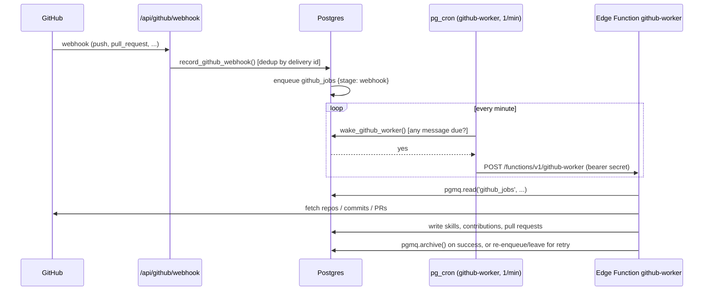
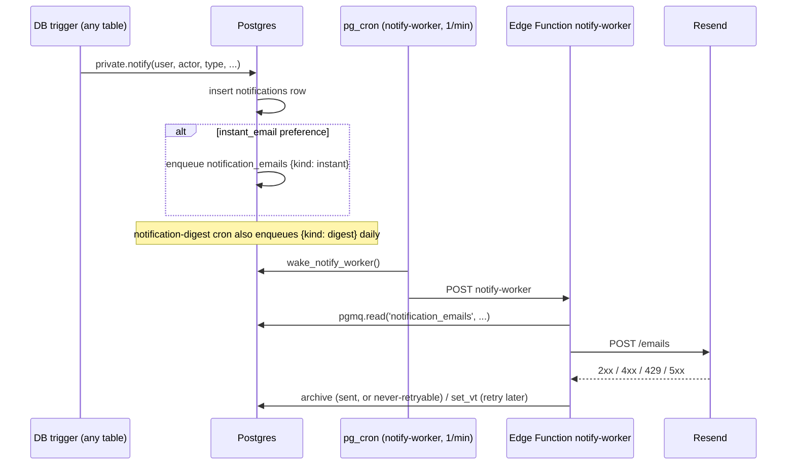
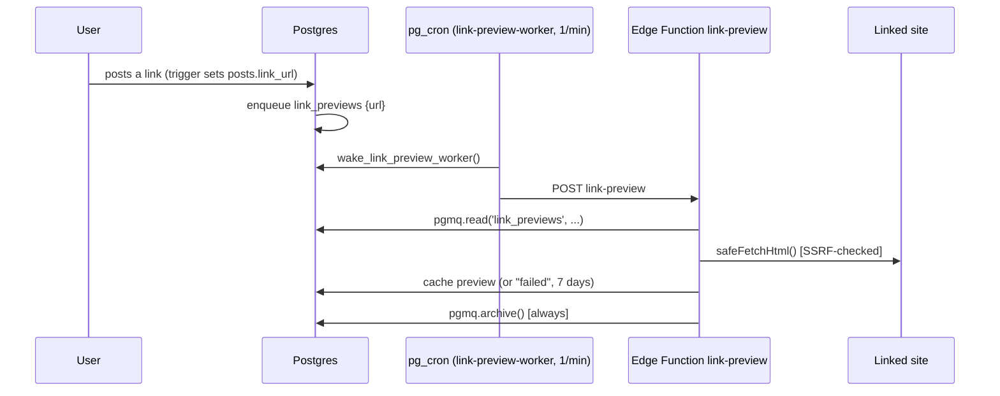
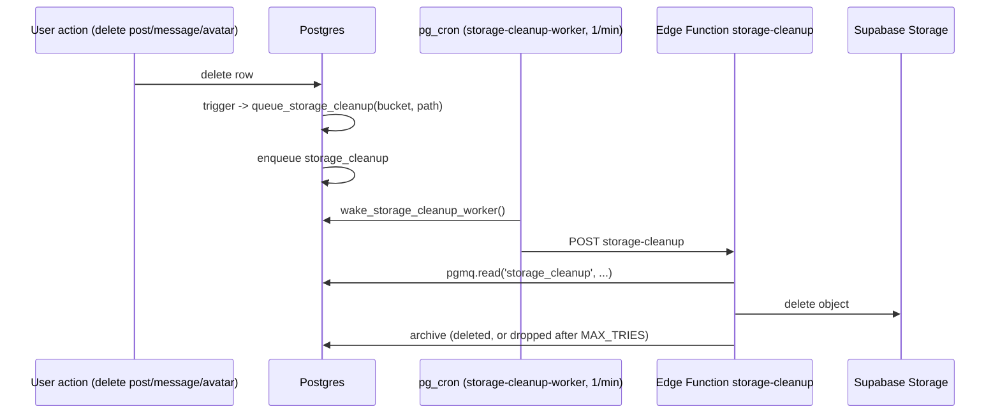
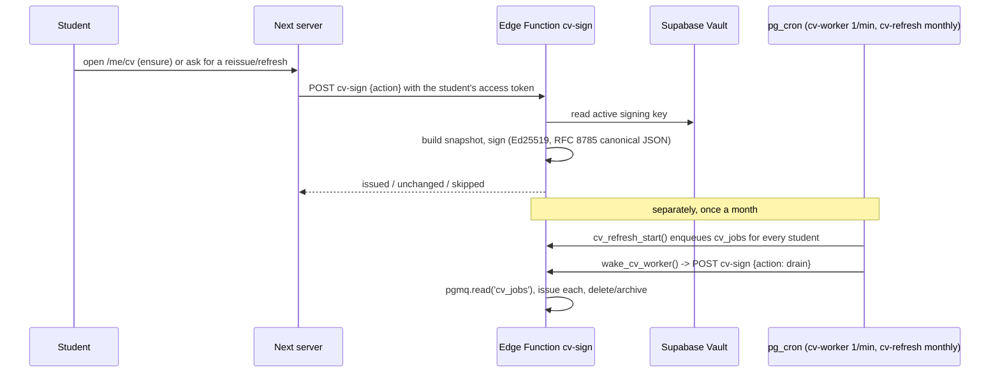
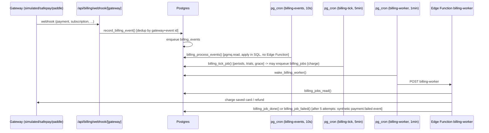

Commit: 4024fe9
Covers: `supabase/migrations/`, `supabase/functions/`, `app/api/github/webhook/`, `app/api/billing/webhook/`, `app/api/webhooks/resend/`

# Background jobs

Three mechanisms carry background work, all in `supabase/migrations/` and `supabase/functions/`:

1. **pgmq queue + Edge Function, woken by pg_cron.** A trigger or action enqueues a message with `pgmq.send()`; a pg_cron job running every minute calls a `private.wake_*_worker()` function that checks `pgmq.q_<queue>` for a message whose `vt` (visibility time) has passed and, only then, `net.http_post`s the matching Edge Function with a bearer secret from Vault, e.g. `private.wake_github_worker` [src: supabase/migrations/20260927224500_github_connect.sql#private.wake_github_worker]. The Edge Function re-checks that same secret before doing anything [src: supabase/functions/github-worker/index.ts#safeEqual]. A message `pgmq.read()` doesn't finish processing stays in the queue and reappears once its visibility timeout elapses — there is no separate retry scheduler; the next wake (at most a minute later) tries it again.
2. **pg_cron calling a SQL function directly.** No queue, no Edge Function — the scheduled SQL does the work itself in one transaction (ranking steps, digests, purges, most maintenance). A failure rolls that run back; pg_cron's own log (`cron.job_run_details`) and, for functions that call `job_run_start`/`job_run_finish`, the `public.job_runs` table record it, and `job-watchdog` (below) turns a failed or missed run into an alert.
3. **A plain due-queue table**, used only by the organisation webhook delivery (`api_webhook_deliveries`): no pgmq, a `for update skip locked` select on `next_attempt_at <= now()` instead [src: supabase/migrations/20261016000000_recruiter_api.sql#private.webhook_due].

## Job monitoring

Every job, however it runs, is covered by one alerting path: `private.job_watchdog()`, woken every 10 minutes by cron `job-watchdog` [src: supabase/migrations/20261105000000_alerts.sql#job-watchdog], evaluates `private.alert_conditions()` and emails anything new or still-firing through the `notification_emails` queue [src: supabase/migrations/20261105000000_alerts.sql#job_watchdog] [src: supabase/migrations/20261105000000_alerts.sql#queue_alert_email]. `alert_conditions()` covers, generically, every job and every queue:

- **`job_failed`**: a `cron.job_run_details` row with `status = 'failed'` in the last 15 minutes, or a `public.job_runs` row with `status = 'failed'` [src: supabase/migrations/20261105000000_alerts.sql#alert_conditions].
- **`job_slow`**: a `job_runs` row still `running` for more than twice its usual duration (and at least `job_slow_minutes`) [src: supabase/migrations/20261105000000_alerts.sql#alert_conditions].
- **`job_missed`**: a cron job whose gap since its last start is more than twice its usual gap (and at least 15 minutes) [src: supabase/migrations/20261105000000_alerts.sql#alert_conditions].
- **`queue_stuck`**: iterates every queue `pgmq.list_queues()` knows about and alerts if any message's `vt` is older than `queue_stuck_minutes` — this one check covers all eight pgmq queues below without a queue-specific rule [src: supabase/migrations/20261105000000_alerts.sql#alert_conditions].

## pgmq queues

| Queue | Created | Producer(s) | Consumer | Woken by |
| --- | --- | --- | --- | --- |
| `github_jobs` | [src: supabase/migrations/20260927224500_github_connect.sql#github_jobs] | `private.enqueue_github()` from GitHub connect actions, the webhook handler and `github-nightly-sync` [src: supabase/migrations/20260927224500_github_connect.sql#private.enqueue_github] | Edge Function `github-worker` → `runWorker()` [src: supabase/functions/_shared/github/worker.ts#runWorker] | cron `github-worker`, every minute [src: supabase/migrations/20260927224500_github_connect.sql#github-worker] |
| `notification_emails` | [src: supabase/migrations/20260929000000_notifications.sql#notification_emails] | `private.notify()` (instant-email preference) [src: supabase/migrations/20260929000000_notifications.sql#private.notify], `private.queue_notification_digests()`, `private.queue_teacher_digests()` [src: supabase/migrations/20261012000000_teacher_portal.sql#queue_teacher_digests], `private.queue_university_launch()` [src: supabase/migrations/20261102000000_university_launch.sql#private.queue_university_launch], `private.queue_alert_email()` [src: supabase/migrations/20261105000000_alerts.sql#queue_alert_email] | Edge Function `notify-worker` [src: supabase/functions/_shared/notify/worker.ts#DAILY_CAP] | cron `notify-worker`, every minute [src: supabase/migrations/20260929000000_notifications.sql#notify-worker] |
| `link_previews` | [src: supabase/migrations/20260929020000_comments_links.sql#link_previews] | a trigger setting `posts.link_url` [src: supabase/migrations/20260929020000_comments_links.sql#link_url] | Edge Function `link-preview` → `runLinkPreviewWorker()` [src: supabase/functions/_shared/links/worker.ts#runLinkPreviewWorker] | cron `link-preview-worker`, every minute [src: supabase/migrations/20260929020000_comments_links.sql#link-preview-worker] |
| `storage_cleanup` | [src: supabase/migrations/20260930000000_phase3_answers.sql#storage_cleanup] | `private.queue_storage_cleanup()`, called by a delete trigger on every file-holding table [src: supabase/migrations/20260930000000_phase3_answers.sql#queue_storage_cleanup] | Edge Function `storage-cleanup` [src: supabase/functions/_shared/storage/cleanup.ts#BUCKETS] | cron `storage-cleanup-worker`, every minute [src: supabase/migrations/20260930000000_phase3_answers.sql#storage-cleanup-worker] |
| `cv_jobs` | [src: supabase/migrations/20261008000000_verified_cv.sql#cv_jobs] | `private.cv_refresh_start()`, monthly [src: supabase/migrations/20261008000000_verified_cv.sql#cv_refresh_start] | Edge Function `cv-sign` → `drainQueue()` [src: supabase/functions/_shared/cv/issue.ts#drainQueue] | cron `cv-worker`, every minute; `cv-refresh` enqueues on day 28–31 of the month [src: supabase/migrations/20261008000000_verified_cv.sql#cv-refresh] |
| `billing_events` | [src: supabase/migrations/20261024000000_billing_lifecycle.sql#billing_events] | `record_billing_event()`, called by the three webhook routes and `billing-worker` itself [src: supabase/migrations/20261024000000_billing_lifecycle.sql#record_billing_event] | **SQL directly** — `private.billing_process_events()`, no Edge Function [src: supabase/migrations/20261024000000_billing_lifecycle.sql#billing_process_events] | cron `billing-events`, every 10 seconds [src: supabase/migrations/20261024000000_billing_lifecycle.sql#billing-events] |
| `billing_jobs` | [src: supabase/migrations/20261024000000_billing_lifecycle.sql#billing_jobs] | `billing_tick_job()` (renewal charges) and staff refund actions [src: supabase/migrations/20261025000000_billing_ops.sql#pgmq.send] | Edge Function `billing-worker` [src: supabase/functions/_shared/billing/worker.ts#adapterFor] | cron `billing-worker`, every minute [src: supabase/migrations/20261024000000_billing_lifecycle.sql#billing-worker] |
| `analytics` | [src: supabase/migrations/20261104000000_analytics.sql#analytics] | `private.track()`/`private.track_once()`, called by triggers across the schema, and a deletion trigger on `auth.users` [src: supabase/migrations/20261104000000_analytics.sql#private.track] | Edge Function `analytics-worker` [src: supabase/functions/_shared/analytics/worker.ts#AnalyticsConfig] | cron `analytics-worker`, every minute [src: supabase/migrations/20261104000000_analytics.sql#analytics-worker] |

### Retry, failure and idempotency, per worker

- **github-worker**: batches of `pgmq.read('github_jobs', 120, 10)` inside a time budget [src: supabase/functions/_shared/github/worker.ts#runWorker]; on success the message is `pgmq.archive`d [src: supabase/functions/_shared/github/worker.ts#handle]; a `RateLimited` error re-enqueues a fresh copy with a delay and archives the original, so waiting doesn't count as a failed attempt [src: supabase/functions/_shared/github/worker.ts#handle]; `NoToken` (revoked GitHub token) or `read_ct >= MAX_ATTEMPTS` (5) archives the message as a dead letter and marks the sync job `cancelled`/`failed` [src: supabase/functions/_shared/github/worker.ts#MAX_ATTEMPTS]; anything else is left in the queue to retry. Each stage (`discover`, `classify`, `harvest`, `extract`, `prs`, `pr`, `webhook`, `revoke`, `code_check`) is idempotent, so a redelivered message repeats safely — e.g. `extract` is only reached once every pull request is already stored, so a retry re-checks them rather than re-fetching [src: supabase/functions/_shared/github/worker.ts#Message].
- **notify-worker**: `pgmq.read('notification_emails', 120, …)` [src: supabase/functions/_shared/notify/worker.ts#DAILY_CAP]; Resend's own response decides retryability (`NotifySendResult.retry`): a 4xx is `"never"` (archived, won't help to retry), a 429 or 5xx is `"later"` and reschedules the same message `30 * read_ct` seconds out via `pgmq.set_vt()` while `read_ct < MAX_ATTEMPTS` (5), otherwise archived [src: supabase/functions/_shared/notify/worker.ts#MAX_ATTEMPTS]. A day's 60th email (`DAILY_CAP`) and every email after it that day is deferred to the next UTC day rather than sent, parking (not failing) the queue [src: supabase/functions/_shared/notify/worker.ts#DAILY_CAP].
- **link-preview**: one pass, batch 10, `pgmq.read('link_previews', 60, …)` [src: supabase/functions/_shared/links/worker.ts#runLinkPreviewWorker]; every outcome — success or a refused/failed fetch — archives the message, because a failed fetch is itself cached as `"failed"` for 7 days so the same URL is never retried for a week [src: supabase/functions/_shared/links/worker.ts#runLinkPreviewWorker].
- **storage-cleanup**: batch 50, `pgmq.read('storage_cleanup', 60, …)` [src: supabase/functions/_shared/storage/cleanup.ts#BUCKETS]; a failed delete stays queued and is retried roughly a minute later (the visibility timeout); after `read_ct >= MAX_TRIES` it is archived and logged, never retried indefinitely [src: supabase/functions/_shared/storage/cleanup.ts#BUCKETS].
- **cv-sign** (`drainQueue`): batch 20, visibility 120s [src: supabase/functions/_shared/cv/issue.ts#drainQueue]; a message with no `user_id` or `read_ct > 5` is archived and logged `dropped`; otherwise `issueCv()` is retried on failure (left in the queue) except a missing active signing key (`NoSigningKey`), which stops the whole drain pass rather than burning through the batch [src: supabase/functions/_shared/cv/issue.ts#drainQueue]; a successful issue is `pgmq.delete`d, not archived, unlike every other queue here.
- **billing_events** (drained by SQL, not an Edge Function): each event runs in its own sub-transaction; on success `pgmq.delete`; on any exception the attempt count and error are recorded on `billing_webhook_events`, and only once `read_ct >= 5` is the message archived [src: supabase/migrations/20261024000000_billing_lifecycle.sql#billing_process_events]. Idempotency comes from the unique `(gateway, event_id)` on `billing_webhook_events` itself, checked before this queue is ever reached — a replayed webhook is a no-op there, not here.
- **billing-worker** (`billing_jobs`): `private.billing_jobs_read()` wraps `pgmq.read` [src: supabase/migrations/20261024000000_billing_lifecycle.sql#billing_jobs_read]; success calls `private.billing_job_done()` (`pgmq.delete`) [src: supabase/migrations/20261024000000_billing_lifecycle.sql#billing_job_done]; failure calls `private.billing_job_failed()`, which only acts once `read_ct >= 5` — it archives the message and, for a `charge` job, records a synthetic `payment.failed` billing event so the subscription's lifecycle treats it as a failed renewal [src: supabase/migrations/20261024000000_billing_lifecycle.sql#billing_job_failed]; below 5 attempts the message is simply left to retry next minute.
- **analytics-worker**: batch size from config, `pgmq.read('analytics', 120, …)` [src: supabase/functions/_shared/analytics/worker.ts#AnalyticsConfig]; a successful capture batch is `pgmq.delete`d by id; a failed batch is left queued to retry at its next visibility window and dropped once `read_ct >= MAX_TRIES` [src: supabase/functions/_shared/analytics/worker.ts#MAX_TRIES]; a person-deletion message is treated specially — on failure it is `pgmq.set_vt`'d `DELETE_RETRY_S` seconds out and retried hourly indefinitely, never dropped, because PostHog deletions must eventually succeed [src: supabase/functions/_shared/analytics/worker.ts#DELETE_RETRY_S]. Events listed in `platform_config`'s `analytics.muted_events` are read and discarded unsent, counting neither as success nor failure.

## Table-based due-queue: organisation webhooks

`webhook-worker` has no pgmq queue; it drains `public.api_webhook_deliveries` directly. `private.webhook_due(limit)` selects rows `status = 'pending' and next_attempt_at <= now()` with `for update skip locked` and bumps `next_attempt_at` two minutes out as a claim before returning them, so two concurrent runs never double-send the same delivery [src: supabase/migrations/20261016000000_recruiter_api.sql#private.webhook_due]. Each delivery is signed with HMAC-SHA256 over `<timestamp>.<body>` and sent only to an address that passes the same SSRF checks as a link preview fetch (https, public address, no redirects) [src: supabase/functions/_shared/webhooks/worker.ts#checkUrl]. `private.webhook_result()` records the outcome: success sets `delivered` and resets `consecutive_failures`; failure backs off through a fixed schedule — 1 minute, 5 minutes, 30 minutes, 2 hours, 12 hours — and then marks the delivery `failed` for good; an endpoint accumulating `consecutive_failures` is deactivated once it reaches 30, regardless of any single delivery's own retry state [src: supabase/migrations/20261016000000_recruiter_api.sql#private.webhook_result]. Woken every minute by cron `webhook-worker` [src: supabase/migrations/20261016000000_recruiter_api.sql#webhook-worker]; stale `delivered`/`failed` rows are purged nightly by `webhook-purge` [src: supabase/migrations/20261016000000_recruiter_api.sql#webhook-purge].

## Edge Functions

| Function | Purpose | Invocation |
| --- | --- | --- |
| `github-worker` | drains `github_jobs` (the whole GitHub import pipeline: repo discovery, classification, commit/PR harvesting, skill extraction, webhook events, token revocation) [src: supabase/functions/_shared/github/worker.ts#STAGES] | woken by cron, bearer secret from Vault [src: supabase/functions/github-worker/index.ts#safeEqual] |
| `github-link` | binds a student's profile to the GitHub account behind a one-time OAuth code, then runs one pass of the same `runWorker()` so the new link's first sync starts immediately [src: supabase/functions/github-link/index.ts#runWorker] | called by `/api/github/callback` with a one-time ticket [src: supabase/functions/github-link/index.ts#linkGithub] |
| `notify-worker` | drains `notification_emails` through Resend [src: supabase/functions/_shared/notify/worker.ts#notifyConfigFromEnv] | woken by cron |
| `link-preview` | drains `link_previews`, fetching and caching Open Graph metadata behind an SSRF guard [src: supabase/functions/_shared/links/worker.ts#runLinkPreviewWorker] | woken by cron |
| `storage-cleanup` | drains `storage_cleanup`, deleting orphaned Storage objects [src: supabase/functions/_shared/storage/cleanup.ts#BUCKETS] | woken by cron |
| `cv-sign` | issues/re-issues signed CV versions, rotates the Ed25519 signing key, drains `cv_jobs` [src: supabase/functions/_shared/cv/issue.ts#rotateKey] | woken by cron (`drain`, `rotate`) **or** called directly by the Next server with the student's own access token (`ensure`/`reissue`/`refresh`) [src: supabase/functions/cv-sign/index.ts#authVerifier] |
| `code-check` | reads a code check's snippet live from GitHub at the recorded commit; never stores the code [src: supabase/functions/code-check/index.ts#serveSnippet] | called directly by the Next server with the signed-in user's access token — no queue, no cron |
| `competition-freeze` | at a competition's submission freeze, records each team's latest readable commit [src: supabase/functions/_shared/competitions/freeze.ts#runCompetitionFreeze] | woken by cron `competition-freeze` (polls `private.competition_freeze_candidates()`, a table, not a queue) [src: supabase/migrations/20261015000000_recruiter_jobs.sql#wake_competition_freeze] |
| `billing-worker` | drains `billing_jobs` (saved-card renewal charges, staff refunds) through the configured gateway adapter [src: supabase/functions/_shared/billing/worker.ts#adapterFor] | woken by cron |
| `webhook-worker` | delivers `application.created`/`contact.accepted` to organisations' registered webhook endpoints [src: supabase/functions/_shared/webhooks/worker.ts#checkHost] | woken by cron |
| `analytics-worker` | sends the analytics outbox to PostHog EU and runs person deletions [src: supabase/functions/_shared/analytics/worker.ts#AnalyticsConfig] | woken by cron |

## Inbound webhooks

| Source | Route | Verification | What it does |
| --- | --- | --- | --- |
| GitHub App | `app/api/github/webhook` | HMAC signature (`x-hub-signature-256`) checked against the raw body before anything else parses [src: app/api/github/webhook/route.ts#verifySignature] | Stores the (trimmed) delivery once per `x-github-delivery` id via `record_github_webhook` (service role) — a replay is a no-op, reported as `replay: true` — then the stored row feeds a `github_jobs` `webhook` stage [src: app/api/github/webhook/route.ts#record_github_webhook]. |
| Billing gateways (`simulated`, `safepay`, `paddle`) | `app/api/billing/webhook/[gateway]` | Signature and a 5-minute timestamp window, gateway-specific, inside `handleBillingWebhook` [src: app/api/billing/webhook/[gateway]/route.ts#handleBillingWebhook] | Stores the event once (`gateway` + event id unique) and enqueues `billing_events`; a signature/timestamp/storage failure calls `recordWebhookFailure()`, feeding the `payments_webhook` alert condition [src: app/api/billing/webhook/[gateway]/route.ts#recordWebhookFailure]. |
| Resend | `app/api/webhooks/resend` | Svix-style signature in `handleResendWebhook`, secret `RESEND_WEBHOOK_SECRET` [src: app/api/webhooks/resend/route.ts#handleResendWebhook] | Records only the signal kind (`email.delivered`/`email.bounced`) via `record_service_signal` (service role) [src: app/api/webhooks/resend/route.ts#record_service_signal], feeding the bounce-rate alert. |

(`/api/github/callback` is the OAuth redirect that hands a one-time ticket to `github-link`, not a webhook — covered above under Edge Functions.)

## Sequence diagrams

### GitHub import pipeline



### Notifications



### Link previews



### Storage cleanup



### CV signing and monthly refresh



### Billing



### Analytics

```mermaid
sequenceDiagram
  participant Trig as DB trigger (any table)
  participant DB as Postgres
  participant Cron as pg_cron (analytics-worker, 1/min)
  participant Fn as Edge Function analytics-worker
  participant PH as PostHog EU
  Trig->>DB: private.track()/track_once()
  DB->>DB: enqueue analytics {kind: capture}
  Note over DB: auth.users delete trigger enqueues {kind: delete_person} instead
  Cron->>DB: wake_analytics_worker()
  Cron->>Fn: POST analytics-worker
  Fn->>DB: pgmq.read('analytics', ...)
  Fn->>PH: batch capture, or delete person/events/recordings
  Fn->>DB: delete (sent) / set_vt (retry) / drop after MAX_TRIES (captures only; deletes retry forever)
```

### Organisation webhook delivery

```mermaid
sequenceDiagram
  participant Action as recruiter action (application created, contact accepted)
  participant DB as Postgres
  participant Cron as pg_cron (webhook-worker, 1/min)
  participant Fn as Edge Function webhook-worker
  participant Org as Organisation's endpoint
  Action->>DB: insert api_webhook_deliveries (status pending)
  Cron->>DB: wake_webhook_worker()
  Cron->>Fn: POST webhook-worker
  Fn->>DB: webhook_due() [claims rows, bumps next_attempt_at]
  Fn->>Org: HTTPS POST, HMAC-signed, SSRF-checked
  Org-->>Fn: 2xx or failure
  Fn->>DB: webhook_result() [delivered, or backoff 1m/5m/30m/2h/12h then failed; endpoint disabled at 30 consecutive failures]
```

## Maintenance and direct-SQL cron jobs

These run on their own schedule with no pgmq queue and no Edge Function; each is one SQL function call, atomic, and simply reruns next tick if it fails (surfaced by `job_watchdog`'s `job_failed`/`job_missed` checks above).

| Job | Schedule | What it does |
| --- | --- | --- |
| `feed-stage` | every 5 min | advances `private.compute_stage()` for posts entering the ranked feed [src: supabase/migrations/20260929040000_feed_ranking.sql#feed-stage] |
| `purge-feed-sessions` | daily 03:53 | deletes feed-pagination sessions older than a day [src: supabase/migrations/20260929040000_feed_ranking.sql#purge-feed-sessions] |
| `ranking-nightly` / `ranking-step` | nightly 22:07 UTC / every minute | starts, then steps, the `ranking_runs` state machine that recomputes every student's score [src: supabase/migrations/20261005000000_ranking.sql#ranking-nightly] [src: supabase/migrations/20261005000000_ranking.sql#ranking-step] |
| `code-checks-tick` | every 5 min | moves due code checks through their timing states [src: supabase/migrations/20261004000000_code_checks.sql#code-checks-tick] |
| `credentials-daily` | daily 00:13 PKT | daily credential-queue housekeeping [src: supabase/migrations/20261003000000_credentials.sql#credentials-daily] |
| `cv-exports-daily` | daily 00:23 PKT | daily CV-export housekeeping [src: supabase/migrations/20261009000000_cv_control.sql#cv-exports-daily] |
| `graduate-rollover` | daily 00:10 PKT | moves final-year students to `graduate` status on schedule [src: supabase/migrations/20261010000000_student_portal.sql#graduate-rollover] |
| `account-deletion` | hourly | runs `private.delete_account()` for accounts past their cooling-off period [src: supabase/migrations/20261010000000_student_portal.sql#account-deletion] |
| `github-nightly-sync` | daily 02:17 PKT | re-syncs every connected GitHub account (enqueues `github_jobs`) [src: supabase/migrations/20260928150000_github_evidence.sql#github-nightly-sync] |
| `teacher-reminders` | hourly | nudges faculty with pending review work [src: supabase/migrations/20261012000000_teacher_portal.sql#teacher-reminders] |
| `teacher-digest` | weekly, Monday 04:00 UTC | enqueues `notification_emails {kind: teacher_digest}` [src: supabase/migrations/20261012000000_teacher_portal.sql#teacher-digest] |
| `notification-digest` | daily 13:07 UTC | enqueues `notification_emails {kind: digest}` for everyone with unread notifications [src: supabase/migrations/20260929000000_notifications.sql#notification-digest] |
| `talent-index-refresh` | every 15 min | rebuilds the recruiter talent index [src: supabase/migrations/20261014000000_recruiter_talent.sql#talent-index-refresh] |
| `contact-expiry` | hourly | expires unanswered recruiter contact requests [src: supabase/migrations/20261014000000_recruiter_talent.sql#contact-expiry] |
| `saved-searches` | hourly | runs recruiters' saved talent searches [src: supabase/migrations/20261014000000_recruiter_talent.sql#saved-searches] |
| `hire-outcome` | daily 05:11 UTC | asks organisations for hire outcomes [src: supabase/migrations/20261015000000_recruiter_jobs.sql#hire-outcome] |
| `close-expired-jobs` | daily 19:17 UTC | closes job postings past their deadline [src: supabase/migrations/20261015000000_recruiter_jobs.sql#close-expired-jobs] |
| `competitions-tick` | every 10 min | moves competitions through their lifecycle states [src: supabase/migrations/20261015000000_recruiter_jobs.sql#competitions-tick] |
| `org-spam-check` | daily 04:29 UTC | flags organisations for review on spam signals [src: supabase/migrations/20261016000000_recruiter_api.sql#org-spam-check] |
| `uni-daily` | daily 00:23 PKT | daily university-portal housekeeping [src: supabase/migrations/20261017000000_uni_core.sql#uni-daily] |
| `uni-events-hourly` | hourly | event-related housekeeping (reminders, capacity) [src: supabase/migrations/20261019000000_uni_comms.sql#uni-events-hourly] |
| `uni-stats` | daily 22:37 UTC (after ranking) | refreshes university statistics with group suppression [src: supabase/migrations/20261021000000_uni_records.sql#uni-stats] |
| `sponsorship-sync` | daily 20:15 UTC | syncs university sponsorship entitlements [src: supabase/migrations/20261025000000_billing_ops.sql#sponsorship-sync] |
| `ops-metrics` | hourly | refreshes the `/ops/metrics` materialised view [src: supabase/migrations/20261029000000_config_metrics.sql#ops-metrics] |
| `marketing-stats` | hourly | refreshes the public landing-page stats [src: supabase/migrations/20261031000000_marketing.sql#marketing-stats] |
| `purge-security-data` | daily 03:23 | purges expired security/rate-limit rows [src: supabase/migrations/20260927210238_identity.sql#purge-security-data] |
| `purge-github-data` | daily 03:37 | purges old webhook events and spent link tickets [src: supabase/migrations/20260927224500_github_connect.sql#purge-github-data] |
| `purge-notifications` | daily 03:23 | purges old notifications [src: supabase/migrations/20260929000000_notifications.sql#purge-notifications] |
| `purge-link-previews` | daily 03:41 | purges expired link-preview cache rows [src: supabase/migrations/20260929020000_comments_links.sql#purge-link-previews] |
| `webhook-purge` | daily 03:37 | purges old delivered/failed webhook deliveries [src: supabase/migrations/20261016000000_recruiter_api.sql#webhook-purge] |
| `billing-purge` | daily 03:41 | purges `billing_webhook_events` older than 400 days [src: supabase/migrations/20261024000000_billing_lifecycle.sql#billing-purge] |
| `purge-analytics` | daily 03:47 | purges old analytics-queue housekeeping rows [src: supabase/migrations/20261104000000_analytics.sql#purge-analytics] |
| `purge-monitoring` | daily 03:43 | purges old service-signal/web-vitals rows [src: supabase/migrations/20261105000000_alerts.sql#purge-monitoring] |
| `job-watchdog` | every 10 min | see "Job monitoring" above [src: supabase/migrations/20261105000000_alerts.sql#job-watchdog] |
