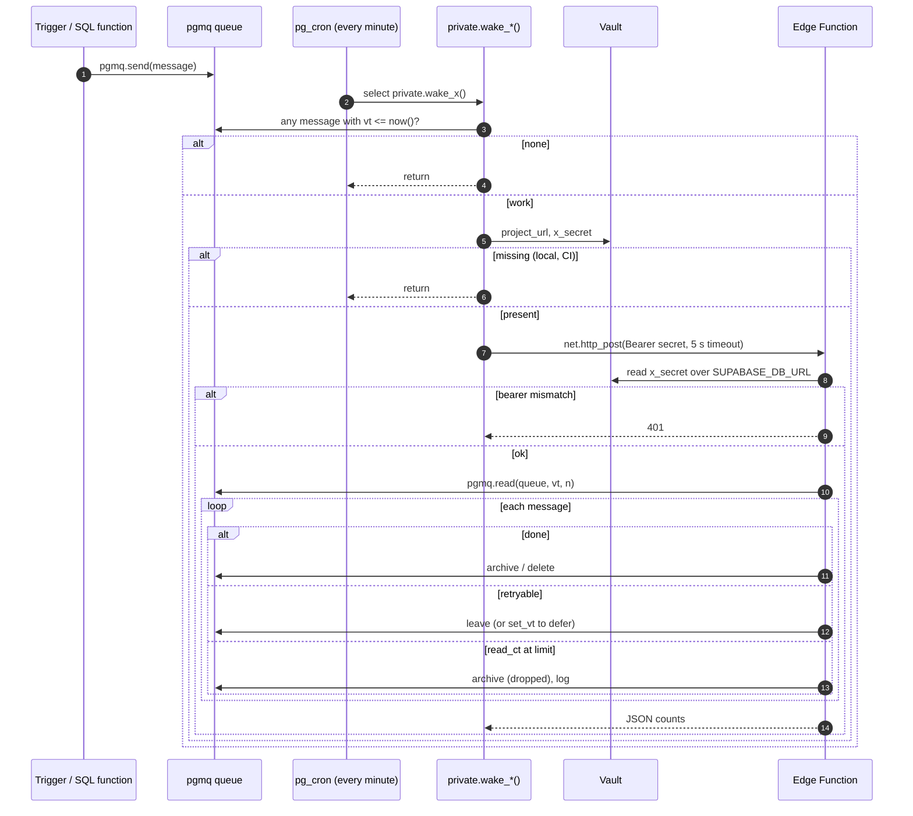
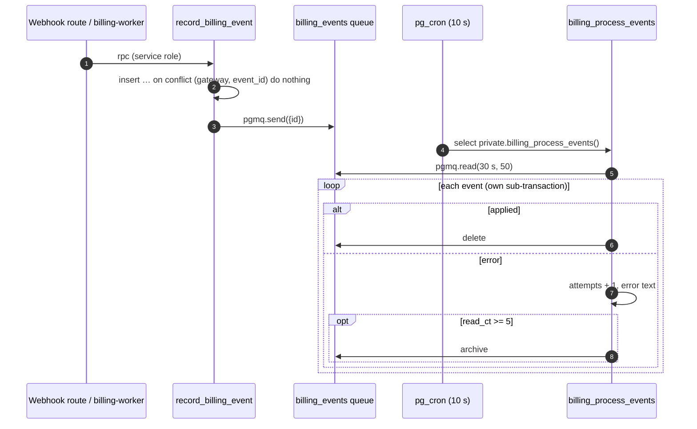
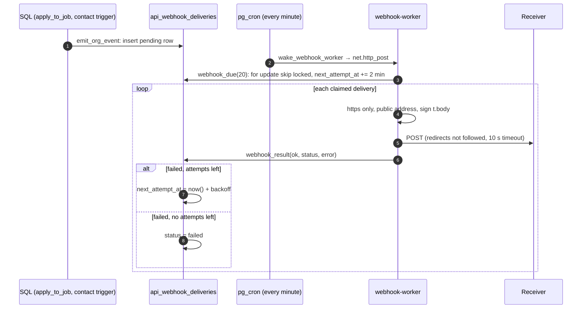
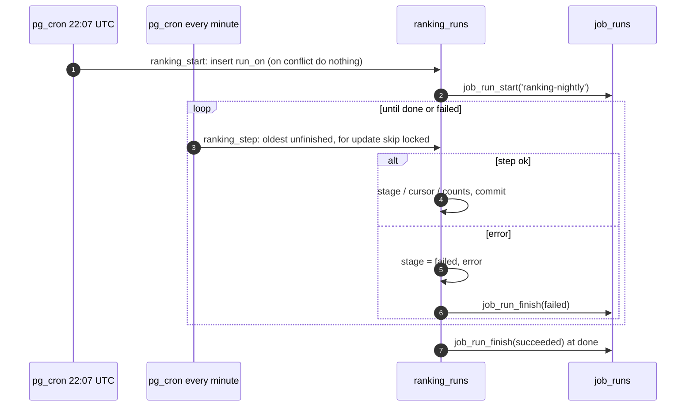
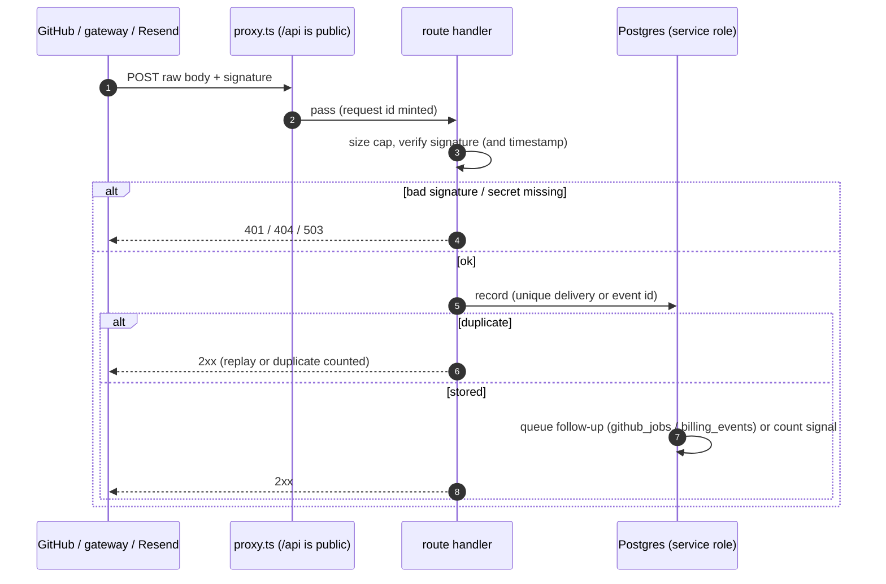
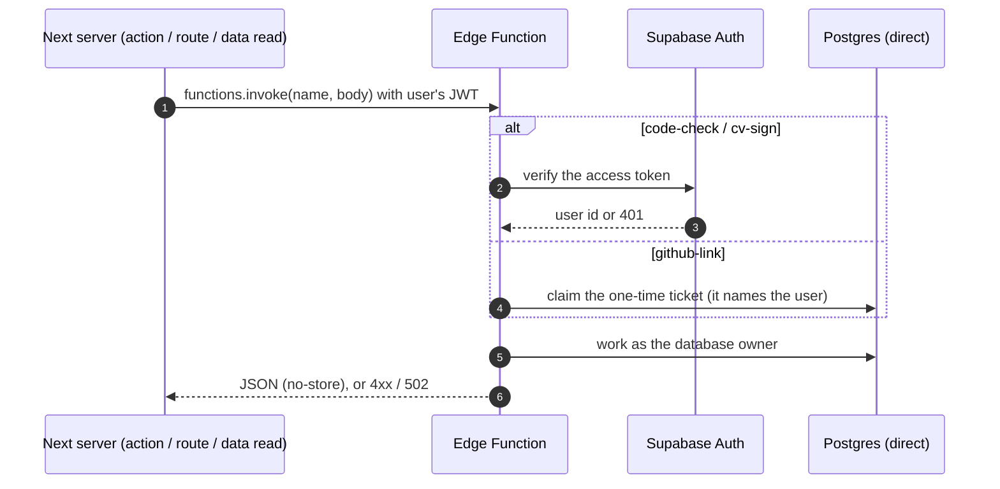

Commit: dee328c
Covers: supabase/migrations/20260927000000_foundations.sql (job_runs), supabase/migrations/20260930000000_phase3_answers.sql (storage_cleanup), every cron.schedule and pgmq.create in supabase/migrations/, supabase/functions/*/index.ts, supabase/functions/storage-cleanup/, supabase/functions/_shared/storage/, the inbound webhook routes, supabase/config.toml ([functions.*])

# Background jobs

Everything that runs without a page request: 47 pg_cron jobs, 8 pgmq queues, 11 Edge Functions and 3 inbound webhooks. Each subsystem doc explains what its jobs compute; this doc explains how they are woken, how they fail and how they avoid doing work twice.

## Mechanisms

### pg_cron

Every job is created once by `cron.schedule` in a migration; no migration reschedules or unschedules one. Schedules are in UTC: `cv-refresh` runs at `30 19 28-31 * *` for "00:30 PKT on the 1st" [src: supabase/migrations/20261008000000_verified_cv.sql#at 00:30 PKT on the 1st] [src: supabase/migrations/20261008000000_verified_cv.sql#select cron.schedule('cv-refresh', '30 19 28-31 * *']. A job either runs SQL directly or calls a `private.wake_*` function that wakes an Edge Function.

### Waking an Edge Function

A wake function does nothing unless there is work: a visible message in its queue, a due row, or a candidate [src: supabase/migrations/20260927224500_github_connect.sql#if not exists (select 1 from pgmq.q_github_jobs where vt <= now()) then] [src: supabase/migrations/20261016000000_recruiter_api.sql#d.status = 'pending' and d.next_attempt_at <= now()]. It then reads two Vault secrets, `project_url` and the worker's own bearer secret, and returns quietly if either is missing, which is the case on local and CI stacks [src: supabase/migrations/20260927224500_github_connect.sql#without it (local, CI) this is a no-op]. Finally it calls `net.http_post` to `<project_url>/functions/v1/<name>` with the bearer secret and a 5-second timeout, and does not look at the response [src: supabase/migrations/20260927224500_github_connect.sql#url := rtrim(v_url, '/') || '/functions/v1/github-worker'] [src: supabase/migrations/20260927224500_github_connect.sql#timeout_milliseconds := 5000]. If the call fails, the work stays in the queue and the next minute's wake tries again.

Each worker's bearer secret is generated by its migration with `gen_random_bytes(32)` and stored only in Vault [src: supabase/migrations/20260927224500_github_connect.sql#The worker's bearer secret is generated here, never stored in the repo]. The function reads the same secret over its own database connection and compares it in constant time; anything but a POST gets 405, a wrong or missing bearer 401 [src: supabase/functions/github-worker/index.ts#select decrypted_secret as secret from vault.decrypted_secrets where name = 'github_worker_secret'] [src: supabase/functions/_shared/github/types.ts#Constant-time string comparison for bearer secrets] [src: supabase/functions/github-worker/index.ts#status: 405]. The Supabase gateway's JWT check is off for all eleven functions; each checks its caller itself [src: supabase/config.toml#Woken by pg_cron with a Vault bearer secret (billing_worker_secret)] [src: supabase/config.toml#Callers are checked inside].

| Wake function | Vault secret | Edge Function | Wakes when |
|---|---|---|---|
| `wake_github_worker` | `github_worker_secret` | `github-worker` | `github_jobs` has a visible message [src: supabase/migrations/20260927224500_github_connect.sql#create function private.wake_github_worker] |
| `wake_notify_worker` | `notify_worker_secret` | `notify-worker` | `notification_emails` has one [src: supabase/migrations/20260929000000_notifications.sql#create function private.wake_notify_worker] |
| `wake_link_preview_worker` | `link_preview_worker_secret` | `link-preview` | `link_previews` has one [src: supabase/migrations/20260929020000_comments_links.sql#create function private.wake_link_preview_worker] |
| `wake_storage_cleanup_worker` | `storage_cleanup_worker_secret` | `storage-cleanup` | `storage_cleanup` has one [src: supabase/migrations/20260930000000_phase3_answers.sql#create function private.wake_storage_cleanup_worker] |
| `wake_cv_worker` (through `cv_call_worker`) | `cv_worker_secret` | `cv-sign`, action `drain` | `cv_jobs` has one [src: supabase/migrations/20261008000000_verified_cv.sql#perform private.cv_call_worker('{"action":"drain"}'::jsonb)] |
| `wake_webhook_worker` | `webhook_worker_secret` | `webhook-worker` | a pending delivery is due [src: supabase/migrations/20261016000000_recruiter_api.sql#create function private.wake_webhook_worker] |
| `wake_competition_freeze` | `competition_freeze_secret` | `competition-freeze` | `competition_freeze_candidates()` returns a row [src: supabase/migrations/20261015000000_recruiter_jobs.sql#if not exists (select 1 from private.competition_freeze_candidates()) then] |
| `wake_billing_worker` | `billing_worker_secret` | `billing-worker` | `billing_jobs` has one [src: supabase/migrations/20261024000000_billing_lifecycle.sql#create function private.wake_billing_worker] |
| `wake_analytics_worker` | `analytics_worker_secret` | `analytics-worker` | `analytics` has one [src: supabase/migrations/20261104000000_analytics.sql#create function private.wake_analytics_worker] |

### pgmq

A worker reads a batch with a visibility timeout (`pgmq.read(queue, vt, n)`); an unacknowledged message becomes visible again when the timeout ends and its `read_ct` grows by one. Workers acknowledge with `pgmq.delete` or `pgmq.archive`. Several workers archive on success as well as on giving up, so a queue's `a_<queue>` archive table holds both [src: supabase/functions/_shared/github/worker.ts#await db.query("select pgmq.archive('github_jobs', $1::bigint)", [row.msg_id]);]. The worker that gives up after N reads is the only dead-letter step; there is no separate dead-letter queue.

### job_runs and the watchdog

`public.job_runs` holds one row per run of a job that reports itself: `job_run_start(job)` inserts a `running` row and `job_run_finish(id, status, rows, error)` closes it [src: supabase/migrations/20260927000000_foundations.sql#create table public.job_runs] [src: supabase/migrations/20260927000000_foundations.sql#create or replace function public.job_run_start]. Most such jobs wrap their work in an inner block that catches every error and records `failed` with the message, so the work rolls back but the `failed` row commits [src: supabase/migrations/20260927224500_github_connect.sql#perform public.job_run_finish(v_run, 'failed', null, sqlerrm)].

`job-watchdog` runs every 10 minutes and alerts by email on: a pg_cron run that failed in the last 15 minutes, a `job_runs` row that failed, a run going on longer than twice its median, a job whose last start is more than twice its usual gap late, and a queue with a message visible for longer than the `queue_stuck_minutes` limit [src: supabase/migrations/20261105000000_alerts.sql#Scheduled jobs that failed in the last 15 minutes] [src: supabase/migrations/20261105000000_alerts.sql#Runs longer than twice their usual length] [src: supabase/migrations/20261105000000_alerts.sql#Missed schedules] [src: supabase/migrations/20261105000000_alerts.sql#Queues nobody is draining]. Alert state is kept per key with a cooldown, and a condition that stops appearing is marked resolved [src: supabase/migrations/20261105000000_alerts.sql#v_cooldown interval] [src: supabase/migrations/20261105000000_alerts.sql#update private.alert_state set resolved_at = now()]. The emails go through `notification_emails` as kind `ops_alert` [src: supabase/migrations/20261105000000_alerts.sql#'kind', 'ops_alert'].

## Every job, queue, worker and webhook

Kinds: **Q** a pgmq queue with its wake job and worker; **T** a worker that polls a table; **F** an Edge Function called on request; **W** an inbound webhook; **S** a cron job that runs SQL only. Schedules are pg_cron expressions in UTC.

| Name | Kind | Triggered or fed by | Run or drained by | Retry and failure | Idempotency |
|---|---|---|---|---|---|
| `github_jobs` | Q | `private.enqueue_github`, called by `start_github_sync`, `record_github_webhook`, `github_job_advance`, `process_github_webhook`, `request_code_check`, `github_tokens_revoke` [src: supabase/migrations/20260927224500_github_connect.sql#create function private.enqueue_github] [src: supabase/migrations/20260928150000_github_evidence.sql#create function private.github_job_advance] [src: supabase/migrations/20261004000000_code_checks.sql#create function private.request_code_check]. Cron `github-worker` (`* * * * *`) wakes the worker; `github-link` also runs it for 40 s after a link [src: supabase/migrations/20260927224500_github_connect.sql#select cron.schedule('github-worker'] [src: supabase/functions/github-link/index.ts#budgetMs: 40_000] | `github-worker` → `runWorker`: batches of 10, visibility 120 s, stops taking new messages after 50 s [src: supabase/functions/_shared/github/worker.ts#deps.visibilitySeconds ?? 120] [src: supabase/functions/_shared/github/worker.ts#const budget = deps.budgetMs ?? 50_000] | A failed stage reappears after 120 s; at 5 reads, or with no token, it is archived and its sync job marked `failed` or `cancelled` [src: supabase/functions/_shared/github/worker.ts#export const MAX_ATTEMPTS = 5] [src: supabase/functions/_shared/github/worker.ts#error instanceof NoToken ? "cancelled" : "failed"]. A rate limit re-queues a fresh copy with a delay, which does not count as an attempt [src: supabase/functions/_shared/github/worker.ts#A fresh copy with a delay] | A stage that finishes but crashes before its archive runs again after 120 s; per-stage guards are in subsystems/github-skills. Webhook deliveries enter once per delivery id (see the GitHub webhook row) |
| `notification_emails` | Q | `private.notify` (instant emails), `queue_notification_digests` (cron `notification-digest`, `7 13 * * *`), `queue_teacher_digests` (cron `teacher-digest`, `0 4 * * 1`), `queue_university_launch`, `queue_alert_email` [src: supabase/migrations/20261010000000_student_portal.sql#pgmq.send('notification_emails'] [src: supabase/migrations/20260929000000_notifications.sql#select cron.schedule('notification-digest'] [src: supabase/migrations/20261012000000_teacher_portal.sql#select cron.schedule('teacher-digest'] [src: supabase/migrations/20261102000000_university_launch.sql#'kind', 'university_launch'] [src: supabase/migrations/20261105000000_alerts.sql#create function private.queue_alert_email]. Cron `notify-worker` (`* * * * *`) wakes the worker [src: supabase/migrations/20260929000000_notifications.sql#select cron.schedule('notify-worker'] | `notify-worker` → `runNotifyWorker`: batches of 20, visibility 120 s [src: supabase/functions/_shared/notify/worker.ts#pgmq.read('notification_emails', 120, $1::integer)] | A retryable send is deferred `30 × read_ct` seconds, up to 5 reads, then archived as failed; a 429 stops the batch [src: supabase/functions/_shared/notify/worker.ts#await deferUntil(row.msg_id, 30 * row.read_ct)] [src: supabase/functions/_shared/notify/worker.ts#if (sent.status === 429) break]. At 60 sends a day, or when Resend's quota is spent, every message except `ops_alert` is parked until 00:05 UTC [src: supabase/functions/_shared/notify/worker.ts#export const DAILY_CAP = 60] [src: supabase/functions/_shared/notify/worker.ts#midnight.setUTCHours(24, 5, 0, 0)] | Each send carries a Resend `Idempotency-Key`: `notification-<id>`, `digest-<user>-<date>`, `teacher-digest-<user>-<date>`, `university-launch-<request>` [src: supabase/functions/_shared/notify/worker.ts#"Idempotency-Key": idempotencyKey] [src: supabase/functions/_shared/notify/worker.ts#key = `digest-${userId}] |
| `link_previews` | Q | Trigger function `private.post_link_url` when a post gets a link [src: supabase/migrations/20260929020000_comments_links.sql#perform pgmq.send('link_previews', jsonb_build_object('url', new.link_url))]. Cron `link-preview-worker` (`* * * * *`) [src: supabase/migrations/20260929020000_comments_links.sql#select cron.schedule('link-preview-worker'] | `link-preview` → `runLinkPreviewWorker`: batches of 10, visibility 60 s [src: supabase/functions/_shared/links/worker.ts#pgmq.read('link_previews', 60, $1::integer)] | No retry: a refused or failed fetch saves a `failed` preview, and every message is archived [src: supabase/functions/_shared/links/worker.ts#save_link_preview($1, 'failed'] | A URL with a preview fetched in the last 7 days is skipped [src: supabase/functions/_shared/links/worker.ts#fetched_at > now() - interval '7 days'] |
| `storage_cleanup` | Q | `private.queue_storage_cleanup(bucket, path)`, called by delete and update triggers on post media, removed posts, chat images and avatars, by the daily file jobs and by account deletion [src: supabase/migrations/20260930000000_phase3_answers.sql#create trigger post_media_cleanup] [src: supabase/migrations/20260930000000_phase3_answers.sql#create trigger profiles_avatar_cleanup] [src: supabase/migrations/20261010000000_student_portal.sql#perform private.queue_storage_cleanup(o.bucket_id, o.name)]. Cron `storage-cleanup-worker` (`* * * * *`) [src: supabase/migrations/20260930000000_phase3_answers.sql#select cron.schedule('storage-cleanup-worker'] | `storage-cleanup` → `runStorageCleanup`: batches of 50, visibility 60 s, one Storage API delete per bucket as the service role [src: supabase/functions/_shared/storage/cleanup.ts#pgmq.read('storage_cleanup', 60, $1::integer)] [src: supabase/functions/storage-cleanup/index.ts#SUPABASE_SERVICE_ROLE_KEY] | A failed bucket delete leaves its messages; after 5 reads they are archived as dropped. A message with an unknown bucket or a path that is not `<uuid>/<uuid>.webp` (or `.pdf` for three buckets) is archived at once [src: supabase/functions/_shared/storage/cleanup.ts#const MAX_TRIES = 5] [src: supabase/functions/_shared/storage/cleanup.ts#reason: "bad_message"] | A message read again after a crash sends the same delete again. The SQL side queues `org-documents` paths [src: supabase/migrations/20261030000000_ops_wrapup.sql#'university-claims', 'university-media', 'org-documents'], but the worker's bucket list lacks it [src: supabase/functions/_shared/storage/cleanup.ts#const BUCKETS], so those messages are archived as `bad_message` and the files stay |
| `analytics` | Q | `private.track` from triggers on source tables, and `private.analytics_forget_user` (a `delete_person` message, delayed one hour) when an `auth.users` row is deleted [src: supabase/migrations/20261104000000_analytics.sql#perform pgmq.send('analytics', jsonb_strip_nulls] [src: supabase/migrations/20261104000000_analytics.sql#'kind', 'delete_person', 'distinct_id', old.id), 3600]. Cron `analytics-worker` (`* * * * *`) [src: supabase/migrations/20261104000000_analytics.sql#select cron.schedule('analytics-worker'] | `analytics-worker` → `runAnalyticsWorker`: up to 200 messages, visibility 120 s, one PostHog `/batch/` call [src: supabase/functions/_shared/analytics/worker.ts#pgmq.read('analytics', 120, $1::integer)] | A failed batch stays and is retried; captures at 5 reads are deleted. Muted events and malformed messages are deleted unsent. Deletions retry hourly and are never dropped [src: supabase/functions/_shared/analytics/worker.ts#export const MAX_TRIES = 5] [src: supabase/functions/_shared/analytics/worker.ts#const DELETE_RETRY_S = 3600]. Cron `purge-analytics` (`47 3 * * *`) drops captures older than 7 days [src: supabase/migrations/20261104000000_analytics.sql#where enqueued_at < now() - interval '7 days' and message ->> 'kind' = 'capture'] | Each capture carries the `uuid` the trigger generated [src: supabase/migrations/20261104000000_analytics.sql#'uuid', gen_random_uuid()] [src: supabase/functions/_shared/analytics/worker.ts#uuid: message.uuid] |
| `cv_jobs` | Q | `private.cv_refresh_start` (cron `cv-refresh`, `30 19 28-31 * *`), which acts only when the Pakistan date is the 1st [src: supabase/migrations/20261008000000_verified_cv.sql#extract(day from now() at time zone 'Asia/Karachi') <> 1]. Cron `cv-worker` (`* * * * *`) [src: supabase/migrations/20261008000000_verified_cv.sql#select cron.schedule('cv-worker'] | `cv-sign`, action `drain` → `drainQueue`: 20 at a time, visibility 120 s [src: supabase/functions/_shared/cv/issue.ts#pgmq.read('cv_jobs', 120, $1)] | A failure leaves the message for 120 s; after 5 reads it is archived; a missing signing key stops the batch [src: supabase/functions/_shared/cv/issue.ts#m.read_ct > 5] [src: supabase/functions/_shared/cv/issue.ts#if (error instanceof NoSigningKey) break] | The worker issues a new version only if the snapshot changed [src: supabase/migrations/20261008000000_verified_cv.sql#the worker issues a new version only if the snapshot changed] |
| `billing_events` | Q | `private.record_billing_event`, called with the service role by the billing webhook route and by the billing worker for its own outcomes [src: supabase/migrations/20261024000000_billing_lifecycle.sql#perform pgmq.send('billing_events', jsonb_build_object('id', v_id))] [src: lib/billing/record.ts#rpc("record_billing_event"] | SQL, not an Edge Function: `private.billing_process_events` (cron `billing-events`, every 10 seconds), and the billing worker calls it after a run. 50 per run, visibility 30 s [src: supabase/migrations/20261024000000_billing_lifecycle.sql#select cron.schedule('billing-events', '10 seconds'] [src: supabase/migrations/20261024000000_billing_lifecycle.sql#pgmq.read('billing_events', 30, p_max)] | Each event applies in its own sub-transaction; a failure records `attempts` and `error` on the stored event and leaves the message; at 5 reads it is archived [src: supabase/migrations/20261024000000_billing_lifecycle.sql#update public.billing_webhook_events set attempts = attempts + 1] | `billing_webhook_events` is unique on gateway and event id; a repeat insert does nothing [src: supabase/migrations/20261024000000_billing_lifecycle.sql#on conflict (gateway, event_id) do nothing]. Cron `billing-purge` (`41 3 * * *`) deletes processed events after 400 days |
| `billing_jobs` | Q | `private.queue_charge` (renewals, from `billing_tick`) and `private.ops_refund` (staff refunds) [src: supabase/migrations/20261024000000_billing_lifecycle.sql#perform private.queue_charge(r.id)] [src: supabase/migrations/20261025000000_billing_ops.sql#perform pgmq.send('billing_jobs'] . Cron `billing-worker` (`* * * * *`) [src: supabase/migrations/20261024000000_billing_lifecycle.sql#select cron.schedule('billing-worker'] | `billing-worker` → `runBillingWorker`, reading through `private.billing_jobs_read` (10, visibility 120 s) [src: supabase/migrations/20261024000000_billing_lifecycle.sql#pgmq.read('billing_jobs', 120, p_max)] | A job that throws stays queued; at 5 reads `billing_job_failed` archives it and, for a charge, records a `payment.failed` event [src: supabase/migrations/20261024000000_billing_lifecycle.sql#create function private.billing_job_failed] | The job's `idempotency_key` goes to the gateway adapter, and its outcome is recorded with event id `charge:<key>` [src: supabase/functions/_shared/billing/worker.ts#idempotencyKey: job.idempotency_key] [src: supabase/functions/_shared/billing/worker.ts#charge:${job.idempotency_key}] |
| `webhook-worker` | T | Rows in `api_webhook_deliveries`, inserted by `private.emit_org_event` from `apply_to_job` (`application.created`) and the `contact_requests_accepted` trigger (`contact.accepted`) [src: supabase/migrations/20261016000000_recruiter_api.sql#create or replace function private.emit_org_event] [src: supabase/migrations/20261015000000_recruiter_jobs.sql#'application.created'] [src: supabase/migrations/20261016000000_recruiter_api.sql#create trigger contact_requests_accepted]. Cron `webhook-worker` (`* * * * *`) | `runWebhookWorker`: `private.webhook_due` claims up to 20 with `for update skip locked` and pushes their next attempt 2 minutes out [src: supabase/migrations/20261016000000_recruiter_api.sql#for update skip locked] [src: supabase/migrations/20261016000000_recruiter_api.sql#set next_attempt_at = now() + interval '2 minutes'] | `webhook_result` backs off 1 min, 5 min, 30 min, 2 h, 12 h, then marks the delivery `failed`; an endpoint is deactivated after 30 consecutive failures [src: supabase/migrations/20261016000000_recruiter_api.sql#Backoff: 1 minute, 5 minutes, 30 minutes, 2 hours, 12 hours, then failed] [src: supabase/migrations/20261016000000_recruiter_api.sql#active = (consecutive_failures + 1) < 30]. Cron `webhook-purge` (`37 3 * * *`) deletes deliveries after 30 days | Each body carries `delivery_id` and `attempt`, signed with HMAC over `<timestamp>.<body>`, for the receiver to de-duplicate [src: supabase/functions/_shared/webhooks/worker.ts#delivery_id: String(row.id), attempt: row.attempt + 1]. `webhook_result` ignores a delivery that is no longer pending [src: supabase/migrations/20261016000000_recruiter_api.sql#if not found or d.status <> 'pending' then] |
| `competition-freeze` | T | Teams in a frozen or judged competition with a repository and no freeze record [src: supabase/migrations/20261015000000_recruiter_jobs.sql#t.frozen_checked_at is null]. Cron `competition-freeze` (`*/5 * * * *`) | `runCompetitionFreeze` reads GitHub's commits API (optional `GITHUB_READ_TOKEN`) [src: supabase/functions/competition-freeze/index.ts#GITHUB_READ_TOKEN] | Network errors, 5xx and rate-limit 403s are left for the next tick; 404, other 403s, 409 and 451 record "not readable" [src: supabase/functions/_shared/competitions/freeze.ts#Transient failures (network, 5xx, rate limits) are retried on the next tick] | `competition_freeze_record` writes only where `frozen_checked_at is null` [src: supabase/migrations/20261015000000_recruiter_jobs.sql#where id = p_team and frozen_checked_at is null] |
| `github-link` | F | `/api/github/callback` after the GitHub App redirect, with the student's session [src: app/api/github/callback/route.ts#functions.invoke<{ status: string }>("github-link"] | `linkGithub(ticket)`: the ticket the student wrote decides who is linked [src: supabase/functions/github-link/index.ts#the ticket, not the caller, decides who is linked] | 503 `not_configured` before the ticket is claimed when GitHub App secrets are missing [src: supabase/functions/github-link/index.ts#Checked before the ticket is claimed] | The GitHub OAuth code is one-time [src: supabase/functions/github-link/index.ts#one-time OAuth code]; spent link tickets are purged after a day [src: supabase/migrations/20260927224500_github_connect.sql#spent link tickets a day] |
| `code-check` | F | `getSnippet` in `lib/data/code-checks.ts` with the user's access token [src: lib/data/code-checks.ts#functions.invoke] | `serveSnippet`, after checking the token with Supabase Auth [src: supabase/functions/code-check/index.ts#authVerifier] | 502 `unavailable` on an exception; responses are `no-store` [src: supabase/functions/code-check/index.ts#status: 502] | Read-only: the snippet is read from GitHub and never stored [src: supabase/functions/code-check/index.ts#never stored] |
| `cv-sign` (user actions) | F | `lib/actions/cv.ts` and `lib/data/cv.ts` with the student's session: `ensure`, `reissue`, `refresh` [src: lib/actions/cv.ts#("cv-sign", { body: { action } })] [src: lib/data/cv.ts#body: { action: "ensure" }]; `private.cv_rotate_key()` by hand with the worker secret [src: supabase/migrations/20261008000000_verified_cv.sql#create function private.cv_rotate_key] | `handleCvSign` [src: supabase/functions/_shared/cv/issue.ts#export async function handleCvSign] | SQL refusals map to 403, 429 or 409; other errors 502 [src: supabase/functions/_shared/cv/issue.ts#"54000": [429, "rate_limited"]] | `ensure` issues only when the student has no CV [src: supabase/functions/_shared/cv/issue.ts#ensure (issue their first CV] |
| `POST /api/github/webhook` | W | GitHub App deliveries [src: app/api/github/webhook/route.ts#GitHub App webhooks] | `record_github_webhook` (service role) stores a trimmed summary and queues stage `webhook` [src: supabase/migrations/20260927224500_github_connect.sql#perform private.enqueue_github(jsonb_build_object('stage', 'webhook', 'delivery_id', p_delivery_id))] | 401 on a bad signature, 503 without a secret, 500 when storing fails; unhandled events 202 [src: app/api/github/webhook/route.ts#error_code: "bad_signature"] [src: app/api/github/webhook/route.ts#if (error) return reply(500] | One row per delivery id; a replay answers 202 with `replay: true` [src: supabase/migrations/20260927224500_github_connect.sql#on conflict (delivery_id) do nothing] [src: app/api/github/webhook/route.ts#replay: recorded === false] |
| `POST /api/billing/webhook/<gateway>` | W | Simulated, Safepay and Paddle gateways [src: lib/billing/webhook.ts#export async function handleBillingWebhook] | `handleBillingWebhook` verifies the signature and timestamp on the raw body, then `recordWithServiceRole` stores each event (→ `billing_events`) [src: lib/billing/webhook.ts#adapter.verifyWebhook] [src: lib/billing/record.ts#recordWithServiceRole] | 404 unknown or disabled gateway, 400/401 bad body or signature, 500 on a verify or store error; signature, timestamp and store failures record a service signal for the payments alert [src: lib/billing/webhook.ts#errorCode: "store_failed"] [src: lib/billing/record.ts#recordWebhookFailure] | Unique gateway and event id (see `billing_events`); duplicates are counted in the log line [src: lib/billing/webhook.ts#duplicates] |
| `POST /api/webhooks/resend` | W | Resend delivery events [src: app/api/webhooks/resend/route.ts#Resend's delivery webhook] | `handleResendWebhook` verifies the Svix signature (±5 minutes) and records `email_delivered` or `email_bounced` with `record_service_signal` [src: lib/monitoring/resend-webhook.ts#export function verifySvix] [src: app/api/webhooks/resend/route.ts#rpc("record_service_signal"] | 404 when `RESEND_WEBHOOK_SECRET` is unset, 401 on a bad signature, 400 on bad JSON, 500 when recording fails; other event types 200 and ignored [src: lib/monitoring/resend-webhook.ts#if (!opts.secret) return { status: 404] | None: only the signal kind is stored, so a redelivered event counts twice [src: lib/monitoring/resend-webhook.ts#await opts.record(signal)] |
| `account-deletion` | S | `17 * * * *` [src: supabase/migrations/20261010000000_student_portal.sql#select cron.schedule('account-deletion'] | `private.account_deletion_run`: 20 accounts past `delete_after`, `for update skip locked` [src: supabase/migrations/20261010000000_student_portal.sql#create function private.account_deletion_run] | A failed account logs a warning and the rest continue; it is picked again next hour [src: supabase/migrations/20261010000000_student_portal.sql#account deletion failed for %] | A deleted account no longer matches `status = 'deleting'` |
| `billing-tick` | S | `*/5 * * * *` [src: supabase/migrations/20261024000000_billing_lifecycle.sql#select cron.schedule('billing-tick'] | `billing_tick_job` → `private.billing_tick` (trials, periods, retries, grace; subsystems/billing) [src: supabase/migrations/20261024000000_billing_lifecycle.sql#v_out := private.billing_tick()] | `job_runs` `failed`, work rolled back [src: supabase/migrations/20261024000000_billing_lifecycle.sql#v_run uuid := public.job_run_start('billing-tick')] | subsystems/billing |
| `close-expired-jobs` | S | `17 19 * * *` [src: supabase/migrations/20261015000000_recruiter_jobs.sql#select cron.schedule('close-expired-jobs'] | `private.close_expired_jobs` closes live job posts past their deadline [src: supabase/migrations/20261015000000_recruiter_jobs.sql#where status = 'live' and deadline < current_date] | pg_cron log; watchdog `job_failed` | Guarded by `status = 'live'` |
| `code-checks-tick` | S | `*/5 * * * *` [src: supabase/migrations/20261004000000_code_checks.sql#select cron.schedule('code-checks-tick'] | `private.code_checks_tick`: time-outs, expiries, stuck checks [src: supabase/migrations/20261004000000_code_checks.sql#Every 5 minutes: time-outs submit what was saved] | `job_runs` `failed` | Every update is guarded by the check's status |
| `competitions-tick` | S | `*/10 * * * *` [src: supabase/migrations/20261015000000_recruiter_jobs.sql#select cron.schedule('competitions-tick'] | `private.competitions_tick`: approved → live at start, live → frozen at deadline [src: supabase/migrations/20261015000000_recruiter_jobs.sql#update public.competitions set status = 'frozen'] | pg_cron log | Status-guarded |
| `contact-expiry` | S | `7 * * * *` [src: supabase/migrations/20261014000000_recruiter_talent.sql#select cron.schedule('contact-expiry'] | `private.expire_contact_requests` [src: supabase/migrations/20261014000000_recruiter_talent.sql#where status = 'pending' and expires_at <= now()] | pg_cron log | Guarded by `status = 'pending'` |
| `credentials-daily` | S | `13 19 * * *` [src: supabase/migrations/20261003000000_credentials.sql#select cron.schedule('credentials-daily'] | `private.credentials_daily`: expire credentials, queue rejected and orphaned files for deletion [src: supabase/migrations/20261003000000_credentials.sql#Daily: expire credentials, delete rejected files after 30 days] | `job_runs` `failed` | Status and `file_deleted_at` guards; an orphaned file is queued again each day until it is gone |
| `cv-exports-daily` | S | `23 19 * * *` [src: supabase/migrations/20261009000000_cv_control.sql#select cron.schedule('cv-exports-daily'] | `private.cv_exports_daily`: PDF files after 30 days, unrecorded uploads after a day [src: supabase/migrations/20261009000000_cv_control.sql#Daily: PDF files go after 30 days] | `job_runs` `failed` | `file_deleted_at is null` guard |
| `cv-refresh` | S | `30 19 28-31 * *` | Queues `cv_jobs` (see that row) | `job_runs` `failed` [src: supabase/migrations/20261008000000_verified_cv.sql#v_run := public.job_run_start('cv-refresh')] | Day-of-month check; the worker skips unchanged snapshots |
| `feed-stage` | S | `*/5 * * * *` [src: supabase/migrations/20260929040000_feed_ranking.sql#select cron.schedule('feed-stage'] | `private.feed_stage_job` recomputes the stage of recent posts [src: supabase/migrations/20260929040000_feed_ranking.sql#v_new := private.compute_stage(r.id)] | `job_runs` `failed` | Writes only when the stage changed |
| `github-nightly-sync` | S | `17 21 * * *` [src: supabase/migrations/20260928150000_github_evidence.sql#select cron.schedule('github-nightly-sync'] | `private.github_nightly_sync` starts a sync for every linked account → `github_jobs` [src: supabase/migrations/20260928150000_github_evidence.sql#perform private.start_github_sync(v_user, 'nightly')] | `job_runs` `failed` | subsystems/github-skills |
| `graduate-rollover` | S | `10 19 * * *` [src: supabase/migrations/20261010000000_student_portal.sql#select cron.schedule('graduate-rollover'] | `private.graduate_rollover` (last defined in `graduate_rule`) [src: supabase/migrations/20261011000000_graduate_rule.sql#create function private.graduate_rollover(p_today date default null)] | pg_cron log | Guarded by `status = 'active'` [src: supabase/migrations/20261011000000_graduate_rule.sql#and p.status = 'active'] |
| `hire-outcome` | S | `11 5 * * *` [src: supabase/migrations/20261015000000_recruiter_jobs.sql#select cron.schedule('hire-outcome'] | `private.ask_hire_outcomes`: one question 90 days after a hire [src: supabase/migrations/20261015000000_recruiter_jobs.sql#Daily: 90 days after a hire] | pg_cron log | `not exists` plus `on conflict do nothing` on `hire_outcomes` |
| `job-watchdog` | S | `*/10 * * * *` [src: supabase/migrations/20261105000000_alerts.sql#select cron.schedule('job-watchdog'] | `private.job_watchdog` (see above) | A failure rolls the run back; pg_cron's log keeps the error and the next run reports it [src: supabase/migrations/20261105000000_alerts.sql#A failure rolls this run back] | Alert state per key with a cooldown |
| `marketing-stats` | S | `17 * * * *` [src: supabase/migrations/20261031000000_marketing.sql#select cron.schedule('marketing-stats'] | `private.refresh_landing_stats` refreshes two materialised views [src: supabase/migrations/20261031000000_marketing.sql#refresh materialized view concurrently private.landing_universities_mv] | pg_cron log | A refresh |
| `ops-metrics` | S | `23 * * * *` [src: supabase/migrations/20261029000000_config_metrics.sql#select cron.schedule('ops-metrics'] | `private.refresh_ops_metrics` [src: supabase/migrations/20261029000000_config_metrics.sql#refresh materialized view private.ops_metrics_mv] | pg_cron log | Snapshots upsert on metric, time and label |
| `org-spam-check` | S | `29 4 * * *` [src: supabase/migrations/20261016000000_recruiter_api.sql#select cron.schedule('org-spam-check'] | `private.check_org_spam` opens a spam review above the decline rate [src: supabase/migrations/20261016000000_recruiter_api.sql#Daily: an organisation above 80% declines] | pg_cron log | `on conflict do nothing` on `org_spam_reviews` |
| `purge-feed-sessions` | S | `53 3 * * *` | Deletes feed sessions older than a day [src: supabase/migrations/20260929040000_feed_ranking.sql#delete from public.feed_sessions where created_at < now() - interval '1 day'] | pg_cron log | Delete by age |
| `purge-github-data` | S | `37 3 * * *` | `private.purge_github_data`: webhook payloads after 30 days, link tickets after a day [src: supabase/migrations/20260927224500_github_connect.sql#select cron.schedule('purge-github-data'] | `job_runs` `failed` | Delete by age |
| `purge-link-previews` | S | `41 3 * * *` | Deletes previews older than 30 days [src: supabase/migrations/20260929020000_comments_links.sql#delete from public.link_previews where fetched_at < now() - interval '30 days'] | pg_cron log | Delete by age |
| `purge-monitoring` | S | `43 3 * * *` [src: supabase/migrations/20261105000000_alerts.sql#select cron.schedule('purge-monitoring'] | `private.purge_monitoring`: service signals 30 days, web vitals 14, resolved alerts 90, pg_cron's run log 7 [src: supabase/migrations/20261105000000_alerts.sql#delete from cron.job_run_details where end_time < now() - interval '7 days'] | pg_cron log | Delete by age |
| `purge-notifications` | S | `23 3 * * *` [src: supabase/migrations/20260929000000_notifications.sql#select cron.schedule('purge-notifications'] | `private.purge_notifications`: read after 90 days, all after a year, send log after 60 days [src: supabase/migrations/20260929000000_notifications.sql#Read notifications go after 90 days] | pg_cron log | Delete by age |
| `purge-security-data` | S | `23 3 * * *` [src: supabase/migrations/20260927210238_identity.sql#select cron.schedule('purge-security-data'] | `private.purge_security_data` (last defined in `auth_decisions`) [src: supabase/migrations/20260928123000_auth_decisions.sql#create or replace function private.purge_security_data] | `job_runs` `failed` | Delete by age |
| `ranking-nightly` | S | `7 22 * * *` [src: supabase/migrations/20261005000000_ranking.sql#select cron.schedule('ranking-nightly'] | `private.ranking_start` inserts a `ranking_runs` row for the Pakistan date [src: supabase/migrations/20261005000000_ranking.sql#create function private.ranking_start] | Raises `55000` when no formula is set [src: supabase/migrations/20261005000000_ranking.sql#raise exception 'ranking.formula is not set' using errcode = '55000'] | `on conflict (run_on) do nothing`: one run a day [src: supabase/migrations/20261005000000_ranking.sql#on conflict (run_on) do nothing] |
| `ranking-step` | S | `* * * * *` [src: supabase/migrations/20261005000000_ranking.sql#select cron.schedule('ranking-step'] | `private.ranking_step`: one committed step of the oldest unfinished run (rings → students in batches → tiers → snapshot on Sundays) [src: supabase/migrations/20261005000000_ranking.sql#One committed step of the oldest unfinished run] | An error marks the run `failed` and closes its `job_runs` row; the run is not resumed [src: supabase/migrations/20261005000000_ranking.sql#set stage = 'failed', error = left(sqlerrm, 2000)] | `for update skip locked` on the run; a cursor resumes the student batch [src: supabase/migrations/20261005000000_ranking.sql#where finished_at is null order by id limit 1 for update skip locked] |
| `saved-searches` | S | `23 * * * *` [src: supabase/migrations/20261014000000_recruiter_talent.sql#select cron.schedule('saved-searches'] | `private.run_saved_searches`: one notice per due search with new matches [src: supabase/migrations/20261014000000_recruiter_talent.sql#Hourly: a due search with new matches leaves one notice] | pg_cron log | `last_run_at` moves on for every processed search |
| `sponsorship-sync` | S | `15 20 * * *` [src: supabase/migrations/20261025000000_billing_ops.sql#select cron.schedule('sponsorship-sync'] | `sponsorship_sync_job` → `private.sponsorship_sync` (subsystems/billing) | `job_runs` `failed` | subsystems/billing |
| `talent-index-refresh` | S | `*/15 * * * *` [src: supabase/migrations/20261014000000_recruiter_talent.sql#select cron.schedule('talent-index-refresh'] | `private.refresh_talent_index` upserts and prunes `talent_index` [src: supabase/migrations/20261014000000_recruiter_talent.sql#on conflict (student_id) do update] | pg_cron log | A rebuild |
| `teacher-reminders` | S | `7 * * * *` [src: supabase/migrations/20261012000000_teacher_portal.sql#select cron.schedule('teacher-reminders'] | `private.teacher_reminders`: review reminders and expiries [src: supabase/migrations/20261012000000_teacher_portal.sql#create function private.teacher_reminders] | `job_runs` `failed` | `remind7_at` / `remind12_at` and status guards [src: supabase/migrations/20261012000000_teacher_portal.sql#q.remind7_at is null] |
| `uni-daily` | S | `23 19 * * *` [src: supabase/migrations/20261017000000_uni_core.sql#select cron.schedule('uni-daily'] | `private.uni_daily` (last defined in `uni_ecosphere`): claim letters after 90 days, orphaned uploads, media, slug history [src: supabase/migrations/20261018000000_uni_ecosphere.sql#create or replace function private.uni_daily] | `job_runs` `failed` | `letter_deleted_at` guard; orphans queued again until gone |
| `uni-events-hourly` | S | `17 * * * *` [src: supabase/migrations/20261019000000_uni_comms.sql#select cron.schedule('uni-events-hourly'] | `private.uni_events_hourly`: event reminders 24 hours ahead [src: supabase/migrations/20261019000000_uni_comms.sql#Hourly: a reminder 24 hours before, once per registration] | `job_runs` `failed` | `reminded_at` guard |
| `uni-stats` | S | `37 22 * * *` [src: supabase/migrations/20261021000000_uni_records.sql#select cron.schedule('uni-stats'] | `private.uni_stats_run` per university [src: supabase/migrations/20261021000000_uni_records.sql#create function private.uni_stats_run] | `job_runs` `failed` | Upsert on university and area |

The wake jobs `github-worker`, `notify-worker`, `link-preview-worker`, `storage-cleanup-worker`, `cv-worker`, `webhook-worker`, `competition-freeze`, `billing-worker` and `analytics-worker`, and the purge jobs `billing-purge`, `purge-analytics` and `webhook-purge`, are described in their queue or worker rows above.

## Sequences by worker family

### Queue workers woken by pg_cron

`github-worker`, `notify-worker`, `link-preview`, `storage-cleanup`, `analytics-worker`, `billing-worker`, and `cv-sign` in its `drain` role.

### Queue drained in SQL

`billing_events` has no Edge Function: pg_cron calls SQL every 10 seconds.

### Workers that poll a table

`webhook-worker` and `competition-freeze` keep their state in rows, not in a queue.

### SQL jobs and the ranking state machine

Most SQL jobs are one call; the nightly ranking is a run row moved one committed step a minute.

### Inbound webhooks

### Functions called on request

`github-link`, `code-check` and `cv-sign` are called by the Next server with the signed-in user's access token, through `supabase.functions.invoke` on the session client.

## Running jobs by hand

- `private.cv_rotate_key()` sends a `rotate` request to `cv-sign`; it says to set `project_url` first when the secret is missing [src: supabase/migrations/20261008000000_verified_cv.sql#not sent: set the Vault secret project_url first]. `private.cv_refresh_start(true)` skips the day-of-month check [src: supabase/migrations/20261008000000_verified_cv.sql#if not p_force and extract(day].
- `private.billing_process_events()` can be called directly, as the tests do [src: supabase/migrations/20261024000000_billing_lifecycle.sql#tests call it directly].
- The watchdog's missed-schedule check looks only at jobs whose `cron.job.active` is true, so a paused job raises no `job_missed` alert [src: supabase/migrations/20261105000000_alerts.sql#where j.active and s.n >= 4].
