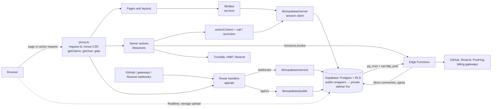

Commit: dee328c
Covers: app/ (route groups and root files), proxy.ts, lib/actions/context.ts, lib/actions/rpc.ts, lib/data/, lib/supabase/, lib/env.ts, lib/storage.ts, lib/motion.ts, lib/format/, lib/images/, components/ui/, components/providers/theme-provider.tsx, app/globals.css, vercel.json, supabase/config.toml

# Architecture overview

The map of the system: which route group serves which portal, the layers a request passes through, and where each external service is called. The request path in detail is in [request-lifecycle.md](request-lifecycle.md); jobs, queues and workers in [background-jobs.md](background-jobs.md); configuration and deploy in [environments-and-deploy.md](environments-and-deploy.md).

## Route groups and portals

Everything under `app/` is one Next.js App Router app. Route groups (folders in parentheses) share a layout but add nothing to the URL; who may open a path is decided by the gate in `lib/auth/gate.ts`, which `proxy.ts` runs on every matched request [src: proxy.ts#decideRoute] [src: lib/auth/gate.ts#export function decideRoute].

| Folder | Paths | Who it serves | Where access is decided |
|---|---|---|---|
| `app/(marketing)/` | `/`, `/recruiters`, `/universities`, `/faculty`, `/about`, `/pricing`, `/request-university`, `/terms`, `/privacy`, `/verify` | Anyone, signed in or not | Listed as public paths [src: lib/auth/gate.ts#MARKETING_PATHS] [src: lib/auth/gate.ts#"/verify"] |
| `app/(auth)/` | `/signin`, `/signup` (and `/signup/recruiter`), `/forgot-password`, `/reset-password` | Signed-out visitors; a signed-in user is sent home | [src: lib/auth/gate.ts#AUTH_PAGES] [src: lib/auth/gate.ts#if (isAuthPage(pathname)) return redirect(homeFor(state))] |
| `app/auth/` | `/auth/callback`, `/auth/confirm`, `/auth/confirmed`, `/auth/link`, `/auth/not-me` | Email-link and OAuth returns | Public prefix `/auth` [src: lib/auth/gate.ts#"/auth"] |
| `app/(app)/` | Everything a signed-in account uses | Students, faculty, recruiters, university officials and staff, each kept to its own prefixes | The gate's role rules, then each portal layout [src: lib/auth/gate.ts#RECRUITER_PREFIXES] [src: lib/auth/gate.ts#UNI_ADMIN_PREFIXES] |
| `app/(dev)/ui/` | `/ui` | Developers: the primitive gallery | Returns 404 in a production build unless `ENABLE_UI_GALLERY` is `1` [src: app/(dev)/ui/page.tsx#ENABLE_UI_GALLERY] |
| `app/api/` | Route handlers | Browsers, webhooks, the recruiter API | `/api` is public to the gate; each handler checks its own caller [src: lib/auth/gate.ts#"/api"] |
| `app/cv/`, `app/join/`, `app/.well-known/` | Shared CV links, the no-JavaScript email field, `security.txt` and the CV signing keys | Anyone | Public prefixes `/cv` and `/.well-known`, and `/join` in the marketing list [src: lib/auth/gate.ts#"/cv"] [src: lib/auth/gate.ts#"/join"] |

Inside `app/(app)/`, the portals are folders, not groups:

| Portal | Paths | Home for | Extra guard |
|---|---|---|---|
| Student | `/feed`, `/explore`, `/ventures`, `/me`, `/chat`, `/opportunities`, `/leaderboard`, … | `role = student` → `/feed` [src: lib/auth/gate.ts#return state.role === "faculty" ? "/teach" : "/feed"] | The student shell renders only for onboarded students [src: components/shell/app-shell.tsx#user.role !== "student"] |
| Faculty | `/teach` | `role = faculty` → `/teach` | `/teach/(portal)` needs an approved teacher profile, else `/teach/apply` [src: app/(app)/teach/(portal)/layout.tsx#redirect("/teach/apply")] |
| Recruiter | `/recruit`, `/org`, `/companies` | `role = recruiter` → `/recruit` [src: lib/auth/gate.ts#if (state.role === "recruiter") return "/recruit"] | Only recruiter accounts open `/recruit` and `/org` [src: lib/auth/gate.ts#isRecruiterArea]; the layout needs an active org member [src: app/(app)/recruit/layout.tsx#redirect("/org/join")] |
| University officials | `/uni`, `/u`, `/events` | `role = university_admin` → `/uni` [src: lib/auth/gate.ts#if (state.role === "university_admin") return "/uni"] | `/uni/(portal)` needs a seat, else `/uni/claim` [src: app/(app)/uni/(portal)/layout.tsx#redirect("/uni/claim")] |
| Staff | `/ops` | Any role that holds staff roles | `/ops` answers 404 to anyone without a staff role [src: app/(app)/ops/layout.tsx#if (!roles.size) notFound()] |

`/ops`, `/uni`, `/recruit` and `/org` also need a two-factor (`aal2`) session; on `aal1` the gate sends the user to Settings → Security [src: lib/auth/gate.ts#requiresTwoFactor] [src: lib/auth/gate.ts#/settings/security?required=1].

The `(app)` layout seeds the signed-in user from `getUser()` into a client provider, records last activity after the response, and wraps every page in the student shell and the restriction banner [src: app/(app)/layout.tsx#getCurrentUser] [src: app/(app)/layout.tsx#touch_activity] [src: app/(app)/layout.tsx#RestrictionBanner]. The root layout reads the per-request CSP nonce and passes it to the theme provider and the PostHog loader [src: app/layout.tsx#NONCE_HEADER] [src: app/layout.tsx#AnalyticsLoader].

## Layers

Each layer calls only the one below it; the database is the only place that decides who may read or change a row.

1. **Browser.** Client components. The browser Supabase client is for Realtime subscriptions and storage uploads only; mutations go through server actions [src: lib/supabase/client.ts#Realtime subscriptions and storage uploads only]. Realtime channels are opened by chat, the nav badges and the new-posts pill [src: components/chat/conversation.tsx#config: { private: true, broadcast] [src: components/shell/nav-badges.tsx#channel(].
2. **Proxy** (`proxy.ts`). Runs before every matched request: strips trailing slashes, mints a request id and a CSP nonce, refreshes the session cookie with `getClaims()`, verifies the user with `getUser()`, reads `my_gate_state`, and applies the gate [src: proxy.ts#newRequestId] [src: proxy.ts#newNonce] [src: proxy.ts#refreshSession] [src: proxy.ts#auth.getUser()] [src: proxy.ts#my_gate_state]. Static assets, image optimisation and `/ingest` are not matched [src: proxy.ts#matcher].
3. **Pages and layouts** (server components). They read through `lib/data/*`; every module there imports `server-only` [src: lib/data/recruit.ts#import "server-only"]. The shared helper `rpcJson` calls one SQL function with the user's session client and returns its jsonb document; the recruiter reads, for example, are each one such call [src: lib/data/rpc-json.ts#rpcJson] [src: lib/data/recruit.ts#rpcJson<ShortlistSummary[]>("shortlists_list")]. Pages turn refusal codes into `notFound()` or a redirect with `isRefusal` [src: lib/data/rpc-json.ts#isRefusal].
4. **Server actions** (`lib/actions/*`, `"use server"`). Each opens an `ActionContext` (request id, client IP hash, user agent, origin, and a `done()` that writes one log line), validates input with Zod, checks the session with `getUser()`, and calls one SQL function through `call` or `rpcAction` [src: lib/actions/context.ts#actionContext] [src: lib/actions/rpc.ts#signedIn] [src: lib/actions/rpc.ts#export async function call] [src: lib/actions/recruit-run.ts#rpcAction]. The result is a typed `ActionResult` [src: lib/actions/result.ts#ActionResult].
5. **Route handlers** (`app/api/**/route.ts`). Webhooks verify a signature on the raw body and write with the service-role client [src: app/api/github/webhook/route.ts#createServiceClient] [src: app/api/webhooks/resend/route.ts#createServiceClient]; the recruiter API runs as `anon` carrying a bearer token [src: lib/api/v1.ts#createPublicClient].
6. **Supabase clients** (`lib/supabase/*`). Five constructors:

   | Module | Key | Cookies | Used by |
   |---|---|---|---|
   | `client.ts` | publishable | browser session | client components [src: lib/supabase/client.ts#createBrowserClient] |
   | `server.ts` | publishable | request cookies (read-only in server components) | pages, server actions, route handlers acting for a user [src: lib/supabase/server.ts#Session client for RSC, route handlers and server actions] |
   | `proxy.ts` | publishable | request and response cookies | `proxy.ts` only [src: lib/supabase/proxy.ts#refreshSession] |
   | `public.ts` | publishable | none (acts as `anon`) | public reference data and `/api/v1` [src: lib/supabase/public.ts#createPublicClient] |
   | `service.ts` | service role | none (bypasses RLS) | webhooks and billing only [src: lib/supabase/service.ts#Service-role client: bypasses RLS] |

   ESLint refuses an import of `service.ts` outside `lib/jobs/**`, `lib/billing/**`, `app/api/webhooks/**`, `app/api/github/webhook/**` and `app/api/jobs/**`, and refuses any `getSession()` call [src: eslint.config.mjs#SERVICE_ROLE_ALLOWED] [src: eslint.config.mjs#Don't use getSession()]. All three cookie-reading clients share one cookie name, `__Secure-skl-auth` in production and `skl-auth` otherwise [src: lib/supabase/cookie-options.ts#__Secure-skl-auth].
7. **Postgres.** Business rules live in `security definer` functions in the unexposed `private` schema; `public` gets a `security invoker` wrapper per function, generated at the end of each migration by a temporary `pg_temp.expose` helper and granted to `authenticated` (or `anon` for the API) [src: supabase/migrations/20261013000000_recruiter_orgs.sql#security invoker set search_path] [src: supabase/migrations/20261016000000_recruiter_api.sql#pg_temp.expose(array['api_candidate']. A function checks the caller itself, for example `require_org` (signed in, `aal2`, active member, verified organisation) [src: supabase/migrations/20261013000000_recruiter_orgs.sql#create function private.require_org].
8. **Jobs.** pg_cron runs SQL on a schedule and wakes Edge Functions with `net.http_post` and a bearer secret from Vault; pgmq queues carry work to them [src: supabase/migrations/20260927224500_github_connect.sql#perform net.http_post] [src: supabase/migrations/20260927224500_github_connect.sql#github_worker_secret]. Details in [background-jobs.md](background-jobs.md).
9. **Edge Functions** (`supabase/functions/*`, Deno). Eleven functions; each `index.ts` checks its caller and hands off to shared logic in `supabase/functions/_shared/` [src: supabase/functions/github-worker/index.ts#runWorker] [src: supabase/functions/notify-worker/index.ts#runNotifyWorker]. They connect to Postgres directly with `SUPABASE_DB_URL` [src: supabase/functions/github-worker/index.ts#SUPABASE_DB_URL]. None uses the gateway's JWT check [src: supabase/config.toml#verify_jwt = false].

## External services

| Service (Stack) | What the code uses it for | Where it is called |
|---|---|---|
| Next.js 16 on Vercel, region `bom1` | Hosting and builds | Region and build commands in `vercel.json` [src: vercel.json#bom1]; Vercel Analytics and Speed Insights render only when `VERCEL` is set [src: app/layout.tsx#process.env.VERCEL] |
| Supabase Postgres | Every read and write | `supabase.rpc` from the session client [src: lib/data/rpc-json.ts#supabase.rpc] [src: lib/actions/rpc.ts#supabase.rpc]; Edge Functions over `postgres` [src: supabase/functions/github-worker/index.ts#npm:postgres] |
| Supabase Auth (PKCE via `@supabase/ssr`) | Sessions, sign-up, sign-in, two-factor | `getClaims()` in the proxy client [src: lib/supabase/proxy.ts#getClaims]; sign-in and sign-up actions [src: lib/actions/auth.ts#signInWithPassword]; the before-user-created hook [src: supabase/config.toml#auth.hook.before_user_created] |
| Supabase Realtime | Live chat, badges, new-posts pill | Browser channels [src: components/chat/conversation.tsx#.channel(]; `/api/health` probes it [src: lib/health.ts#realtimeProbe] |
| Supabase Storage | Images, PDFs, uploads | Server actions upload with the session client [src: lib/actions/profile.ts#supabase.storage.from]; public URLs from `publicImageUrl` [src: lib/storage.ts#publicImageUrl]; deletes by the `storage-cleanup` function [src: supabase/functions/_shared/storage/cleanup.ts#storageRemover] |
| Supabase Edge Functions | Workers and user-called functions | From Next with `functions.invoke` [src: lib/actions/cv.ts#functions.invoke] [src: lib/data/code-checks.ts#functions.invoke] [src: app/api/github/callback/route.ts#functions.invoke]; from pg_cron through `net.http_post` |
| pg_cron, pgmq, Vault | Schedules, queues, worker and signing secrets | Migrations (`cron.schedule`, `pgmq.create`, `vault.create_secret`) [src: supabase/migrations/20260927224500_github_connect.sql#pgmq.create('github_jobs')] [src: supabase/migrations/20260927224500_github_connect.sql#vault.create_secret] |
| Resend | Email | App security emails [src: lib/email/send.ts#https://api.resend.com/emails]; notification emails from the worker with an idempotency key [src: supabase/functions/_shared/notify/worker.ts#sendViaResend]; delivery webhooks in [src: app/api/webhooks/resend/route.ts#handleResendWebhook] |
| Sentry | Errors | Server and edge runtimes [src: instrumentation.ts#sentry.server.config] [src: sentry.server.config.ts#SENTRY_DSN]; browser, loaded at once in the app and only on an error on marketing pages [src: instrumentation-client.ts#MARKETING]; every event scrubbed [src: lib/sentry-scrub.ts#scrubEvent] |
| PostHog (EU) | Product analytics | Browser `posthog-js` [src: components/analytics/analytics-loader.tsx#import("posthog-js")] through the `/ingest` rewrite [src: next.config.ts#eu.i.posthog.com]; server events from the `analytics-worker` batch call [src: supabase/functions/_shared/analytics/worker.ts#/batch/] |
| Axiom | Log storage | No code in the repo calls it. Server code writes JSON lines to the console [src: lib/log.ts#defaultSink]; how they reach Axiom is outside the repo (see `reference/verification-log.md`) |
| Cloudflare Turnstile | Bot checks on auth forms | Server-side verification [src: lib/security/turnstile.ts#siteverify]; allowed in the CSP [src: lib/security/headers.ts#TURNSTILE_ORIGIN] |

Services outside the Stack list that the code also calls: the GitHub App (from Edge Functions only, configured by `configFromEnv`) [src: supabase/functions/_shared/github/types.ts#configFromEnv]; Have I Been Pwned's range API for password checks [src: lib/security/hibp.ts#RANGE_API]; the billing gateways (simulated, Safepay, Paddle) chosen by environment variables [src: supabase/functions/_shared/billing/config.ts#billingGateways].

## Shared UI layer

- **Tokens.** `app/globals.css` imports `app/styles/tokens.css` and maps the CSS variables into Tailwind v4 utilities with `@theme inline`, so `.light` and `.dark` subtrees re-theme without new classes [src: app/globals.css#@theme inline] [src: app/globals.css#@import "./styles/tokens.css"]. The `dark` variant is the `.dark` class [src: app/globals.css#@custom-variant dark].
- **Theme switching.** `next-themes` sets the class on `<html>`, defaults to the device setting, and gets the CSP nonce for its inline script [src: components/providers/theme-provider.tsx#defaultTheme="system"].
- **Primitives.** `components/ui` exports avatar, badge, button, checkbox, dialog, empty state, field, select, skeleton, skill chip, switch, tabs, theme toggle, tier badge, toast, verified stamp and tooltip [src: components/ui/index.ts#./tooltip]. Reduced motion shortens every animation globally [src: app/globals.css#prefers-reduced-motion]; motion tokens have no spring [src: lib/motion.ts#No bounce, no spring].
- **Images.** Profile and cover images are re-encoded on the server with sharp to WebP, rotated by EXIF before metadata is dropped [src: lib/images/reencode.ts#apply EXIF orientation before the metadata is dropped] [src: lib/images/reencode.ts#webp({ quality: 82 })]. Post images are downscaled in the browser to about 2,000 px first, then re-encoded again on the server [src: lib/images/downscale.ts#UPLOAD_MAX_SIDE] [src: lib/images/content-images.ts#reencodeToFit]. `avatars`, `covers` and `post-media` are public-read with uuid paths [src: lib/storage.ts#the buckets are public-read].
- **Dates.** Times are formatted in `Asia/Karachi` by `lib/format/time.ts`, which data modules call on the server [src: lib/format/time.ts#timeZone: "Asia/Karachi"] [src: app/(app)/recruit/shortlists/page.tsx#ageLabel].

## Where to look next

| You are changing | Open |
|---|---|
| Who may open a path | `lib/auth/gate.ts` (subsystems/auth-and-rls) |
| A page's data | the `lib/data/*.ts` module it imports, then the SQL function it names |
| A form's behaviour | the `lib/actions/*.ts` action, then its SQL function |
| A scheduled or queued job | [background-jobs.md](background-jobs.md) |
| An environment variable or CI step | [environments-and-deploy.md](environments-and-deploy.md) |
