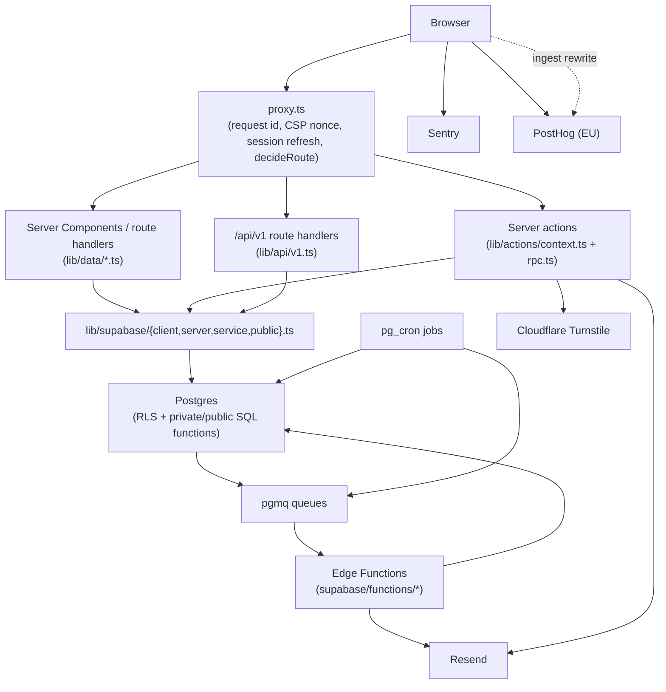

Commit: 4024fe9
Covers: `app/`, `proxy.ts`, `lib/actions/`, `lib/data/`, `lib/supabase/`, `lib/env.ts`, `lib/log.ts`, `lib/analytics/`, `lib/security/`, `lib/email/`, `supabase/functions/`, `vercel.json`, `next.config.ts`

# System overview

## Route groups

`app/` holds five route groups plus the API tree, each gated by `decideRoute()` in `proxy.ts` [src: proxy.ts#decision] via the pure decision table in `lib/auth/gate.ts` [src: lib/auth/gate.ts#decideRoute]:

- **`app/(marketing)/`** — the public marketing site: landing (`page.tsx`), `/recruiters`, `/universities`, `/faculty`, `/pricing`, `/about`, `/request-university`, `/terms`, `/privacy`, `/verify`. Listed as public by `MARKETING_PATHS` [src: lib/auth/gate.ts#MARKETING_PATHS], so `decideRoute` never redirects a visitor away from it.
- **`app/(auth)/`** — `/signin`, `/signup`, `/forgot-password`, `/reset-password`. `isAuthPage()` sends an already-signed-in user to their home instead [src: lib/auth/gate.ts#isAuthPage].
- **`app/(app)/`** — the signed-in product: student portal (`/feed`, `/me`, `/ventures`, `/opportunities`, …), recruiter portal (`/recruit`, `/org`), university portal (`/uni`, `/u`), teacher portal (`/teach`), and staff (`/ops`). One layout (`app/(app)/layout.tsx`) seeds `getCurrentUser()` into `CurrentUserProvider` for every page in the group [src: app/(app)/layout.tsx#AppLayout]. Which portal a role may reach inside this group is enforced again by `decideRoute`'s `RECRUITER_PREFIXES` / `UNI_ADMIN_PREFIXES` checks [src: lib/auth/gate.ts#RECRUITER_PREFIXES] [src: lib/auth/gate.ts#UNI_ADMIN_PREFIXES], and `requiresTwoFactor()` refuses `/ops`, `/uni`, `/recruit`, `/org` without an `aal2` session [src: lib/auth/gate.ts#requiresTwoFactor].
- **`app/(dev)/ui`** — the component gallery, public via the `/ui` prefix in `isPublicPath` [src: lib/auth/gate.ts#isPublicPath].
- **`app/api/`** — route handlers: `health`, `csp-report`, `vitals`, `github` (OAuth callback + webhook), `billing` (gateway webhooks + invoice PDFs), `cv` (PDF export), `ops` (staff exports, PDF check), `uni` (CSV/PDF export), `universities` (confirm/unsubscribe), `webhooks/resend`, and `v1` (the recruiter API, bearer-token authenticated, never session cookies) [src: lib/api/v1.ts#apiCall].
- **`app/auth/`** (no group) — `callback`, `confirm`, `confirmed`, `link`, `not-me`: the non-JSON parts of the Supabase Auth flow, outside `(app)`/`(auth)` so they can run before a profile exists. Public via the `/auth` prefix [src: lib/auth/gate.ts#isPublicPath].
- **`app/cv/[username]`** and **`app/.well-known/`** — the public, signed CV page and its verification keys; both under `isPublicPath`'s `/cv` and `/.well-known` prefixes.

## Layers

1. **`proxy.ts`** [src: proxy.ts#proxy] runs on every request the matcher admits. It mints a request id and CSP nonce never trusted from the client [src: proxy.ts#newRequestId] [src: proxy.ts#newNonce], refreshes the Supabase session cookies via `refreshSession()` [src: lib/supabase/proxy.ts#refreshSession], and — for any path that isn't public and has a session — calls `getUser()` (never `getSession()`) and `my_gate_state()` before handing the result to `decideRoute()` [src: proxy.ts#decideRoute]. It returns the gate's `next`/`redirect`/`sign-out` decision as a `NextResponse`.
2. **Server Components and route handlers** read through **`lib/data/*.ts`**, one file per domain (`posts.ts`, `friends.ts`, `recruit.ts`, …), each calling `createClient()` from `lib/supabase/server.ts` [src: lib/supabase/server.ts#createClient] and either a single SQL function per read (`getFeed` → `feed_page` [src: lib/data/posts.ts#getFeed]) or the generic `rpcJson()` wrapper for domains built as one-function-one-document, notably the recruiter and university portals [src: lib/data/rpc-json.ts#rpcJson] [src: lib/data/recruit.ts#MyOrg].
3. **Mutations** go through **`lib/actions/*.ts`** server actions. Each opens an `ActionContext` via `actionContext()` (request id, IP hash, JSON log line) [src: lib/actions/context.ts#actionContext], validates input with Zod, calls `signedIn()` to get a session-bound Supabase client [src: lib/actions/rpc.ts#signedIn], then `call()` to invoke exactly one SQL function and turn its SQLSTATE into a typed `ActionResult` [src: lib/actions/rpc.ts#call]. Paid actions additionally call `paymentRequired()` against `require_entitlement` before `call()` [src: lib/actions/rpc.ts#paymentRequired].
4. **`lib/supabase/`** holds the three client factories: `client.ts` (browser, Realtime and Storage only) [src: lib/supabase/client.ts#createClient], `server.ts` (RSC/actions, RLS always applies) [src: lib/supabase/server.ts#createClient], and `service.ts` (service-role, bypasses RLS, restricted by ESLint to jobs/webhooks/the billing worker) [src: lib/supabase/service.ts#createServiceClient]. `lib/supabase/public.ts` backs the bearer-token recruiter API with an `anon` client [src: lib/api/v1.ts#createPublicClient].
5. **Postgres** (Supabase, `supabase/migrations/`) is the authority: every table has RLS, and most writes and multi-step reads are `security definer` functions in the `private` schema exposed through `security invoker` wrappers in `public` (e.g. `private.send_friend_request` behind `public.send_friend_request`) [src: supabase/migrations/20260928230000_friends_blocks.sql#private.send_friend_request] [src: supabase/migrations/20260928230000_friends_blocks.sql#public.send_friend_request].
6. **Background work** — pgmq queues drained by Supabase Edge Functions under `supabase/functions/`, and `pg_cron` jobs that either run SQL directly or enqueue/wake a worker — is covered in `background-jobs.md`.

## External services

| Service | Where the code calls it |
| --- | --- |
| Supabase Postgres + RLS | Every `lib/data/`/`lib/actions/` call via `lib/supabase/server.ts` [src: lib/supabase/server.ts#createClient]; migrations in `supabase/migrations/`. |
| Supabase Auth (PKCE, `@supabase/ssr`) | `lib/supabase/proxy.ts#refreshSession` (cookie refresh + `getClaims()`) [src: lib/supabase/proxy.ts#refreshSession]; `lib/supabase/server.ts`/`client.ts` session clients; `app/auth/callback` completes the PKCE exchange. |
| Supabase Realtime | Browser-only, via `lib/supabase/client.ts#createClient` [src: lib/supabase/client.ts#createClient]; e.g. chat (`components/chat/*`) subscribes after `realtime.setAuth()`. |
| Supabase Storage | `lib/storage.ts`'s `publicImageUrl()` builds public bucket URLs [src: lib/data/posts.ts#publicImageUrl]; private buckets (credentials, CV exports, chat media) are read through signed URLs in their own `lib/data/*.ts`. |
| Supabase Edge Functions | `supabase/functions/*` (workers and webhook-facing functions); invoked by pgmq-draining crons or, for `code-check`/`cv-sign`, directly from `lib/data/*` with the caller's session. |
| Supabase pg_cron / pgmq / Vault | Declared in `supabase/migrations/*`; see `background-jobs.md`. Vault holds the CV signing keys and `cv_export_secret`, read only inside `private.*` SQL functions and Edge Functions. |
| Vercel | `vercel.json` pins the `bom1` region and the build/install commands [src: vercel.json#regions]; `process.env.VERCEL_ENV` gates Turnstile enforcement [src: lib/security/turnstile.ts#mustVerify]. |
| Resend | `lib/email/send.ts#sendEmail` posts to `api.resend.com` with `RESEND_API_KEY`/`EMAIL_FROM`, logging and skipping when unset [src: lib/email/send.ts#sendEmail]; Supabase Auth's own emails (codes, resets) go through Resend SMTP outside this repo. |
| Sentry | `instrumentation.ts` wires `sentry.server.config.ts`/`sentry.edge.config.ts` server-side [src: instrumentation.ts#register]; `instrumentation-client.ts` lazy-loads the browser SDK, loading it immediately off marketing pages and only on first error on marketing pages [src: instrumentation-client.ts#load]; `app/api/csp-report` and `lib/sentry-scrub.ts` scrub what reaches it. |
| PostHog (EU) | `lib/analytics/client.ts` holds the browser handle (`track`, `identify`, `followRoute`) [src: lib/analytics/client.ts#run]; `components/analytics/analytics-loader.tsx` loads `posthog-js` and calls `enableAnalytics`/`attachAnalytics`; `next.config.ts` rewrites `/ingest/*` to PostHog's EU ingestion so the browser call stays same-origin [src: next.config.ts#rewrites]; `supabase/functions/analytics-worker` sends server-side events from the `analytics` pgmq queue. |
| Axiom | Not yet wired into application code: `lib/log.ts` only writes JSON lines to `console` [src: lib/log.ts#defaultSink]. Axiom via Vercel Log Drains needs Vercel Pro and is deferred (`docs/decisions.md`, 2026-10-02); until then Vercel's own runtime logs carry these lines. |
| Cloudflare Turnstile | `lib/security/turnstile.ts#verifyTurnstile` posts the token to `challenges.cloudflare.com/turnstile/v0/siteverify`, enforced unconditionally only when `VERCEL_ENV === "production"` [src: lib/security/turnstile.ts#mustVerify]; the CSP's `frame-src`/`form-action` allow `TURNSTILE_ORIGIN` [src: lib/security/headers.ts#TURNSTILE_ORIGIN]. |

## Whole-system diagram

