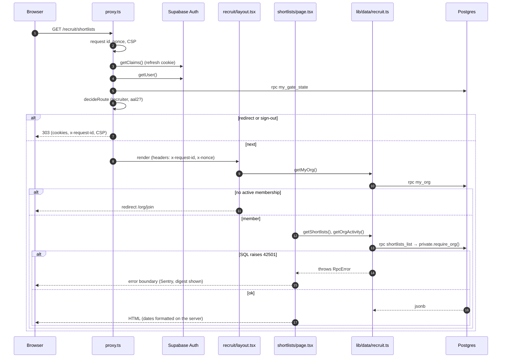
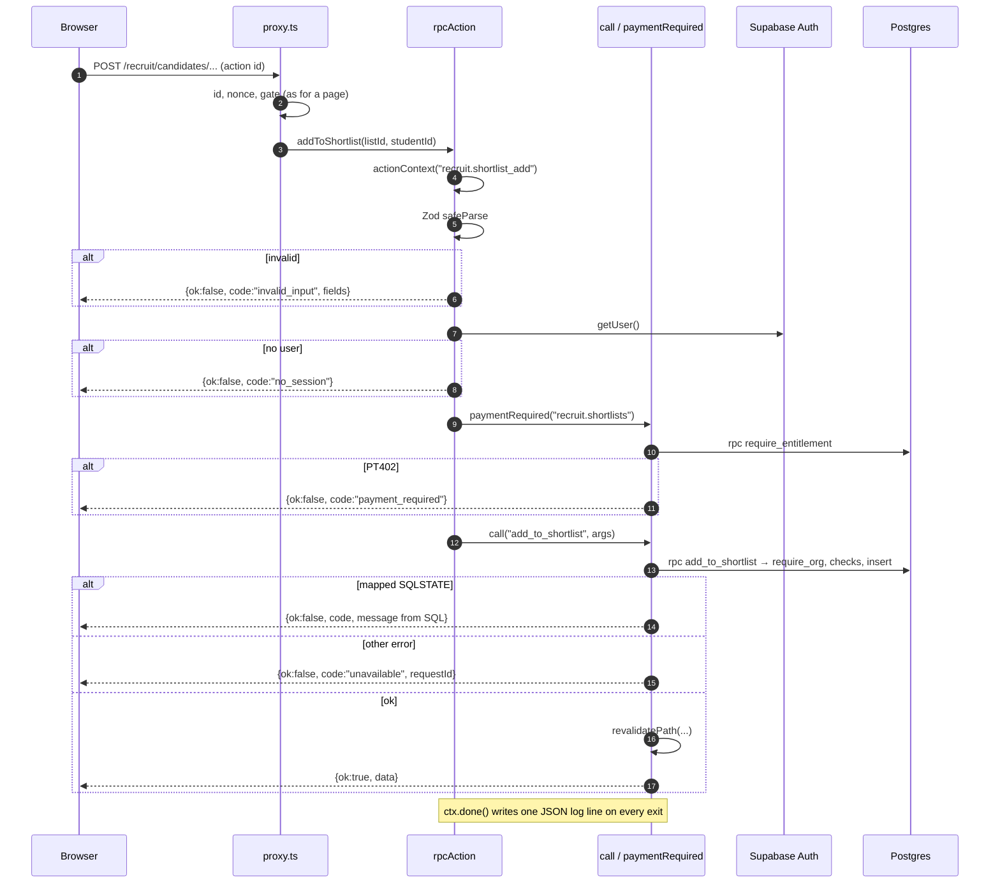
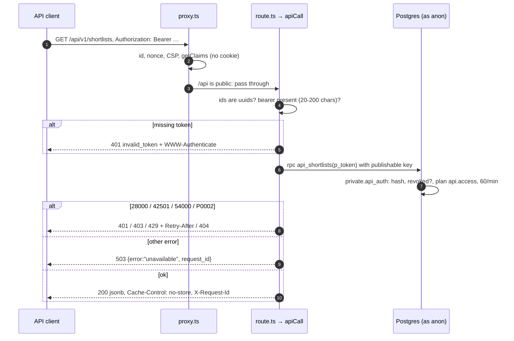

Commit: dee328c
Covers: proxy.ts, lib/request-id.ts, lib/log.ts, lib/actions/context.ts, lib/actions/result.ts, lib/actions/rpc.ts, lib/actions/recruit-run.ts, lib/data/rpc-json.ts, lib/api/v1.ts, lib/security/headers.ts, lib/security/csp-report.ts, lib/security/cookie-name.ts, lib/security/security-txt.ts, app/api/csp-report/route.ts, app/.well-known/security.txt/route.ts, instrumentation.ts, lib/sentry-scrub.ts

# Request lifecycle

What happens to one request between the edge and the database, for a page, a server action and a recruiter API call. The gate's decision table is described in subsystems/auth-and-rls; this doc covers the order of steps around it.

## The proxy (every matched request)

`proxy.ts` matches every path except Next's static files and image optimisation, `/ingest/` (the PostHog rewrite), `/brand/`, the icon, the manifest and image files [src: proxy.ts#matcher]. The matcher excludes no method, so server actions (POSTs to a page path) pass through it too [src: proxy.ts#Everything except static assets]. For each request, in order:

1. **Trailing slash.** A path ending in `/` (other than `/`) gets a 308 redirect without it; `next.config.ts` turns off Next's own redirect so PostHog's `/ingest/` paths keep theirs [src: proxy.ts#NextResponse.redirect(url, 308)] [src: next.config.ts#skipTrailingSlashRedirect].
2. **Request id and nonce.** A fresh `crypto.randomUUID()` and a 128-bit base64 nonce, never taken from the client [src: proxy.ts#Always mint our own id and nonce] [src: lib/request-id.ts#crypto.randomUUID()] [src: lib/security/headers.ts#export function newNonce].
3. **CSP.** `buildCsp` builds the policy from the nonce, the Supabase URL, the Sentry DSN and the report path [src: proxy.ts#buildCsp]. The response is built by `makeResponse`, which puts `x-request-id`, `x-nonce` and the CSP on the forwarded request headers (Next reads its script nonce from there) and `x-request-id`, the CSP and `Reporting-Endpoints` on the response [src: proxy.ts#headers.set(NONCE_HEADER, nonce)] [src: proxy.ts#res.headers.set("reporting-endpoints"].
4. **Session refresh.** `refreshSession` creates the proxy Supabase client and calls `getClaims()` straight away; a cookie it refreshes is written to the request (so the render sees it) and to a rebuilt response [src: lib/supabase/proxy.ts#Don't put code between client creation and getClaims()] [src: lib/supabase/proxy.ts#response = makeResponse()]. With no Supabase env (a fresh clone) it returns the plain response [src: lib/supabase/proxy.ts#if (!env) return { response, supabase: null, claims: null }].
5. **Public paths stop here.** `/`, the marketing pages, `/auth`, `/api`, `/ui`, `/verify`, `/cv` and `/.well-known` go straight through with the refreshed cookies and headers [src: proxy.ts#if (isPublicPath(pathname) || !session.supabase) return session.response] [src: lib/auth/gate.ts#export function isPublicPath].
6. **User and gate state.** With valid claims the proxy calls `getUser()` (checked with the Auth server) and then the `my_gate_state` RPC [src: proxy.ts#Route decisions use getUser()] [src: proxy.ts#session.supabase.rpc("my_gate_state")].
7. **Decision.** `decideRoute` gets the path, sign-in state, the `aal` claim, whether the user has a verified factor, and the gate state [src: proxy.ts#decideRoute({]. It answers `next`, `redirect` or `sign-out`; a sign-out clears the local session first; redirects are 303s that keep the refreshed cookies, the cache headers, the request id and the CSP [src: proxy.ts#auth.signOut({ scope: "local" })] [src: lib/supabase/proxy.ts#NextResponse.redirect(new URL(to, request.url), 303)] [src: lib/supabase/proxy.ts#"x-request-id", "content-security-policy"].

### Headers

Static headers on every path come from `next.config.ts`: HSTS with preload, `X-Frame-Options: DENY`, `Referrer-Policy`, `Permissions-Policy` (no camera, microphone or geolocation) and `nosniff` [src: next.config.ts#source: "/:path*", headers: securityHeaders] [src: lib/security/headers.ts#Strict-Transport-Security]. The CSP is per request:

| Directive | Sources |
|---|---|
| `script-src` | `'self'`, the nonce, `'strict-dynamic'`, Turnstile; `'unsafe-eval'` in development only [src: lib/security/headers.ts#"script-src"] |
| `connect-src` | `'self'`, Supabase (https and wss), the Sentry origin, Turnstile [src: lib/security/headers.ts#"connect-src"] |
| `img-src` | `'self'`, `data:`, `blob:`, Supabase [src: lib/security/headers.ts#"img-src"] |
| `form-action` | `'self'`, Supabase, Google accounts, GitHub [src: lib/security/headers.ts#"form-action"] |
| `frame-src` / `frame-ancestors` | Turnstile / `'none'` [src: lib/security/headers.ts#"frame-ancestors"] |
| reporting | `report-uri /api/csp-report` and `report-to csp` [src: lib/security/headers.ts#report-uri ${reportPath}] |

`upgrade-insecure-requests` is added only when Supabase is on https and not in development [src: lib/security/headers.ts#upgrade-insecure-requests]. The root layout reads `x-nonce`, which makes every page render dynamically, and hands it to `next-themes` and the PostHog loader so their inline scripts pass [src: app/layout.tsx#reading it renders every page dynamically].

### CSP reports

`POST /api/csp-report` always answers 204. It drops bodies over 16 KB, limits each client address to 30 reports a minute per server instance, parses both the legacy `csp-report` body and Reporting API batches (at most 20 per body), and reduces each to directive, blocked origin or keyword, scrubbed page path and script source [src: app/api/csp-report/route.ts#Always 204] [src: lib/security/csp-report.ts#CSP_REPORT_MAX_BYTES] [src: app/api/csp-report/route.ts#createLimiter(30, 60_000)] [src: lib/security/csp-report.ts#At most 20 violations]. Each violation is a `csp.violation` warn log line; one in ten also goes to Sentry, fingerprinted by directive and blocked source [src: app/api/csp-report/route.ts#csp.violation] [src: app/api/csp-report/route.ts#SENTRY_SAMPLE = 0.1].

### Cookies

The Supabase session cookie is `__Secure-skl-auth` (Secure) in production builds and `skl-auth` elsewhere; the browser, server and proxy clients all use `authCookieOptions` so they read the same cookie [src: lib/supabase/cookie-options.ts#authCookieOptions]. It is not HttpOnly because the browser client reads the session for Realtime [src: lib/supabase/cookie-options.ts#cookie can't be HttpOnly]. The app's own cookies get the `__Secure-` prefix in production through `secureCookieName`; such a cookie is deleted by setting it empty with `maxAge: 0` and the same options, since a bare delete is not Secure and the browser ignores it [src: lib/security/cookie-name.ts#secureCookieName] [src: lib/security/cookie-name.ts#a bare delete() isn't Secure].

`/.well-known/security.txt` is a static route built from `SECURITY_CONTACT` and an `Expires` date that a unit test fails on 60 days ahead [src: app/.well-known/security.txt/route.ts#force-static] [src: lib/security/security-txt.ts#SECURITY_TXT_EXPIRES].

## The request id and the log line

- **Where it is born.** Only in `proxy.ts` for matched requests [src: proxy.ts#newRequestId]. Readers that find no header mint their own: `actionContext`, the API helper, the webhook routes and the CSP report route [src: lib/actions/context.ts#requestIdFrom(h) ?? newRequestId()] [src: lib/api/v1.ts#requestIdFrom(request.headers) ?? newRequestId()] [src: app/api/github/webhook/route.ts#requestIdFrom(request.headers) ?? newRequestId()].
- **Logs.** `lib/log.ts` writes one JSON object per line to the console: `ts`, `level`, `msg`, then `request_id`, `action`, `user_id`, `duration_ms`, `outcome` (`ok`, `error`, `refused`), `error_code` and extra fields; undefined fields are dropped [src: lib/log.ts#export function log] [src: lib/log.ts#export type Outcome]. Only internal uuids go in, never names, emails, bodies or query strings [src: lib/log.ts#Only internal uuids]. `ActionContext.done()` writes the line for an action at `info`, `warn` (refused) or `error` [src: lib/actions/context.ts#const level = outcome === "error"].
- **Sentry.** Server errors are captured by `onRequestError` [src: instrumentation.ts#onRequestError]. `scrubEvent` keeps only the `user-agent` and `x-request-id` request headers, strips query strings, bodies and cookies, keeps only the user id and masks emails [src: lib/sentry-scrub.ts#"x-request-id": rid] [src: lib/sentry-scrub.ts#delete event.request.data].
- **The browser.** An action refusal of kind `unavailable` (and the captcha refusal in sign-in and sign-up) carries `requestId` for the UI to show as "Ref" [src: lib/actions/result.ts#shown as "Ref"] [src: lib/actions/rpc.ts#requestId: ctx.requestId] [src: lib/actions/auth.ts#fail("captcha"]. API responses carry `X-Request-Id`, and a 503 body carries `request_id` [src: lib/api/v1.ts#"X-Request-Id": requestId]. A page error boundary shows Next's error `digest`, not the proxy's request id [src: components/app/route-error.tsx#requestId={error.digest}].
- **The database.** `call` and `rpcJson` pass only the SQL function's own arguments [src: lib/actions/rpc.ts#supabase.rpc(fn as never, args as never)] [src: lib/data/rpc-json.ts#supabase.rpc(fn as never, args as never)], so the request id stays in the Next server's log lines.

## Trace 1: a page (`GET /recruit/shortlists`)

1. The proxy runs as above. For `/recruit` the gate also needs `role = recruiter` and an `aal2` session [src: lib/auth/gate.ts#if (isRecruiterArea(pathname) && state.role !== "recruiter")] [src: lib/auth/gate.ts#if (requiresTwoFactor(pathname) && aal !== "aal2")].
2. The root layout reads the nonce; the `(app)` layout gets the user with `getUser()` (cached for the request) and schedules `touch_activity` after the response [src: lib/auth/current-user.ts#export const getCurrentUser = cache] [src: app/(app)/layout.tsx#after(async () => {].
3. The recruiter layout calls `getMyOrg()` and redirects to `/org/join` without an active membership, or to `/org/plan` for a billing-only seat [src: app/(app)/recruit/layout.tsx#redirect("/org/plan")]. `getMyOrg` is wrapped in React `cache`, so the layout and the page share one call [src: lib/data/recruit.ts#export const getMyOrg = cache].
4. The page calls `getShortlists()`, which is `rpcJson("shortlists_list")`: the session client calls the `public` wrapper, which calls `private.shortlists_list`; that function starts with `private.require_org()` [src: lib/data/recruit.ts#rpcJson<ShortlistSummary[]>("shortlists_list")] [src: supabase/migrations/20261014000000_recruiter_talent.sql#create function private.shortlists_list] [src: supabase/migrations/20261014000000_recruiter_talent.sql#v_org uuid := private.require_org()].
5. `require_org` raises `42501` when the caller is signed out, on `aal1`, not an active member with the right role, or in an unverified organisation [src: supabase/migrations/20261013000000_recruiter_orgs.sql#turn on two-factor sign-in to use the recruiter portal] [src: supabase/migrations/20261013000000_recruiter_orgs.sql#your organisation isn''t verified yet].
6. **Refusal path.** `rpcJson` throws an `RpcError` carrying the SQLSTATE [src: lib/data/rpc-json.ts#if (error) throw new RpcError(fn, error.code, error.message)]. A page that expects it catches it with `isRefusal(err, "P0002")` and answers `notFound()` [src: lib/data/rpc-json.ts#The refusal codes a page turns into "not found" (P0002) or "not yours" (42501)]; otherwise the error reaches the `(app)` error boundary, which reports to Sentry [src: app/(app)/error.tsx#RouteError] [src: components/app/route-error.tsx#Sentry.captureException(error)].

## Trace 2: a server action (`addToShortlist`)

1. `addToShortlist` is a one-call `rpcAction` with `entitlement: "recruit.shortlists"` [src: lib/actions/recruit.ts#name: "recruit.shortlist_add", entitlement: "recruit.shortlists"].
2. `rpcAction` opens the context, then parses the input. A Zod failure logs `refused`/`invalid_input` and returns the first message per field; an `unwrap` key lets nested form values report under their own field names [src: lib/actions/recruit-run.ts#ctx.done("refused", { error_code: "invalid_input" })] [src: lib/actions/result.ts#export function fieldErrors].
3. `signedIn` creates the session client and calls `getUser()`; no user logs `no_session` and returns `NO_SESSION` [src: lib/actions/rpc.ts#ctx.done("refused", { error_code: "no_session" })] [src: lib/actions/rpc.ts#export const NO_SESSION]. The user id used in logs comes from here, never from the input [src: lib/actions/recruit-run.ts#The user id never comes from the browser].
4. For a paid action, `paymentRequired` calls `require_entitlement`; an error that maps in `REFUSALS` (`PT402` → `payment_required`) is returned as a typed refusal, which the UI turns into the upgrade sheet [src: lib/actions/rpc.ts#export async function paymentRequired] [src: lib/actions/rpc.ts#PT402: "payment_required"].
5. `call` runs one RPC. The SQL function re-checks the organisation, ownership and limits and raises when it changes nothing, so success is the write check [src: lib/actions/rpc.ts#so a successful call is the write check]. `add_to_shortlist` raises `P0002` for a list or candidate outside the organisation and `23514` past 500 people [src: supabase/migrations/20261014000000_recruiter_talent.sql#raise exception 'list not found' using errcode = 'P0002'] [src: supabase/migrations/20261014000000_recruiter_talent.sql#up to 500 people per list].
6. **Refusals.** `REFUSALS` maps SQLSTATEs to stable codes: `42501` forbidden, `P0002` not_found, `23505` duplicate, `23514` limit, `55000` not_now, `22023` invalid_input, `54000` rate_limited, `PT402` payment_required [src: lib/actions/rpc.ts#export const REFUSALS]. A mapped refusal keeps the SQL message, capitalised and punctuated by `sentence()`, except `rate_limited`, which gets a fixed message [src: lib/actions/rpc.ts#export function sentence] [src: lib/actions/rpc.ts#You're doing that too often].
7. **Errors.** Any other error logs `error` with the SQLSTATE and returns `unavailable` with the request id [src: lib/actions/rpc.ts#Something went wrong on our side. Try again.].
8. **Success** logs `ok` with the user id, revalidates the listed paths and returns `{ ok: true, data }` [src: lib/actions/rpc.ts#for (const path of revalidate) revalidatePath(path as Route)].

Actions that need more than one call (for example friends) use the same pieces by hand: `actionContext`, Zod, `signedIn`, `call` [src: lib/actions/friends.ts#const ctx = await actionContext("friends.send")] [src: lib/actions/friends.ts#"send_friend_request"]. Server action bodies are limited to 9 MB for image uploads [src: next.config.ts#bodySizeLimit: "9mb"].

## Trace 3: a recruiter API call (`GET /api/v1/shortlists`)

1. The proxy runs, finds `/api` public and returns after the session refresh; no gate applies [src: lib/auth/gate.ts#"/api"].
2. The route is one line: `apiCall(request, "GET /api/v1/shortlists", "api_shortlists", token => ({ p_token: token }))` [src: app/api/v1/shortlists/route.ts#apiCall(request, "GET /api/v1/shortlists"].
3. `apiCall` checks that every path id is a uuid (else 404) and that a bearer token of 20 to 200 characters is present (else 401 with `WWW-Authenticate`) [src: lib/api/v1.ts#error_code: "invalid_id"] [src: lib/api/v1.ts#Bearer\s+(\S{20,200})].
4. It calls the function with the cookie-less public client, so the database sees `anon` plus the token; no service-role key is involved [src: lib/api/v1.ts#carrying the token, so no service-role key is involved] [src: supabase/migrations/20261016000000_recruiter_api.sql#pg_temp.expose(array['api_candidate', 'api_shortlists', 'api_shortlist_candidates', 'api_job_applications'], true)].
5. `private.api_auth` hashes the token with SHA-256 and looks it up unrevoked (`28000` otherwise), checks the organisation's plan grants `api.access` (`42501`), applies 60 requests a minute per token (`54000`), and touches `last_used_at` at most once a minute [src: supabase/migrations/20261016000000_recruiter_api.sql#create function private.api_auth] [src: supabase/migrations/20261016000000_recruiter_api.sql#private.rate_limit('api:' || t.id::text, 60, interval '1 minute')].
6. `STATUS_BY_CODE` maps `28000` → 401, `42501` → 403, `54000` → 429 with `Retry-After: 60`, `P0002` and `22P02` → 404; anything else is a 503 with the request id [src: lib/api/v1.ts#const STATUS_BY_CODE] [src: lib/api/v1.ts#"Retry-After": "60"]. Every exit writes one log line named after the route [src: lib/api/v1.ts#logger[outcome === "error"].

## Where a failing request shows up

| Symptom | First place to look | Fields |
|---|---|---|
| A refused or failed action | The JSON log line named after the action | `request_id`, `action`, `user_id`, `duration_ms`, `outcome`, `error_code` [src: lib/actions/context.ts#duration_ms: Math.round] |
| An uncaught server error | Sentry (`onRequestError`) | scrubbed request with `x-request-id` header [src: lib/sentry-scrub.ts#scrubEvent] |
| A page error in the browser | Sentry from the error boundary; the page shows the digest | [src: components/app/route-error.tsx#Sentry.captureException(error)] |
| A blocked script or connection | `csp.violation` log lines; sampled Sentry messages | directive, blocked, page, source, line, disposition [src: lib/security/csp-report.ts#export interface CspViolation] |
| A recruiter API failure | The log line named `GET /api/v1/...` and the `X-Request-Id` the client received | [src: lib/api/v1.ts#"X-Request-Id": requestId] |
