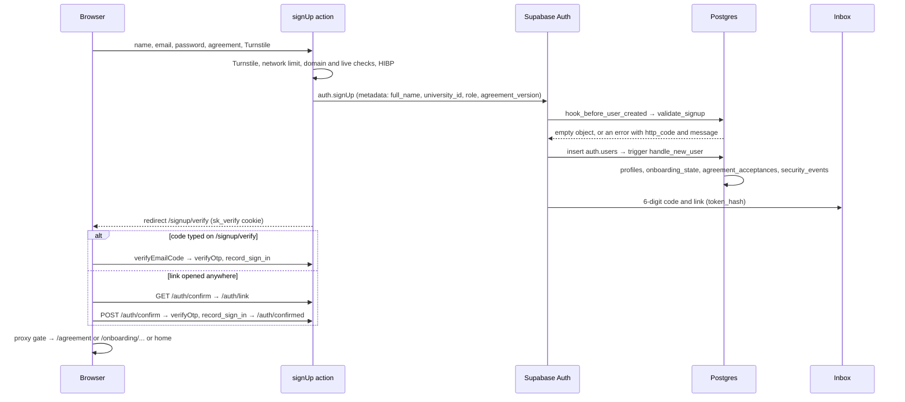
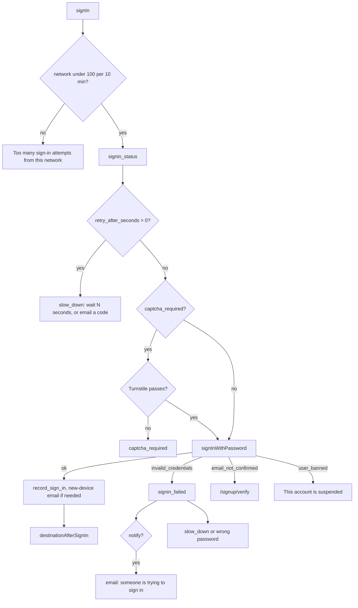
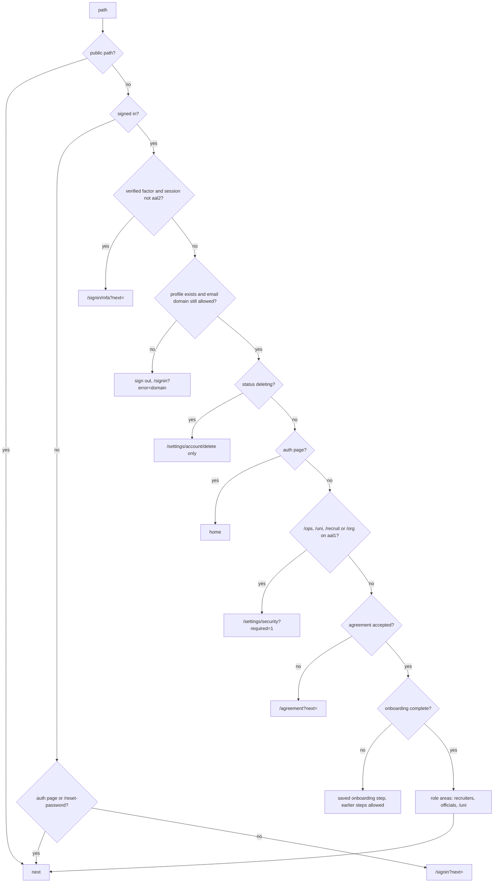
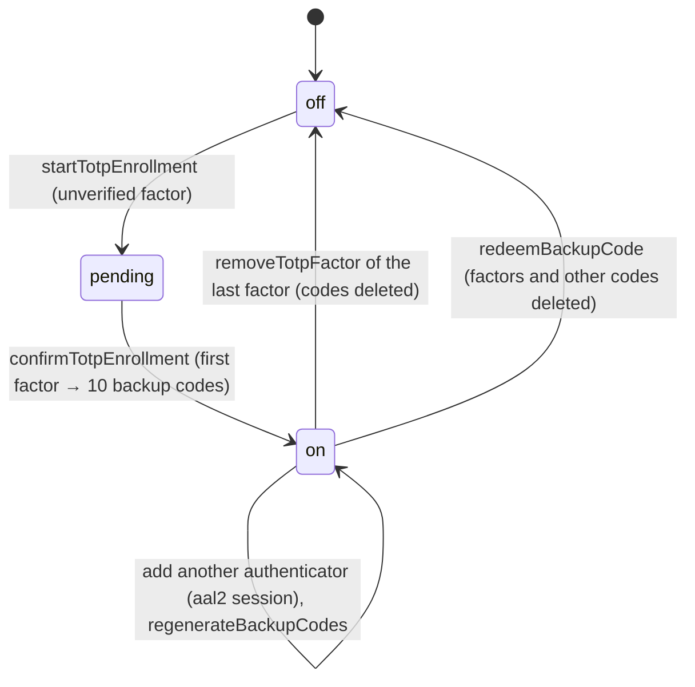
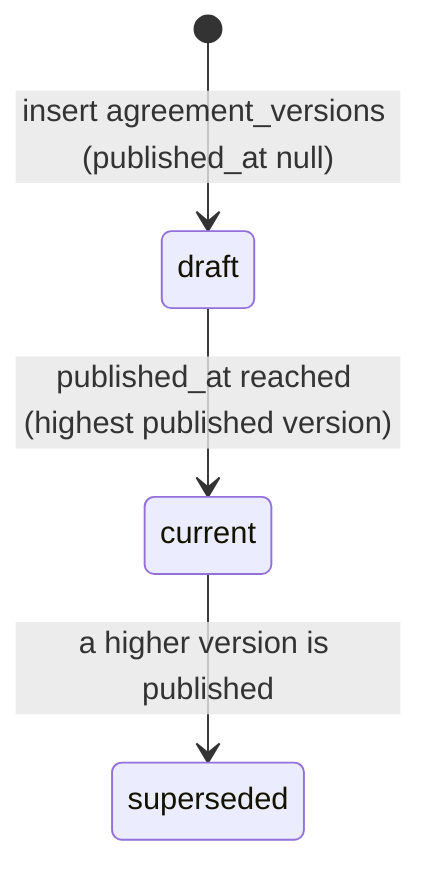

Commit: 418074f

Email update (2026-10-14): [Brevo inventory and cutover](../../email-brevo-migration.md) supersedes the historical Resend sections, credentials, endpoints and retry/signature descriptions below. Local migration only; automated and live checks remain unexecuted.
Covers: supabase/migrations/20260927210238_identity.sql, supabase/migrations/20260927210824_sync_hec_universities.sql, supabase/migrations/20260928123000_auth_decisions.sql, scripts/universities.mjs, lib/auth/, lib/supabase/, lib/actions/auth.ts, lib/actions/mfa.ts, lib/actions/agreement.ts, lib/data/agreement.ts, lib/data/universities.ts, lib/security/turnstile.ts, lib/security/hibp.ts, lib/security/hash.ts, lib/security/rate-limit.ts, lib/security/request-meta.ts, lib/hooks/use-domain-directory.ts, components/auth/, components/agreement/, components/providers/current-user-provider.tsx, app/(auth)/, app/auth/, app/(app)/agreement/, app/(app)/settings/security/, app/api/universities/domains/route.ts. Non-source: supabase/templates/*.html, supabase/seed/hec_universities.csv

# Auth and RLS

## Purpose

Who someone is and what they may touch. Sign-up admits four account roles by email domain, Supabase Auth issues the session, and a gate in `proxy.ts` sends each signed-in person to the agreement, onboarding, two-factor or their home.
Below that, Postgres decides every read and write: row level security on every table, privileged work in `security definer` functions in the unexposed `private` schema, thin `security invoker` wrappers in `public`.
Throttling, Turnstile, breached-password checks, two-factor with backup codes, new-device alerts and "This wasn't me" protect the sign-in itself.

In [architecture/overview.md](../architecture/overview.md) this subsystem owns two of the "Layers": the gate decisions applied by the proxy (layer 2) and the RLS model of Postgres (layer 7), plus the five Supabase clients of layer 6. [architecture/request-lifecycle.md](../architecture/request-lifecycle.md) follows one request through the proxy; this doc explains what the gate decides and why. It is the first step of the "Sign-up to first page" pipeline in [PLAN.md](../PLAN.md); onboarding itself belongs to the profiles doc.

## Data model

Column lists are in the generated reference: [identity](../reference/schema/identity.md), [auth_decisions](../reference/schema/auth_decisions.md). Supabase owns `auth.users`, `auth.sessions` and `auth.mfa_factors`; this subsystem reads them in triggers and definer functions and never stores passwords itself.

| Table | One row is | Columns and constraints that carry meaning |
|---|---|---|
| `universities` | A university | `name` unique, `slug`, `city`, `province` (one of seven) [src: supabase/migrations/20260927210238_identity.sql#create table public.universities (]. `live_at` (added by the marketing migration) opens sign-up for its students and faculty [src: supabase/migrations/20261031000000_marketing.sql#create function private.university_live(p_university uuid)]. |
| `university_domains` | An email domain of a university | `(university_id, domain)` key, so one domain can belong to several universities; `kind` `student`, `faculty` or `both` (default `both`); `source` `hec_seed` (owned by the HEC sync) or `ops` (added by staff, never touched by it) [src: supabase/migrations/20260927210238_identity.sql#create table public.university_domains (]. Exact domains only: no wildcard for subdomains. |
| `personal_email_domains` | A webmail domain | 34 seeded (Gmail, Outlook, Yahoo, Proton and others), refused for every role [src: supabase/migrations/20260927210238_identity.sql#create table public.personal_email_domains (] |
| `profiles` | One account | `role` (`student`, `faculty`, `recruiter`, `university_admin`), `university_id` (null only while a shared domain leaves it open), `username` (`^[a-z0-9_]{3,30}$`, not one of 25 reserved names), `onboarding_complete`, `visibility`; image paths must start with the owner's id [src: supabase/migrations/20260927210238_identity.sql#create table public.profiles (]. Created only by `handle_new_user`. `status` (`active`, `graduate`, `deleting`) comes from the student portal [src: supabase/migrations/20261010000000_student_portal.sql#add constraint profiles_deleting_has_date check ((status = 'deleting') = (delete_after is not null));]. |
| `profiles_public_card` | Name, department and batch of a profile | kept in sync by trigger; readable only through `get_profile_card(username)`, an exact-username lookup [src: supabase/migrations/20260927210238_identity.sql#create table public.profiles_public_card (] |
| `staff_roles` | One staff role of one account | `(user_id, role)`, roles `moderator`, `trust_reviewer`, `accounts`, `super_admin` [src: supabase/migrations/20260927210238_identity.sql#create type public.staff_role as enum ('moderator', 'trust_reviewer', 'accounts', 'super_admin');] |
| `agreement_versions` | A version of the User Agreement | `version` > 0, `body_md`, `summary_md` ("What changed"), `published_at` (null = draft). The current version is the highest one published by now [src: supabase/migrations/20260927210238_identity.sql#create function private.current_agreement_version()]. Version 1 is seeded with headings and "[To be written]". |
| `agreement_acceptances` | One account accepting one version | `(user_id, version)` key, `ip_hash` [src: supabase/migrations/20260927210238_identity.sql#create table public.agreement_acceptances (] |
| `onboarding_state` | The wizard's progress | `step` 1 to 6, `data` under 16 KB, `completed_at` [src: supabase/migrations/20260927210238_identity.sql#create table public.onboarding_state (] |
| `security_events` | One account event | `kind` from a fixed list (sign-up, sign-in, failures, alerts, new device, "not me", password and two-factor changes, GitHub connect), `ip_hash`, `user_agent`, `meta`; kept a year [src: supabase/migrations/20260928123000_auth_decisions.sql#alter table public.security_events add constraint security_events_kind_check check (kind in (] |
| `user_devices` | A browser an account signed in from | `device_hash` = SHA-256 of a random per-browser cookie; first and last seen [src: supabase/migrations/20260927210238_identity.sql#create table public.user_devices (] |

Private tables (not reachable through the API at all):

| Table | Holds | Kept |
|---|---|---|
| `private.rate_limit_events` | one row per counted event, keyed by an opaque string [src: supabase/migrations/20260927210238_identity.sql#create table private.rate_limit_events (] | 1 day |
| `private.auth_failures` | one row per failed password, for the account key and the network key [src: supabase/migrations/20260927210238_identity.sql#create table private.auth_failures (] | 1 day |
| `private.security_alert_tokens` | SHA-256 of each "This wasn't me" token, 7-day expiry, `used_at` [src: supabase/migrations/20260927210238_identity.sql#create table private.security_alert_tokens (] | until a day after expiry |
| `private.mfa_backup_codes` | SHA-256 of each backup code, `used_at` [src: supabase/migrations/20260928123000_auth_decisions.sql#create table private.mfa_backup_codes (] | used codes 1 year |

The phase 1 table `private.auth_lockouts` was dropped when lockouts were removed [src: supabase/migrations/20260928123000_auth_decisions.sql#drop table private.auth_lockouts;]. Retention is the nightly `purge-security-data` job (03:23 UTC) [src: supabase/migrations/20260928123000_auth_decisions.sql#create or replace function private.purge_security_data()] [src: supabase/migrations/20260927210238_identity.sql#select cron.schedule('purge-security-data', '23 3 * * *', 'select private.purge_security_data()');].

Cookies the app sets beside Supabase's session cookie:

| Cookie | Holds | Lifetime |
|---|---|---|
| `skl-auth` (`__Secure-skl-auth` in production) | the Supabase session; not HttpOnly, because the browser client reads it for Realtime [src: lib/supabase/cookie-options.ts#export function authCookieOptions] | Supabase's |
| `sk_did` | a random 32-byte device id; only its hash reaches the database [src: lib/auth/sign-in-record.ts#export const DEVICE_COOKIE = secureCookieName("sk_did");] | 400 days |
| `sk_verify` | the email waiting for its sign-up code [src: lib/auth/cookies.ts#export const VERIFY_COOKIE = secureCookieName("sk_verify");] | 1 hour [src: lib/auth/cookies.ts#maxAge: 60 * 60] |
| `sk_signin_code` | the email waiting for its sign-in code [src: lib/auth/cookies.ts#export const SIGNIN_CODE_COOKIE = secureCookieName("sk_signin_code");] | 15 minutes [src: lib/auth/cookies.ts#maxAge: 15 * 60] |
| `sk_agree` | the agreement version ticked before "Continue with Google" [src: lib/auth/cookies.ts#export const AGREE_COOKIE = secureCookieName("sk_agree");] | 15 minutes |

The `sk_*` cookies are HttpOnly, `SameSite=Lax`, and `Secure` in production [src: lib/auth/cookies.ts#const base = { httpOnly: true, secure: process.env.NODE_ENV === "production", sameSite: "lax" as const, path: "/" };].

### The university list

`supabase/seed/hec_universities.csv` is the source; `pnpm universities:sync` (`scripts/universities.mjs --write`) turns it into a new `*_sync_hec_universities.sql` migration that calls `private.sync_hec_universities(rows)` [src: scripts/universities.mjs#export function renderMigration]. The migration records the CSV's SHA-256, and a unit test fails when the newest sync migration doesn't match the CSV [src: tests/unit/universities-seed.test.ts#the latest sync migration was generated from this CSV]. The script requires the `name`, `city`, `province` and `domains` columns, splits domains on `;`, lower-cases and de-duplicates them, and refuses bad domains, unknown provinces and duplicate names or slugs [src: scripts/universities.mjs#export function toSeedRows]. The one sync migration so far loads 283 universities and 364 domains [src: supabase/migrations/20260927210824_sync_hec_universities.sql#-- universities: 283, domains: 364]. The SQL upserts by name and makes each university's `hec_seed` domains match the file, inserting them as kind `both`; `ops` domains and universities missing from the file are left alone [src: supabase/migrations/20260927210238_identity.sql#create function private.sync_hec_universities(p_rows jsonb)].

## Lifecycles and state machines

### Sign-up paths

| Path | Form and action | Accepted when | Final check |
|---|---|---|---|
| Student | `/signup`, `signUp` | not webmail; the domain has a `student` or `both` row; one owning university is live; a university is chosen when several own the domain | `validate_signup` in the Auth hook, then `handle_new_user` |
| Faculty | `/signup?role=faculty`, `signUp` | as a student, with `faculty` or `both` domains; the teacher role is asked for after sign-up [src: app/(auth)/signup/page.tsx#then ask for the teacher role.] | same |
| University official | `/signup?role=university_admin`, `signUp` | a `faculty` or `both` domain of the chosen university, live or not; the portal seat comes later from a claim or an invite | same; `handle_new_user` refuses an official with no university |
| Recruiter | `/signup/recruiter`, `signUpRecruiter` | not webmail and not any university domain | same; `handle_new_user` refuses a domain that isn't a company domain |
| Google | "Continue with Google" on `/signin` and student `/signup`, `startGoogleSignIn` | the Google email passes the student rules; the account is always a student | the hook (with the Google wording), then `/auth/callback` on every sign-in |

The browser's check is only for fast feedback. The action repeats it against the database before calling Supabase [src: lib/actions/auth.ts#Authoritative domain check (the form's check is only for fast feedback; the Auth hook repeats it).], and the `before-user-created` hook repeats it inside Supabase Auth, where the request can't skip it [src: supabase/migrations/20260927210238_identity.sql#create function public.hook_before_user_created(event jsonb)]. That is why a sign-up can be refused after the form said the domain was fine: the CDN keeps the list for an hour and may serve a stale copy for a day after that, the browser shows a message but never blocks the submit [src: app/(auth)/signup/signup-form.tsx#function onSubmit], and only the hook sees a Google account's email [src: app/api/universities/domains/route.ts#"Cache-Control": "public, max-age=300, s-maxage=3600, stale-while-revalidate=86400"].

### Email sign-up, start to first page

- The hook runs for email sign-ups, Google and admin-created users [src: supabase/migrations/20260927210238_identity.sql#Runs for email signups, OAuth (Google) and admin-created users.]. For email it reads `role` and `university_id` from the user metadata; malformed metadata is refused with 400 "Start again from the Skilient signup page.", and any refusal from `validate_signup` returns 403 with its message, replaced by "Use your university Google account." for a non-email provider [src: supabase/migrations/20260927210238_identity.sql#v_error := 'Use your university Google account.';]. The action shows those messages on the email field [src: lib/actions/auth.ts#const HOOK_MESSAGES = new Set(].
- `handle_new_user` runs after the `auth.users` insert and builds the account (see "Creating the account"). It raises `42501` for a domain that can't own the role, so an account can't exist without a profile [src: supabase/migrations/20261017000000_uni_core.sql#raise exception 'signup refused: % is not a university email domain', coalesce(v_domain, '(none)')].
- Email links never verify on `GET`. `/auth/confirm` redirects to `/auth/link`, whose button POSTs the `token_hash` back; the POST must come from the same origin [src: app/auth/confirm/route.ts#Opening the link (GET) spends nothing] [src: app/auth/confirm/route.ts#function sameOrigin]. Mail scanners open links but don't submit forms, so they can't spend the token [src: app/auth/link/page.tsx#mail scanners open links, but they don't submit forms.].
- The waiting tab moves on by itself: it listens for Supabase auth events, for a `confirmed` broadcast from `/auth/confirmed` in another tab, for focus, and polls every 4 seconds, then hard-navigates to `/feed` for the gate to route [src: app/(auth)/signup/verify/verify-form.tsx#function useAdvanceWhenConfirmed] [src: app/auth/confirmed/confirmed-broadcast.tsx#postAuthMessage("confirmed");].
- Codes and links last 15 minutes in the local config [src: supabase/config.toml#otp_expiry = 900]; resends are capped at 3 an hour per address [src: lib/actions/auth.ts#rateLimit(supabase, "otp_resend", email, 3, 3600)].

### Password sign-in

[src: lib/actions/auth.ts#export async function signIn]

`destinationAfterSignIn` sends an account with a verified factor to `/signin/mfa`; a recruiter or official whose home needs two-factor but whose session hasn't got it to `/settings/security?required=1`; otherwise to the safe `next` when the home is the feed, carrying `next` through the agreement, or home [src: lib/actions/auth.ts#async function destinationAfterSignIn].

### Sign-in with an emailed code

`requestSignInCode` always needs Turnstile, counts against the network limit and 5 codes an hour per address, and calls `signInWithOtp` with `shouldCreateUser: false` [src: lib/actions/auth.ts#export async function requestSignInCode]. It answers the same whether or not the account exists: `user_not_found`, `otp_disabled` and Supabase's own rate limits are swallowed, and the next page says "If ... has a Skilient account" [src: lib/actions/auth.ts#Same answer whether or not the account exists (unknown addresses get no email).]. `verifyEmailSignInCode` allows 5 wrong codes per 15 minutes per address [src: lib/actions/auth.ts#rateLimit(supabase, "signin_code_verify", email, 5, 15 * 60)]. Nothing in the password throttle touches this path, which is why a student can't be locked out (see "Throttling password sign-in").

### The gate

`decideRoute` runs in `proxy.ts` on every matched request that isn't public, with the user from `getUser()` and the state from `my_gate_state()` [src: proxy.ts#Route decisions use getUser() (verified with the Auth server), never the cookie alone.]. The first matching rule wins [src: lib/auth/gate.ts#export function decideRoute]:

| Account state | Where the gate sends it |
|---|---|
| Signed out | public paths, `/signin`, `/signup`, `/forgot-password`, `/reset-password`; anything else to `/signin?next=` |
| Two-factor enrolled, session not yet `aal2` | `/signin/mfa` only [src: lib/auth/gate.ts#const mfaPending = hasVerifiedFactor && aal !== "aal2";] |
| No profile, or the email domain no longer fits the role | signed out, `/signin?error=domain` ("Your email's domain is no longer on Skilient's university list") [src: app/(auth)/signin/page.tsx#domain: "Your email's domain is no longer on Skilient's university list. Contact support to move your account.",] |
| Deleting | `/settings/account/delete` only |
| `/ops`, `/uni`, `/recruit`, `/org` on an `aal1` session | `/settings/security?required=1` [src: lib/auth/gate.ts#export function requiresTwoFactor] |
| Current agreement not accepted | `/agreement` |
| Onboarding incomplete | the saved step; earlier steps open, later ones redirect [src: lib/auth/gate.ts#Back always works; skipping ahead of the saved step does not.] |
| Recruiter | only `/recruit`, `/org`, `/companies`, `/chat`, `/notifications`, `/settings`, `/feedback`, `/fairs`, `/billing`, `/appeals` [src: lib/auth/gate.ts#const RECRUITER_PREFIXES] |
| University official | only `/uni`, `/u`, `/events`, `/notifications`, `/settings`, `/feedback`, `/competitions`, `/billing` [src: lib/auth/gate.ts#const UNI_ADMIN_PREFIXES] |
| Student or recruiter on `/uni`; anyone but a recruiter on `/recruit` or `/org` | home |

Home is the delete page while deleting, then `/agreement`, then the onboarding step, then `/recruit`, `/uni`, `/teach` or `/feed` by role [src: lib/auth/gate.ts#export function homeFor]. Public paths are `/`, the marketing pages, `/auth`, `/api`, `/ui`, `/verify`, `/cv`, `/.well-known`, `/demo` and the Open Graph image [src: lib/auth/gate.ts#export function isPublicPath]. The gate has no staff check for `/ops`: it only demands `aal2`, and the ops layout answers 404 to anyone without a staff role [src: app/(app)/ops/layout.tsx#if (!roles.size) notFound();]. `/api` routes check their own callers.

`my_gate_state()` is one `security invoker` query: the caller's profile, onboarding step, current agreement version and whether it is accepted, whether the email domain still fits the role (`email_domain_allowed`), and the account status [src: supabase/migrations/20261010000000_student_portal.sql#create or replace function public.my_gate_state()]. The domain check is per role: faculty and officials against `faculty`/`both` domains of their university, recruiters against company domains (and their organisation's domain once they belong to one), everyone else against `student`/`both` domains of their university [src: supabase/migrations/20261017000000_uni_core.sql#create or replace function private.email_domain_allowed()].

### Two-factor

| Transition | Function | Notes |
|---|---|---|
| Start | `startTotpEnrollment` | clears abandoned unverified factors; at most 5 verified authenticators; a second one needs an `aal2` session [src: lib/actions/mfa.ts#const MAX_AUTHENTICATORS = 5;] |
| Confirm | `confirmTotpEnrollment` | the factor must be the caller's; on the first factor the session is now `aal2`, so `create_mfa_backup_codes` succeeds and the codes are shown once [src: lib/actions/mfa.ts#The session is aal2 now, which the database requires to create codes.] |
| Sign in | `verifySignInCode` on `/signin/mfa` | tries the code against each verified authenticator; 10 tries per 15 minutes per account [src: lib/actions/mfa.ts#rateLimit(supabase, "mfa_verify", user.id, 10, 15 * 60)] |
| Backup code | `redeemBackupCode` → `use_mfa_backup_code` | Supabase reaches `aal2` only through a real factor, so a used code deletes every factor and the other codes, logs the use and emails the owner; the session stays `aal1` and the student is sent to set two-factor up again [src: supabase/migrations/20260928123000_auth_decisions.sql#delete from auth.mfa_factors where user_id = v_user;] [src: lib/actions/mfa.ts#redirect("/settings/security?backup=used");] |
| Remove | `removeTotpFactor` | removing the last factor also deletes the backup codes [src: lib/actions/mfa.ts#Two-factor is off: backup codes would be meaningless, so they go too.] |

Where `aal2` is required:

| Area | Route check | Database check |
|---|---|---|
| Staff (`/ops`) | gate | `private.is_staff(role)` counts a role only on an `aal2` session; `super_admin` implies every role [src: supabase/migrations/20260927210238_identity.sql#select coalesce((select auth.jwt() ->> 'aal'), '') = 'aal2']. `require_super_admin` builds on it [src: supabase/migrations/20261026000000_ops_shell.sql#create function private.require_super_admin()] |
| Recruiters (`/recruit`, `/org`) | gate | `private.require_org` refuses without `aal2` [src: supabase/migrations/20261013000000_recruiter_orgs.sql#raise exception 'turn on two-factor sign-in to use the recruiter portal' using errcode = '42501';] |
| University portal (`/uni`) | gate | `private.require_uni` refuses without `aal2` [src: supabase/migrations/20261017000000_uni_core.sql#raise exception 'turn on two-factor sign-in to use the university portal' using errcode = '42501';] |
| Creating or regenerating backup codes | none | `create_mfa_backup_codes` [src: supabase/migrations/20260928123000_auth_decisions.sql#raise exception 'two-factor session required' using errcode = '42501';] |

Students and faculty may turn it on; no area of theirs requires it [src: app/(app)/settings/security/page.tsx#Optional for students.] [src: lib/auth/gate.ts#export function requiresTwoFactor]. A required role reaching its portal on `aal1` is sent to Settings → Security, which shows "This area needs two-factor" [src: app/(app)/settings/security/page.tsx#This area needs two-factor. Turn it on below, then open it again.].

### The agreement

- Sign-up records acceptance in `handle_new_user` when the email sign-up's metadata names the current version [src: supabase/migrations/20261017000000_uni_core.sql#if v_version is not null and v_provider = 'email' and (v_meta ->> 'agreement_version') = v_version::text then]. A stale version is not recorded, and the gate then asks for it.
- Google sign-ups tick the box on `/signup`; the version goes into the `sk_agree` cookie and `/auth/callback` records it if it is still current [src: app/auth/callback/route.ts#"I agree" ticked on /signup before choosing Google.].
- Publishing a higher version makes `agreement_accepted` false for everyone at once; the gate blocks every page behind `/agreement` until "I agree" [src: lib/auth/gate.ts#if (!state.agreement_accepted) {]. Someone who accepted any earlier version sees "We've updated our User Agreement" and the version's summary as "What changed" [src: app/(app)/agreement/page.tsx#const isUpdate = (previous?.length ?? 0) > 0;].
- The insert policy accepts only the caller's own row for the current version; a stale button gets "A newer version was just published" [src: supabase/migrations/20260927210238_identity.sql#create policy agreement_acceptances_accept_current on public.agreement_acceptances] [src: lib/actions/agreement.ts#A newer version was just published. Refresh the page to read it.].
- New versions are inserted by a migration; no app code or later migration writes `agreement_versions` (the app only reads it) [src: lib/data/agreement.ts#export async function getCurrentAgreement].

### Sessions, sign-out and other tabs

- The proxy refreshes the session with `getClaims()` on every matched request and copies refreshed cookies onto redirects [src: lib/supabase/proxy.ts#export async function refreshSession] [src: lib/supabase/proxy.ts#export function redirectWithCookies]. Locally access tokens last an hour and sessions 30 days [src: supabase/config.toml#jwt_expiry = 3600] [src: supabase/config.toml#timebox = "720h"].
- Sign-out: the action ends this session (`scope: "local"`), then the button broadcasts `signed-out` on a `BroadcastChannel`, clears session storage, the `sk:` and `sb-` local storage keys and PostHog, and does a full page load to `/` [src: components/auth/sign-out-button.tsx#export function SignOutButton] [src: lib/auth/channel.ts#export function clearClientState]. Every other tab's `CurrentUserProvider` does the same on the broadcast or on Supabase's `SIGNED_OUT`, and reloads when a different account signs in [src: components/providers/current-user-provider.tsx#export function CurrentUserProvider].
- "Sign out of all devices" logs the event and signs out with `scope: "global"` [src: lib/actions/auth.ts#export async function signOutEverywhere]. A password reset or change signs out every other session [src: lib/actions/auth.ts#PRD 10: a password change ends every other session.].

## Algorithms

### Domains

- SQL takes the part after the last `@`, trimmed and lower-cased [src: supabase/migrations/20260927210238_identity.sql#select nullif(lower(substring(btrim(p_email) from '@(]. The browser and actions use a stricter pattern of dot-separated labels [src: lib/auth/email-domain.ts#const EMAIL_RE]. Matching is exact: `cs.nutech.edu.pk` does not match `nutech.edu.pk` [src: tests/unit/email-domain.test.ts#says the university isn't on Skilient for unknown domains, including subdomains].
- `domain_admits_students(domain, university)` looks for a `student` or `both` row, for any university when the second argument is null [src: supabase/migrations/20260927210238_identity.sql#create function private.domain_admits_students(p_domain text, p_university_id uuid)]; `domain_admits_faculty` does the same with `faculty` or `both` [src: supabase/migrations/20261012000000_teacher_portal.sql#create function private.domain_admits_faculty(p_domain text, p_university_id uuid)]. A company domain is any domain that is neither webmail nor any university's [src: supabase/migrations/20261013000000_recruiter_orgs.sql#and not exists (select 1 from public.university_domains d where d.domain = p_domain);].

### `validate_signup` (last defined in the marketing migration)

Returns null to accept, or the message to show [src: supabase/migrations/20261031000000_marketing.sql#create or replace function private.validate_signup(p_email text, p_role public.account_role, p_university_id uuid default null)]. In order:

1. No domain: "Enter a valid email address."
2. Recruiter: webmail → "Use your work email."; any university domain → "Use your company email, not a university one."; otherwise accepted.
3. Webmail (every other role): "Use your university email."
4. Faculty or official: no `faculty`/`both` row → "Your university isn't on Skilient yet."; a named university that doesn't own the domain → "That university doesn't use this email domain."
5. Student: the same with `student`/`both` rows.
6. Any other role: "This kind of account can't sign up here yet."
7. Students and faculty also need a live university among the owners of that kind (and the named one, when named) → else "Your university isn't on Skilient yet." Officials skip this, so a portal can be claimed before the university opens [src: supabase/migrations/20261031000000_marketing.sql#and private.university_live(d.university_id)) then].

The function has been replaced four times (identity, teacher_portal, recruiter_orgs, uni_core, marketing); each replacement carries every earlier branch. A migration that replaced it without them would silently refuse or admit whole roles; see "Change guide".

### Creating the account (`handle_new_user`, last defined in uni_core)

1. The role comes from the metadata only for email sign-ups and only when it is `faculty`, `recruiter` or `university_admin`; everything else, Google included, is a student [src: supabase/migrations/20261017000000_uni_core.sql#if v_provider = 'email' and (v_meta ->> 'role') in ('faculty', 'recruiter', 'university_admin') then].
2. Recruiter: the domain must be a company domain, else `42501`. Profile with no university, onboarding complete, visibility `friends`; onboarding state at step 6 [src: supabase/migrations/20261017000000_uni_core.sql#raise exception 'signup refused: % is not a company email domain', coalesce(v_domain, '(none)')].
3. Everyone else: the owners of the domain for the role's kinds; none → `42501`. The university is the metadata's `university_id` when it is one of the owners, else the only owner, else null. An official with no university → `42501` "choose the university" [src: supabase/migrations/20261017000000_uni_core.sql#raise exception 'signup refused: choose the university' using errcode = '42501';].
4. Profile: the name from `full_name`, Google's `name`, or the email's local part, cut to 60 characters; onboarding complete for faculty with a university and for officials; officials get visibility `friends` so they stay out of boards and search; others `university`.
5. Onboarding state at step 1 for students, 6 for everyone else.
6. Agreement acceptance as described above; a `signup` security event with the provider and role.

`handle_new_user` does not check `live_at`; only `validate_signup` does.

### Throttling password sign-in (no lockout)

Keys: the account key is `acct:` + SHA-256 of the trimmed, lower-cased email (so unknown emails are counted too); the network key is `ip:` + the keyed IP hash, used only when it is 64 hex characters [src: supabase/migrations/20260927210238_identity.sql#create function private.signin_account_key(p_email text)] [src: supabase/migrations/20260927210238_identity.sql#create function private.signin_ip_key(p_ip_hash text)].

Before the password is tried, `signin_status(email, ip_hash)` counts failures in the last 15 minutes [src: supabase/migrations/20260928123000_auth_decisions.sql#create or replace function private.signin_status(p_email text, p_ip_hash text)]:

- `captcha_required` = account failures ≥ 3 or network failures ≥ 5.
- From 10 account failures, `retry_after_seconds` = ceil(latest failure + delay(failures) − now), never below 0.

After `invalid_credentials`, `signin_failed` inserts one failure for each key, logs `sign_in_failed` when the account exists, and, from the 10th account failure, logs `sign_in_alert` and asks the app to email the owner unless an alert was logged in the past hour [src: supabase/migrations/20260928123000_auth_decisions.sql#create or replace function private.signin_failed(p_email text, p_ip_hash text)]. The email offers the code sign-in and the reset [src: lib/actions/auth.ts#const urls = { codeUrl:].

The delay after the latest failure [src: supabase/migrations/20260928123000_auth_decisions.sql#select case when p_failures < 10 then 0 else least(60, (2 ^ least(p_failures - 9, 6))::integer) end;]:

| Failures in 15 min | 1–9 | 10 | 11 | 12 | 13 | 14 | 15 and more |
|---|---|---|---|---|---|---|---|
| Wait (seconds) | 0 | 2 | 4 | 8 | 16 | 32 | 60 |

A successful sign-in clears the account's failures [src: supabase/migrations/20260927210238_identity.sql#delete from private.auth_failures f]. Network failures never slow anyone down; they only bring Turnstile [src: tests/e2e/auth.spec.ts#wrong passwords slow sign-in down but never lock it, and the emailed code always works].

Why no lockout: the phase 1 build locked an account for 15 minutes after 10 failures [src: supabase/migrations/20260927210238_identity.sql#lock that account for 15 minutes (PRD 10).], which let anyone lock any student out by typing their email. It was replaced by the delay, and the emailed code and university Google bypass the password throttle entirely [src: supabase/migrations/20260928123000_auth_decisions.sql#No account lockout.]. pgTAP checks the absence of a lock [src: supabase/tests/07_security.test.sql#there is no lockout].

### General rate limits

`private.rate_limit(key, limit, window)` takes an advisory lock on the key, counts its events inside the window, and either records one and returns true, or returns false and records nothing. Limits must be 1 to 1,000 and windows up to a day [src: supabase/migrations/20260927210238_identity.sql#create function private.rate_limit(p_key text, p_limit integer, p_window interval)]. The app's `rateLimit(scope, subject, limit, seconds)` builds the key as `scope:` + HMAC of `scope:subject`, so the table holds no emails or IPs, and refuses when the check itself errors [src: lib/security/rate-limit.ts#export async function rateLimit] [src: lib/security/rate-limit.ts#Fails closed: if the check itself errors, the action is refused.].

The keyed hash is HMAC-SHA256 with `IP_HASH_SECRET`; without the secret (local runs) it falls back to SHA-256 of `skilient:` + value and warns once [src: lib/security/hash.ts#export function keyedHash]. IPs are hashed as `ip:` + the client IP, taken from `x-vercel-forwarded-for`, then `x-forwarded-for`, then `x-real-ip` [src: lib/security/hash.ts#export function hashIp] [src: lib/security/request-meta.ts#export function clientIp].

| Scope | Subject | Limit | Where |
|---|---|---|---|
| `auth_ip` | network | 100 per 10 minutes; skipped without an IP or on loopback | sign-up, sign-in, code requests and resends, reset requests [src: lib/actions/auth.ts#async function networkAllowed] |
| `otp_verify` | email | 5 per 15 minutes | sign-up code |
| `otp_resend` | email | 3 per hour | sign-up code resend |
| `signin_code` | email | 5 per hour | sign-in code request and resend |
| `signin_code_verify` | email | 5 per 15 minutes | sign-in code |
| `reset_email` | email | 3 per hour | reset request [src: lib/actions/auth.ts#rateLimit(supabase, "reset_email", parsed.data.email, 3, 3600)] |
| `password_change` | account | 5 per 15 minutes | change password [src: lib/actions/auth.ts#rateLimit(supabase, "password_change", user.id, 5, 900)] |
| `mfa_verify` | account | 10 per 15 minutes | two-factor sign-in |
| `mfa_backup_use:` (SQL) | account | 10 per 15 minutes | backup code [src: supabase/migrations/20260928123000_auth_decisions.sql#private.rate_limit('mfa_backup_use:'] |
| `mfa_backup_codes:` (SQL) | account | 10 per hour | creating codes |
| `username_check:` (SQL) | account | 120 per hour | username availability [src: supabase/migrations/20260927210238_identity.sql#private.rate_limit('username_check:'] |
| `record_sign_in:`, `security_event:` (SQL) | account | 30 per hour; extra calls are dropped silently | sign-in log, account events [src: supabase/migrations/20260927210238_identity.sql#private.rate_limit('record_sign_in:'] |

### Turnstile, breached passwords, password rules

- Turnstile is verified on the server with a 5-second timeout. Without `TURNSTILE_SECRET_KEY` it refuses on Vercel production (`unavailable`) and passes everywhere else with a warning [src: lib/security/turnstile.ts#export async function verifyTurnstile]. It is required on every sign-up and every code request, and on password sign-in only once `captcha_required` is set [src: app/(auth)/signin/signin-form.tsx#captcha && siteKey ?].
- Breached passwords: the first 5 hex characters of the password's SHA-1 go to Have I Been Pwned's range API with padding and a 3-second timeout; a suffix match with a count above 0 refuses. An outage passes the password (fails open) and logs `hibp.unavailable` [src: lib/security/hibp.ts#export async function isBreachedPassword]. It runs at sign-up, reset and change.
- Passwords are 10 to 128 characters; nothing else is required [src: lib/auth/password.ts#export const passwordSchema]. The strength meter is a hint only [src: lib/auth/password.ts#export function passwordStrength].

### New device and "This wasn't me"

1. Every successful sign-in (password, code, link, recovery, Google) calls `record_sign_in` with the hash of the `sk_did` cookie, minting the cookie when missing [src: lib/auth/sign-in-record.ts#export async function recordSignIn].
2. The function logs `sign_in`, upserts the device, clears failures, and, when this device is new and the account had signed in from another device before, stores the SHA-256 of a fresh 32-byte token and logs `new_device` [src: supabase/migrations/20260927210238_identity.sql#if not v_known and v_had_devices then]. The first device of an account raises no alert.
3. The app emails device, browser, approximate location (Vercel's city and country headers) and a link to `/auth/not-me?token=...`, after the response [src: lib/auth/sign-in-record.ts#/auth/not-me?token=${token}].
4. Opening the link does nothing; its button calls `reportNotMe`. `security_not_me` spends the token once within 7 days, deletes every `auth.sessions` row of the account (so `getUser()` refuses each one at once), logs `not_me`, and returns the email, to which the action sends a reset link [src: supabase/migrations/20260927210238_identity.sql#delete from auth.sessions s where s.user_id = v_user;] [src: lib/actions/auth.ts#export async function reportNotMe].

### Backup codes

Ten codes, each 10 characters drawn from `23456789abcdefghjkmnpqrstuvwxyz` by taking a random byte modulo 31, shown as `xxxxx-xxxxx`; only SHA-256 of the 10 characters is stored, and creating codes replaces the old ones [src: supabase/migrations/20260928123000_auth_decisions.sql#v_code := v_code || substr(v_alphabet, (get_byte(v_bytes, j) % length(v_alphabet)) + 1, 1);]. 256 is not a multiple of 31, so the eight digits come up with probability 9/256 and the letters 8/256. Input is lower-cased and stripped of anything but letters and digits before hashing [src: supabase/migrations/20260928123000_auth_decisions.sql#create function private.normalize_backup_code(p_code text)].

### `safeNext`

A `next` path is kept only when it is at most 512 characters, starts with one `/`, has no backslash or control character, stays on the same origin after URL parsing, and isn't under `/auth/` or an auth page [src: lib/auth/gate.ts#export function safeNext]. Everything that redirects after sign-in passes `next` through it.

### Constants

| Constant | Value | Defined |
|---|---|---|
| Password length | 10 to 128 | [src: lib/auth/password.ts#export const PASSWORD_MIN = 10;] [src: supabase/config.toml#minimum_password_length = 10] |
| Captcha thresholds | 3 account or 5 network failures in 15 minutes | `signin_status` |
| Delay | from the 10th failure, 2 s doubling to a 60 s cap | `signin_delay_seconds` |
| Sign-in alert email | at most once an hour per account | `signin_failed` |
| Alert token | 32 bytes, 7 days, single use | [src: supabase/migrations/20260927210238_identity.sql#expires_at timestamptz not null default now() + interval '7 days',] |
| Device cookie | 400 days | [src: lib/auth/sign-in-record.ts#const DEVICE_MAX_AGE = 400 * 24 * 60 * 60;] |
| Authenticators | at most 5 verified per account (Supabase allows 10 locally) | [src: supabase/config.toml#max_enrolled_factors = 10] |
| Backup codes | 10, 10 characters | `create_mfa_backup_codes` |
| Reserved usernames | 25, such as `admin`, `ops`, `verify` | [src: supabase/migrations/20260927210238_identity.sql#create function private.reserved_usernames()] |
| Domain directory cache | 5 min browser, 1 hour CDN, a day stale-while-revalidate | `/api/universities/domains` |
| Code resend cooldown in the UI | 60 s | [src: app/(auth)/signup/verify/verify-form.tsx#const RESEND_COOLDOWN = 60;] |
| Retention | rate and failure rows 1 day, events and used backup codes 1 year | `purge_security_data` |

## Entry points

### Server actions

| Action | Who may call | Does |
|---|---|---|
| `signUp`, `signUpRecruiter` | anyone, with Turnstile | create an account, then `/signup/verify` |
| `verifyEmailCode`, `resendVerificationCode` | the browser holding `sk_verify` | confirm the sign-up code; resend it |
| `signIn` | anyone | password sign-in with the throttle |
| `requestSignInCode`, `verifyEmailSignInCode`, `resendSignInCode`, `forgetSignInCode` | anyone (Turnstile on request); the browser holding `sk_signin_code` | code sign-in |
| `startGoogleSignIn` | anyone | returns Google's URL with `hd` set to the typed email's domain (only a hint) and `prompt=select_account` [src: lib/actions/auth.ts#queryParams: { hd: hint ?? "*", prompt: "select_account" },] |
| `requestPasswordReset` | anyone | reset email, same answer for unknown addresses |
| `resetPassword` | any signed-in session | set a new password without the current one |
| `changePassword` | signed in | checks the current password on a separate cookie-less client, then updates [src: lib/actions/auth.ts#export async function changePassword] |
| `signOut`, `signOutEverywhere` | signed in | end this session, or all of them |
| `reportNotMe` | anyone with a token | "This wasn't me" |
| `startTotpEnrollment`, `confirmTotpEnrollment`, `removeTotpFactor`, `regenerateBackupCodes` | signed in; ownership of the factor checked | two-factor settings |
| `verifySignInCode`, `redeemBackupCode` | signed in, at `/signin/mfa` | second step of sign-in |
| `acceptAgreement` | signed in | insert the acceptance, checked with `count: "exact"` [src: lib/actions/agreement.ts#export async function acceptAgreement] |

Every action opens an `actionContext` (request id, keyed IP hash, user agent, origin) and ends with one log line [src: lib/actions/context.ts#ipHash: hashIp(ip),].

### Routes and pages

| Path | Who | Does |
|---|---|---|
| `GET /auth/callback` | the Google redirect | exchanges the code, re-checks the domain on every Google sign-in (signs out and shows "Use your university Google account" when it fails), records a ticked agreement, logs the sign-in, routes to `/signin/mfa`, `next` or home [src: app/auth/callback/route.ts#export async function GET] |
| `GET /auth/confirm` | email links | validates the shape (`token_hash` 8 to 200 base64url characters, a known type) and redirects to `/auth/link` [src: app/auth/confirm/route.ts#const TOKEN_HASH = /^] |
| `POST /auth/confirm` | the `/auth/link` button, same origin only | `verifyOtp`, then confirmed page, feed, or `/reset-password` by type [src: app/auth/confirm/route.ts#const ROUTES: Partial<Record<EmailOtpType, { ok: string; failed: string }>> = {] |
| `GET /api/universities/domains` | anyone | the `student`/`both` domain directory with each university's live flag, plus webmail domains [src: lib/data/universities.ts#export async function loadDomainDirectory] |
| `/signin`, `/signin/code`, `/signin/mfa`, `/signup`, `/signup/recruiter`, `/signup/verify`, `/forgot-password`, `/reset-password` | as in the gate | the forms above |
| `/auth/link`, `/auth/confirmed`, `/auth/not-me` | anyone | interstitial, confirmation, "This wasn't me" |
| `/agreement` | signed in | blocking agreement screen |
| `/settings/security` | signed in | password, two-factor, sign out everywhere, the last 10 security events [src: app/(app)/settings/security/page.tsx#export default async function SecurityPage] |

### RPCs

| Function | Granted to |
|---|---|
| `signin_status`, `signin_failed`, `security_not_me` | `anon`, `authenticated` |
| `rate_limit` | `anon`, `authenticated`, `service_role` [src: supabase/migrations/20260927210238_identity.sql#grant execute on function public.rate_limit(text, integer, integer) to anon, authenticated, service_role;] |
| `record_sign_in`, `log_security_event`, `my_gate_state`, `complete_onboarding`, `set_my_university`, `username_available`, `get_profile_card`, `is_staff`, `create_mfa_backup_codes`, `mfa_backup_codes_remaining`, `delete_mfa_backup_codes`, `use_mfa_backup_code` | `authenticated` |
| `hook_before_user_created` | `supabase_auth_admin` only [src: supabase/migrations/20260927210238_identity.sql#grant execute on function public.hook_before_user_created(jsonb) to supabase_auth_admin;] |
| `validate_signup` | `supabase_auth_admin`, `service_role` |
| `sync_hec_universities` | no API role; called by data migrations |

`log_security_event` accepts only `password_changed`, `mfa_enrolled`, `mfa_unenrolled` and `signed_out_everywhere`; sign-in, sign-up, failure and alert rows come only from the functions above, so a user can't forge them [src: supabase/migrations/20260927210238_identity.sql#if p_kind not in ('password_changed', 'mfa_enrolled', 'mfa_unenrolled', 'signed_out_everywhere') then].

### Hook, triggers, job

| Entry | What |
|---|---|
| Auth hook `before_user_created` | `public.hook_before_user_created`, configured in `supabase/config.toml` locally [src: supabase/config.toml#uri = "pg-functions://postgres/public/hook_before_user_created"]; on the hosted project it is set in the dashboard |
| Trigger `on_auth_user_created` (after insert on `auth.users`) | `handle_new_user` [src: supabase/migrations/20260927210238_identity.sql#create trigger on_auth_user_created] |
| Triggers on email change (before update of `email`, `email_change`) | `guard_email_change`: students, faculty and recruiters must keep an email that fits their role and university or organisation [src: supabase/migrations/20261013000000_recruiter_orgs.sql#create or replace function private.guard_email_change()]; `guard_uni_admin_email_change` for officials [src: supabase/migrations/20261017000000_uni_core.sql#create function private.guard_uni_admin_email_change()] |
| Trigger `profiles_sync_public_card` | keeps the restricted card in step with the profile |
| Cron `purge-security-data` (daily 03:23 UTC) | retention |

## RLS and privileges

### The pattern

1. **Default deny.** Every table enables RLS and revokes everything from `anon` and `authenticated`, then grants back exactly what its policies allow, down to columns where it matters [src: supabase/migrations/20260927210238_identity.sql#revoke all on table public.profiles, public.profiles_public_card from anon, authenticated;].
2. **Privileged work in `private`.** The `private` schema is not exposed by the Data API, which serves `public` and `graphql_public` only [src: supabase/config.toml#schemas = ["public", "graphql_public"]. API roles get `usage` on it so wrappers can call into it [src: supabase/migrations/20260927210238_identity.sql#grant usage on schema private to anon, authenticated, service_role, supabase_auth_admin;]. Functions there are `security definer` with `search_path = ''`, and each checks `auth.uid()` itself.
3. **Thin public wrappers.** What users may call over the API gets a `security invoker` SQL wrapper in `public` that calls the private function; grants are per function and per role [src: supabase/migrations/20260927210238_identity.sql#Where users need a privileged operation over the API, a thin public invoker wrapper]. From phase 8 the wrappers are generated at the end of a migration by a temporary `pg_temp.expose` helper [src: supabase/migrations/20261013000000_recruiter_orgs.sql#create function pg_temp.expose(p_names text].
4. **No user id from the caller.** This subsystem's functions read `auth.uid()` and `auth.jwt()`; none takes the acting user as an argument [src: supabase/migrations/20260927210238_identity.sql#v_user uuid := (select auth.uid());].

How "no table without RLS" is enforced: pgTAP `00_rls_everywhere` fails when any table in `public` lacks RLS, when a `security definer` function in `public` has no pinned `search_path`, or when one is executable by `anon` or `authenticated` [src: supabase/tests/00_rls_everywhere.test.sql#every public table has row level security enabled] [src: supabase/tests/00_rls_everywhere.test.sql#no security definer function in public is callable by anon or authenticated]. It does not look at tables in `private`; those enable RLS by hand and have no policies.

### This subsystem's tables

| Table | Read | Write |
|---|---|---|
| `universities`, `university_domains`, `personal_email_domains` | `anon` and `authenticated`, every row | migrations and staff functions |
| `profiles` | own row; others under `profiles_select_visible` (not blocked either way, and global, same university, or a friend) [src: supabase/migrations/20260928230000_friends_blocks.sql#create policy profiles_select_visible on public.profiles] | own row, listed columns only: never `role`, `university_id` or `onboarding_complete`, which change through checked functions [src: supabase/migrations/20260927210238_identity.sql#full_name, username, department, programme, graduation_year, campus, bio,] |
| `profiles_public_card` | nobody directly; `get_profile_card` for signed-in users, refused across a block [src: supabase/migrations/20260929070000_reports.sql#create function private.get_profile_card(p_username text)] | trigger |
| `staff_roles` | own rows; super admins all [src: supabase/migrations/20260927210238_identity.sql#create policy staff_roles_read on public.staff_roles] | staff functions (phase 11) |
| `agreement_versions` | `anon` and `authenticated`, published versions only | migrations |
| `agreement_acceptances` | own rows | insert own row for the current version; no update or delete |
| `onboarding_state` | own row | `step` and `data` of own row; completion through `complete_onboarding` [src: supabase/migrations/20260927210238_identity.sql#grant update (step, data) on table public.onboarding_state to authenticated;] |
| `security_events`, `user_devices` | own rows [src: supabase/migrations/20260927210238_identity.sql#create policy security_events_read_own on public.security_events] | definer functions only |
| `private.*` throttling and token tables | nobody | definer functions only |

### Restricted accounts

A suspended account can still sign in and read. A trigger on 29 tables where people create things refuses its inserts with "your account is suspended, so you can only read, appeal or delete your account"; jobs and Edge Functions have no `auth.uid()` and pass [src: supabase/migrations/20261027000000_sanctions_appeals.sql#create function private.refuse_if_restricted()]. A ban also sets `auth.users.banned_until` [src: supabase/migrations/20261027000000_sanctions_appeals.sql#update auth.users set banned_until = coalesce(p_until, timestamptz '2999-12-31 00:00:00+00') where id = p_user;], which Supabase answers with `user_banned` at sign-in, shown as "This account is suspended" [src: lib/actions/auth.ts#if (code === "user_banned") {].

### Supabase clients

| Client | Key | Used where | Why |
|---|---|---|---|
| `lib/supabase/client.ts` | publishable | client components | Realtime and storage uploads only; mutations go through actions |
| `lib/supabase/server.ts` | publishable, request cookies | pages, actions, route handlers acting for a user | RLS applies; decisions use `getUser()` [src: lib/supabase/server.ts#export async function createClient] |
| `lib/supabase/proxy.ts` | publishable, request and response cookies | `proxy.ts` | refreshes the session; `getClaims()` right after creating the client |
| `lib/supabase/public.ts` | publishable, no cookies | public reference data (domain list, agreement text), the current-password check | acts as `anon`; keeps routes cacheable [src: lib/supabase/public.ts#export function createPublicClient] |
| `lib/supabase/service.ts` | service role | jobs, webhooks, billing | bypasses RLS; throws when the key is missing [src: lib/supabase/service.ts#export function createServiceClient] |

All three cookie-reading clients use the same cookie options, or they would read different cookies [src: lib/supabase/cookie-options.ts#All three clients must agree, or they read different cookies.]. ESLint stops the service role reaching user paths: importing `lib/supabase/service` is an error outside `lib/jobs/**`, `lib/billing/**`, `app/api/webhooks/**`, `app/api/github/webhook/**` and `app/api/jobs/**`; reading `SUPABASE_SERVICE_ROLE_KEY` is an error anywhere but `service.ts`; `getSession()` and raw `fetch` to `/rest/v1` are errors everywhere [src: eslint.config.mjs#export const SERVICE_ROLE_ALLOWED = [] [src: eslint.config.mjs#const getSessionSelectors = []. A unit test runs ESLint against samples of each [src: tests/unit/eslint-rules.test.ts#blocks the service-role client outside allowed folders]. Today only the GitHub webhook, the Resend webhook and `lib/billing/record.ts` import it. Edge Functions are outside the lint (`supabase/functions/**` is ignored) and use their own clients [src: eslint.config.mjs#"supabase/functions/**",].

## Failure modes

| What goes wrong | What the person sees | What the logs and data show |
|---|---|---|
| Webmail at sign-up | "Use your university email." (recruiters: "Use your work email.") | `auth.sign_up` refused `personal_email` |
| Unknown domain, or no live university behind it | "Your university isn't on Skilient yet." with "Request it" | `unknown_domain` or `university_not_live`; from the hook, `hook_refused` |
| Shared domain without a choice | "Choose your university." | `choose_university` |
| Breached password | "This password has appeared in a data breach. Choose a different one." | `breached_password` |
| HIBP down | nothing; the password is accepted | warn `hibp.unavailable` |
| Turnstile secret missing in production | "Complete the check that you're human, then try again." on every sign-up | error `turnstile.not_configured`; refused `turnstile_unavailable` |
| Already registered | "This email is already registered. Sign in instead." | `already_registered` (Supabase returns no identities) [src: lib/actions/auth.ts#PRD 5.2: an empty identities array means the address is already registered.] |
| Wrong passwords | "That email and password don't match."; Turnstile after the 3rd; from the 10th "Wait N seconds ... or sign in with an emailed code" | `security_events` `sign_in_failed`, one `sign_in_alert` an hour |
| Campus network over 100 auth requests in 10 minutes | "Too many sign-in attempts from this network." | refused `network_rate_limited` |
| `rate_limit` RPC fails | the action refuses (rate limited) | error `rate_limit.failed` |
| Expired or reused email link | `/auth/confirmed?error=expired`, `/forgot-password?error=expired` or "That link has expired or was already used" | `auth.confirm` refused with Supabase's code |
| Link POST from another site | "That link has expired..." | `auth.confirm` refused `cross_origin` |
| Google account outside the list | "Use your university Google account." | `auth.callback` refused `domain_not_allowed`, or the provider's error from the hook |
| Email domain removed from the list after sign-up | signed out at the next request, "Your email's domain is no longer on Skilient's university list" | gate `sign-out` |
| Hook not configured on the hosted project | webmail and unknown domains are still refused by `handle_new_user`; a Google student at a university that isn't live yet is let in | no hook rows; `security_events` `signup` |
| Lost authenticator | backup code at `/signin/mfa`; it turns two-factor off | `mfa_backup_code_used`, email to the owner |
| Lost authenticator and codes | the staff reset in `/ops/users` [src: supabase/migrations/20261028000000_users_view_as.sql#create function private.ops_reset_mfa(p_user uuid, p_identity_note text)] | `ops_audit_log` |
| New device | email with "This wasn't me" | `new_device`; a failed send logs `email.failed` [src: lib/email/send.ts#logger.error("email.failed", {] |
| Agreement version changed while the screen was open | "A newer version was just published. Refresh the page to read it." | `agreement.accept` refused |

## Tests

| Suite | Covers |
|---|---|
| pgTAP `00_rls_everywhere` | RLS on every public table; pinned `search_path` and no API grant on public definer functions |
| pgTAP `03_universities`, `04_signup_gate` | the HEC list and anon reads; the hook (webmail, unknown domains, no subdomain match, Google wording, Workspace accounts, officials, the wrong university, malformed metadata, shared domains); `handle_new_user` defaults, agreement at sign-up, the email-change guards [src: supabase/tests/04_signup_gate.test.sql#only listed domains match (no subdomain wildcard)] |
| pgTAP `05_profiles_rls`, `06_agreements_onboarding` | profile visibility and column grants, the card, usernames; publishing and accepting versions, onboarding completion and the university picker |
| pgTAP `07_security` | throttling thresholds, the delay and its cap, one email an hour, no lockout, devices, alert tokens, sessions deleted by "not me", `rate_limit` bounds, staff needing `aal2` [src: supabase/tests/07_security.test.sql#staff without two-factor are not staff] |
| pgTAP `11_auth_decisions` | backup codes: `aal2` to create, hashes only, single use, case and spacing, two-factor off after use, regeneration |
| pgTAP `40`, `41`, `43`, `50` | faculty, recruiter and official sign-up; the live-university gate [src: supabase/tests/50_marketing.test.sql#a student at a university that is not live is refused] |
| Unit `gate`, `email-domain`, `universities-seed`, `eslint-rules` | the decision table, detection, the CSV and its migration, the lint guards |
| E2E `auth.spec.ts` | sign-up with the code, refused domains, the server check without the form, duplicates, a second tab advancing, reset, change, zero residue after sign-out, the throttle and the code path, two-factor with backup codes, new devices, the gates, axe and CSP on auth pages |

Not covered by any test: the real Google flow (no provider is configured locally, and the E2E only checks the refusal message), the hook's configuration on the hosted project, Turnstile and HIBP against the real services, the `auth_ip` network limit (E2E runs on loopback, which skips it), `purge-security-data`, the 30-an-hour caps on `record_sign_in` and `log_security_event`, and `/reset-password` reached from an ordinary session.

## Change guide

### Add or change a sign-up rule or role

1. New migration: `create or replace function private.validate_signup` starting from its last definition (marketing), and `private.handle_new_user` from its last (uni_core). Copy every existing branch: these are whole-function replacements, and a branch left out silently refuses or admits that role, or creates accounts without the right profile.
2. If the role changes what "allowed" means later, update `private.email_domain_allowed` and the email-change guards, or the gate will sign those accounts out.
3. Add the message to `HOOK_MESSAGES` in `lib/actions/auth.ts` and the matching pre-check in `signUp` or `signUpRecruiter`.
4. Extend `homeFor`, the role prefixes and `requiresTwoFactor` in `lib/auth/gate.ts`, and `tests/unit/gate.test.ts`.
5. pgTAP in `04_signup_gate` style: the hook's answer and the profile `handle_new_user` creates.

### Add a university or a domain

1. Edit `supabase/seed/hec_universities.csv`, run `pnpm universities:sync`, commit the new migration (the unit test fails otherwise).
2. A domain outside the HEC list is added by staff as `source = 'ops'`; the sync never removes those.
3. Students and faculty can sign up only once the university's `live_at` has passed.

### Add a table

1. In its migration: `enable row level security`, `revoke all ... from anon, authenticated`, then grant only what each policy needs, with column lists for updates.
2. Privileged reads or writes as `private` definer functions with `search_path = ''` and their own `auth.uid()` checks; expose them with a `public` invoker wrapper (or `pg_temp.expose`).
3. If people create rows in it, add it to the `refuse_if_restricted` list.
4. A pgTAP file with a refusal test; `00_rls_everywhere` checks RLS is on.

### Publish a new agreement version

1. New migration inserting `agreement_versions` with the next `version`, `title`, `body_md` (`## ` headings and paragraphs only), `summary_md` for "What changed", and `published_at`.
2. Everyone is sent to `/agreement` at their next request after `published_at`; sign-ups in flight with the old version are asked again.

### Change sign-in throttling or a limit

1. Thresholds and the delay are in `private.signin_status`, `private.signin_failed` and `private.signin_delay_seconds`: replace them together in a new migration and update pgTAP `07`.
2. App limits are the `rateLimit(...)` calls in `lib/actions/auth.ts` and `lib/actions/mfa.ts`; SQL limits are inside the functions.
3. Update the copy that repeats them: `waitMessage`, the sign-in form's comment, the code pages.

## Questions this doc answers

1. Sign-up paths and where each is accepted or refused: "Sign-up paths", "`validate_signup`", "Creating the account".
2. Refusals after the browser said yes, and the final check: "Sign-up paths".
3. The gate for each state: "The gate".
4. Failures, Turnstile, delays, the alert email and no lockout: "Throttling password sign-in", "Turnstile, breached passwords, password rules".
5. TOTP, backup codes and `aal2`: "Two-factor".
6. Clients and the service-role guard: "Supabase clients".
7. The RLS pattern and its enforcement: "The pattern".
8. Email confirmation, the cross-tab broadcast and "not me": "Email sign-up, start to first page", "Sessions, sign-out and other tabs", "New device and 'This wasn't me'".
9. The agreement version: "The agreement".
10. Replacing `validate_signup` or `handle_new_user` without the earlier branches: "`validate_signup`", "Change guide".

## Open questions

- `/reset-password` and `resetPassword` accept any signed-in session, not only one opened from a recovery link, so a password can be changed there without the current one, which `changePassword` requires. Is that intended? (Finding 19 in [verification-log.md](../reference/verification-log.md).)
- `handle_new_user` refuses unknown domains even without the hook, but only the hook checks `live_at`. Should the trigger check it too? (Finding 20.)
- The sign-up form's domain list has only `student` and `both` domains, so faculty and officials on a `faculty`-only domain see "isn't on Skilient yet" and get no university picker, although the server accepts them. Should the directory carry faculty domains? (Finding 21.)
- `security_events` allows `password_reset_requested`, but nothing writes it, and Settings → Security has a "Signed-in devices" section that lists no devices although `user_devices` holds them. Are both planned? (Row 11 of [prd-mismatches.md](../reference/prd-mismatches.md), finding 24.)
