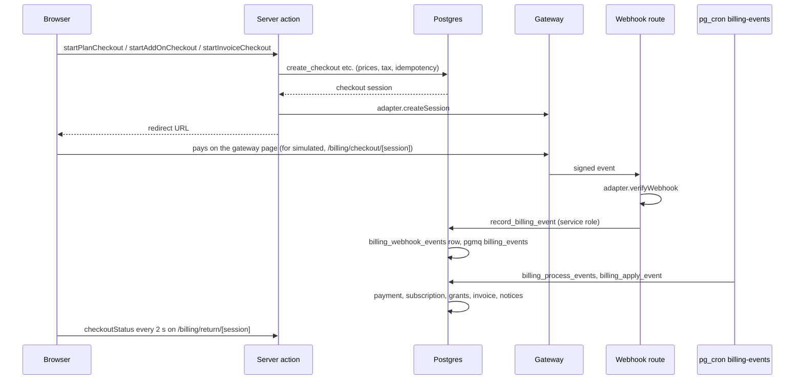
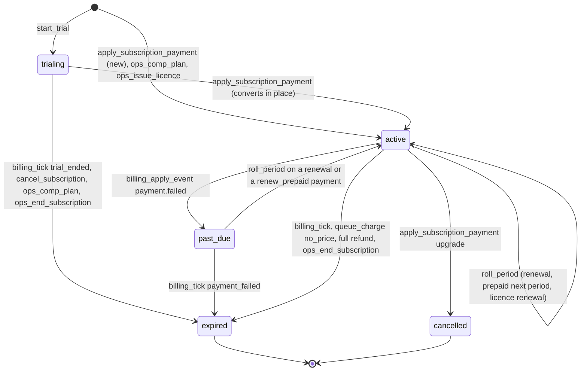
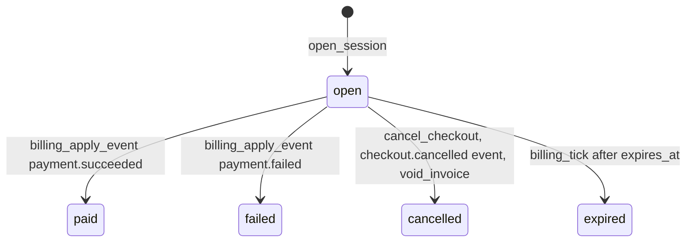
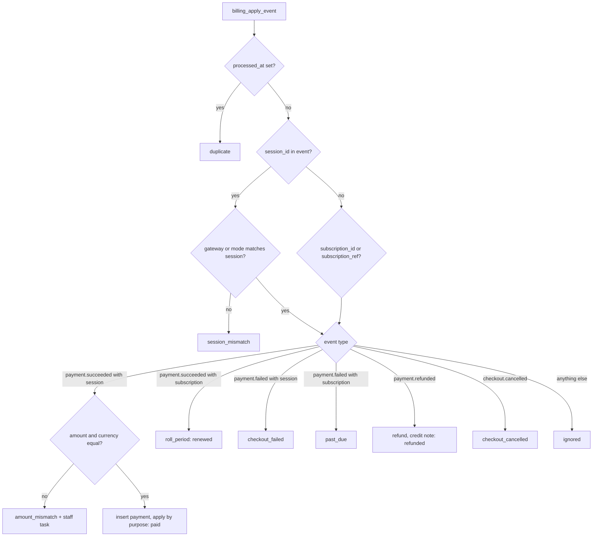
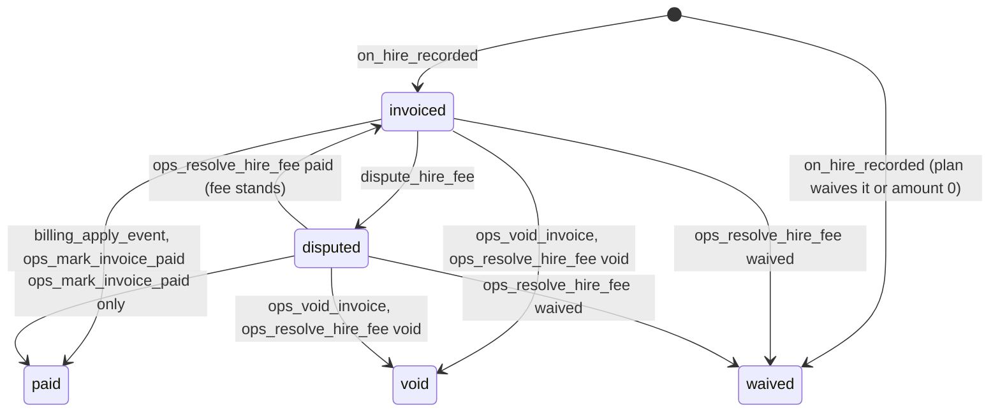
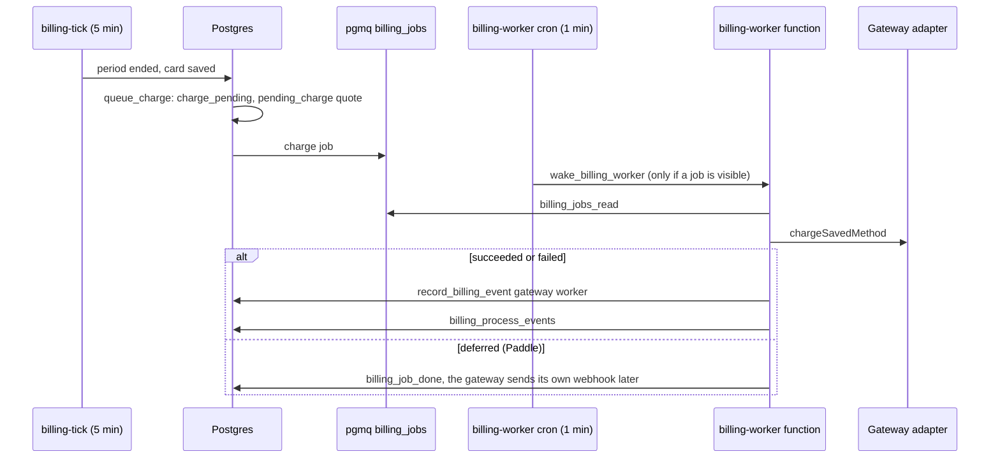

Commit: 06a359d
Covers: supabase/migrations/20261022000000_billing_enums.sql, supabase/migrations/20261023000000_billing_core.sql, supabase/migrations/20261024000000_billing_lifecycle.sql, supabase/migrations/20261025000000_billing_ops.sql, lib/billing/, lib/actions/billing.ts, lib/actions/ops/billing.ts, lib/data/billing.ts, components/billing/, app/(app)/billing/, app/(app)/settings/billing/, app/(app)/org/(portal)/billing/, app/(app)/uni/(portal)/billing/, app/(app)/ops/billing/, app/api/billing/, supabase/functions/billing-worker/, supabase/functions/_shared/billing/

# Billing

## Purpose

Billing decides what a student, an organisation or a university may use beyond the free product, and takes the money for it. Every paid capability is an entitlement key; plans, trials, add-ons, university sponsorship and staff grants all become rows in one grants table that Postgres merges at each check. Money arrives only as verified gateway events that SQL applies once, and pg_cron moves subscriptions on in time.

In [architecture/overview.md](../architecture/overview.md) billing runs through every layer in "Layers": pages in the `(app)` portals (`/settings/billing`, `/org/billing`, `/uni/billing`, `/ops/billing`, `/billing/*`), server actions that each call one SQL function, `private` security-definer functions behind `public` wrappers, two pgmq queues and five pg_cron jobs, one Edge Function, and the payment gateways listed under "External services" [src: supabase/functions/_shared/billing/config.ts#export function billingGateways]. The refusal path (`PT402` → `payment_required` → upgrade sheet) is traced in [request-lifecycle.md](../architecture/request-lifecycle.md) "Trace 2", and the `billing_events` queue mechanics in [background-jobs.md](../architecture/background-jobs.md) "Queue drained in SQL".

Other subsystems call into billing: recruiting spends contact credits [src: supabase/migrations/20261014000000_recruiter_talent.sql#perform private.consume_quota(v_org, 'contact.credits', 1);]; jobs records hires, which trigger hiring fees [src: supabase/migrations/20261024000000_billing_lifecycle.sql#create trigger hires_fee after insert on public.hires]; university, CV, feed and recruiter functions ask `uni_plan`, `uni_entitled`, `uni_limit`, `has_entitlement`, `org_entitled` and `org_limit`, which billing redefines over its registry [src: supabase/migrations/20261023000000_billing_core.sql#create or replace function private.has_entitlement(p_user uuid, p_key text)] [src: supabase/migrations/20261023000000_billing_core.sql#create or replace function private.uni_entitled(p_university uuid, p_key text)].

## Data model

Column lists are in the generated reference: [billing_core](../reference/schema/billing_core.md), [billing_lifecycle](../reference/schema/billing_lifecycle.md), [billing_ops](../reference/schema/billing_ops.md). This section names what carries meaning.

### Types

| Type | Values | Defined |
|---|---|---|
| `billing_subject` | `user`, `org`, `university` | [src: supabase/migrations/20261023000000_billing_core.sql#create type public.billing_subject:L17] |
| `grant_source` | `plan`, `add_on`, `sponsorship`, `trial`, `admin` | [src: supabase/migrations/20261023000000_billing_core.sql#create type public.grant_source:L18] |
| `entitlement_kind` | `bool`, `int`, `limit`, `enum` | [src: supabase/migrations/20261023000000_billing_core.sql#create type public.entitlement_kind:L19] |
| `subscription_status` | `trialing`, `active`, `past_due`, `expired`, `cancelled` | [src: supabase/migrations/20261024000000_billing_lifecycle.sql#create type public.subscription_status:L20] |
| `job_status` gains `paused` | own migration, because a new enum value can't be used in the transaction that adds it | [src: supabase/migrations/20261022000000_billing_enums.sql#alter type public.job_status add value if not exists 'paused';] |

### Tables

| Table | One row is | Columns and constraints that carry meaning |
|---|---|---|
| `entitlement_keys` | A paid capability | `subject` (who can hold it), `kind`, `free_value`, `levels` (enum keys, lowest first; the first is free), `period` (limit keys only). `levels` is set exactly for enum keys and `period <> 'none'` exactly for limit keys [src: supabase/migrations/20261023000000_billing_core.sql#check ((kind = 'enum') = (levels is not null))]. A key not in this table is denied everywhere. |
| `entitlement_key_aliases` | An older name for a key | `privacy.viewer_names`, `seats`, `saved_searches`, `analytics`, `competitions.create` map to `cv.viewer_names`, `org.seats`, `recruit.saved_searches`, `recruit.analytics`, `competitions.run` [src: supabase/migrations/20261023000000_billing_core.sql#('privacy.viewer_names', 'cv.viewer_names')] |
| `plans` | A plan and its grant template | `audience`, `tier`, `interval`, `price_pkr`, `price_usd` (null = not sold in that currency), `grants` (key → value), `self_serve` (bought at checkout; the rest are applied by staff), `active` [src: supabase/migrations/20261023000000_billing_core.sql#create table public.plans (]. A migration-time check refuses a template key of the wrong audience or shape [src: supabase/migrations/20261023000000_billing_core.sql#raise exception 'plan % has a bad grant %', r.id, r.key;]. |
| `entitlement_grants` | One value of one key for one subject, with its reason | `source`, `source_id` (subscription, add-on order, university or nothing), `starts_at`, `ends_at`, `revoked_at` + `revoked_reason` (set together), `consumed` (add-on limits only), `notice_sent_at` (sponsorship only). Admin grants need a reason [src: supabase/migrations/20261023000000_billing_core.sql#check (source <> 'admin' or reason is not null)]. Trigger `check_grant` refuses a key of another subject, a value of the wrong shape, a negative or fractional number, and an add-on grant on a non-limit key [src: supabase/migrations/20261023000000_billing_core.sql#raise exception 'add-ons only top up limits' using errcode = '22023';]. |
| `usage_counters` | Use of one limit key in one period | Primary key `(subject_type, subject_id, key, period_start)`; a new period is a new row and old rows stay [src: supabase/migrations/20261023000000_billing_core.sql#primary key (subject_type, subject_id, key, period_start)] |
| `trial_claims` | A student who has used the trial | Primary key `user_id`: one trial per account, ever [src: supabase/migrations/20261023000000_billing_core.sql#create table public.trial_claims (] |
| `tax_rates` | A provincial sales-tax rate from a date | `rate` between 0 and 0.5, `unique (province, effective_from)`, `reason` required [src: supabase/migrations/20261024000000_billing_lifecycle.sql#rate numeric(6, 4) not null check (rate >= 0 and rate <= 0.5),] |
| `checkout_sessions` | A payment someone started | `purpose` (`subscription`, `add_on`, `invoice`) with exactly the matching reference set, `change` (`new`, `upgrade`, `renew_prepaid`), `quote` (fixed at creation), `amount`, `currency`, `gateway`, `live`, `idempotency_key` unique per creator, `status`, `expires_at` [src: supabase/migrations/20261024000000_billing_lifecycle.sql#unique (created_by, idempotency_key),] |
| `subscriptions` | A plan a subject holds over time | At most one row per subject in `trialing`, `active` or `past_due` (partial unique index) [src: supabase/migrations/20261024000000_billing_lifecycle.sql#create unique index subscriptions_one_current_idx on public.subscriptions (subject_type, subject_id)]. `gateway` adds `manual` (licences), `comp` (staff) and `none` (trials); `payment_method` `card` renews itself, `wallet` and `bank_transfer` are prepaid; `period_amount` (pre-tax price of the current period, used for upgrade credit and MRR); `saved_method_ref`; flags `cancel_at_period_end`, `next_period_paid`, `charge_pending`; `next_plan_id`; `retry_count`, `next_retry_at`, `grace_ends_at`; `simulate_fail_next` (test tool); `renewal_invoice_id` (licences). |
| `payments` | Money received | `unique (gateway, gateway_payment_id)`, `refunded_amount <= amount`, `status` `succeeded`, `refunded`, `partially_refunded`, `mor_invoice_ref` (USD), `live` [src: supabase/migrations/20261024000000_billing_lifecycle.sql#unique (gateway, gateway_payment_id),] |
| `billing_webhook_events` | One verified gateway event | `unique (gateway, event_id)`; `payload` as received, `event` (the adapter's normalised reading), `processed_at`, `outcome`, `attempts`, `error`; gateway `worker` for the worker's own outcomes [src: supabase/migrations/20261024000000_billing_lifecycle.sql#create table public.billing_webhook_events (] |
| `invoice_counters` | The last number used per series and year | Series `SKL`, `TEST`, `SKL-CN`, `TEST-CN` [src: supabase/migrations/20261024000000_billing_lifecycle.sql#series text not null check (series in ('SKL', 'TEST', 'SKL-CN', 'TEST-CN')),] |
| `invoices` | An invoice, receipt or credit note | `number` unique, `kind`, `purpose`, `lines`, `subtotal`, `tax_lines`, `tax_total`, `total`, `status` (`issued`, `paid`, `void`), `bill_to` and `seller` (copied at issue), `draft_reasons`, `live`, `content_hash`. A credit note always names the invoice it credits [src: supabase/migrations/20261024000000_billing_lifecycle.sql#check ((kind = 'credit_note') = (credits_invoice_id is not null))]. Trigger `invoice_immutable` refuses any delete, and any change to number, kind, lines, amounts, currency, parties, issue date, `live`, hash or subject [src: supabase/migrations/20261024000000_billing_lifecycle.sql#raise exception 'an issued invoice can''t change; issue a credit note' using errcode = '42501';]. Status, due date, payment and void fields stay writable. |
| `add_on_orders` | Contact credits or a sponsored post | Organisations only; `quantity` 1 to 100; `status` `pending`, `fulfilled`, `cancelled`, `refunded`; `grant_id` for credits [src: supabase/migrations/20261024000000_billing_lifecycle.sql#subject_type public.billing_subject not null check (subject_type = 'org'),] |
| `hire_fees` | The fee for one recorded hire | `hire_id` unique, PKR only, `status` `pending`, `invoiced`, `paid`, `disputed`, `void`, `waived`; dispute fields; `overdue_notified_at` [src: supabase/migrations/20261024000000_billing_lifecycle.sql#status text not null check (status in ('pending', 'invoiced', 'paid', 'disputed', 'void', 'waived')),]. No function writes `pending` (see the hire-fee states below). |
| `billing_tasks` | A follow-up for accounts staff | `kind` `offer_follow_up`, `unreported_hire`, `amount_mismatch`, `licence_request`; `unique (kind, ref_id)` makes each task once [src: supabase/migrations/20261024000000_billing_lifecycle.sql#kind text not null check (kind in ('offer_follow_up', 'unreported_hire', 'amount_mismatch', 'licence_request')),]. No code creates `unreported_hire`; the ops page only has a label for it [src: app/(app)/ops/billing/page.tsx#unreported_hire: "Unreported hire",]. |
| `billing_reminders` | A prepaid-renewal reminder already sent | Primary key `(subscription_id, period_end, kind)` [src: supabase/migrations/20261024000000_billing_lifecycle.sql#primary key (subscription_id, period_end, kind)] |

Columns billing adds to other tables: `organizations.province`, `billing_ntn`, `billing_address`; `universities.billing_ntn`, `billing_address`; `org_members.seat_keep`; `job_posts.sponsored_until`, `paused_at` [src: supabase/migrations/20261024000000_billing_lifecycle.sql#add column province text check (province is null or province in ('Punjab', 'Sindh', 'KP', 'Balochistan', 'ICT', 'AJK', 'GB')),] [src: supabase/migrations/20261024000000_billing_lifecycle.sql#add column seat_keep boolean not null default false;] [src: supabase/migrations/20261024000000_billing_lifecycle.sql#add column sponsored_until timestamptz,]. A hire's own `fee_status` allows only `unbilled`, `invoiced` and `waived` [src: supabase/migrations/20261015000000_recruiter_jobs.sql#fee_status text not null default 'unbilled' check (fee_status in ('unbilled', 'invoiced', 'waived')),].

Deleting an auth user or an organisation deletes its grants and counters; payments and invoices stay [src: supabase/migrations/20261023000000_billing_core.sql#create trigger billing_forget_user after delete on auth.users] [src: supabase/migrations/20261023000000_billing_core.sql#create trigger billing_forget_org after delete on public.organizations]. Universities have no such trigger.

### The registry and the plans

All 33 keys are inserted by the core migration [src: supabase/migrations/20261023000000_billing_core.sql#insert into public.entitlement_keys (key, subject, kind, period, free_value, levels, label) values:L63].

| Subject | Keys (kind, free value) |
|---|---|
| user | `student.plan` (enum free → pro), `cv.pdf_export`, `cv.refresh_on_demand`, `cv.insights`, `cv.viewer_names`, `privacy.record_viewers`, `insights.post_survey` (bool, false), `cv.templates` (int, 1) |
| org | `org.plan` (enum explore → starter → growth → enterprise), `talent.full_profile`, `recruit.shortlists`, `recruit.saved_searches`, `recruit.analytics`, `api.access`, `hire_fee.waived`, `org.sso` (bool, false), `org.seats` (int, 1), `jobs.active_posts` (int, 1), `contact.credits` (limit per `billing_period`, 0), `competitions.run` (limit per `quarter`, 0) |
| university | `uni.plan` (enum free → basic → growth → campus), `uni.dashboard` (enum none → summary → full → accreditation), `uni.sponsored_pro` (enum none → final_year → all), `uni.exports`, `uni.student_records`, `uni.skills_gap`, `uni.outcomes`, `uni.faculty_panel`, `uni.benchmark`, `uni.accreditation` (bool, false), `uni.job_fairs`, `uni.hackathons` (limit per `licence_year`, 0), `uni.admin_seats` (int, 1) |

| Plan | PKR | USD | Self-serve | Grants beyond the free values |
|---|---|---|---|---|
| `student_pro_monthly` / `_yearly` | 399 / 3,499 | none | yes | every student key on, `cv.templates` 5 [src: supabase/migrations/20261023000000_billing_core.sql#('student_pro_monthly', 'user', 'pro', 'Student Pro', 'month', 399, null, true, 1,] |
| `recruiter_starter_monthly` / `_yearly` | 15,000 / 150,000 | 55 / 550 | yes | full profiles, 25 credits, 1 seat, shortlists, saved searches, 3 live posts |
| `recruiter_growth_monthly` / `_yearly` | 45,000 / 450,000 | 160 / 1,600 | yes | Starter plus analytics, 100 credits, 5 seats, 10 posts, 1 competition, API, fee waived [src: supabase/migrations/20261023000000_billing_core.sql#('recruiter_growth_monthly', 'org', 'growth', 'Growth', 'month', 45000, 160, true, 3,] |
| `recruiter_enterprise_yearly` | none | none | no | 500 credits, 25 seats, 100000 posts, 4 competitions, SSO |
| `uni_basic_yearly` | 300,000 | none | no | summary dashboard, 2 admin seats |
| `uni_growth_yearly` | 900,000 | none | no | full dashboard, exports, records, skills gap, outcomes, faculty panel, benchmark, sponsored Pro for final year, 1 fair, 2 hackathons, 5 seats |
| `uni_campus_yearly` | 2,000,000 | none | no | Growth's booleans plus accreditation, accreditation dashboard, sponsored Pro for all, 2 fairs, 4 hackathons, 10 seats [src: supabase/migrations/20261023000000_billing_core.sql#('uni_campus_yearly', 'university', 'campus', 'Campus', 'year', 2000000, null, false, 3,] |

Prices can change after the migration: a super admin edits them with `ops_set_plan_price`, which keeps each plan's currencies and audits the change [src: supabase/migrations/20261029000000_config_metrics.sql#create function private.ops_set_plan_price(]. Renewals read the plan's price when they are quoted (see "Renewal").

## Lifecycles and state machines

### Money to entitlement

The action prices nothing: `startCheckout` picks the gateway from environment variables and calls one of three SQL functions that price from `plans` and config [src: lib/billing/checkout.ts#export async function startCheckout]. The simulated gateway's buttons produce a signed webhook and POST it to the app's own webhook route, so a test payment takes the same path [src: lib/actions/billing.ts#/api/billing/webhook/simulated]. The return page polls the checkout session in the database every 2 seconds for up to 60 seconds [src: components/billing/return-status.tsx#} else if (Date.now() - started > 60_000) {].

### Subscription

| Transition | Function | Ended reason |
|---|---|---|
| Trial starts, 7 days, plan `student_pro_monthly`, gateway `none` | `start_trial` [src: supabase/migrations/20261024000000_billing_lifecycle.sql#values ('user', v_me, 'student_pro_monthly', 'trialing', 'none', false, 'none', now(), now() + make_interval(days => v_days),] | |
| First payment creates `active`; a payment during a trial converts the trial row | `apply_subscription_payment` [src: supabase/migrations/20261024000000_billing_lifecycle.sql#-- A trial converts in place.] | |
| Upgrade: the old row becomes `cancelled`, a new `active` row starts now | `apply_subscription_payment` [src: supabase/migrations/20261024000000_billing_lifecycle.sql#update public.subscriptions set status = 'cancelled', ended_at = now(), ended_reason = 'upgraded', charge_pending = false] | `upgraded` |
| Every other end goes to `expired`, never `cancelled` | `expire_subscription` [src: supabase/migrations/20261024000000_billing_lifecycle.sql#set status = 'expired', ended_at = now(), ended_reason = p_reason, charge_pending = false, next_retry_at = null] | `trial_ended`, `cancelled`, `period_ended`, `licence_ended`, `payment_failed`, `unpaid`, `no_price`, `refunded`, `replaced_by_comp`, `ended_by_staff` |
| Period rolls (the scheduled plan takes over, retries and flags reset) | `roll_period` [src: supabase/migrations/20261024000000_billing_lifecycle.sql#create function private.roll_period(p_sub uuid, p_amount numeric default null)] | |
| Renewal declined → `past_due` | `billing_apply_event` [src: supabase/migrations/20261024000000_billing_lifecycle.sql#next_retry_at = case when retry_count + 1 <= jsonb_array_length(v_retry)] | |

Flags change inside `active` without a state change: `cancel_subscription` sets or clears `cancel_at_period_end` (and ends a trial at once) [src: supabase/migrations/20261024000000_billing_lifecycle.sql#perform private.expire_subscription(s.id, 'cancelled');]; `schedule_plan_change` sets `next_plan_id`, or `cancel_at_period_end` for `free` [src: supabase/migrations/20261024000000_billing_lifecycle.sql#update public.subscriptions set cancel_at_period_end = true, next_plan_id = null where id = s.id;]; a `renew_prepaid` payment on an active row sets `next_period_paid` [src: supabase/migrations/20261024000000_billing_lifecycle.sql#update public.subscriptions set next_period_paid = true where id = s.id;]; `queue_charge` sets `charge_pending`.

Every state change that matters re-creates the subscription's grants through `sync_plan_grants`: it revokes the row's `plan` and `trial` grants and, for a live state, inserts the plan's template again until the trial end, the period end, or the later of grace end and period end while past due [src: supabase/migrations/20261024000000_billing_lifecycle.sql#when 'past_due' then greatest(s.grace_ends_at, s.current_period_end)].

### Checkout session

`checkout_session` reports an open session past `expires_at` as `expired` before the tick writes it [src: supabase/migrations/20261024000000_billing_lifecycle.sql#case when c.status = 'open' and c.expires_at <= now() then 'expired' else c.status end,]. A `payment.succeeded` event marks its session `paid` whatever the session's status, so a payment that arrives after expiry or cancellation still applies [src: supabase/migrations/20261024000000_billing_lifecycle.sql#update public.checkout_sessions set status = 'paid', completed_at = now() where id = c.id;].

### Webhook event

`record_billing_event` inserts once per `(gateway, event_id)` and queues the row id; a repeat returns `{duplicate: true}` and queues nothing [src: supabase/migrations/20261024000000_billing_lifecycle.sql#on conflict (gateway, event_id) do nothing]. `billing_apply_event` locks the row, returns `duplicate` if it already has `processed_at`, and otherwise stamps `processed_at` and an outcome: `paid`, `payment_already_recorded`, `renewed`, `renewal_after_end`, `checkout_failed`, `past_due`, `refunded`, `nothing_to_refund`, `checkout_cancelled`, `session_mismatch`, `amount_mismatch`, or `ignored` [src: supabase/migrations/20261024000000_billing_lifecycle.sql#v_outcome text := 'ignored';]. An exception leaves the row unprocessed with `attempts` and `error` set (see "Failure modes").

### Invoice

| From | To | Function |
|---|---|---|
| (none) | `paid` receipt or invoice for a gateway payment, PKR only | `document_for_payment` [src: supabase/migrations/20261024000000_billing_lifecycle.sql#if pay.currency <> 'PKR' then] |
| (none) | `issued` invoice (hiring fee, licence) | `on_hire_recorded`, `ops_issue_licence` |
| (none) | `issued` credit note (refund or void); credit notes never change status | `billing_apply_event` refund branch, `void_invoice` |
| `issued` | `paid` | `billing_apply_event` (invoice checkout), `ops_mark_invoice_paid` [src: supabase/migrations/20261025000000_billing_ops.sql#create function private.ops_mark_invoice_paid(] |
| `issued` | `void`, plus a credit note for minus the total | `void_invoice` [src: supabase/migrations/20261025000000_billing_ops.sql#create function private.void_invoice(] |

### Hiring fee

Paying a disputed fee's invoice online leaves the fee `disputed`: the online path updates only `invoiced` and `pending` fees, while a bank payment recorded by staff also closes `disputed` ones [src: supabase/migrations/20261024000000_billing_lifecycle.sql#update public.hire_fees set status = 'paid', resolved_at = now() where invoice_id = c.invoice_id and status in ('invoiced', 'pending');] [src: supabase/migrations/20261025000000_billing_ops.sql#update public.hire_fees set status = 'paid', resolved_at = now() where invoice_id = i.id and status in ('invoiced', 'disputed', 'pending');]. Resolving a fee to `void` or `waived` also sets the hire's `fee_status` to `waived` [src: supabase/migrations/20261025000000_billing_ops.sql#update public.hires set fee_status = 'waived' where id = f.hire_id;]. Hires that existed before billing were all set to `waived` with a zero fee [src: supabase/migrations/20261024000000_billing_lifecycle.sql#'waived', 'recorded before billing launched'].

### Add-on order and sponsorship grant

An add-on order starts `pending` at checkout, becomes `fulfilled` in `fulfil_add_on`, `refunded` on a full refund, and `cancelled` when its checkout is cancelled, fails or expires [src: supabase/migrations/20261024000000_billing_lifecycle.sql#create function private.fulfil_add_on(p_order uuid)] [src: supabase/migrations/20261024000000_billing_lifecycle.sql#update public.add_on_orders o set status = 'cancelled'].

A sponsorship grant set (the whole Student Pro template, `source = sponsorship`, `source_id` = the university) is created open-ended by `sponsorship_sync`, given an end date and a notice when the student stops qualifying, made open-ended again if they qualify before that date, and lapses at its end date [src: supabase/migrations/20261025000000_billing_ops.sql#-- Re-qualified before their end date: the end date goes away.] [src: supabase/migrations/20261025000000_billing_ops.sql#-- No longer eligible: Pro continues to the end of the first month 30 days away; told now.].

### Renewal

The worker's event id is `charge:` plus the job's idempotency key, which includes the period end and the retry count, so each attempt is its own event and a re-run of the same job records once [src: supabase/functions/_shared/billing/worker.ts#charge:${job.idempotency_key}] [src: supabase/migrations/20261024000000_billing_lifecycle.sql#'idempotency_key', 'renew:' || s.id::text || ':' || to_char(s.current_period_end at time zone 'UTC', 'YYYYMMDDHH24MISSUS') || ':' || s.retry_count::text,].

## Algorithms

### Resolving a key

`entitlement_key(p)` returns the registry row for `p`, or for the key `p` is an alias of [src: supabase/migrations/20261023000000_billing_core.sql#create function private.entitlement_key(p_key text)]. Every reader resolves aliases this way, so `has_entitlement(user, 'privacy.viewer_names')` reads `cv.viewer_names`.

### Merging grants: `entitlement_value(subject_type, subject_id, key)`

1. Resolve the key. Return null if it is unknown, belongs to another subject type, or the id is null [src: supabase/migrations/20261023000000_billing_core.sql#create function private.entitlement_value(].
2. Collect the values of the subject's active grants for the key, leaving out add-ons. Active means not revoked, started, and not ended: `starts_at <= now()` and `ends_at` null or later than now [src: supabase/migrations/20261023000000_billing_core.sql#a where a.source <> 'add_on'] [src: supabase/migrations/20261023000000_billing_core.sql#create function private.active_grants(].
3. For a user, add derived values: `insights.post_survey` is true for an approved teacher whose university holds an active `uni.plan` grant of `growth` or `campus`. Nothing is stored for this [src: supabase/migrations/20261023000000_billing_core.sql#create function private.derived_user_values(].
4. Append the key's `free_value` [src: supabase/migrations/20261023000000_billing_core.sql#v_values := coalesce(v_values, '{}') || k.free_value;].
5. Merge by kind: `bool` is true if any value is true; `enum` is the value with the highest position in `levels` (values not in the list sort last); `int` and `limit` are the maximum, cast to `bigint` [src: supabase/migrations/20261023000000_billing_core.sql#order by array_position(k.levels, x #>> '{}') desc nulls last limit 1] [src: supabase/migrations/20261023000000_billing_core.sql#else to_jsonb((select max((x #>> '{}')::numeric)::bigint from unnest(v_values) x))].

`effective_entitlements(type, id)` returns `{values, quotas}` for every key of that subject type, with `quota_status` for each limit key [src: supabase/migrations/20261023000000_billing_core.sql#create function private.effective_entitlements(].

### "Has it": `entitled(type, id, key)`

True when the merged value is above free: `bool` true; `enum` above the first level; a number above the free value; or, for a `limit` key, any unspent add-on top-up [src: supabase/migrations/20261023000000_billing_core.sql#when 'enum' then coalesce(array_position(k.levels, v #>> '{}'), 1) > 1] [src: supabase/migrations/20261023000000_billing_core.sql#or (k.kind = 'limit' and private.quota_extras(p_type, p_id, k.key) > 0)]. Unknown keys are false.

The older helpers are wrappers over this:

| Helper | Rule |
|---|---|
| `has_entitlement(user, key)` | `entitled('user', …)` [src: supabase/migrations/20261023000000_billing_core.sql#create or replace function private.has_entitlement(p_user uuid, p_key text)] |
| `org_entitled(org, key)` | the organisation must be `verified`, then `entitled('org', …)` [src: supabase/migrations/20261023000000_billing_core.sql#and exists (select 1 from public.organizations o where o.id = p_org and o.status = 'verified')] |
| `org_limit(org, key)` / `org_limit(key)` | the merged number for `int` and `limit` keys, else null; the one-argument form uses the caller's active organisation [src: supabase/migrations/20261023000000_billing_core.sql#create function private.org_limit(p_org uuid, p_key text)] [src: supabase/migrations/20261023000000_billing_core.sql#create or replace function private.org_limit(p_key text)] |
| `uni_plan(university)` | `free` unless the university has an owner; then the merged `uni.plan` [src: supabase/migrations/20261023000000_billing_core.sql#create or replace function private.uni_plan(p_university uuid)] |
| `uni_entitled(university, key)` | false without an owner; `uni.dashboard` means summary or above and `uni.dashboard_full` means full or above [src: supabase/migrations/20261023000000_billing_core.sql#return coalesce(v_level, 1) >= case p_key when 'uni.dashboard' then 2 else 3 end;] |
| `uni_limit(university, key)` | the free value while `uni_plan` is free, else the merged number [src: supabase/migrations/20261023000000_billing_core.sql#create or replace function private.uni_limit(p_university uuid, p_key text)] |

### Counter periods: `quota_period_start(type, id, key)`

All calendar arithmetic is in `Asia/Karachi` [src: supabase/migrations/20261023000000_billing_core.sql#v_local timestamp := now() at time zone 'Asia/Karachi';].

| `period` | Start of the current period |
|---|---|
| `quarter` | start of the calendar quarter |
| `month` | start of the calendar month (no key uses it) |
| `billing_period` | start of the current `active` or `past_due` subscription's period; without one, the calendar month [src: supabase/migrations/20261023000000_billing_core.sql#return coalesce(lower(v_sub), date_trunc('month', v_local) at time zone 'Asia/Karachi');] [src: supabase/migrations/20261024000000_billing_lifecycle.sql#create or replace function private.current_subscription_period(p_type public.billing_subject, p_id uuid)] |
| `licence_year` | anchor = the subscription's period start, else the earliest active `plan` or `admin` grant of `uni.plan`; period start = anchor plus the whole years since it (`age`, floored at 0). Without an anchor, the calendar year [src: supabase/migrations/20261023000000_billing_core.sql#v_years := greatest(0, extract(year from age(now(), v_anchor))::integer);] |

Because `billing_period` is the whole subscription period, a yearly plan's contact credits are one allowance for the year, and a comp plan's for its whole length (see [prd-mismatches.md](../reference/prd-mismatches.md)). A trial does not count: `current_subscription_period` reads only `active` and `past_due`. An upgrade starts a new subscription, so its first counter row starts at the upgrade.

### Spending a metered key: `consume_quota(type, id, key, n)`

1. Refuse with `PT402` if the key is unknown, not a `limit`, or of another subject; refuse `n` outside 1 to 1000 with `22023` [src: supabase/migrations/20261023000000_billing_core.sql#if p_n is null or p_n < 1 or p_n > 1000 then].
2. Find the period start, insert the period's counter row if missing, and lock it `FOR UPDATE`.
3. `limit` = merged value; `base = least(n, max(limit − used, 0))` is taken from the period's allowance [src: supabase/migrations/20261023000000_billing_core.sql#v_base := least(p_n, greatest(v_limit - v_used, 0));].
4. The rest comes from active add-on grants, locked, earliest `ends_at` first (no end last, then oldest), each giving at most `value − consumed` [src: supabase/migrations/20261023000000_billing_core.sql#order by x.ends_at nulls last, x.created_at].
5. If something is still owed, raise `PT402`; the whole transaction, add-on updates included, rolls back [src: supabase/migrations/20261023000000_billing_core.sql#raise exception 'you''ve used this period''s allowance' using errcode = 'PT402';].
6. Add `base` to the counter and return what is left: `max(limit − used − base, 0)` plus the remaining add-ons [src: supabase/migrations/20261023000000_billing_core.sql#return greatest(v_limit - v_used - v_base, 0) + private.quota_extras(p_type, p_id, k.key);].

The row lock serialises parallel spends; the worker test runs 50 parallel spends against one remaining credit and expects exactly one to succeed [src: tests/worker/billing-concurrency.test.ts#50 parallel spends against 1 remaining credit: exactly 1 succeeds].

The organisation wrapper `consume_quota(org, key, amount)` refuses `contact.credits` with `PT402` while any hiring-fee invoice is past its due date, then calls the general function [src: supabase/migrations/20261024000000_billing_lifecycle.sql#if p_key = 'contact.credits' and exists (select 1 from public.hire_fees f where f.org_id = p_org and f.status = 'invoiced' and f.due_at < now()) then]. `send_contact_request` calls it inside its own transaction, so a failed request spends nothing [src: supabase/migrations/20261014000000_recruiter_talent.sql#perform private.consume_quota(v_org, 'contact.credits', 1);].

`release_quota` gives back the period counter first, then add-ons with the latest `ends_at` first [src: supabase/migrations/20261023000000_billing_core.sql#order by x.ends_at desc nulls first]. Nothing in SQL or TypeScript calls it; pgTAP calls it directly.

`quota_status` reports `limit`, `used`, `extras` and `remaining = max(limit − used, 0) + extras` [src: supabase/migrations/20261023000000_billing_core.sql#'remaining', greatest(v_limit - coalesce(v_used, 0), 0) + v_extras].

Only `contact.credits` is counted in `usage_counters`. The other limit keys are counted by their own functions:

| Key | Counted by |
|---|---|
| `competitions.run` | `save_competition` checks only that the key is held [src: supabase/migrations/20261015000000_recruiter_jobs.sql#if not private.org_entitled(v_org, 'competitions.create') then]; `submit_competition` allows one competition per calendar quarter whatever the plan's value, with `date_trunc` on the stored timestamps and no Asia/Karachi conversion [src: supabase/migrations/20261015000000_recruiter_jobs.sql#and date_trunc('quarter', x.created_at) = date_trunc('quarter', now())) then] |
| `uni.hackathons`, `uni.job_fairs` | rows created since `uni_licence_start` compared with `uni_limit` (billing patched the earlier rolling 365 days) [src: supabase/migrations/20261023000000_billing_core.sql#c.created_at >= private.uni_licence_start(a.university_id)] [src: supabase/migrations/20261020000000_uni_fairs.sql#if v_used >= coalesce(private.uni_limit(a.university_id, 'uni.hackathons'), 0) then] |

### Checkout pricing

`open_session` is shared by all three checkouts [src: supabase/migrations/20261024000000_billing_lifecycle.sql#create function private.open_session(]:

1. The key must be 16 to 80 characters. The same creator and key return the existing session, whatever its status [src: supabase/migrations/20261024000000_billing_lifecycle.sql#-- The same click twice gets the same session back.]. The browser makes one key per checkout button [src: components/billing/checkout-button.tsx#crypto.randomUUID().replace(/-/g, "")].
2. 30 new sessions per person per hour, else `54000` [src: supabase/migrations/20261024000000_billing_lifecycle.sql#if not private.rate_limit('checkout:' || v_me::text, 30, interval '1 hour') then].
3. A total below 1 is refused with `55000` [src: supabase/migrations/20261024000000_billing_lifecycle.sql#raise exception 'nothing to pay' using errcode = '55000';].
4. `live` is true for every gateway except `simulated`; the session expires after `billing.lifecycle.checkout_minutes` (60) [src: supabase/migrations/20261024000000_billing_lifecycle.sql#p_quote ->> 'currency', p_gateway, p_gateway <> 'simulated', p_key,].

`create_checkout(subject, plan, currency, gateway, key)` [src: supabase/migrations/20261024000000_billing_lifecycle.sql#create function private.create_checkout(]:

1. The caller's subject comes from `billing_subject_of_caller` (see "RLS and privileges").
2. The plan must be active, self-serve and for that audience, else `P0002`. A user must have the student role; an organisation must be verified and, to pay in PKR, have a province (`55000`).
3. The gateway must suit the currency (`check_gateway`: PKR with simulated, safepay or payfast; USD with simulated or paddle), and only organisations may pay in USD [src: supabase/migrations/20261024000000_billing_lifecycle.sql#if p_currency is null or not private.check_gateway(p_gateway, p_currency) or (v_type <> 'org' and p_currency <> 'PKR') then]. The plan needs a price in that currency.
4. Against the current non-trial subscription: the same plan is `renew_prepaid` when it is past due, or prepaid (wallet or bank transfer), not yet paid ahead and ending within 14 days; otherwise `23505` [src: supabase/migrations/20261024000000_billing_lifecycle.sql#and s.current_period_end < now() + interval '14 days') then]. A higher `plan_rank` is an `upgrade`; a lower one is refused with `55000` (downgrades are scheduled). A trial counts as no subscription (`new`).
5. `plan_rank = 10 × tier + (1 if yearly)`, with tier 1 for pro, starter and basic, 2 for growth, 3 for enterprise and campus [src: supabase/migrations/20261024000000_billing_lifecycle.sql#select case p.tier when 'pro' then 1 when 'starter' then 1 when 'basic' then 1 when 'growth' then 2] [src: supabase/migrations/20261024000000_billing_lifecycle.sql#+ case p.interval when 'year' then 1 else 0 end]. So Starter yearly (11) outranks Starter monthly (10) and is an upgrade.
6. Upgrade credit, only when the old subscription has the same currency and a `period_amount` above 0: `credit = round(period_amount × max(seconds left, 0) / seconds in the period, 2)` [src: supabase/migrations/20261024000000_billing_lifecycle.sql#v_credit := round(s.period_amount * greatest(extract(epoch from s.current_period_end - now()), 0)]. The credit line is `−min(credit, price − 1)`, so an upgrade always costs at least 1 [src: supabase/migrations/20261024000000_billing_lifecycle.sql#'unit_amount', -least(v_credit, v_price - 1), 'amount', -least(v_credit, v_price - 1));].
7. The lines go through `billing_quote`, then `open_session`.

`billing_quote(type, id, lines, currency)` [src: supabase/migrations/20261024000000_billing_lifecycle.sql#create function private.billing_quote(]:

1. `subtotal` = sum of line amounts.
2. Tax applies only to organisations and universities paying PKR. The rate is the subject's province's latest `tax_rates` row effective on today's Karachi date; `tax = round(subtotal × rate, 2)` [src: supabase/migrations/20261024000000_billing_lifecycle.sql#v_tax := round(v_subtotal * r.rate, 2);]. No rate (including no province) adds draft reason `tax_rate_missing`. Students' prices carry no tax line and their document is a `receipt` [src: supabase/migrations/20261024000000_billing_lifecycle.sql#'document', case when p_type = 'user' then 'receipt' else 'invoice' end);].
3. Draft reason `company_details_missing` while `billing.company` lacks a legal name, NTN or address, or an STRN for a taxable subject [src: supabase/migrations/20261024000000_billing_lifecycle.sql#create function private.company_complete(p_with_tax boolean)].
4. `total = subtotal + tax`.

Worked example from pgTAP: Starter monthly for a Punjab organisation at 16% is PKR 15,000 + 2,400 = 17,400; upgrading to Growth straight after costs 45,000 − 15,000 credit = 30,000, plus 16% = 34,800 [src: supabase/tests/44_billing.test.sql#PKR 15,000 plus 16% Punjab tax] [src: supabase/tests/44_billing.test.sql#unused Starter time is credited].

`create_add_on_checkout` takes its unit price from `billing.add_ons` in the chosen currency. Contact credits must be between the configured `min` and `max` (5 and 100); a sponsored post must be a live post of the organisation that isn't already sponsored, quantity 1. It creates a `pending` order, then a quote and a session [src: supabase/migrations/20261024000000_billing_lifecycle.sql#create function private.create_add_on_checkout(]. `create_invoice_checkout` pays an issued invoice of the caller's subject at its own amounts, and refuses the simulated gateway for a live invoice [src: supabase/migrations/20261024000000_billing_lifecycle.sql#if not private.check_gateway(p_gateway, i.currency) or (i.live and p_gateway = 'simulated') then].

### Applying a payment

For a `payment.succeeded` event naming a session, `billing_apply_event` [src: supabase/migrations/20261024000000_billing_lifecycle.sql#create function private.billing_apply_event(p_id bigint)]:

1. Refuses a session whose gateway differs from the event's, or a simulated session with a live event (`session_mismatch`, not retried). Otherwise a mismatched live flag is copied from the event to the session, so a real gateway's sandbox payment is a test [src: supabase/migrations/20261024000000_billing_lifecycle.sql#if c.gateway <> v_gateway or (c.gateway = 'simulated' and ev.live) then].
2. Requires the event's amount and currency to equal the session's exactly; otherwise it records `amount_mismatch` and opens a staff task [src: supabase/migrations/20261024000000_billing_lifecycle.sql#if v_amount is distinct from c.amount or e ->> 'currency' is distinct from c.currency then].
3. Inserts the payment once per gateway payment id; a known id is `payment_already_recorded` and changes nothing else [src: supabase/migrations/20261024000000_billing_lifecycle.sql#on conflict (gateway, gateway_payment_id) do nothing].
4. Applies by purpose. A subscription goes through `apply_subscription_payment`; an add-on through `fulfil_add_on`; an invoice is marked paid (refused if a test payment would settle a live invoice) and its hiring fee becomes `paid`. PKR payments get a document from `document_for_payment`.

`apply_subscription_payment` [src: supabase/migrations/20261024000000_billing_lifecycle.sql#create function private.apply_subscription_payment(]:

- The method is `card` only if the event says card and carries a saved method reference; anything else is `wallet` (prepaid) [src: supabase/migrations/20261024000000_billing_lifecycle.sql#v_method text := case when e ->> 'method' = 'card' and coalesce(e ->> 'saved_method_ref', '') <> '' then 'card' else 'wallet' end;].
- Same plan, past due: `roll_period` with the quote's subtotal. Same plan, active: `next_period_paid`.
- Different plan on a paid subscription: the old row ends as `cancelled` (`upgraded`) and a new row starts now.
- A trial row converts in place; otherwise a new `active` row is inserted. Both run from now to now plus the plan interval, with `period_amount` = the first quote line, which is the list price before any credit [src: supabase/migrations/20261024000000_billing_lifecycle.sql#v_full numeric(12, 2) := (select (l ->> 'amount')::numeric from jsonb_array_elements(c.quote -> 'lines') l limit 1);].

`fulfil_add_on`: credits become an `add_on` grant of `contact.credits` worth the quantity, ending after `days` (90); a sponsored post's `sponsored_until` becomes `max(current value, now) + days` (14) [src: supabase/migrations/20261024000000_billing_lifecycle.sql#values ('org', o.subject_id, 'contact.credits', to_jsonb(o.quantity), 'add_on', o.id,] [src: supabase/migrations/20261024000000_billing_lifecycle.sql#update public.job_posts set sponsored_until = greatest(coalesce(sponsored_until, now()), now()) + make_interval(days => (v_cfg ->> 'days')::integer)]. The sponsored flag reaches students as a column of `opportunities` [src: supabase/migrations/20261024000000_billing_lifecycle.sql#coalesce(j.sponsored_until > now(), false)], and pgTAP 39 checks that no `order by` in that function mentions sponsorship [src: supabase/tests/39_student_portal.test.sql#is never ordered by sponsorship].

Refund (`payment.refunded`): the amount is `min(event amount or the whole payment, what is not yet refunded)` [src: supabase/migrations/20261024000000_billing_lifecycle.sql#v_amount := least(coalesce(v_amount, pay.amount), pay.amount - pay.refunded_amount);]. Above 0, the payment's refunded amount and status change; a PKR payment with a document gets a credit note for minus that amount; a full refund expires the subscription it paid for, revokes its credit grant, clears the sponsored date and marks the order `refunded` [src: supabase/migrations/20261024000000_billing_lifecycle.sql#-- A full refund ends what the payment bought.].

### Renewal, retries, grace

`billing_tick` runs these passes in order; the first four lock the subscriptions they read with `FOR UPDATE SKIP LOCKED` [src: supabase/migrations/20261024000000_billing_lifecycle.sql#create function private.billing_tick()]:

1. Trials whose `trial_ends_at` passed → expire `trial_ended`.
2. Active subscriptions whose period ended and with no charge in flight: cancel at period end → expire `cancelled`; paid ahead → `roll_period`; a licence with a renewal invoice → `roll_period` at that invoice's subtotal; a card with a saved method → `queue_charge`; anything else → expire `licence_ended` (manual) or `period_ended` [src: supabase/migrations/20261024000000_billing_lifecycle.sql#elsif r.payment_method = 'card' and r.saved_method_ref is not null then].
3. Past-due subscriptions with no charge in flight: grace over → expire `payment_failed`; retry due → `queue_charge` [src: supabase/migrations/20261024000000_billing_lifecycle.sql#perform private.expire_subscription(r.id, 'payment_failed');].
4. Licences (`manual`, `active`) with a licence invoice still `issued` 14 days (`licence_grace_days`) after its due date → expire `unpaid`.
5. Prepaid reminders (below).
6. Abandoned checkouts: open sessions past `expires_at` → `expired`, their pending orders → `cancelled`.
7. Hiring fees past due and not yet notified → one `billing_hire_fee_overdue` notice each.
8. Applications at `offer` for 45 days (`offer_follow_up_days`) → one `offer_follow_up` task each [src: supabase/migrations/20261024000000_billing_lifecycle.sql#where a.stage = 'offer' and a.stage_changed_at <= now() - make_interval(days => v_days)].

`queue_charge` quotes the renewal at the next plan's (or the current plan's) price in the subscription's currency through `billing_quote`, so it is taxed like a checkout [src: supabase/migrations/20261024000000_billing_lifecycle.sql#create function private.renewal_quote(p_sub uuid)]; no price in that currency expires the subscription `no_price` [src: supabase/migrations/20261024000000_billing_lifecycle.sql#perform private.expire_subscription(p_sub, 'no_price');]. It stores the quote in `pending_charge` and queues a `charge` job.

On a declined renewal (`payment.failed` naming a subscription that is `active` or `past_due`) [src: supabase/migrations/20261024000000_billing_lifecycle.sql#grace_ends_at = coalesce(grace_ends_at, current_period_end + make_interval(days => coalesce((private.lifecycle('grace_days') #>> '{}')::integer, 7))),]:

- `grace_ends_at` = period end + 7 days, set once.
- `retry_count` goes up by one, and `next_retry_at` = period end + `retry_days[old retry_count]` while `old retry_count + 1 ≤ 3`. With `[1, 3, 6]` the retries fall on period end + 1, + 3 and + 6 days; after the fourth failure there is no retry and the subscription expires at period end + 7 [src: supabase/migrations/20261024000000_billing_lifecycle.sql#then current_period_end + make_interval(days => (v_retry ->> retry_count)::integer) end].
- Grants are re-synced and last until the grace end.

`roll_period`: the new period starts at the old period end and ends at `max(old end + plan interval, now + 1 day)`; the scheduled `next_plan_id` becomes the plan, and `period_amount` becomes the amount paid if given [src: supabase/migrations/20261024000000_billing_lifecycle.sql#current_period_end = greatest(s.current_period_end + private.plan_interval(v_plan), now() + interval '1 day'),]. When the plan changed and the subject is an organisation, `apply_org_limits` runs.

Between a card subscription's period end and the applied renewal, its plan grants have already ended (`sync_plan_grants` ends them at `current_period_end`), so paid checks refuse until the renewal event is applied; see [verification-log.md](../reference/verification-log.md).

### Prepaid reminders

For active wallet and bank-transfer subscriptions that are not paid ahead, not cancelling and have no renewal invoice, each threshold `d` in `reminder_days` ([7, 3, 1]) with `period end ≤ now + d` sends one `billing_renewal_reminder`, recorded in `billing_reminders` as `renew_<d>` for that period end [src: supabase/migrations/20261024000000_billing_lifecycle.sql#insert into public.billing_reminders (subscription_id, period_end, kind) values (r.id, r.current_period_end, 'renew_' || r.days)]. A period that starts with fewer than 7 days left sends every threshold already passed in the same tick.

### Limits after a downgrade: `apply_org_limits(org)`

Runs under an advisory lock on `org-seats:<org>` [src: supabase/migrations/20261024000000_billing_lifecycle.sql#create function private.apply_org_limits(p_org uuid)]:

1. Over the seat limit: pending non-billing invites are revoked, then active non-billing members are ranked by `seat_keep` first, then admins, then latest sign-in, then oldest membership; members past the limit become `inactive` [src: supabase/migrations/20261024000000_billing_lifecycle.sql#row_number() over (order by m.seat_keep desc, (m.role = 'admin') desc, u.last_sign_in_at desc nulls last, m.created_at) as n].
2. Live posts are ranked by `published_at` (unpublished last), then `created_at`; posts past `jobs.active_posts` become `paused`, so the newest pause [src: supabase/migrations/20261024000000_billing_lifecycle.sql#select j.id, row_number() over (order by j.published_at nulls last, j.created_at) as n].
3. Without `api.access`, API tokens are revoked and webhooks deactivated.
4. If anything changed, the billing readers get `billing_limits_applied`.

It runs on expiry, on a plan change at roll-over, and when staff revoke an organisation's grant. `choose_seats` lets an admin set `seat_keep` beforehand (a non-empty list must include an admin) and `reopen_paused_job` reopens a post when a live slot is free [src: supabase/migrations/20261024000000_billing_lifecycle.sql#raise exception 'keep at least one admin' using errcode = '22023';] [src: supabase/migrations/20261024000000_billing_lifecycle.sql#raise exception 'your plan''s live posts are all in use; close one or upgrade' using errcode = 'PT402';].

### Hiring fees

`on_hire_recorded` runs after each `hires` insert [src: supabase/migrations/20261024000000_billing_lifecycle.sql#create function private.on_hire_recorded()]:

1. Amount = `billing.hire_fees[kind]` (intern 10,000, full-time 30,000 PKR).
2. If the organisation holds `hire_fee.waived`, or the amount is 0 or missing, the fee is `waived`.
3. Otherwise an invoice is issued in PKR with tax as for any organisation invoice, live only when `billing.live_mode` is on, due in `hire_fee_due_days` (30); the fee is `invoiced` and the billing readers are told.

`dispute_hire_fee` accepts `candidate_withdrew` or `marked_in_error` with 10 to 1,000 characters, on an invoiced or pending fee, within `hire_fee_dispute_days` (14) of the fee's creation [src: supabase/migrations/20261024000000_billing_lifecycle.sql#create function private.dispute_hire_fee(]. `ops_resolve_hire_fee` with `paid` sends the fee back to `invoiced` and moves both due dates to at least 30 days from now; with `void` or `waived` it voids the invoice if still issued [src: supabase/migrations/20261025000000_billing_ops.sql#update public.hire_fees set status = 'invoiced', due_at = greatest(due_at, now() + interval '30 days'), resolved_at = now(),].

### Invoices

1. Series: `SKL` when live, else `TEST`; credit notes add `-CN` [src: supabase/migrations/20261024000000_billing_lifecycle.sql#v_series text := case when p_live then 'SKL' else 'TEST' end || case when p_kind = 'credit_note' then '-CN' else '' end;].
2. Number: upsert the `(series, Karachi year)` counter and take the new value, formatted `SERIES-YYYY-NNNNNN` [src: supabase/migrations/20261024000000_billing_lifecycle.sql#return p_series || '-' || v_year::text || '-' || lpad(v_n::text, 6, '0');]. The counter row is updated in the same transaction as the invoice insert, so a rolled-back issue gives its number back and the series has no gaps.
3. A non-live document gets `test_mode` in front of the quote's draft reasons [src: supabase/migrations/20261024000000_billing_lifecycle.sql#v_reasons := array_prepend('test_mode', v_reasons);].
4. `bill_to` and `seller` (`billing.company`) are copied into the row.
5. `content_hash` = SHA-256 hex of the JSON text of number, kind, lines, subtotal, tax lines, total, currency, bill-to, seller and PO number; tax total, dates and status are not part of it [src: supabase/migrations/20261024000000_billing_lifecycle.sql#encode(extensions.digest(convert_to(v_body::text, 'UTF8'), 'sha256'), 'hex')].

The PDF is rendered on each request from `invoice_document` by the CV Chromium; nothing is stored [src: lib/billing/invoices.ts#export async function renderInvoicePdf]. It is titled "Tax invoice" only when it has a tax line and no draft reasons, is watermarked `TEST` (not live) or `DRAFT` (live with reasons), shows bank details for an issued organisation or university invoice when an IBAN is set, and prints the first 16 characters of the hash [src: lib/billing/invoices.ts#return doc.tax_lines.length > 0 && doc.draft_reasons.length === 0 ? "Tax invoice" : "Invoice";] [src: lib/billing/invoices.ts#doc.live ? "DRAFT" : "TEST"] [src: lib/billing/invoices.ts#Document fingerprint].

### University sponsorship

1. Final year = the university's `final_year_batch`, else the Karachi year plus 1 from September on [src: supabase/migrations/20261025000000_billing_ops.sql#+ case when extract(month from (now() at time zone 'Asia/Karachi')) >= 9 then 1 else 0 end)].
2. Eligible = active students of the university while `uni_plan` isn't free: all of them when `uni.sponsored_pro` is `all`, those whose `graduation_year` is the final year when it is `final_year` [src: supabase/migrations/20261025000000_billing_ops.sql#when 'final_year' then p.graduation_year = private.final_year_of(p_university)].
3. End date = the end of the Karachi month that contains now + 30 days (`sponsorship_notice_days`) [src: supabase/migrations/20261025000000_billing_ops.sql#select (date_trunc('month', (now() at time zone 'Asia/Karachi')]. Run on 10 March or on 31 March, it gives 1 May 00:00 PKT, the end of April; run on 1 April, the end of May.
4. `sponsorship_sync` grants the `student_pro_monthly` template to each newly eligible student of a claimed university (telling them, and whether they already pay), clears the end date of anyone who qualifies again, and sets the end date and a notice for anyone who no longer qualifies [src: supabase/migrations/20261025000000_billing_ops.sql#create function private.sponsorship_sync()]. It runs nightly on `15 20 * * *` [src: supabase/migrations/20261025000000_billing_ops.sql#select cron.schedule('sponsorship-sync', '15 20 * * *', $$select private.sponsorship_sync_job()$$);]. A paying student keeps their own subscription; nothing is paused.

### Revenue view: `ops_revenue()`

Counts only live subscriptions and payments, and never `comp` or `none` subscriptions [src: supabase/migrations/20261025000000_billing_ops.sql#create function private.ops_revenue()]:

- MRR per currency = sum of `period_amount` (divided by 12 for yearly plans), rounded to 2 places, over `active` and `past_due` rows [src: supabase/migrations/20261025000000_billing_ops.sql#select s.currency, round(sum(case p.interval when 'year' then s.period_amount / 12 else s.period_amount end), 2) as mrr].
- Money in, last 30 days, per kind and currency = sum of amount minus refunded.
- Churn, last 30 days = live paid subscriptions ended in the window (not upgrades) and those that existed at the window's start; the page divides them [src: app/(app)/ops/billing/page.tsx#const churn = r.churn_30_days.active_at_start ?].
- Open hiring fees = invoiced or disputed fees on live invoices.

### Choosing a gateway

| Rule | Where |
|---|---|
| PKR uses `BILLING_GATEWAY_LOCAL` (`safepay`, else `simulated`); USD uses `BILLING_GATEWAY_MOR` (`paddle`, else `simulated`) | [src: supabase/functions/_shared/billing/config.ts#const local = env("BILLING_GATEWAY_LOCAL") === "safepay" ? "safepay" : "simulated";] |
| A real gateway is usable only with all its keys (Safepay: API, secret and webhook keys; Paddle: API and webhook keys) | [src: supabase/functions/_shared/billing/safepay.ts#const configured = Boolean(cfg.apiKey && cfg.secretKey && cfg.webhookSecret);] [src: supabase/functions/_shared/billing/paddle.ts#const configured = Boolean(cfg.apiKey && cfg.webhookSecret);] |
| Simulated needs a secret of 32 or more characters; outside production it is always allowed; in production only while no real gateway is configured, or with `BILLING_ALLOW_SIMULATED=1` | [src: supabase/functions/_shared/billing/simulated.ts#configured: secret.length >= 32,] [src: supabase/functions/_shared/billing/config.ts#g.allowSimulatedOverride;] |
| Production (Next) = `VERCEL_ENV` is `production` | [src: lib/billing/gateways/index.ts#production: process.env.VERCEL_ENV === "production",] |
| In production, a simulated checkout or simulated payment also needs `may_use_simulated()`: any staff role on two-factor, or a user id in `billing.simulated_testers` | [src: lib/billing/checkout.ts#if (choice.gateway === "simulated" && g.production) {] [src: supabase/migrations/20261025000000_billing_ops.sql#select private.is_staff() or coalesce((private.config('billing.simulated_testers') ? (select auth.uid())::text), false);] |
| A real adapter is live only with `SAFEPAY_ENVIRONMENT` or `PADDLE_ENVIRONMENT` set to `production` | [src: supabase/functions/_shared/billing/safepay.ts#environment: env("SAFEPAY_ENVIRONMENT") === "production" ? "production" : "sandbox",] |

### Verifying a webhook

The tolerance is 5 minutes either side of now [src: supabase/functions/_shared/billing/types.ts#export const WEBHOOK_TOLERANCE_MS = 5 * 60 * 1000;]; the table says when each adapter applies it.

| Gateway | Header | Signed text | Event id |
|---|---|---|---|
| simulated | `x-simulated-signature: t=…,v1=…` | HMAC-SHA256 of `t.body` | the body's `id` [src: supabase/functions/_shared/billing/simulated.ts#export const SIMULATED_SIGNATURE_HEADER = "x-simulated-signature";] |
| safepay | `x-sfpy-signature` | HMAC-SHA512 of `JSON.stringify(body.data)`; the age check runs only when `data.created_at` is present | `<tracker>:<type>` [src: supabase/functions/_shared/billing/safepay.ts#return hmacHex("SHA-512", secret, JSON.stringify(data));] [src: supabase/functions/_shared/billing/safepay.ts#if (at !== null && Math.abs(nowMs - at) > WEBHOOK_TOLERANCE_MS) throw new WebhookRejected("stale");] |
| paddle | `paddle-signature: ts=…;h1=…` (several `h1` while a secret rotates) | HMAC-SHA256 of `ts:body` | Paddle's `event_id` [src: supabase/functions/_shared/billing/paddle.ts#if (!h1.some((sig) => safeEqualHex(expected, sig))) throw new WebhookRejected("bad_signature");] |

Signatures are compared in constant time [src: supabase/functions/_shared/billing/crypto.ts#export function safeEqualHex]. Paddle renewals (`origin: subscription_recurring`) are routed by subscription, never by the first checkout's session [src: supabase/functions/_shared/billing/paddle.ts#if (!recurring && typeof custom.session_id === "string") event.session_id = custom.session_id;]. The lifecycle reads four event types [src: supabase/functions/_shared/billing/types.ts#export type BillingEventType = "payment.succeeded" | "payment.failed" | "payment.refunded" | "checkout.cancelled";]. The Safepay and Paddle adapters return no event for anything they don't map, so the route answers 200 and stores nothing [src: supabase/functions/_shared/billing/paddle.ts#const n = normalisePaddle(env);]; the simulated adapter passes its body's type through, and SQL marks an unknown type `ignored`.

### Constants

| Constant | Value | Defined |
|---|---|---|
| `billing.add_ons.contact_credits` | PKR 300 / USD 1.10 each, 5 to 100, 90 days | [src: supabase/migrations/20261023000000_billing_core.sql#"contact_credits": {"pkr": 300, "usd": 1.10, "min": 5, "max": 100, "days": 90}] |
| `billing.add_ons.sponsored_post` | PKR 5,000 / USD 18, 14 days | [src: supabase/migrations/20261023000000_billing_core.sql#"sponsored_post": {"pkr": 5000, "usd": 18, "days": 14}] |
| `billing.lifecycle` | trial 7, grace 7, retries on days 1, 3 and 6, reminders 7, 3 and 1 days before, licence terms 30 | [src: supabase/migrations/20261023000000_billing_core.sql#"trial_days": 7, "grace_days": 7, "retry_days"] [src: supabase/migrations/20261023000000_billing_core.sql#"licence_terms_days": 30,] |
| | licence grace 14, sponsorship notice 30, hire fee due 30, dispute 14 | [src: supabase/migrations/20261023000000_billing_core.sql#"licence_grace_days": 14, "sponsorship_notice_days": 30, "hire_fee_due_days": 30, "hire_fee_dispute_days": 14] |
| | offer follow-up 45, checkout 60 minutes, migrated grants 30 | [src: supabase/migrations/20261023000000_billing_core.sql#"offer_follow_up_days": 45, "checkout_minutes": 60, "migrated_grant_days": 30] |
| `billing.hire_fees` | intern 10,000, full-time 30,000 (PKR) | [src: supabase/migrations/20261023000000_billing_core.sql#('billing.hire_fees', 1, '{"intern": 10000, "full_time": 30000}'] |
| `billing.company` | empty placeholders; documents say DRAFT until set | [src: supabase/migrations/20261024000000_billing_lifecycle.sql#('billing.company', 1,] |
| `billing.live_mode` | false; hiring-fee and licence invoices are TEST until true | [src: supabase/migrations/20261024000000_billing_lifecycle.sql#('billing.live_mode', 1, 'false',] |
| `billing.simulated_testers` | `[]` | [src: supabase/migrations/20261024000000_billing_lifecycle.sql#('billing.simulated_testers', 1,] |
| Webhook tolerance | 5 minutes | [src: supabase/functions/_shared/billing/types.ts#export const WEBHOOK_TOLERANCE_MS = 5 * 60 * 1000;] |
| Webhook body limit | more than 262,144 characters (`256 * 1024` on the body string) answers 413 | read in `app/api/billing/webhook/[gateway]/route.ts` (see the note under "Tests") |
| Checkout rate limit | 30 per person per hour | [src: supabase/migrations/20261024000000_billing_lifecycle.sql#private.rate_limit('checkout:'] |
| Licence request rate limit | 3 per university per day | [src: supabase/migrations/20261024000000_billing_lifecycle.sql#private.rate_limit('licence_request:'] |
| Queue reads | events: visibility 30 s, 50 per run, archived at the 5th read; jobs: visibility 120 s, 10 per run, archived at the 5th read | [src: supabase/migrations/20261024000000_billing_lifecycle.sql#for m in select * from pgmq.read('billing_events', 30, p_max) loop] [src: supabase/migrations/20261024000000_billing_lifecycle.sql#select m.msg_id, m.read_ct, m.message from pgmq.read('billing_jobs', 120, p_max) m;] [src: supabase/functions/_shared/billing/worker.ts#opts.batch ?? 10] |
| Webhook event retention | 400 days, processed events only | [src: supabase/migrations/20261024000000_billing_lifecycle.sql#$$delete from public.billing_webhook_events where received_at < now() - interval '400 days' and processed_at is not null$$);] |
| Staff grant expiry | required, at most 3 years ahead; the form sends 23:59:59 PKT of the chosen day | [src: supabase/migrations/20261025000000_billing_ops.sql#if p_ends_at is null or p_ends_at <= now() or p_ends_at > now() + interval '3 years' then] [src: lib/actions/ops/billing.ts#T23:59:59+05:00] |
| Comp plan length | 1 to 36 months | [src: supabase/migrations/20261025000000_billing_ops.sql#if p_months is null or p_months not between 1 and 36 then] |
| Licence renewal window | last 60 days | [src: supabase/migrations/20261025000000_billing_ops.sql#if s.gateway <> 'manual' or s.current_period_end > now() + interval '60 days' then] |
| Tax rate | 0 to 0.5, from at most 31 days ago; the form turns a percentage into a rate rounded to 4 places | [src: supabase/migrations/20261025000000_billing_ops.sql#if p_rate is null or p_rate < 0 or p_rate > 0.5 or p_from is null or p_from < current_date - 31 then] [src: lib/actions/ops/billing.ts#p_rate: Math.round(v.ratePercent * 100) / 10000] |

## Entry points

### Server actions

All run Zod, `getUser()` and one SQL function; the SQL decides who may act [src: lib/actions/recruit-run.ts#if (opts.entitlement) {].

| Action | SQL function | Who the SQL allows |
|---|---|---|
| `startPlanCheckout` | `create_checkout` | a student for itself; an organisation's admin or billing member on two-factor [src: lib/actions/billing.ts#export async function startPlanCheckout] |
| `startAddOnCheckout` | `create_add_on_checkout` | organisation admin or billing member on two-factor |
| `startInvoiceCheckout` | `create_invoice_checkout` | the organisation (admin, billing) or university (owner) the invoice belongs to |
| `simulatePayment` | `checkout_session`, then a signed POST to the webhook route | the person who started the session or a billing reader; simulated gateway allowed here [src: lib/actions/billing.ts#export async function simulatePayment] |
| `startTrial` | `start_trial` | an onboarded, active student, once |
| `schedulePlanChange`, `cancelSubscription` | `schedule_plan_change`, `cancel_subscription` | student; organisation admin or billing member |
| `chooseSeats` | `choose_seats` | organisation admin |
| `reopenPausedJob` | `reopen_paused_job` | organisation admin or recruiter (`require_org` defaults) |
| `saveBillingDetails` | `save_billing_details` | organisation admin or billing member; university owner |
| `requestLicence` | `request_licence` | university owner |
| `disputeHireFee` | `dispute_hire_fee` | organisation admin or billing member |
| `cancelCheckout`, `checkoutStatus` | `cancel_checkout`, `checkout_session` | the session's creator (cancel); creator or billing readers (status) [src: lib/actions/billing.ts#export async function checkoutStatus] |
| `opsGrant`, `opsRevokeGrant`, `opsQuotaOverride`, `opsCompPlan`, `opsEndSubscription`, `opsIssueLicence`, `opsVoidInvoice`, `opsMarkPaid`, `opsRefund`, `opsResolveHireFee`, `opsSetTaxRate`, `opsSimulate`, `opsCloseTask` | the matching `ops_*` function | accounts staff (or super admin) on two-factor, with a reason [src: supabase/migrations/20261005000000_ranking.sql#raise exception 'accounts staff only, with two-factor on' using errcode = '42501';] |

Paid actions in other subsystems are listed in `PAID_ACTIONS` with their key, and call `require_entitlement` before their SQL function: shortlists and notes, contact requests, saved searches, competitions, API tokens and webhooks, university hackathons and fairs, and the CV refresh [src: lib/billing/registry.ts#export const PAID_ACTIONS] [src: lib/actions/rpc.ts#export async function paymentRequired]. A `PT402` refusal becomes `payment_required`, and client code calls `showUpgrade`, which opens the sheet mounted in the app layout [src: lib/actions/rpc.ts#PT402: "payment_required",] [src: components/billing/upgrade-sheet.tsx#if (result.ok || result.code !== "payment_required") return false;] [src: app/(app)/layout.tsx#<UpgradeSheetHost />].

### Routes and pages

| Path | Guard |
|---|---|
| `POST /api/billing/webhook/[gateway]` | Anyone may call; `handleBillingWebhook` answers 404 for an unknown or disabled gateway, 401 for a missing, bad or stale signature, 400 for a malformed body, 500 when storing fails, 200 otherwise [src: lib/billing/webhook.ts#export async function handleBillingWebhook]. The route reads the raw body, answers 413 above 262,144 characters, stores through the service role and writes one `billing.webhook` log line (read in `app/api/billing/webhook/[gateway]/route.ts`). |
| `GET /api/billing/invoice/[id]` | Signed-in user; `invoice_document` allows the subject's billing readers and accounts staff, and needs two-factor for organisation and university invoices [src: supabase/migrations/20261024000000_billing_lifecycle.sql#if i.id is null or not (v_me in (select private.billing_readers(i.subject_type, i.subject_id)) or private.is_staff('accounts')) then]. Anything else is 404 (read in `app/api/billing/invoice/[id]/route.ts`). |
| `/settings/billing` | students only (`notFound` otherwise) [src: app/(app)/settings/billing/page.tsx#if (user?.role !== "student") notFound();] |
| `/org/billing` | organisation members except the `recruiter` role [src: app/(app)/org/(portal)/billing/page.tsx#org.role === "recruiter") notFound();] |
| `/uni/billing` | the university owner [src: app/(app)/uni/(portal)/billing/page.tsx#if (!uni?.is_owner) notFound();] |
| `/ops/billing` | accounts staff [src: app/(app)/ops/billing/page.tsx#if (!roles.has("accounts")) notFound();] |
| `/ops/billing/[type]/[id]`, `/billing/checkout/[session]`, `/billing/return/[session]` | the same staff check, and `checkout_session` for the two checkout pages (404 on `P0002` or `42501`); the checkout page renders only an open simulated session and sends anything else to the return page (read in those files) |

### RPCs and other callers

| Entry | Caller and permission |
|---|---|
| `public` wrappers of `my_entitlements`, `require_entitlement` | `authenticated` only [src: supabase/migrations/20261023000000_billing_core.sql#select pg_temp.expose(array['my_entitlements', 'require_entitlement'] |
| `public` wrappers of the 15 lifecycle functions (checkouts, trial, plan changes, seats, details, licence request, dispute, `billing_overview`, `invoice_document`) | `authenticated` only [src: supabase/migrations/20261024000000_billing_lifecycle.sql#'save_billing_details', 'request_licence', 'dispute_hire_fee', 'billing_overview', 'invoice_document'] |
| `public` wrappers of the 18 `ops_*` functions and `may_use_simulated` | `authenticated`; each `ops_*` function checks accounts staff [src: supabase/migrations/20261025000000_billing_ops.sql#'ops_set_tax_rate', 'ops_simulate', 'ops_billing_tasks', 'ops_close_task', 'ops_revenue', 'ops_gateway_activity', 'may_use_simulated'] |
| `record_billing_event` | `service_role` only; revoked from `anon` and `authenticated` [src: supabase/migrations/20261024000000_billing_lifecycle.sql#revoke all on function public.record_billing_event(text, text, text, jsonb, jsonb, boolean) from public, anon, authenticated;] |
| `entitled`, `entitlement_value`, `org_limit`, `consume_quota`, `release_quota`, `quota_status`, `billing_process_events`, `billing_apply_event`, `billing_tick`, `sponsorship_sync` | `service_role` grants [src: supabase/migrations/20261023000000_billing_core.sql#private.release_quota(public.billing_subject, uuid, text, integer), private.quota_status] [src: supabase/migrations/20261024000000_billing_lifecycle.sql#grant execute on function private.billing_process_events(integer), private.billing_apply_event(bigint) to service_role;] |
| `billing-worker` Edge Function | POST with `Bearer <billing_worker_secret>` from Vault, compared in constant time; connects with `SUPABASE_DB_URL` [src: supabase/functions/billing-worker/index.ts#if (req.method !== "POST") return new Response(null, { status: 405 });] [src: supabase/functions/billing-worker/index.ts#Deno.env.get("SUPABASE_DB_URL")] |

| Cron job | Schedule | Runs |
|---|---|---|
| `billing-events` | every 10 s | `billing_process_events()` [src: supabase/migrations/20261024000000_billing_lifecycle.sql#select cron.schedule('billing-events', '10 seconds', $$select private.billing_process_events()$$);] |
| `billing-tick` | every 5 min | `billing_tick_job()` with a `job_runs` row [src: supabase/migrations/20261024000000_billing_lifecycle.sql#select cron.schedule('billing-tick', '*/5 * * * *', $$select private.billing_tick_job()$$);] |
| `billing-worker` | every minute | `wake_billing_worker()`: POSTs to the Edge Function only when a `billing_jobs` message is visible and both Vault secrets exist [src: supabase/migrations/20261024000000_billing_lifecycle.sql#if not exists (select 1 from pgmq.q_billing_jobs where vt <= now()) then] |
| `billing-purge` | `41 3 * * *` | deletes processed events older than 400 days |
| `sponsorship-sync` | `15 20 * * *` (01:15 PKT, per the migration's comment) | `sponsorship_sync_job()` with a `job_runs` row [src: supabase/migrations/20261025000000_billing_ops.sql#-- 01:15 PKT, after graduate-rollover] |

| Queue | Message | Producer | Consumer |
|---|---|---|---|
| `billing_events` | `{id}` of a `billing_webhook_events` row | `record_billing_event` [src: supabase/migrations/20261024000000_billing_lifecycle.sql#perform pgmq.send('billing_events', jsonb_build_object('id', v_id));] | `billing_process_events` |
| `billing_jobs` | `charge` (subscription, gateway, refs, amount, currency, idempotency key, simulate flag) or `refund` (payment, gateway payment id, amount, idempotency key) | `queue_charge`, `ops_refund` [src: supabase/migrations/20261025000000_billing_ops.sql#'idempotency_key', 'refund:'] | `runBillingWorker` [src: supabase/functions/_shared/billing/worker.ts#export async function runBillingWorker] |

Triggers: `entitlement_grants_check` (shape), `invoices_immutable`, `hires_fee`, `billing_forget_user`, `billing_forget_org`; observability adds `subscription_started` and `subscription_cancelled` analytics triggers on `subscriptions` [src: supabase/migrations/20261104000000_analytics.sql#create function private.analytics_subscription()].

Notices: 14 types in category `billing`; `billing_trial_started` and `billing_plan_changed` are in-app only, the rest are emailed, and the billing category is always instant email whatever the user's preference [src: supabase/migrations/20261024000000_billing_lifecycle.sql#when t.category = 'billing' then 'instant_email'::public.email_channel]. They go to `billing_readers`: the student; an organisation's active admin and billing members; a university's owner [src: supabase/migrations/20261024000000_billing_lifecycle.sql#create function private.billing_readers(].

## RLS and privileges

- Every billing table has RLS on and all privileges revoked from `anon` and `authenticated` [src: supabase/migrations/20261023000000_billing_core.sql#revoke all on table public.entitlement_keys, public.entitlement_key_aliases, public.plans, public.entitlement_grants,] [src: supabase/migrations/20261024000000_billing_lifecycle.sql#public.invoice_counters, public.invoices, public.add_on_orders, public.hire_fees, public.billing_tasks, public.billing_reminders]. Only `entitlement_keys`, `entitlement_key_aliases` and active `plans` are readable, by `authenticated`, through `using (true)` / `using (active)` policies [src: supabase/migrations/20261023000000_billing_core.sql#create policy plans_read on public.plans for select to authenticated using (active);]. No table has a write policy; every write goes through a security-definer function. pgTAP 44 checks that the other 14 tables refuse a direct read [src: supabase/tests/44_billing.test.sql#is not readable directly].
- Functions live in `private` as `security definer` with `search_path = ''`; the `public` wrappers are `security invoker` SQL functions that call them, granted to `authenticated` only [src: supabase/migrations/20261023000000_billing_core.sql#language sql %s security invoker].
- Who a function acts for:

| Helper | Answers | Used by |
|---|---|---|
| `my_subject(type)` | user: the caller; org: any active member (admin, recruiter, billing) on two-factor, verified or not; university: any admin role on two-factor [src: supabase/migrations/20261023000000_billing_core.sql#return private.require_org(array['admin', 'recruiter', 'billing'] | `my_entitlements`, `require_entitlement` |
| `billing_subject_of_caller(subject)` | user: the caller, onboarded (`require_user`); org: admin or billing member on two-factor; university: the owner on two-factor [src: supabase/migrations/20261024000000_billing_lifecycle.sql#create function private.billing_subject_of_caller(p_subject text)] | checkouts, plan changes, details, disputes, `billing_overview` |
| `billing_readers(type, id)` | the set who see a subject's billing and get its notices | `checkout_session`, `invoice_document`, `billing_notify` |
| `require_accounts()` | `is_staff('accounts')`: the role or `super_admin`, on an `aal2` session [src: supabase/migrations/20260927210238_identity.sql#and (p_role is null or s.role = p_role or s.role = 'super_admin')] | every `ops_*` billing function |

- `require_entitlement` also refuses an organisation that isn't verified (`42501`) before the plan check [src: supabase/migrations/20261023000000_billing_core.sql#raise exception 'your organisation isn''t verified yet' using errcode = '42501';].
- `checkout_session` requires two-factor for organisation and university sessions even when read by their creator [src: supabase/migrations/20261024000000_billing_lifecycle.sql#if c.subject_type <> 'user' and coalesce((select auth.jwt() ->> 'aal'), '') <> 'aal2' then].
- Service role: the webhook route stores events with `createServiceClient`, which ESLint allows inside `lib/billing/**` [src: lib/billing/record.ts#const { data, error } = await createServiceClient().rpc("record_billing_event", {] [src: eslint.config.mjs#SERVICE_ROLE_ALLOWED]. The same file records refused or failed webhooks as service signals [src: lib/billing/record.ts#export async function recordWebhookFailure]. The worker does not use the service role: it connects with the database URL and calls `private` functions directly [src: supabase/functions/billing-worker/index.ts#Deno.env.get("SUPABASE_DB_URL")] [src: supabase/migrations/20261024000000_billing_lifecycle.sql#it connects as the database owner].
- Staff writes record before and after values and a reason of 3 to 2,000 characters in `ops_audit_log` through `billing_audit` [src: supabase/migrations/20261025000000_billing_ops.sql#raise exception 'give a reason (3 to 2,000 characters)' using errcode = '22023';]; pgTAP 49 counts `billing_audit` as writing both [src: supabase/tests/49_ops_wrapup.test.sql#billing_audit writes both]. Plan prices are edited only by a super admin [src: supabase/migrations/20261029000000_config_metrics.sql#v_me uuid := private.require_super_admin();:L228].

## Failure modes

| What goes wrong | What the person sees | What the logs and data show |
|---|---|---|
| No usable gateway for the currency, or simulated refused in production | "Payments aren't available yet…", "Paying in USD isn't available yet…" or "Payments open soon…" under the button [src: lib/billing/checkout.ts#isn't available yet. Pay in PKR instead.] [src: lib/billing/checkout.ts#Payments open soon. Write to the Skilient team to be invited.] | `billing.checkout_*` log line, outcome `refused`, `error_code` `not_configured` or `simulated_refused` |
| SQL refuses the checkout (no province, not verified, already on the plan, a downgrade, rate limit) | The SQL message as a sentence under the button | outcome `refused`, `error_code` = the SQLSTATE [src: lib/actions/billing.ts#res.sqlCode ? (REFUSALS] |
| The adapter's `createSession` throws | "The payment page didn't open. Try again in a minute." | `gateway_error`; the session row stays `open` until it expires [src: lib/billing/checkout.ts#return { ok: false, code: "gateway_error", message: "The payment page didn't open. Try again in a minute." };] |
| Webhook with a bad, missing or old signature, or a malformed body | Nothing (the gateway gets 401 or 400) | `billing.webhook` warn line; signal `billing_webhook_rejected`; the `payments_webhook` alert fires on any signal in 15 minutes [src: supabase/migrations/20261105000000_alerts.sql#where kind in ('billing_webhook_rejected', 'billing_webhook_error') and created_at > now() - interval '15 minutes';] |
| Storing the event fails | Nothing; the gateway retries on 500 | `store_failed`, signal `billing_webhook_error` [src: lib/billing/webhook.ts#return { status: 500, outcome: "error", errorCode: "store_failed", stored, duplicates };] |
| Same event again | Nothing | 200 with `duplicates` counted; no new row |
| Applying an event throws (unknown session, unknown refunded payment, a test payment for a live invoice) | Return page says "Still confirming" after 60 seconds | `attempts`, `error` on the event row; retried until the 5th read, then archived from the queue with the row still unprocessed [src: supabase/migrations/20261024000000_billing_lifecycle.sql#update public.billing_webhook_events set attempts = attempts + 1, error = left(sqlerrm, 500) where id = v_id;]. It shows on `/ops/billing` as `event_failed` with no action button, the `payments_processing` alert counts it while unprocessed, and `billing-purge` never deletes it [src: supabase/migrations/20261105000000_alerts.sql#where processed_at is null and received_at < now() - interval '15 minutes';] |
| Paid amount or currency differs from the session | "Still confirming", then the session expires | outcome `amount_mismatch` and an `amount_mismatch` task |
| Gateway or mode differs from the session | Same | outcome `session_mismatch`, no task |
| Renewal declined | Plan shows "Payment failed" and the grace end; an email | outcome `past_due`; `billing_payment_failed` notice |
| Worker can't call the gateway (no adapter, network) | Nothing at first | `billing.job` error line; after the 5th read a `payment.failed` event `charge-error:…` with reason `gateway_unavailable` [src: supabase/migrations/20261024000000_billing_lifecycle.sql#'charge-error:'] |
| Worker never woken (Vault `project_url` or `billing_worker_secret` missing, function not deployed) | Renewals stay pending | `wake_billing_worker` returns silently; the generic queue-stuck alert covers every pgmq queue [src: supabase/migrations/20261105000000_alerts.sql#for v_queue in select queue_name from pgmq.list_queues() loop] |
| Staff refund of a Safepay payment | Audit says a refund was requested | The adapter always answers `failed`, so the job is retried and archived after 5 reads; no event is recorded [src: supabase/functions/_shared/billing/safepay.ts#return Promise.resolve({ status: "failed", error: "Refund in the Safepay dashboard until its refund API is confirmed" });] |
| A Paddle renewal Paddle never reports | Plan still shows active; paid features refuse | The worker counted it `deferred` and deleted the job; `charge_pending` stays true, so the tick skips the row [src: supabase/functions/_shared/billing/worker.ts#if (res.status === "deferred") {] |
| `billing-tick` or `sponsorship-sync` throws | Nothing moves on time | `job_runs` row `failed` with the error (watchdog) [src: supabase/migrations/20261024000000_billing_lifecycle.sql#v_run uuid := public.job_run_start('billing-tick');] |
| Invoice PDF render fails | 500 `render_failed` | `billing.invoice_pdf` error line (route) |
| Overdue hiring fee | Contact requests refused with "pay the overdue hiring-fee invoice…", shown in the upgrade sheet | `PT402` from `consume_quota` |

## Tests

| Suite | Covers |
|---|---|
| pgTAP `supabase/tests/44_billing.test.sql` | direct reads refused; merge rules, aliases and grant shape checks; quotas, top-ups and release; the trial; checkout pricing, currency and gateway rules; replays and duplicate payment ids; session and amount mismatches; renewal, decline, retries and expiry; organisation two-factor, province and tax; upgrade credit; downgrade with seat choice, paused posts and API revocation; add-ons and a full refund; hiring fees, dispute, void, overdue block and bank payment; licence issue, sponsorship start, end and restore, unpaid licence lapse; staff tools and their audit; test tools refused on live and comp subscriptions [src: supabase/tests/44_billing.test.sql#every staff billing action is audited] |
| pgTAP 49, 55 | staff writes audit before and after; the payments alerts fire on webhook signals [src: supabase/tests/55_alerts.test.sql#a refused payment webhook is an alert] |
| Unit `tests/unit/billing-gateways.test.ts` | simulated, Paddle and Safepay signature schemes against fixtures, normalisation, tolerance, which gateway runs, readiness |
| Unit `tests/unit/billing-registry.test.ts` | finds every volatile SQL function that checks an entitlement and fails if an action reaching one is missing from `PAID_ACTIONS` or lacks its `entitlement` |
| Unit `tests/unit/billing-wording.test.ts` | billing notice wording, invoice HTML escaping, DRAFT and TEST marks, bank details |
| Worker `tests/worker/billing-webhooks.test.ts` | the simulated pipeline (payment, replay, tampering, renewal, decline and retry, refund) and Paddle fixtures (USD payment, Paddle's own renewal, approved refund) through `handleBillingWebhook` and the SQL |
| Worker `billing-concurrency`, `billing-registry` | 50 parallel credit spends; every registered paid action refuses without its key |
| E2E `tests/e2e/billing.spec.ts` | trial, simulated payment and receipt PDF; a failed payment; an organisation meeting the upgrade sheet then buying Starter and credits; staff pages and the university licence page [src: tests/e2e/billing.spec.ts#expect(pdf).toEqual({ status: 200, type: "application/pdf" });] |

Not covered by any test: Safepay events through the full pipeline; the Paddle and Safepay `createSession` and Paddle `refund` HTTP calls; prepaid reminders; a licence renewal through `renewal_invoice_id`; `ops_void_invoice` and `ops_end_subscription` on their own; the webhook route's 413 limit; contact-credit periods on yearly and comp plans; a Paddle renewal that never arrives.

The citation checker can't parse a path containing `]` [src: scripts/docs/check-citations.mjs#const CITATION =], so claims about `app/api/billing/webhook/[gateway]/route.ts`, `app/api/billing/invoice/[id]/route.ts`, `app/(app)/billing/checkout/[session]/page.tsx`, `app/(app)/billing/return/[session]/page.tsx` and `app/(app)/ops/billing/[type]/[id]/page.tsx` name the file instead of citing it.

## Change guide

### Add a paid action

1. In the SQL function that does the paid write, check the key with `org_entitled`, `has_entitlement`, `uni_entitled`, or spend it with `consume_quota` in the same transaction (new migration).
2. In the server action, pass `entitlement: "<key>"` to `rpcAction`, or call `paymentRequired` first.
3. Add a row to `PAID_ACTIONS`; if the function checks a key but the action is free, add it to `ENTITLEMENT_CHECKED_BUT_FREE` with the reason [src: lib/billing/registry.ts#export const ENTITLEMENT_CHECKED_BUT_FREE].
4. Add a sample for it in `tests/worker/billing-registry.test.ts`, which fails without one [src: tests/worker/billing-registry.test.ts#has a sample for every registered action].
5. In the client, call `showUpgrade(result)` after a refusal, or use `RpcForm`, which does [src: components/uni/rpc-form.tsx#if (showUpgrade(result)) return;].

### Add an entitlement key or change what a plan grants

1. New migration: insert into `entitlement_keys` (kind, subject, free value, levels or period). An enum key needs `levels`, a limit key a `period`.
2. Update `plans.grants` for the plans that grant it; the core migration's shape check ran once, so check the values by hand or in pgTAP.
3. Existing subscriptions keep their old grants until `sync_plan_grants` runs for them (at the next state change or roll-over).
4. Add a label to `ENTITLEMENT_LABELS`, and add the key to the `KEYS` list of each billing page that is to show it [src: lib/billing/constants.ts#export const ENTITLEMENT_LABELS].
5. If it is metered, decide who counts it: `consume_quota` with `usage_counters`, or a count in the feature's own function.

### Change a price, an add-on or a timing

1. Plan prices: `/ops/config/plans` (`ops_set_plan_price`, super admin). New checkouts and renewal quotes read them; existing sessions keep their quote.
2. Add-ons, hiring fees, lifecycle timings, company details, live mode, testers: new `platform_config` versions through `/ops/config` (each key has a `config_keys` row with a schema) [src: supabase/migrations/20261029000000_config_metrics.sql#('billing.add_ons', 'Add-on prices and sizes (sponsored posts, contact credits).'),].
3. Then fix the copies that don't read config: the organisation billing page's add-on, fee and dispute text, the sponsor button's "14 days", and SQL that hard-codes 14 or 30 days (see [verification-log.md](../reference/verification-log.md)) [src: app/(app)/org/(portal)/billing/page.tsx#unitLabel="PKR 300"].

### Switch on a real gateway

1. Set the adapter's environment variables in both Vercel and the Edge Function secrets, and `BILLING_GATEWAY_LOCAL` or `BILLING_GATEWAY_MOR`.
2. Point the gateway's webhook at `/api/billing/webhook/safepay` or `/paddle`.
3. Work through the `CONFIRM` notes in the adapter against the sandbox [src: supabase/functions/_shared/billing/safepay.ts#CONFIRM: event names and fields against real sandbox deliveries.]; a new adapter implements `GatewayAdapter` and is added to `billingGateways`, `adapterFor`, `check_gateway` and the `gateway` checks on `checkout_sessions`, `subscriptions` and `billing_webhook_events` [src: supabase/functions/_shared/billing/types.ts#export interface GatewayAdapter {].
4. Check `/ops/billing?tab=gateways`, then set `billing.live_mode` to true.

### Add a lifecycle step or a billing notice

1. A time-based step: a new pass in `billing_tick`, redefined whole in a new migration (it is one function), with `FOR UPDATE SKIP LOCKED` and a count in its result.
2. A notice: insert into `notification_types` with category `billing`, call `billing_notify`, and add the wording in `supabase/functions/_shared/notify/describe.ts` [src: supabase/functions/_shared/notify/describe.ts#case "billing_payment_succeeded":]; `tests/unit/billing-wording.test.ts` checks every billing type has wording [src: tests/unit/billing-wording.test.ts#every billing notification type has its own wording and a billing link].
3. Add pgTAP to `44_billing`.

## Questions this doc answers

1. "May this subject do X": "Merging grants" and "Has it".
2. Quotas: "Spending a metered key".
3. Pricing and why no client price is trusted: "Checkout pricing"; actions send only ids and keys [src: lib/actions/billing.ts#const key = z.string().regex(].
4. Webhooks twice or out of order: "Webhook event" and "Applying a payment". A refund before its payment raises and is retried; a renewal for an ended subscription is recorded as `renewal_after_end`.
5. The tick: "Renewal, retries, grace".
6. Invoices and credit notes: "Invoices".
7. Gateways and `CONFIRM`: "Choosing a gateway" and "Verifying a webhook".
8. Sponsorship: "University sponsorship".
9. Ops: "Server actions" and "RLS and privileges".
10. A new paid action: "Change guide".

## Open questions

- Contact credits on yearly and comp plans are one allowance per subscription period, while the label says "per billing month" [src: lib/billing/constants.ts#"contact.credits": "Contact requests per billing month",]. Is the yearly behaviour intended? (Also in [prd-mismatches.md](../reference/prd-mismatches.md).)
- Enterprise grants `competitions.run` 4, but `submit_competition` allows one per quarter. Which governs?
- Paddle: when its first payment carries no `payment_method_id`, the subscription is stored as `wallet`, the tick expires it at period end, and Paddle's own renewal then lands as `renewal_after_end` with the money taken. Whether Paddle always sends it can only be settled in its sandbox.
- Paddle checkout always asks for a monthly billing cycle, also for yearly plans [src: supabase/functions/_shared/billing/paddle.ts#...(input.recurring ? { billing_cycle: { interval: "month", frequency: 1 } } : {}),].
- Is there meant to be a staff action that closes an event that failed five times, and is the alert meant to keep counting it?
- Is a card subscription meant to keep its grants while its renewal charge is in flight?
