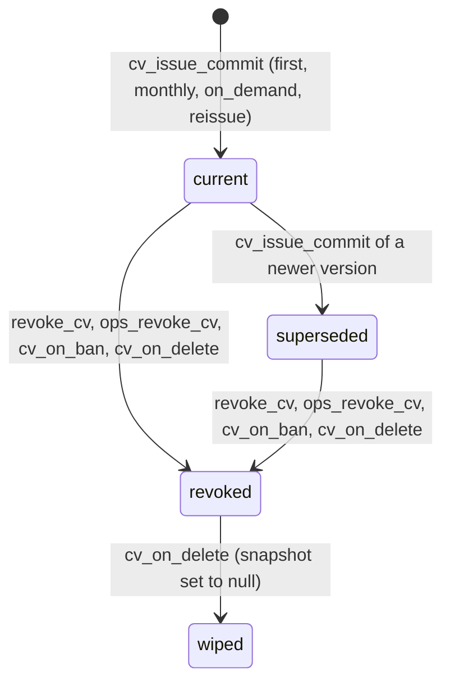
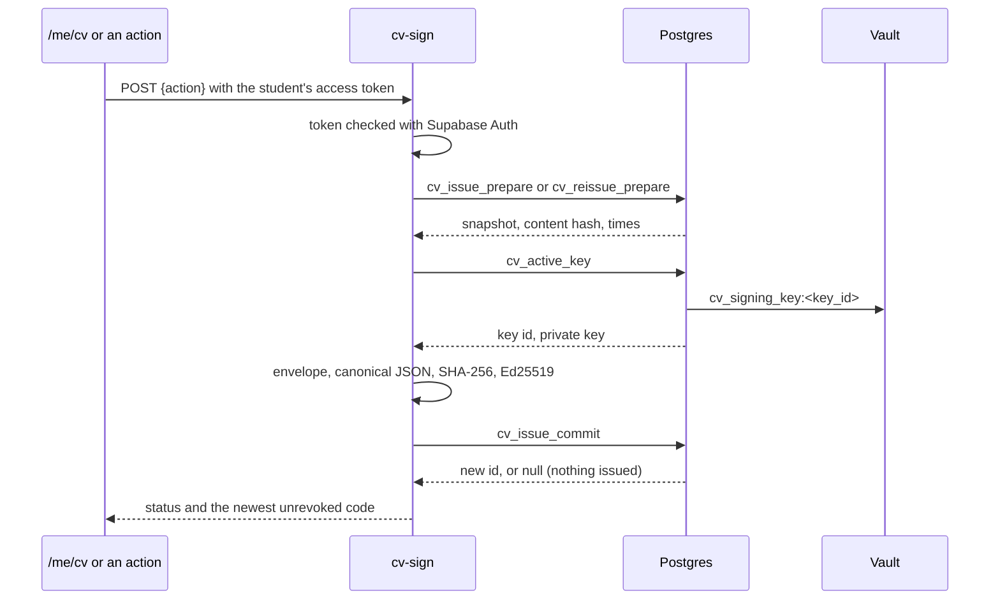
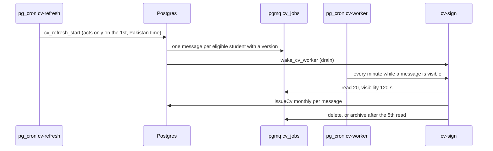
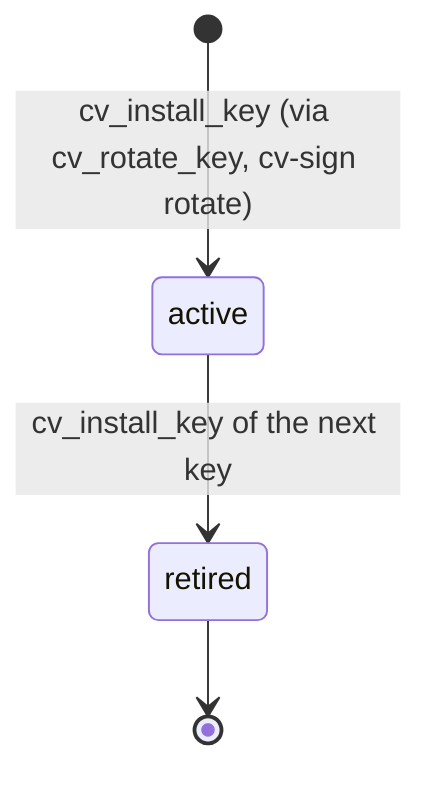
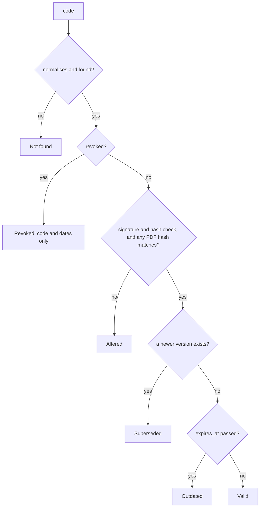

Commit: 9b52ab2
Covers: supabase/migrations/20261008000000_verified_cv.sql, supabase/migrations/20261009000000_cv_control.sql, lib/cv/, lib/data/cv.ts, lib/actions/cv.ts, lib/actions/ops/cv.ts, components/cv/, components/ops/cv-revoke.tsx, app/(app)/me/cv/, app/cv/, app/(marketing)/verify/, app/api/cv/pdf/route.ts, app/api/ops/pdf-check/route.ts, app/.well-known/skilient-cv-keys.json/route.ts, supabase/functions/cv-sign/, supabase/functions/_shared/cv/. Non-source: lib/cv/fonts/

# CV signing

## Purpose

A student's verified CV is a snapshot of their checked evidence, built in SQL and signed with an Ed25519 key that only the `cv-sign` Edge Function can read. Each signed version gets a 10-character code that anyone can check at `/verify/[code]`, and the student controls versions, share links and PDF exports. Versions refresh monthly, are superseded by newer ones, and are revoked by the student, by staff, by a ban or by account deletion.

In [architecture/overview.md](../architecture/overview.md) this subsystem spans the "Layers": Postgres builds the snapshot and decides every permission, an Edge Function holds the private key and signs, the Next server renders the CV and the PDF and re-checks signatures, pg_cron and pgmq drive the monthly refresh, and Vault and Storage hold the key and the PDFs. `/cv` and `/verify` are public to the gate, so share links and verification work signed out [src: lib/auth/gate.ts#"/cv"] [src: lib/auth/gate.ts#"/verify"]. It is the last step of the "Evidence to a signed CV" pipeline in [PLAN.md](../PLAN.md): skills, ventures, endorsements, credentials and the ranking all feed the snapshot.

## Data model

Column lists are in the generated reference: [verified_cv](../reference/schema/verified_cv.md) and [cv_control](../reference/schema/cv_control.md).

| Table | One row is | Columns and constraints that carry meaning |
|---|---|---|
| `signing_keys` | A signing key's public half | `key_id` shaped `cv-YYYYMMDD-xxxxxxxx`, `algorithm` always `Ed25519`, `public_key` (raw 32 bytes, base64url, 43 characters, unique), `active_from`, `retired_at`. At most one row has `retired_at` null [src: supabase/migrations/20261008000000_verified_cv.sql#create unique index signing_keys_one_active_idx on public.signing_keys ((true)) where retired_at is null;]. Rows are never deleted. |
| `cv_settings` | A student's CV choices | `sections` (an ordered subset of the seven sections, each once) [src: supabase/migrations/20261008000000_verified_cv.sql#create function private.cv_sections_valid(], `show_percentile` (null follows the leaderboard opt-out), `show_email` (default false), `visibility` (`private`, `link` (default), `recruiters`) [src: supabase/migrations/20261008000000_verified_cv.sql#create type public.cv_visibility as enum ('private', 'link', 'recruiters');]. A missing row means the defaults. |
| `cv_records` | One signed version | `code` (10 characters of Crockford base32, unique), `version` (1, 2, … per student), `snapshot`, `content_hash` (SHA-256 of the snapshot alone, to detect "nothing changed"), `snapshot_hash` (SHA-256 of the signed envelope), `signature` (86 base64url characters), `key_id`, `source` (`first`, `monthly`, `on_demand`, `reissue`), `issued_at` (whole seconds), `expires_at`, `superseded_by`, `revoked_at` + `revoked_reason` (`owner`, `staff`, `suspended`, `deleted`, set together) + `revoked_by` [src: supabase/migrations/20261008000000_verified_cv.sql#create table public.cv_records (]. `user_id` becomes null when the account is deleted, and `snapshot` may be null only on a revoked row [src: supabase/migrations/20261008000000_verified_cv.sql#check (snapshot is not null or revoked_at is not null)]. |
| `cv_share_links` | A share link | `token_hash` only (SHA-256 of a 32-byte token; the token is never stored), `label` (1 to 60 characters), `expires_at`, `revoked_at` + `revoked_reason`, `view_count`, `last_viewed_at` [src: supabase/migrations/20261009000000_cv_control.sql#create table public.cv_share_links (]. Deleted with the account. |
| `cv_views` | One counted view | `source` (`share_link`, `recruiter`), `viewer_org_id`, `viewer_key` (a keyed hash of the viewer's connection), `day` (Pakistan date); `unique (link_id, viewer_key, day)` counts one view per viewer per link per day [src: supabase/migrations/20261009000000_cv_control.sql#unique (link_id, viewer_key, day)]. Only `open_shared_cv` writes it, always with `source = 'share_link'`; nothing sets `viewer_org_id`. |
| `cv_pdf_exports` | One exported PDF | `id` (the export id the route chose), `record_id`, `template` (one of five), `paper` (`a4`, `letter`), `pdf_hash`, `path` = `<user>/<export>.pdf`, `bytes`, `file_deleted_at` (the hash outlives the file) [src: supabase/migrations/20261009000000_cv_control.sql#create table public.cv_pdf_exports (] |

Other stores:

| Store | What | Defined |
|---|---|---|
| Vault `cv_signing_key:<key_id>` | the active key's private half (PKCS#8, base64); deleted when the key retires | [src: supabase/migrations/20261008000000_verified_cv.sql#delete from vault.secrets where name = 'cv_signing_key:'] |
| Vault `cv_worker_secret` | the bearer secret pg_cron and `cv_rotate_key()` send to `cv-sign`; generated by the migration | [src: supabase/migrations/20261008000000_verified_cv.sql#'cv_worker_secret',] |
| Vault `cv_export_secret` | the PDF route's MAC key; the same value must be set in the app as `CV_EXPORT_SECRET` | [src: supabase/migrations/20261009000000_cv_control.sql#'cv_export_secret',] |
| Bucket `cv-exports` | private, PDF only, 2 MiB per file | [src: supabase/migrations/20261009000000_cv_control.sql#values ('cv-exports', 'cv-exports', false, 2097152, array] |
| pgmq `cv_jobs` | monthly refresh messages `{user_id, source: 'monthly'}` | [src: supabase/migrations/20261008000000_verified_cv.sql#select pgmq.create('cv_jobs');] |

The backup copies of the public key file live in `docs/signing-keys/`, which these docs exclude.

### The snapshot

`private.cv_snapshot(user)` builds `CvSnapshotV1` (typed in `lib/cv/types.ts`) and returns null when the account isn't eligible [src: lib/cv/types.ts#export interface CvSnapshotV1]. Eligible means a student who finished onboarding, with a username and a university, and not banned now [src: supabase/migrations/20261008000000_verified_cv.sql#create function private.cv_eligible(p_user uuid)]. The function has been rebuilt twice, so the current builder is two layers:

| Migration | Change |
|---|---|
| `verified_cv` | the original builder [src: supabase/migrations/20261008000000_verified_cv.sql#create function private.cv_snapshot(p_user uuid)] |
| `teacher_portal` | renames it to `cv_snapshot_base` and wraps it: each project gets `faculty_confirmed` (entries a supervisor confirmed, counted on the latest correction) and `faculty_reviewed` (the venture has a faculty review) [src: supabase/migrations/20261012000000_teacher_portal.sql#alter function private.cv_snapshot(uuid) rename to cv_snapshot_base;] |
| `uni_ecosphere` | replaces the wrapper: the same project fields, plus `awards` (unrevoked university badges, oldest first) [src: supabase/migrations/20261018000000_uni_ecosphere.sql#create or replace function private.cv_snapshot(p_user uuid)] |
| `ai_assisted_commits` | replaces `cv_snapshot_base`: each skill gains `ai_assisted` [src: supabase/migrations/20261103000000_ai_assisted_commits.sql#CREATE OR REPLACE FUNCTION private.cv_snapshot_base(p_user uuid)] |

The `schema` field stayed `skilient.cv/1` through these changes; the type marks `ai_assisted` and `awards` optional so older snapshots still read [src: supabase/migrations/20261103000000_ai_assisted_commits.sql#'schema', 'skilient.cv/1',] [src: lib/cv/types.ts#Added later: absent means false.].

What each part holds (the base, as last defined):

| Part | Rule |
|---|---|
| `person` | name, username, university, department, graduation year; `email` only when the student chose to show it [src: supabase/migrations/20261103000000_ai_assisted_commits.sql#'email', case when coalesce(s.show_email, false) then u.email end)] |
| `standing` | the tier always; `top_percent` = `max(1, ceil((1 − percentile) × 100))` only when the student is ranked, shows it (default: not if they left the leaderboard) and the value is 50 or less [src: supabase/migrations/20261103000000_ai_assisted_commits.sql#and greatest(1, ceil((1 - r.percentile) * 100))::integer <= 50] |
| `sections` | the student's sections in their order, or all seven [src: supabase/migrations/20261008000000_verified_cv.sql#create function private.cv_all_sections()] |
| `skills` | level 2 and above on unretired skills, at most 15, ordered by level, then repos + active days + pull requests + verified entries + endorsements, then name; each with those five counts [src: supabase/migrations/20261103000000_ai_assisted_commits.sql#order by level desc, repos + active_days + pull_requests + entries + endorsements desc, name] |
| `projects` | ventures in progress or completed, not unlisted, where the student is a member or still has peer-verified entries; at most 10, completed first, then newest. A former member's role is `former_member`; dates are Pakistan months; deliverables are a count; a private or unknown repository prints as "Private repository"; descriptions over 500 characters become 499 plus "…" [src: supabase/migrations/20261103000000_ai_assisted_commits.sql#when coalesce((select g.private from public.github_repos g where g.repo_id = mine.repo_id), true)] |
| `open_source` | merged pull requests that count, newest 20; a private repository hides its name and number [src: supabase/migrations/20261103000000_ai_assisted_commits.sql#'number', case when repo_private then null else number end,] |
| `endorsements` | tied to evidence, not hidden, one per endorser (their latest), at most 5, higher endorser tier first, then newest [src: supabase/migrations/20261103000000_ai_assisted_commits.sql#select * from tied order by tier desc nulls last, created_at desc limit 5] |
| `credentials` | approved and not expired on today's Pakistan date, recognised issuer name if any [src: supabase/migrations/20261103000000_ai_assisted_commits.sql#where c.user_id = p_user and c.status = 'approved'] |
| `summary` | one template, no AI: "{Department} student at {University}, class of {year}, with verified work in {top 3 skills} across {n} ventures ({m} completed). {k} merged pull requests to other developers' repositories. {Tier} tier on Skilient, top N%." Each part drops out when empty [src: supabase/migrations/20261103000000_ai_assisted_commits.sql#v_summary := coalesce(v_dept] |
| `education`, `awards` | university, department, year; awards with name, university and Pakistan date |

The snapshot holds no decimal numbers, so the canonical form never depends on how a decimal prints [src: supabase/migrations/20261008000000_verified_cv.sql#Integers and strings only, so the].

## Lifecycles and state machines

### A CV version

| Transition | Function | Notes |
|---|---|---|
| Issue | `cv_issue_commit`, called only by `cv-sign` | under an advisory lock per student; the new version number is the newest + 1; every earlier row with no `superseded_by` now points at the new one, revoked rows included [src: supabase/migrations/20261009000000_cv_control.sql#update public.cv_records set superseded_by = v_id] |
| Owner revokes one version | `revoke_cv` | only their own, not already revoked [src: supabase/migrations/20261009000000_cv_control.sql#create function private.revoke_cv(p_record uuid)] |
| Trust reviewer revokes one or all | `ops_revoke_cv` | reason required, audited, student notified [src: supabase/migrations/20261009000000_cv_control.sql#create function private.ops_revoke_cv(p_record uuid, p_all boolean, p_reason text)] |
| Ban | trigger `cv_on_ban` → `revoke_all_cvs(…, 'suspended')` | fires when `banned_until` moves from unset or past to the future; versions and share links; lifting the ban restores nothing [src: supabase/migrations/20261009000000_cv_control.sql#create function private.cv_on_ban()] |
| Account deletion | trigger `cv_on_delete` before the user row goes | every version revoked (`deleted`, unless already revoked) and its snapshot wiped; code, dates and key stay, and `user_id` then becomes null [src: supabase/migrations/20261009000000_cv_control.sql#set revoked_at = coalesce(revoked_at, now()), revoked_reason = coalesce(revoked_reason, 'deleted'), snapshot = null] |

"Outdated" is not stored: a version is outdated when `expires_at`, 12 months after issue, has passed. A sanction of kind `ban` sets `banned_until` [src: supabase/migrations/20261027000000_sanctions_appeals.sql#update auth.users set banned_until = coalesce(p_until, timestamptz '2999-12-31 00:00:00+00') where id = p_user;]; a `suspend` sanction does not, so a suspended student's CVs stay valid (row 9 of [prd-mismatches.md](../reference/prd-mismatches.md)).

### Issuing

`/me/cv` asks for the first CV the first time it loads with no versions (`ensure`) [src: lib/data/cv.ts#await supabase.functions.invoke("cv-sign", { body: { action: "ensure" } })]. The actions `reissueCv` and `refreshCv` send `reissue` and `refresh` [src: lib/actions/cv.ts#await session.supabase.functions.invoke<{ code: string | null }>("cv-sign", { body: { action } })]. The function maps `ensure` → `first`, `reissue` → `reissue`, `refresh` → `on_demand` [src: supabase/functions/_shared/cv/issue.ts#const source: IssueSource | null = action === "ensure" ? "first"].

### Monthly refresh

The job runs at 19:30 UTC on days 28 to 31 and returns at once unless it is the 1st in Pakistan, which makes it 00:30 PKT on the 1st [src: supabase/migrations/20261008000000_verified_cv.sql#select cron.schedule('cv-refresh', '30 19 28-31 * *', $$select private.cv_refresh_start()$$);] [src: supabase/migrations/20261008000000_verified_cv.sql#if not p_force and extract(day from now() at time zone 'Asia/Karachi') <> 1 then]. It queues every student who has any version and is eligible, whatever their tier, and records a `job_runs` row [src: supabase/migrations/20261008000000_verified_cv.sql#cross join lateral pgmq.send('cv_jobs', jsonb_build_object('user_id', s.user_id, 'source', 'monthly')) q;]. A new monthly version sends an in-app `cv_refreshed` notice [src: supabase/migrations/20261009000000_cv_control.sql#for each row when (new.source = 'monthly') execute function private.cv_refreshed_notice();].

### Signing key

`select private.cv_rotate_key()` (by hand, in the SQL editor) asks `cv-sign` to rotate and returns at once; the new key appears in the key file a few seconds later [src: supabase/migrations/20261008000000_verified_cv.sql#create function private.cv_rotate_key()]. The function generates the pair and calls `cv_install_key`, which, under one lock, retires the old key, deletes its private half from Vault, stores the new private half and inserts the public half [src: supabase/functions/_shared/cv/issue.ts#export async function rotateKey] [src: supabase/migrations/20261008000000_verified_cv.sql#create function private.cv_install_key(p_key_id text, p_public_key text, p_private_key text)]. Nothing rotates automatically. Retired public keys stay in `signing_keys` and in the key file, and each version names its own key, so old versions keep verifying; the worker test rotates twice and re-checks the first version [src: tests/worker/cv-sign.test.ts#keeps old CVs valid after a key rotation].

### Share link

A link is active from creation until it expires or is revoked: by the owner (`revoke_share_link`), by a ban (`suspended`), or by deletion (the rows are deleted with the account) [src: supabase/migrations/20261009000000_cv_control.sql#create function private.revoke_share_link(p_id uuid)] [src: supabase/migrations/20261009000000_cv_control.sql#update public.cv_share_links set revoked_at = now(), revoked_reason = p_reason]. Opening one gives one of three answers [src: supabase/migrations/20261009000000_cv_control.sql#create function private.open_shared_cv(p_token_hash text, p_viewer_key text)]:

| Answer | When |
|---|---|
| `invalid` | no active, unexpired link has this token hash |
| `unavailable` (with the username) | the student's newest version is missing or revoked, the account is no longer eligible, or visibility is `private`. It never falls back to an older version. |
| `ok` | the newest version's code, dates, key, snapshot, hash and signature; a view is counted |

### PDF export

A PDF is printed by the route, uploaded to `cv-exports/<user>/<export>.pdf` as the student, then recorded with a MAC; its file is deleted after 30 days and its hash kept. An upload that was never recorded is deleted after a day [src: supabase/migrations/20261009000000_cv_control.sql#create function private.cv_exports_daily()].

### Verify status

The order is fixed in `verifyStatus` [src: lib/cv/status.ts#export function verifyStatus].

## Algorithms

### Canonical JSON (RFC 8785, as `canonicalize` implements it)

1. `null`, `true`, `false` print as such [src: supabase/functions/_shared/cv/canonical.ts#export function canonicalize].
2. Numbers print as `JSON.stringify` prints them; NaN and infinities are refused.
3. Strings print with `JSON.stringify`'s escaping; a lone UTF-16 surrogate is refused [src: supabase/functions/_shared/cv/canonical.ts#if (hasLoneSurrogate(s)) throw new CanonicalError("lone surrogate in string");].
4. Arrays keep their order. Objects drop keys whose value is `undefined` and sort the rest with JavaScript's default sort, which compares UTF-16 code units [src: supabase/functions/_shared/cv/canonical.ts#const keys = Object.keys(obj).filter((k) => obj].
5. No whitespace; the result is UTF-8 encoded for hashing [src: supabase/functions/_shared/cv/canonical.ts#export function canonicalBytes].

The unit test checks the RFC's own examples [src: tests/unit/cv-canonical.test.ts#matches the RFC's section 3.2.2 example].

### The signature

1. Envelope = `{v: 1, code, key_id, issued_at, expires_at, snapshot}`, with both times as ISO strings in whole seconds ending in `Z` [src: supabase/functions/_shared/cv/sign.ts#export interface CvEnvelope] [src: supabase/functions/_shared/cv/sign.ts#return new Date(value).toISOString().replace(/\.\d{3}Z$/, "Z");].
2. `snapshot_hash` = hex SHA-256 of the envelope's canonical bytes [src: supabase/functions/_shared/cv/sign.ts#export async function envelopeHash].
3. `signature` = Ed25519 (Web Crypto) over the 32 raw bytes of that digest, not over the JSON itself, stored base64url [src: supabase/functions/_shared/cv/sign.ts#const signature = new Uint8Array(await crypto.subtle.sign({ name: "Ed25519" }, key, fromHex(hash) as BufferSource));].

Because the code, key id and both dates are inside the signed envelope, a signature can't be moved to another code or date. `content_hash` is different: SHA-256 of the snapshot's own JSON text as Postgres prints it, used only to compare snapshots [src: supabase/migrations/20261008000000_verified_cv.sql#encode(extensions.digest(convert_to(v_snap::text, 'UTF8'), 'sha256'), 'hex'),].

Checking (`checkEnvelope`) rebuilds the envelope from the stored columns, compares its hash with `snapshot_hash` (`hash_mismatch`), then verifies the signature with the public key of the record's own `key_id` (`valid` or `bad_signature`; any import error counts as `bad_signature`) [src: supabase/functions/_shared/cv/sign.ts#export async function checkEnvelope].

### Codes and keys

- A code is 10 random bytes, each reduced with `& 31` to one of 32 Crockford base32 symbols (no I, L, O or U). 256 is a multiple of 32, so the symbols are uniform: 50 bits per code [src: supabase/functions/_shared/cv/sign.ts#(b) => CODE_ALPHABET] [src: supabase/functions/_shared/cv/sign.ts#export const CODE_ALPHABET = "0123456789ABCDEFGHJKMNPQRSTVWXYZ";]. A clash with an existing code (`cv_records_code_key`) is retried with a fresh code, up to 5 attempts [src: supabase/functions/_shared/cv/issue.ts#for (let attempt = 0; attempt < 5; attempt++) {].
- Typed codes are read forgivingly: upper-cased, spaces and hyphens dropped, I and L read as 1, O as 0, then checked against the alphabet [src: supabase/functions/_shared/cv/sign.ts#export function normaliseCode]. Codes print as `XXXXX-XXXXX` [src: supabase/functions/_shared/cv/sign.ts#export function formatCode].
- A key id is `cv-` + the UTC date (`YYYYMMDD`) + `-` + the first 8 hex characters of SHA-256 of the raw public key [src: supabase/functions/_shared/cv/sign.ts#hex(await sha256(raw)).slice(0, 8)].

### Issue rules by source

`cv_issue_prepare` returns nothing for an ineligible student; otherwise the snapshot, its `content_hash`, the newest unrevoked version's `content_hash`, `issued_at` = now truncated to the second, and `expires_at` = 12 months later [src: supabase/migrations/20261008000000_verified_cv.sql#to_char((v_now + interval '12 months') at time zone 'UTC', 'YYYY-MM-DD"T"HH24:MI:SS"Z"');]. `cv_issue_commit` then decides, under an advisory lock on the student [src: supabase/migrations/20261009000000_cv_control.sql#create or replace function private.cv_issue_commit(]:

| Source | Issued when | Refused or skipped |
|---|---|---|
| `first` (`ensure`) | the student has no version at all, revoked ones included | any version exists → nothing, answer `exists` |
| `monthly` | the snapshot differs from the newest unrevoked version, or there is none | same `content_hash` → nothing, answer `unchanged` (checked first in `issueCv`, again in SQL) [src: supabase/functions/_shared/cv/issue.ts#if (source === "monthly" && prep.content_hash === prep.latest_content_hash) return { status: "unchanged" };] |
| `on_demand` (`refresh`) | the student holds `cv.refresh_on_demand`; always issues, changed or not | no entitlement `42501`; more than 10 a day `54000` [src: supabase/migrations/20261009000000_cv_control.sql#private.rate_limit('cv-refresh:'] |
| `reissue` | the newest version was revoked by its owner; the same snapshot under a new code and dates (`cv_reissue_prepare`) | the newest isn't owner-revoked, or its content differs, `55000`; more than 5 a day `54000` [src: supabase/migrations/20261009000000_cv_control.sql#raise exception 'only the newest version, after you revoked it, can be re-issued' using errcode = '55000';] |

Every source also refuses an ineligible student (null, answer `not_eligible`) and an unknown key id (`22023`). With no active key, `issueCv` throws `NoSigningKey` before signing [src: supabase/functions/_shared/cv/issue.ts#if (!key) throw new NoSigningKey("no active CV signing key: run select private.cv_rotate_key()");].

When the newest version was revoked by its owner and the snapshot has changed since the newest unrevoked version (or every version is revoked), the next monthly refresh issues a new version, and share links open again [src: supabase/migrations/20261009000000_cv_control.sql#select r.content_hash from public.cv_records r]. See "Open questions".

### Draining the queue

`drainQueue` reads up to 20 messages with a 120-second visibility timeout [src: supabase/functions/_shared/cv/issue.ts#"select msg_id, read_ct, message from pgmq.read('cv_jobs', 120, $1)"]. A message with no user id, or read more than 5 times, is archived and logged as `dropped`. Each other message is issued as `monthly` and deleted whatever the answer (`issued`, `unchanged`, `skipped`). An error leaves the message to come back after 120 seconds; a missing signing key stops the run [src: supabase/functions/_shared/cv/issue.ts#if (error instanceof NoSigningKey) break;].

### Share links and views

1. The action makes 32 random bytes, base64url (43 characters), stores only their SHA-256 hex, and shows `/cv/<username>?t=<token>` once [src: lib/actions/cv.ts#const token = randomBytes(32).toString("base64url");].
2. `create_share_link` requires an eligible student at Spark tier or above, a valid hash, an expiry of 7, 30 or 90 days or none, and fewer than 10 active links (`23514`), under a per-student lock [src: supabase/migrations/20261009000000_cv_control.sql#if coalesce((select r.tier >= 'spark' from public.ranking_scores r where r.user_id = v_me), false) is not true then] [src: supabase/migrations/20261009000000_cv_control.sql#raise exception 'up to 10 active share links: revoke one first' using errcode = '23514';]. Dropping below Spark later doesn't touch existing links.
3. Opening: the page refuses a token that isn't 43 base64url characters, then calls `open_shared_cv` with the token's hash and a viewer key = HMAC-SHA256 (`IP_HASH_SECRET`) of `cv-view:<ip>|<user agent>` [src: lib/data/cv.ts#const viewerKey = keyedHash(] [src: lib/security/hash.ts#export function keyedHash]. A new `(link, viewer_key, Pakistan day)` row adds one to the link's `view_count`.
4. If the link was made under another username, the page redirects to the right one [src: app/cv/[username]/page.tsx#?t=${encodeURIComponent(token)}].

### Verifying

1. Normalise the code; a code that doesn't normalise is Not found [src: lib/data/cv.ts#export async function verifyCode].
2. Count the lookup: 30 per 60 seconds per IP (scope `cv_verify`, sliding window) [src: lib/data/cv.ts#if (!(await rateLimit(supabase, "cv_verify", clientIp(h) ?? "unknown", 30, 60))) return { status: "rate_limited" };].
3. `verify_cv` looks the code up (upper-cased). For a revoked version it returns only the code, issue date and revocation date; everything else is null [src: supabase/migrations/20261009000000_cv_control.sql#create function private.verify_cv(p_code text, p_pdf_hash text default null)]. Otherwise it also returns `expires_at`, the newer version's issue date as `superseded_at`, the key and public key, the snapshot, hash and signature, and, when a PDF hash was given, whether any export of this version has that hash.
4. The page re-checks the signature with `checkEnvelope`; a failure is logged as `signature_mismatch` [src: lib/data/cv.ts#error_code: "signature_mismatch"].
5. `verifyStatus` picks the status (see the flowchart); Outdated is `expires_at < now`.

A PDF check never uploads the file: the browser hashes it with Web Crypto and opens `/verify/<code>?pdf=<hex>` [src: components/cv/pdf-check.tsx#const digest = await crypto.subtle.digest("SHA-256", await file.arrayBuffer());]. The page lower-cases the hash and ignores anything that isn't 64 hex characters [src: app/(marketing)/verify/[code]/page.tsx#pdf.toLowerCase()] [src: lib/data/cv.ts#const hash = pdfHash && /^].

### PDF export

The route, in order [src: app/api/cv/pdf/route.ts#export async function POST]:

1. Input: a version id, one of the five templates, `a4` or `letter` (else 400). A session (else 401). `CV_EXPORT_SECRET` set (else 503).
2. `cv_export_rights`: `cv.pdf_export`, and `cv.templates` for any template but Standard (else 402 `payment_required`).
3. 5 exports a minute per student (else 429) [src: app/api/cv/pdf/route.ts#if (!(await rateLimit(supabase, "cv_pdf", user.id, 5, 60))) {].
4. The version must be the student's, not revoked and with a snapshot (else 404).
5. Render with Chromium (below), name the file `<user>/<random uuid>.pdf`, hash it with SHA-256, and upload it as the student, never overwriting.
6. MAC = HMAC-SHA256 with the secret over `export|version|template|paper|hash|bytes`, hex [src: app/api/cv/pdf/route.ts#const mac = createHmac("sha256", secret).update(].
7. `record_cv_export` re-checks both entitlements and the version, recomputes the MAC with the Vault secret, requires the stored object to exist with exactly that size, allows 20 exports a day, and inserts the row [src: supabase/migrations/20261009000000_cv_control.sql#create function private.record_cv_export(]. Its refusals map to 402, 404 and 429.
8. Return a 60-second signed URL that downloads as `skilient-cv-<code>.pdf`, plus the hash and size.

The upload itself is allowed by a storage policy only into the student's own folder, only while they hold `cv.pdf_export`, and only while they have fewer than 100 files in the bucket [src: supabase/migrations/20261009000000_cv_control.sql#create function private.cv_export_upload_allowed(p_name text)].

### Rendering the document

- One view (`cvView`) feeds two renderers: an HTML string for the PDF (`cvDocumentHtml`, every value escaped) and a React component for the web pages (`CvDocument`) [src: lib/cv/document.ts#export function cvView] [src: components/cv/cv-document.tsx#export function CvDocument]. A unit test requires identical markup from both for every template, with and without the QR code [src: tests/unit/cv-document.test.tsx#web and PDF markup are identical for every template, with and without the QR code].
- Sections print in the snapshot's order, and an empty section is left out [src: tests/unit/cv-document.test.tsx#leaves out empty sections and keeps the chosen order]. University awards print under Education.
- Five templates differ only in CSS; Standard is free and the others need `cv.templates` [src: lib/cv/document.ts#export const TEMPLATE_INFO]. Ligatures are off so the text stays extractable [src: lib/cv/document.ts#font-variant-ligatures: none;].
- The footer prints "Verified CV issued by Skilient on {UTC date}. Code XXXXX-XXXXX." and the verify link `<site>/verify/<code>` [src: lib/cv/document.ts#Verified CV issued by Skilient on ${issued.getUTCDate()}]. The site comes from `NEXT_PUBLIC_SITE_URL` when the page or PDF is made; the version stores only the code [src: lib/cv/site.ts#export function siteUrl].
- The QR code is an SVG of the verify link (error correction M), embedded as a data URI [src: lib/cv/qr.ts#errorCorrectionLevel: "M"].
- The PDF embeds Spectral 500/600 and Barlow 400/500/600 from `lib/cv/fonts/` as data URIs and prints A4 or Letter with 16 mm margins as a tagged PDF, after the fonts load [src: lib/cv/pdf.ts#const FONTS] [src: lib/cv/pdf.ts#export async function renderCvPdf].
- Chromium is a local binary (`CV_CHROMIUM_PATH`, else `PW_CHROMIUM_PATH`) when one is set outside Vercel, and `@sparticuz/chromium` otherwise [src: lib/cv/browser.ts#const local = process.env.CV_CHROMIUM_PATH ?? process.env.PW_CHROMIUM_PATH;].

`tests/ats/cv-ats.test.ts` prints every template and checks the extracted text [src: tests/ats/cv-ats.test.ts#keeps headings, order, skills, projects and the code as text].

### Constants

| Constant | Value | Defined |
|---|---|---|
| Code | 10 Crockford base32 symbols | [src: supabase/migrations/20261008000000_verified_cv.sql#code text not null unique check (code ~ '^] |
| Validity | 12 months from issue | [src: supabase/migrations/20261009000000_cv_control.sql#to_char((v_now + interval '12 months') at time zone 'UTC', 'YYYY-MM-DD"T"HH24:MI:SS"Z"')] |
| Snapshot limits | 15 skills, 10 projects, 20 pull requests, 5 endorsements, 500-character descriptions, top N% only up to 50 | the snapshot table above |
| Share links | expiry 7, 30, 90 days or none; 10 active | [src: supabase/migrations/20261009000000_cv_control.sql#(p_days is not null and p_days not in (7, 30, 90))] |
| Daily limits | re-issue 5, on-demand refresh 10, PDF exports 20 | [src: supabase/migrations/20261009000000_cv_control.sql#private.rate_limit('cv-reissue:'] [src: supabase/migrations/20261009000000_cv_control.sql#private.rate_limit('cv-export:'] |
| Per-minute limits | verify 30 per IP, PDF export 5 per student | [src: lib/data/cv.ts#"cv_verify"] [src: app/api/cv/pdf/route.ts#"cv_pdf"] |
| PDF files | 2 MiB each, 100 per student, kept 30 days; unrecorded uploads 1 day; download link 60 s | [src: supabase/migrations/20261009000000_cv_control.sql#and created_at < now() - interval '30 days'] [src: app/api/cv/pdf/route.ts#.createSignedUrl(path, 60, { download:] |
| Queue | read 20, visibility 120 s, archived after the 5th read | [src: supabase/functions/_shared/cv/issue.ts#m.read_ct > 5] |
| Worker call | 5-second HTTP timeout | [src: supabase/migrations/20261008000000_verified_cv.sql#timeout_milliseconds := 5000] |
| Key file cache | 300 seconds, public | [src: app/.well-known/skilient-cv-keys.json/route.ts#{ headers: { "Cache-Control": "public, max-age=300" } },] |

## Entry points

### Server actions

| Action | Calls | Who the SQL allows |
|---|---|---|
| `saveCvSettings` | `save_cv_settings` | an eligible student, for themselves; at least one section, each once [src: lib/actions/cv.ts#export async function saveCvSettings] |
| `createShareLink`, `revokeShareLink` | `create_share_link`, `revoke_share_link` | the owner; creating needs Spark |
| `revokeCvVersion` | `revoke_cv` | the owner |
| `reissueCv` | `cv-sign` `reissue` | the owner, after revoking their newest version |
| `refreshCv` | `require_entitlement('cv.refresh_on_demand')`, then `cv-sign` `refresh` | a student holding the key [src: lib/actions/cv.ts#const refused = await paymentRequired(ctx, session.supabase, session.userId, "cv.refresh_on_demand");]; no page calls this action |
| `opsRevokeCv` | `ops_revoke_cv` | trust reviewers (or super admins) on two-factor, with a 3 to 2,000 character reason [src: lib/actions/ops/cv.ts#export async function opsRevokeCv] |

Refusals from `cv-sign` reach the action as HTTP statuses, mapped back to `forbidden` (403), `not_now` (409) and `rate_limited` (429) [src: lib/actions/cv.ts#const SIGN_REFUSALS: Record<number, ].

### Routes and pages

| Path | Who |
|---|---|
| `POST /api/cv/pdf` | a signed-in student with `cv.pdf_export`; see "PDF export" |
| `GET /api/ops/pdf-check` | any staff role on two-factor (`is_staff`), else 404; prints the sample CV and reports timings and memory [src: app/api/ops/pdf-check/route.ts#!isStaff) return new Response(null, { status: 404 });] |
| `GET /.well-known/skilient-cv-keys.json` | anyone; every key, retired ones included, with a description of the signed format; 503 if the read fails [src: app/.well-known/skilient-cv-keys.json/route.ts#"Each CV record is signed over the SHA-256 digest (32 bytes) of the RFC 8785 canonical JSON of " +] |
| `/me/cv` | a signed-in student; issues the first version on first load [src: app/(app)/me/cv/page.tsx#export default async function MyCvPage] |
| `/cv/[username]?t=` | anyone with the link [src: app/cv/[username]/page.tsx#export default async function SharedCvPage] |
| `/verify`, `/verify/[code]` | anyone; the code form works without JavaScript [src: app/(marketing)/verify/page.tsx#<form method="get" action="/verify"] [src: app/(marketing)/verify/[code]/page.tsx#export default async function VerifyPage]. A signed-in recruiter who may open the student gets a link to them [src: app/(marketing)/verify/[code]/page.tsx#getCandidateForCode(result.code)] |

### RPCs

| Function | Granted to |
|---|---|
| `verify_cv`, `open_shared_cv` | `anon` and `authenticated` [src: supabase/migrations/20261009000000_cv_control.sql#grant execute on function public.open_shared_cv(text, text), public.verify_cv(text, text) to anon, authenticated;] |
| `save_cv_settings`, `create_share_link`, `revoke_share_link`, `revoke_cv`, `ops_cv_records`, `ops_revoke_cv`, `cv_export_rights`, `record_cv_export` | `authenticated` |
| `cv_snapshot`, `cv_issue_prepare`, `cv_reissue_prepare`, `cv_issue_commit`, `cv_active_key`, `cv_install_key`, `cv_rotate_key`, `cv_refresh_start`, `revoke_all_cvs` | no API role; called over the Edge Function's direct connection, by triggers, or by hand [src: supabase/migrations/20261008000000_verified_cv.sql#private.wake_cv_worker(), private.cv_rotate_key(), private.cv_refresh_start(boolean) from public;] |

### Edge Function `cv-sign`

`POST` only, with `Authorization: Bearer <token>` [src: supabase/functions/_shared/cv/issue.ts#export async function handleCvSign]:

| Caller | Token | Actions |
|---|---|---|
| pg_cron (`wake_cv_worker`) and `cv_rotate_key()` | `cv_worker_secret`, compared in constant time | `drain`, `rotate` |
| The Next server, as the student | the student's access token, checked with Supabase Auth's `/auth/v1/user` [src: supabase/functions/_shared/codecheck/serve.ts#export function authVerifier] | `ensure`, `reissue`, `refresh` |

Answers: 401 without or with a bad token, 400 for an unknown action, 403 (`forbidden`, `not_eligible`), 409, 429, 200 with `{status, code}` (the newest unrevoked code), and 502 on any other error, all `no-store` [src: supabase/functions/cv-sign/index.ts#return Response.json({ error: "unavailable" }, { status: 502, headers: { "Cache-Control": "no-store" } });].

### Jobs, queue, triggers

| Entry | What |
|---|---|
| Cron `cv-refresh` (`30 19 28-31 * *`) | `cv_refresh_start()` |
| Cron `cv-worker` (every minute) | `wake_cv_worker()`: calls `cv-sign` `drain` only when a `cv_jobs` message is visible and both Vault secrets exist [src: supabase/migrations/20261008000000_verified_cv.sql#perform private.cv_call_worker('{"action":"drain"}'::jsonb);] |
| Cron `cv-exports-daily` (`23 19 * * *`, 00:23 PKT) | deletes old and unrecorded PDF files through the `storage_cleanup` queue [src: supabase/migrations/20261009000000_cv_control.sql#select cron.schedule('cv-exports-daily', '23 19 * * *', $$select private.cv_exports_daily()$$);] |
| Queue `cv_jobs` | `{user_id, source}` from `cv_refresh_start`, read by `cv-sign` |
| Triggers on `auth.users` | `cv_on_ban` (after update of `banned_until`), `cv_on_delete` (before delete) [src: supabase/migrations/20261009000000_cv_control.sql#create trigger cv_on_ban after update of banned_until on auth.users] [src: supabase/migrations/20261009000000_cv_control.sql#create trigger cv_on_delete before delete on auth.users] |
| Trigger on `cv_records` | `cv_refreshed_notice` for monthly versions |
| Notices | `cv_refreshed` (in-app only) and `cv_revoked` (emailed), category `trust` [src: supabase/migrations/20261009000000_cv_control.sql#('cv_revoked', 'trust', true);] |

Other subsystems read CVs: the recruiter candidate page builds a live, unsigned `cv_snapshot` and shows the verify code only when visibility is `recruiters` [src: supabase/migrations/20261014000000_recruiter_talent.sql#select coalesce(s.visibility = 'recruiters', false) into v_cv_shared]; the recruiter API returns the newest current signed version with its public key [src: supabase/migrations/20261016000000_recruiter_api.sql#from public.cv_records r2 join public.signing_keys k on k.key_id = r2.key_id]; a staff revocation can be appealed (type `cv_revocation`, decided by a trust reviewer) [src: supabase/migrations/20261027000000_sanctions_appeals.sql#elsif p_type = 'cv_revocation' then]; a restricted account can't create share links [src: supabase/migrations/20261027000000_sanctions_appeals.sql#'contributions', 'contribution_confirmations', 'friend_requests', 'credentials', 'code_checks', 'cv_share_links',]; each export is tracked as `cv_exported` [src: supabase/migrations/20261104000000_analytics.sql#create trigger cv_pdf_exports_analytics after insert on public.cv_pdf_exports].

## RLS and privileges

- Every table has RLS on and all privileges revoked from `anon` and `authenticated`, then one read grant each:

| Table | Read | Write |
|---|---|---|
| `signing_keys` | `anon` and `authenticated`, every row [src: supabase/migrations/20261008000000_verified_cv.sql#create policy signing_keys_read on public.signing_keys for select to anon, authenticated using (true);] | `cv_install_key` only |
| `cv_settings`, `cv_records`, `cv_share_links`, `cv_views`, `cv_pdf_exports` | `authenticated`, own rows only (`user_id = auth.uid()`) [src: supabase/migrations/20261008000000_verified_cv.sql#create policy cv_records_owner_read on public.cv_records for select to authenticated] [src: supabase/migrations/20261009000000_cv_control.sql#create policy cv_pdf_exports_owner_read on public.cv_pdf_exports for select to authenticated] | security-definer functions only |

- Nothing reads another student's CV rows directly: share links, verification and the recruiter views go through definer functions that return chosen columns.
- `private.*` functions are `security definer` with `search_path = ''`; the `public` wrappers are `security invoker` SQL functions [src: supabase/migrations/20261009000000_cv_control.sql#language sql stable security invoker set search_path = ''].
- Staff functions start with `require_trust_reviewer()`; revocation also writes `ops_audit_log` with the code and user before and the count after [src: supabase/migrations/20261009000000_cv_control.sql#values (v_me, case when p_all then 'cv.revoke_all' else 'cv.revoke' end, 'cv_record', p_record::text, btrim(p_reason),].
- Storage: students read and upload only inside their own `cv-exports` folder [src: supabase/migrations/20261009000000_cv_control.sql#create policy cv_exports_read on storage.objects for select to authenticated].
- The private key never leaves the database and the Edge Function: `cv_active_key` is callable only over the direct connection, and the app never holds the service role for CV work. The PDF route acts as the student; the MAC proves to SQL that the route made the file [src: app/api/cv/pdf/route.ts#Acts for the signed-in student; no service-role key.].
- The key file is read with the publishable key, which `signing_keys`' policy allows [src: app/.well-known/skilient-cv-keys.json/route.ts#const supabase = createClient<Database>(env.NEXT_PUBLIC_SUPABASE_URL, env.NEXT_PUBLIC_SUPABASE_PUBLISHABLE_KEY, {].

## Failure modes

| What goes wrong | What the person sees | What the logs and data show |
|---|---|---|
| No signing key yet (`cv_rotate_key` never run) | `/me/cv`: "We couldn't prepare your CV" | `cv-sign` throws `NoSigningKey`, answers 502; `cv.ensure` warn line with status 502 [src: lib/data/cv.ts#return status === 403 ? { state: "not_eligible" } : { state: "unavailable" };]; the monthly drain stops at the first message |
| Student not eligible (onboarding, username, university, banned) | "Your CV starts after onboarding" | `cv-sign` 403 `not_eligible` |
| Vault `project_url` or `cv_worker_secret` missing | Monthly refresh never happens; `cv_rotate_key()` says "not sent" | `cv_call_worker` returns null; the queued messages trip the queue-not-draining alert [src: supabase/migrations/20261008000000_verified_cv.sql#return 'not sent: set the Vault secret project_url first (docs/setup-checklist.md)';] [src: supabase/migrations/20261105000000_alerts.sql#Queues nobody is draining] |
| A queue message keeps failing | Nothing for that student this month | `cv.refresh` error lines; archived and logged `dropped` after the 5th read |
| `CV_EXPORT_SECRET` not set in the app | "PDF export isn't set up yet." (503) | `cv.export_pdf` error `not_configured` |
| App and Vault secrets differ | "PDF export is a Student Pro feature." (402) — the MAC refusal shares `42501` with the entitlement refusal | `record_cv_export` raises "this export wasn't made by Skilient"; the uploaded file is removed a day later [src: supabase/migrations/20261009000000_cv_control.sql#raise exception 'this export wasn''t made by Skilient' using errcode = '42501';] |
| Chromium fails or times out | "We couldn't make the PDF." (502) | `cv.export_pdf` error `render_failed` |
| Share link expired or revoked | "This link isn't valid" | `invalid` |
| Newest version revoked, or visibility Only me | "This CV is no longer available" | `unavailable` |
| More than 30 checks a minute | "Too many checks" | `rate_limit_events` scope `cv_verify` |
| Stored row altered (not a PDF) | Altered; the Signature row says it doesn't match; the stored content is still shown below as "the genuine CV" | `cv.verify` error `signature_mismatch` [src: lib/cv/status.ts#The genuine CV is shown below so you can compare.] |
| Code collides 5 times | 502 | "could not find a free CV code" |
| Key file read fails | Verifiers can't fetch keys | 503, `cv.keys` error line |

## Tests

| Suite | Covers |
|---|---|
| pgTAP `37_verified_cv` | what the snapshot includes and leaves out (skill levels and order, unlisted, recruiting and left ventures, private repositories and pull requests, hidden endorsements, the free-text programme), percentile and email settings, the summary, no CV for a banned account, key installs and retirement, issuing, superseding and code clashes, the monthly queue (forced), and that the API can't write the tables or add keys [src: supabase/tests/37_verified_cv.test.sql#the monthly refresh queues every student with a CV] |
| pgTAP `38_cv_control` | entitlements through `entitlement_grants`, settings, Spark-gated share links and the 10-link cap, opening a link (newest only, one view per viewer a day), verify for anon (revoked gives code and dates), owner revocation and re-issue, PDF export records (MAC, file, entitlement), trust reviewer revocation, bans and deletion, the monthly notice [src: supabase/tests/38_cv_control.test.sql#account deletion: revoked, content wiped, the code kept] |
| Unit `cv-canonical` | RFC 8785 examples, signing and tamper detection, codes |
| Unit `cv-document` | escaping, identical web and PDF markup, AI-assisted skills, section order, dates and CSS |
| Worker `cv-sign` | key rotation keeps old versions valid, first issue only once, tampered snapshot or signature, monthly only when changed, worker secret versus student token, re-issue and Pro refresh [src: tests/worker/cv-sign.test.ts#re-issues the revoked newest version under a new code, and keeps refresh for Pro] |
| ATS `cv-ats` | every template's extracted text: headings, order, skills, projects, code |
| E2E `cv.spec.ts`, `cv-keys.spec.ts` | issue, share, verify, supersede, revoke; Spark and Pro gates; a PDF export verifies and one changed byte shows Altered; the key file is public JSON [src: tests/e2e/cv.spec.ts#a PDF export verifies, and one changed byte shows Altered] |

Not covered by any test: `cv-exports-daily` and the file cleanup; `cv_rotate_key()` and the worker wake through `pg_net`; `cv_refresh_start`'s day check against Pakistan time; appeals of a CV revocation; the footer's issued date (the unit test formats snapshot dates only); the PDF route's 503 and 5-a-minute limit.

## Change guide

### Add or change a snapshot field

1. New migration: redefine `private.cv_snapshot_base` (the inner builder) or the `private.cv_snapshot` wrapper, starting from the last definition (`ai_assisted_commits` for the base, `uni_ecosphere` for the wrapper). Keep values to integers, strings, booleans and nulls.
2. Add the field to `CvSnapshotV1`, optional if older versions lack it.
3. Render it in `cvView` (`lib/cv/document.ts`); both renderers follow.
4. Extend `tests/unit/cv-document.test.tsx`, pgTAP 37, and `lib/cv/sample.ts` so the ATS test prints it.
5. Existing versions don't change; the next monthly refresh issues a new version for every student whose snapshot now differs.

### Rotate the signing key

1. Run `select private.cv_rotate_key();` in the SQL editor.
2. Check `/.well-known/skilient-cv-keys.json` lists the new active key and the old one retired.
3. Save a copy of the key file under `docs/signing-keys/` (see its README).
4. For a leaked key, also revoke what it signed: `cv_records` rows with that `key_id`.

### Add a PDF template

1. Add the name to `CV_TEMPLATES`, `TEMPLATE_INFO` and `TEMPLATE_CSS` in `lib/cv/document.ts` [src: lib/cv/document.ts#export const CV_TEMPLATES = ].
2. New migration: widen the `cv_pdf_exports.template` check.
3. The ATS and document tests loop over `CV_TEMPLATES`, so they cover it.

### Change a limit (share links, re-issues, refreshes, exports, verify)

1. SQL limits live in the function bodies (`create_share_link`, `cv_issue_commit`, `record_cv_export`, `cv_export_upload_allowed`): redefine the function in a new migration.
2. Per-minute limits live in `lib/data/cv.ts` (verify) and `app/api/cv/pdf/route.ts` (export).
3. Update the copy that repeats them: `components/cv/share-links.tsx`, `lib/actions/cv.ts` (`SIGN_REFUSALS`), the PDF route's `REFUSED`, the verify page.

### Change who sees what on verify or share links

1. `verify_cv` and `open_shared_cv` decide what leaves the database; change them in a new migration.
2. Then `verifyCode` / `getSharedCv` in `lib/data/cv.ts`, the status order in `lib/cv/status.ts`, and the two pages.
3. Revoked versions must keep returning only code and dates; pgTAP 38 checks this.

## Questions this doc answers

1. What goes into a snapshot, and which migrations changed it: "The snapshot".
2. Canonicalisation, signing, the private key and the public key file: "Canonical JSON", "The signature", "Signing key".
3. Rotation and old CVs: "Signing key".
4. Automatic re-issue and the refresh queue: "Monthly refresh", "Draining the queue".
5. Share links: "Share link", "Share links and views".
6. `/verify` for valid, revoked and unknown codes: "Verify status", "Verifying".
7. The PDF (Chromium, fonts, QR) and how an export is recorded and limited: "PDF export", "Rendering the document".
8. Ban and deletion: "A CV version".
9. Keeping the React and HTML documents identical: "Rendering the document".

## Open questions

- After a student revokes their newest version, the next monthly refresh issues a new one whenever the snapshot differs from the newest unrevoked version (or every version is revoked), which turns share links back on. Is a revocation meant to last only until the next change?
- An overturned appeal of a staff revocation changes no data, and re-issue accepts only owner revocations, so the student waits for a monthly refresh that finds a changed snapshot (row 10 of [prd-mismatches.md](../reference/prd-mismatches.md)). Is re-issue meant to accept an overturned staff revocation?
- The Altered status also covers a stored version whose signature no longer checks, and the page then shows that stored content as "the genuine CV". Is that wording meant for this case?
- `cv_views.source = 'recruiter'` and `viewer_org_id` are never written. Are recruiter CV views planned here, or do they belong to the profile views alone?
