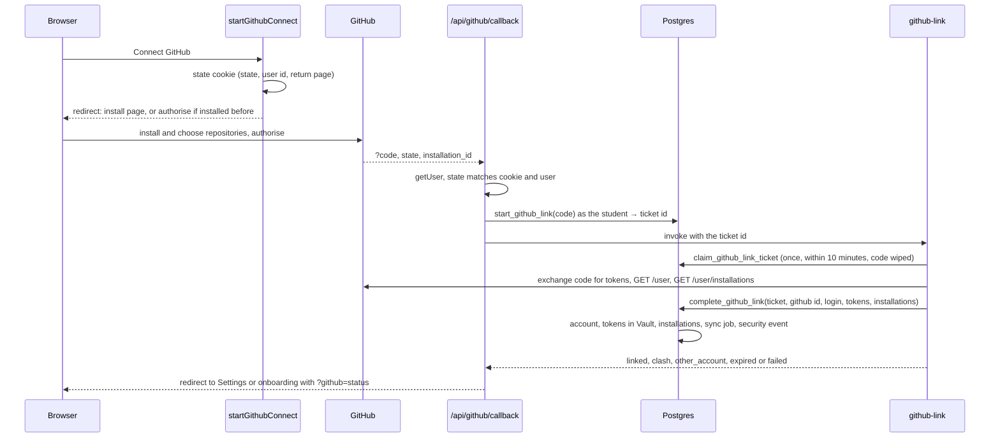
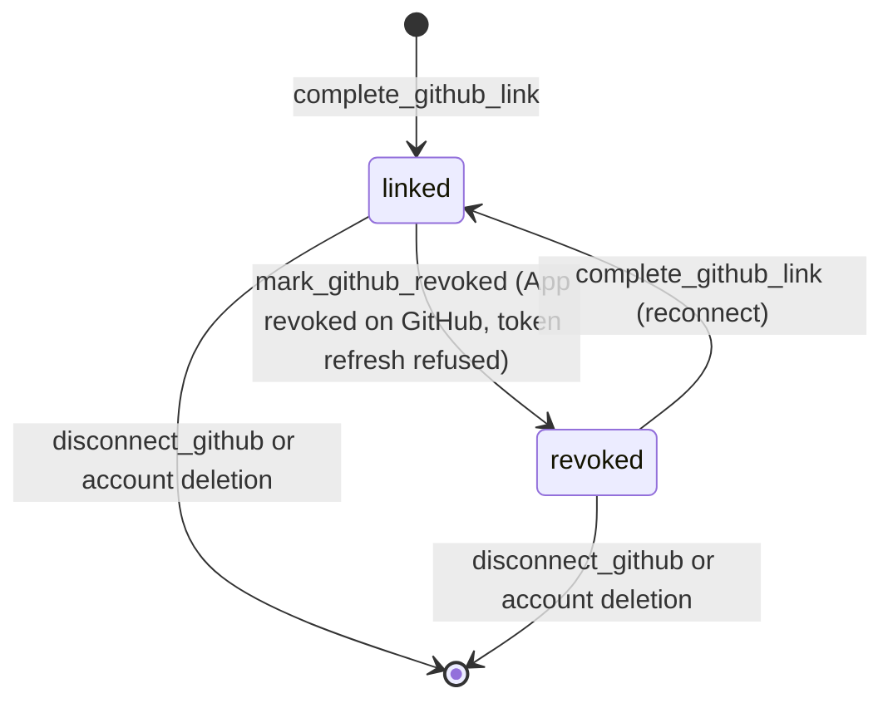
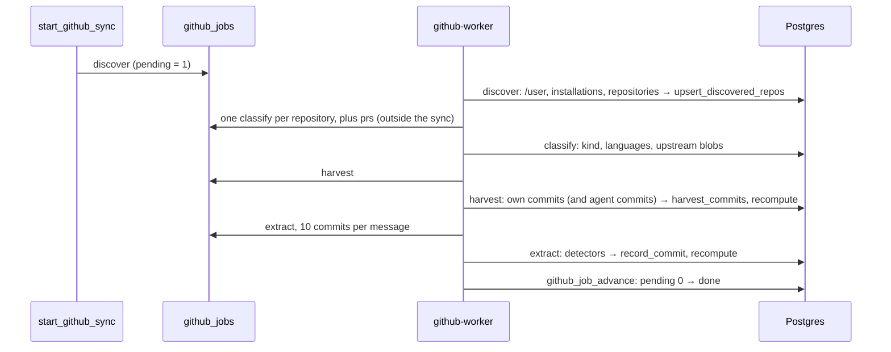
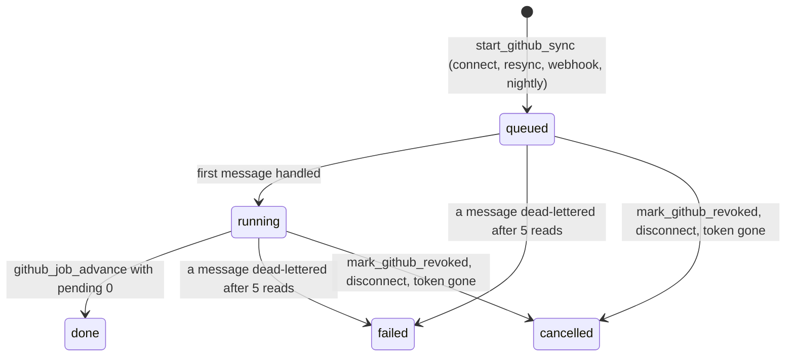
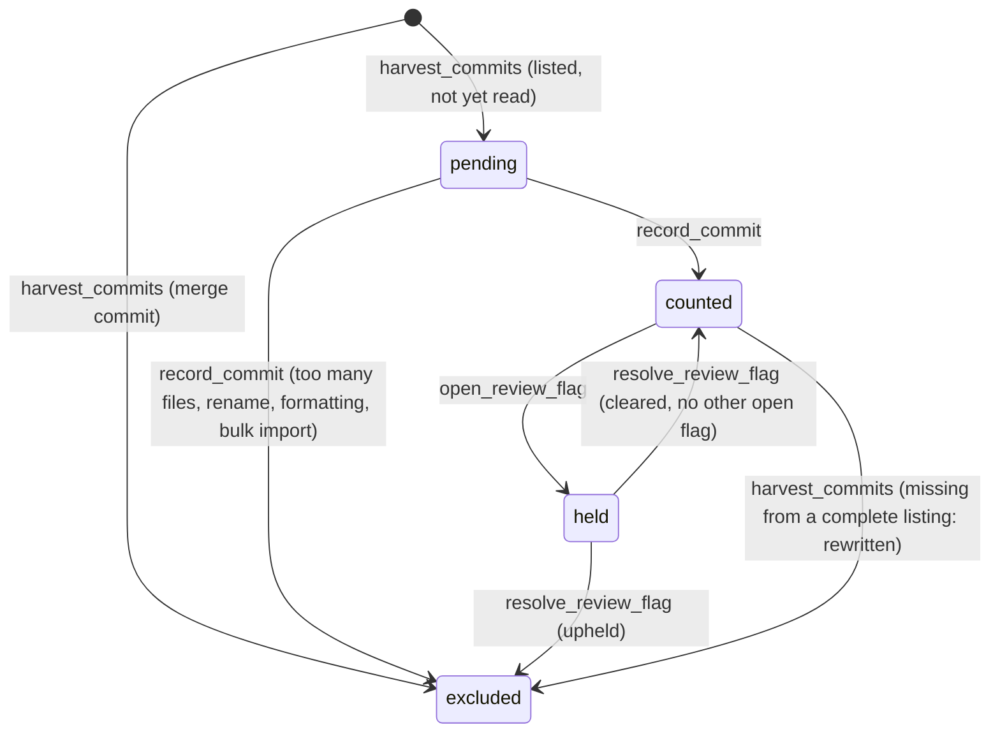

Commit: 7708363
Covers: supabase/migrations/20260927224500_github_connect.sql, supabase/migrations/20260927225000_skills.sql, supabase/migrations/20260927225313_sync_skills_taxonomy.sql, supabase/migrations/20260928150000_github_evidence.sql, supabase/migrations/20260928170000_skill_visibility.sql, supabase/migrations/20261002000000_skill_levels.sql, supabase/migrations/20261103000000_ai_assisted_commits.sql, scripts/skills.mjs, lib/github/, lib/skills/, lib/actions/github.ts, lib/actions/skills.ts, lib/data/github.ts, lib/data/skills.ts, components/github/, components/skills/, app/(app)/settings/github/, app/(app)/me/skills/, app/api/github/, supabase/functions/github-link/, supabase/functions/github-worker/, supabase/functions/_shared/github/. Non-source: lib/github/taxonomy/skills.yaml

# GitHub and skills

## Purpose

A student connects GitHub through the Skilient GitHub App, choosing which repositories it may read; the account is bound by GitHub's numeric id, never by a name the browser sends.
A queue-driven Edge Function reads the student's own commits and merged pull requests, runs the skill taxonomy's detectors over the lines each commit adds, and stores evidence (SHAs, paths, counts; never code).
Postgres turns that evidence, plus teammate confirmations, endorsements, code checks and competition awards, into a level from L1 to L4 per skill, which profiles, ranking, recruiters and the CV read.

In [architecture/overview.md](../architecture/overview.md) this subsystem uses most of the "Layers": route handlers for the App callback and the webhook (layer 5), Postgres for state, levels and RLS (layer 7), pg_cron and pgmq to drive the worker (layer 8), and two Edge Functions, `github-link` and `github-worker` (layer 9). It is the first step of the "Evidence to a signed CV" pipeline in [PLAN.md](../PLAN.md): its `user_skills` feed ranking and the CV snapshot.

## Data model

Column lists are in the generated reference: [github_connect](../reference/schema/github_connect.md), [skills](../reference/schema/skills.md), [github_evidence](../reference/schema/github_evidence.md), [skill_levels](../reference/schema/skill_levels.md), [ai_assisted_commits](../reference/schema/ai_assisted_commits.md).

### Connection

| Table | One row is | Columns and constraints that carry meaning |
|---|---|---|
| `github_accounts` | A student's linked GitHub account | `github_id` (unique: one Skilient account per GitHub account), `login` (refreshed at each sync), `revoked_at` (set when the student revokes the App or a token can't be refreshed: evidence stays, syncing stops) [src: supabase/migrations/20260927224500_github_connect.sql#create table public.github_accounts (] |
| `private.github_tokens` | The student's user-to-server token pair | Vault secret ids and expiry times only; the tokens themselves are in Vault [src: supabase/migrations/20260927224500_github_connect.sql#create table private.github_tokens (]. Deleting a row queues its revocation at GitHub [src: supabase/migrations/20260927224500_github_connect.sql#create trigger github_tokens_revoke after delete on private.github_tokens] |
| `private.github_revocations` | Tokens waiting to be revoked at GitHub | the two Vault secret ids |
| `github_installations` | One installation of the App (a user or an organisation) | `repository_selection` (`all`, `selected`), `suspended_at`, `deleted_at` [src: supabase/migrations/20260927224500_github_connect.sql#create table public.github_installations (] |
| `github_user_installations` | A student reaching repositories through an installation | one installation (a club's organisation) can serve several students |
| `github_repos` | A repository's shared metadata | `private`, `fork`, `parent_full_name`, `template_full_name`, `default_branch`; later `languages` (GitHub's language names, for L1) and `linguist_excludes` (globs `.gitattributes` marks generated or vendored) [src: supabase/migrations/20260927224500_github_connect.sql#create table public.github_repos (] [src: supabase/migrations/20260928150000_github_evidence.sql#add column languages text] |
| `github_user_repos` | A repository one student shared | `kind` (`owned`, `collaborator`, `fork`, `template`; null until classified), `excluded` (the student's switch), `harvested_at`, `agent_prs_checked_at` [src: supabase/migrations/20260927224500_github_connect.sql#create table public.github_user_repos (] [src: supabase/migrations/20261103000000_ai_assisted_commits.sql#alter table public.github_user_repos add column agent_prs_checked_at timestamptz;] |
| `sync_jobs` | One sync of one student | `trigger` (`connect`, `resync`, `webhook`, `nightly`), `status`, `stage`, the progress counters the student sees, `error` (staff only), `pending` (queued messages still to handle); at most one `queued` or `running` per student [src: supabase/migrations/20260927224500_github_connect.sql#create unique index sync_jobs_one_open_per_user] [src: supabase/migrations/20260928150000_github_evidence.sql#alter table public.sync_jobs add column pending integer not null default 0 check (pending >= 0);] |
| `private.github_link_tickets` | One attempt to link | the one-time OAuth code (wiped when claimed), `result` (`linked`, `clash`, `other_account`, `failed`) [src: supabase/migrations/20260927224500_github_connect.sql#create table private.github_link_tickets (] |
| `github_link_clashes` | A GitHub account already linked to someone else | for trust reviewers |
| `private.github_webhook_events` | One webhook delivery | `delivery_id` key (a replay is a no-op), the trimmed payload, `processed_at`; kept 30 days [src: supabase/migrations/20260927224500_github_connect.sql#create table private.github_webhook_events (] |

### Evidence

| Table | One row is | Columns and constraints that carry meaning |
|---|---|---|
| `github_commits` | One commit attributed to the student, per shared repository | `occurred_at` (the push time for pushed commits, else the commit time, never later than first seen; the author date is never used), `seen_via` (`harvest`, `push`), `signed`, `meaningful_lines` (0 to 400), `status` (`pending`, `counted`, `held`, `excluded`), `exclusion` (`merge`, `too_many_files`, `rename_only`, `formatting_only`, `bulk_import`, `rewritten`, `review`); `ai_agent` and `via_pr` for an AI agent's commit (an agent always comes with its pull request); deleted with the repository link [src: supabase/migrations/20260928150000_github_evidence.sql#create table public.github_commits (] [src: supabase/migrations/20261103000000_ai_assisted_commits.sql#add constraint github_commits_agent_via_pr check (ai_agent is null or via_pr is not null);] |
| `private.github_commit_blobs` | A substantial file a commit added | blob hash only, for the cross-account duplicate check |
| `private.github_upstream_blobs` | A file of a fork's parent or a template's source | blob hash; matching files are someone else's work [src: supabase/migrations/20260928150000_github_evidence.sql#create table private.github_upstream_blobs (] |
| `skill_evidence` | One skill in one commit | `detectors` (subset of `lines`, `file`, `path`, `manifest`, `import`), up to 10 `paths`, `lines` (0 to 400); unique per commit and skill [src: supabase/migrations/20260928150000_github_evidence.sql#create table public.skill_evidence (] |
| `github_pull_requests` | One of the student's merged pull requests | `counted` (true exactly when `exclusion` is null: `own_repo`, `no_other_human`, `young_account`), `approver_github_id` (required when counted), `repo_private`; tied to the student, not to a shared repository, so it survives a disconnect [src: supabase/migrations/20261002000000_skill_levels.sql#create table public.github_pull_requests (] |
| `github_pr_skills` | One skill a pull request's files show | up to 10 paths |
| `review_flags` | Held evidence awaiting a trust reviewer | `kind` (`burst`, `backdating`, `cross_account_duplicate`), `key` (one flag per user, kind and day, commit or other student), `status` (`open`, `cleared`, `upheld`); `private.review_flag_commits` links the commits [src: supabase/migrations/20260928150000_github_evidence.sql#create table public.review_flags (] |

### Skills and levels

| Table | One row is | Columns and constraints that carry meaning |
|---|---|---|
| `skills` | A taxonomy entry | `id` (stable slug), `category` (`language`, `framework`, `library`, `tool`, `platform`, `practice`), `parent_id`, `detectors` (expanded), `taxonomy_version`, `retired_at` (dropped skills are retired, never deleted) [src: supabase/migrations/20260927225000_skills.sql#create table public.skills (] |
| `user_skills` | One student's level in one skill | `level` 0 to 4, `active_days`, `lines`, `hits`, `repos`, `last_used_at`, `ai_lines`, `ai_assisted`; `peer_verified` is kept by the endorsements subsystem [src: supabase/migrations/20260928150000_github_evidence.sql#create table public.user_skills (] [src: supabase/migrations/20261103000000_ai_assisted_commits.sql#add column ai_assisted boolean not null default false;] |

Other stores:

| Store | What |
|---|---|
| pgmq `github_jobs` | every worker message [src: supabase/migrations/20260927224500_github_connect.sql#select pgmq.create('github_jobs');] |
| Vault `github_worker_secret` | the bearer secret pg_cron sends to `github-worker`, generated by the migration [src: supabase/migrations/20260927224500_github_connect.sql#'github_worker_secret',] |
| `platform_config` `github.ai_agents` | the AI agents' git emails and GitHub logins, each with a display name; nine entries (Claude, GitHub Copilot, Devin, Cursor, Codex) [src: supabase/migrations/20261103000000_ai_assisted_commits.sql#('github.ai_agents', 1,] |
| `lib/github/taxonomy/skills.yaml` | the taxonomy's source; `pnpm skills:sync` writes it into a migration |

## Lifecycles and state machines

### Linking an account

- What stops someone binding another person's GitHub: the browser hands over only GitHub's one-time code, written into a ticket under the student's own session; the Edge Function exchanges the code with GitHub itself and takes the numeric id GitHub returns for it [src: supabase/migrations/20260927224500_github_connect.sql#Identity is bound server-side. The browser only ever hands over GitHub's one-time OAuth] [src: supabase/functions/_shared/github/link.ts#export async function linkGithub]. The `state` cookie names the user who started the flow, so a callback in another account's session is refused [src: lib/github/state.ts#the flow, so a callback in another account's session is refused.] [src: app/api/github/callback/route.ts#if (!saved || saved.state !== params.get("state") || saved.userId !== user.id) {].
- `github-link` runs with `verify_jwt = false` and doesn't check its caller: the ticket, claimable once and only within 10 minutes, decides who is linked [src: supabase/config.toml#functions.github-link] [src: supabase/migrations/20260927224500_github_connect.sql#where t.id = p_ticket and t.claimed_at is null and t.created_at > now() - interval '10 minutes'].
- `complete_github_link` answers `clash` when the GitHub account belongs to another student (and records the clash for trust reviewers), `other_account` when this student is linked to a different GitHub account, `expired` when the ticket is too old [src: supabase/migrations/20260927224500_github_connect.sql#create function private.complete_github_link(]. On `linked` the function starts the worker at once instead of waiting for the next cron tick [src: supabase/functions/github-link/index.ts#Start discovery now rather than at the next minute's cron tick.].
- Installed without authorising (GitHub sends no code): the callback asks GitHub to authorise with the same state [src: app/api/github/callback/route.ts#Installed or reconfigured without authorising: ask GitHub to authorise, same state.].

### Account

| Transition | Function | Effect |
|---|---|---|
| Revoke | `mark_github_revoked` | `revoked_at` set, tokens deleted (and revoked at GitHub), open syncs cancelled; links, repositories and evidence stay [src: supabase/migrations/20260927224500_github_connect.sql#create function private.mark_github_revoked(p_user uuid)] |
| Disconnect | `disconnect_github` → `remove_github_data` | open syncs cancelled; tokens, repository links (and with them commits and commit evidence), installations and the account deleted; logged `github_disconnected` [src: supabase/migrations/20260927224500_github_connect.sql#create function private.remove_github_data(p_user uuid)]. Pull requests, confirmations, endorsements and code checks are not GitHub-repository data and stay |
| Token revocation | trigger on `private.github_tokens` → `revoke` message | the worker deletes the App grant at GitHub (refreshing first if the access token had expired), then the Vault secrets [src: supabase/functions/_shared/github/worker.ts#async revoke(ctx, msg)] |

Deleting the user deletes the token row by cascade, so the grant is revoked at GitHub then too.

### A sync

A sync is done when every message it queued has been handled: each handled message adds the follow-ups it queues to `pending` and subtracts itself; at 0 the job becomes `done` [src: supabase/migrations/20260928150000_github_evidence.sql#create function private.github_job_advance(]. The `prs` and `pr` messages and webhook-queued work carry no job id, so they never hold a sync open [src: supabase/functions/_shared/github/worker.ts#Merged pull requests (L3) are checked alongside; the sync's progress doesn't wait for them.].

`start_github_sync` returns the open sync instead of opening a second one [src: supabase/migrations/20260928150000_github_evidence.sql#create or replace function private.start_github_sync(p_user uuid, p_trigger text)].

### A commit

[src: supabase/migrations/20261103000000_ai_assisted_commits.sql#CREATE OR REPLACE FUNCTION private.harvest_commits(p_user uuid, p_repo bigint, p_commits jsonb, p_complete boolean)] [src: supabase/migrations/20260928150000_github_evidence.sql#create function private.open_review_flag(] [src: supabase/migrations/20260928150000_github_evidence.sql#create function private.resolve_review_flag(p_flag bigint, p_upheld boolean, p_note text)]

A commit gone from a complete listing (fewer than 500 commits listed) was removed by a history rewrite: its evidence is deleted and it becomes `rewritten`; agent commits are exempt, because they aren't in the student's own listing [src: supabase/migrations/20261103000000_ai_assisted_commits.sql#and ai_agent is null;].

### A review flag

`open` → `cleared` (held commits count again unless another open flag holds them) or `upheld` (excluded for good, `review`), by a trust reviewer with a note of at least 3 characters; the student's levels are recomputed either way [src: supabase/migrations/20260928150000_github_evidence.sql#Back to counted unless another open flag still holds the commit.]. A flag already cleared doesn't hold new commits that join it [src: supabase/migrations/20260928150000_github_evidence.sql#A flag a reviewer already cleared doesn't hold the same commits again]. The queue and screens belong to subsystems/trust-evidence (stage 6).

## Algorithms

### Which commits count as the student's

1. **Shared repositories only**, and only those not excluded by the student; a repository is classified before it is harvested [src: supabase/functions/_shared/github/worker.ts#if (!repo || repo.excluded || !repo.kind) {].
2. **Attributed by GitHub account id.** Harvest lists the default branch filtered by the student's login, newest 500 (5 pages of 100), and keeps only commits whose `author.id` is the student's GitHub id, which a spoofed `git config user.email` can't produce [src: supabase/functions/_shared/github/worker.ts#kept only where GitHub's author.id is the student's account, which a spoofed] [src: supabase/functions/_shared/github/worker.ts#export const MAX_COMMITS = 500;]. Extract checks the author again for each commit [src: supabase/functions/_shared/github/worker.ts#if (commit.author?.id !== Number(repo.github_id) && !isAgent) continue;]. Bots and other people never match.
3. **AI agents' commits** count too, labelled, when they reached the default branch through a pull request the student opened and merged with a merge commit, in a shared repository (see "AI-assisted commits").
4. **Excluded but kept**: merge commits (more than one parent: no evidence at all), commits touching more than 100 files, pure renames, pure reformatting, and a bulk import (a repository's first commit adding more than 2,000 lines or touching more than 50 files) [src: supabase/functions/_shared/github/detectors.ts#export function isBulkImport]. An excluded commit's detections other than a merge's are still stored, so the skill shows as present (L1) but never as authored [src: supabase/migrations/20261103000000_ai_assisted_commits.sql#Evidence: one row per skill. Excluded commits (a bulk import) still show the skill as].
5. **Files that never count**: anything under `node_modules`, `vendor`, `dist`, `build`, `.next` or `__pycache__`; minified files, source maps and lockfiles; anything `.gitattributes` marks `linguist-generated` or `linguist-vendored`; removed files; and, in a fork or a repository made from a template, any file whose blob hash matches the original project's tree [src: supabase/functions/_shared/github/detectors.ts#const EXCLUDED_DIRS] [src: supabase/functions/_shared/github/detectors.ts#export function linguistGlobPatterns] [src: supabase/functions/_shared/github/worker.ts#const files = allFiles.filter((f) => !(f.sha && upstream.has(f.sha)));].

### Detectors

Detectors are data: each skill's `detectors` column, expanded from the YAML. `analyseCommit` runs them over one commit [src: supabase/functions/_shared/github/detectors.ts#export function analyseCommit]:

1. More than 100 files → `too_many_files`, nothing detected [src: supabase/functions/_shared/github/detectors.ts#export const MAX_FILES = 100;].
2. Drop removed and excluded files. If every remaining file is a rename with no changes → `rename_only`; if every one is a modified file whose added text equals its removed text once whitespace is ignored → `formatting_only`.
3. For each file: meaningful lines = non-blank added lines when the file matches a language's file globs (GitHub's addition count when there's no patch), else 0.
4. For each skill: its `files` globs give `lines` (languages, when lines > 0) or `file` (other categories); `paths` globs give `path`; `manifests` give `manifest` when the manifest file matches and one of the commit's added lines matches the pattern; `imports` give `import` the same way for the listed extensions. Only added lines are read, so a framework counts when the student's own commit imports it or adds it as a dependency, never because it sits in the repository [src: supabase/functions/_shared/github/detectors.ts#Pure functions over one commit's changed files: they only ever look at lines the].
5. Cap: when the commit's meaningful lines exceed 400, each `lines` detection becomes floor(lines × 400 ÷ total); the commit's own count is min(total, 400) [src: supabase/functions/_shared/github/detectors.ts#if (d.kind === "lines") d.lines = Math.floor((d.lines * LINE_CAP) / totalLines);].

Globs: `*` stays inside one path segment, `**` crosses segments, `?` is one character, and a glob without a slash matches the file name in any folder [src: supabase/functions/_shared/github/detectors.ts#export function globToRegExp]. `record_commit` stores one evidence row per skill: the distinct detector kinds, the first 10 paths and the lines summed and capped at 400 [src: supabase/migrations/20261103000000_ai_assisted_commits.sql#CREATE OR REPLACE FUNCTION private.record_commit(p_user uuid, p_repo bigint, p_commit jsonb)].

### The taxonomy

`lib/github/taxonomy/skills.yaml` has a `version` and a list of skills, each with an id, name, category, optional parent and detectors. `scripts/skills.mjs` validates it (slug ids, unique; names up to 60; known categories and keys; parents that exist; at least one commit detector, since `linguist` alone never proves a commit; regexes that compile), expands the ecosystem shorthands (`npm`, `pypi`, `maven`, `jvm`, `nuget`, `composer`, `php_ns`, `go`, `gem`, `pub`) into manifest and import patterns, and writes a migration calling `private.sync_skills(version, rows)` with the YAML's SHA-256 [src: scripts/skills.mjs#export function parseTaxonomy] [src: scripts/skills.mjs#export function expandDetectors]. The one sync migration so far loads version 1 with 158 skills [src: supabase/migrations/20260927225313_sync_skills_taxonomy.sql#-- taxonomy version 1: 158 skills]. `sync_skills` upserts by id and retires any skill no longer listed, never deleting it [src: supabase/migrations/20260927225000_skills.sql#create function private.sync_skills(p_version integer, p_skills jsonb)]. A unit test fails when the YAML changes without a new sync migration [src: tests/unit/skills-taxonomy.test.ts#is loaded by the newest sync migration].

### Levels

`recompute_user_skills(user)` rebuilds one student's levels from all current evidence each time [src: supabase/migrations/20261103000000_ai_assisted_commits.sql#CREATE OR REPLACE FUNCTION private.recompute_user_skills(p_user uuid)]:

| Level | Rule as the code computes it | Function |
|---|---|---|
| L1 Present | any evidence row for the skill in a non-excluded shared repository (counted or not), or one of GitHub's language names for a repository the student owns or has any commit in | `recompute_user_skills` (`linguist` part) |
| L2 Authored | counted evidence on 3 or more distinct days (Pakistan dates), and: languages 150+ lines; frameworks and libraries 3+ evidence rows with a `manifest` or `import` hit; tools, platforms and practices 3+ rows with any `file`, `path`, `manifest` or `import` hit [src: supabase/migrations/20261103000000_ai_assisted_commits.sql#when a.skill_id is not null and a.days >= 3 and (] | `recompute_user_skills` |
| L3 Corroborated | a counted merged pull request whose files show the skill; a manual contribution entry tagged with the skill whose current version someone other than its author confirmed; a confirmed "before Skilient" GitHub entry, for the skills found in that commit; a competition award in the skill [src: supabase/migrations/20261015000000_recruiter_jobs.sql#create or replace function private.l3_skills(p_user uuid)] | `l3_skills` |
| L4 Demonstrated | endorsements tied to an entry that shows the skill, not hidden, from at least `peer_verified_min` (2) different endorsers, or from any teacher; a passed code check; a competition win plus one fewer such endorsers [src: supabase/migrations/20261015000000_recruiter_jobs.sql#create or replace function private.l4_skills(p_user uuid)] [src: supabase/migrations/20261001000000_endorsements.sql#'{"per_teammate_per_venture": 5, "per_month": 20, "peer_verified_min": 2}'] | `l4_skills` |

- The level is the highest of the GitHub level and the proofs; a skill can reach L3 or L4 with no GitHub evidence at all.
- Held commits count toward L1 and "last used" but never toward days, lines or hits; excluded repositories count for nothing.
- Only unretired skills are computed, and every row not computed is deleted, so a level drops when its evidence goes: a disconnect, an excluded repository, a history rewrite, an upheld flag, a hidden endorsement, a correction awaiting confirmation [src: supabase/migrations/20261103000000_ai_assisted_commits.sql#join public.skills s on s.id = k.skill_id and s.retired_at is null].
- `active_days`, `lines`, `hits` (manifest/import hits for frameworks and libraries, any hit otherwise), `repos` and `last_used_at` are stored for the owner's "next step" text.
- The function also writes the open sync's `skills_found` (skills at L1 or above).

Recomputes run at the end of each harvest and extract message, after recording a pull request, after a flag is resolved, from statement triggers when repository links are deleted or `excluded` changes, when endorsements are inserted or updated, when a contribution is confirmed or corrected, and from the subsystems that grade code checks and award competitions [src: supabase/migrations/20260928150000_github_evidence.sql#create function private.github_user_repos_recompute()] [src: supabase/migrations/20261002000000_skill_levels.sql#create function private.recompute_endorsees()]. The thresholds are repeated for the drawer's "next step" text [src: lib/skills/levels.ts#export const L2_DAYS = 3;].

### Pull requests (L3)

1. After each discovery, `prs` runs one search, `type:pr is:merged author:<login>`, newest 100, and queues a `pr` message for each result authored by the student that isn't recorded yet [src: supabase/functions/_shared/github/worker.ts#type:pr is:merged author:${account.login}]. A merged `pull_request` webhook or an approving review re-queues that one pull request for its author [src: supabase/migrations/20261002000000_skill_levels.sql#create function private.github_webhook_pr(p_delivery_id uuid)].
2. `pr` reads the pull request; it must be the student's and merged.
3. In the student's own repository → `own_repo`. Otherwise the candidates are the person who merged it, then each approving reviewer, keeping only humans (account type `User`, login not ending in `[bot]`) other than the student [src: supabase/functions/_shared/github/worker.ts#const isHuman = (u: GitHubUser].
4. The first candidate whose GitHub account was created at least 90 days before the merge corroborates it; with candidates but none old enough → `young_account`, with none → `no_other_human` [src: supabase/functions/_shared/github/worker.ts#export const APPROVER_MIN_AGE_DAYS = 90;].
5. A counted pull request's files (up to 200) go through the same detectors; every detection becomes a skill of that pull request [src: supabase/functions/_shared/github/worker.ts#record.skills = analysis.detections.map((d) => ({ skill_id: d.skillId, path: d.path }));].

### AI-assisted commits

1. An agent identity is a git author email or a GitHub login from `github.ai_agents`. A commit GitHub links to an account counts as an agent's only when that account's login is an agent (a person's commit never does, whatever its email says); an unlinked commit counts when its git author email is an agent's; case is ignored [src: supabase/functions/_shared/github/agents.ts#export function agentAuthor].
2. Harvest also lists the repository's closed pull requests (newest 100 by update) and, for those the student opened and that were merged since the last check, `recordAgentPr` reads the pull request's commits (up to 300) and stores the agent's ones with `ai_agent` and `via_pr` [src: supabase/functions/_shared/github/worker.ts#async function recordAgentPr(]. Only merge-commit merges count: a squash or rebase writes new commits on the default branch, and a squash is already the student's own commit [src: supabase/functions/_shared/github/worker.ts#request the student opened, in a repository they shared. Only pull requests merged with a merge]. The `pr` stage does the same for a pull request in a shared repository.
3. Extract accepts a recorded agent commit when its author still matches the recorded agent, and counts it like the student's own.
4. `ai_assisted` on a skill: when the skill has counted lines, AI lines × 2 > counted lines; otherwise AI hits × 2 > counted hits with at least one AI hit; and no passed code check in the skill [src: supabase/migrations/20261103000000_ai_assisted_commits.sql#(case when a.lines > 0 then a.ai_lines * 2 > a.lines]. It shows as an "AI-assisted" label on the skill chip and in the drawer, on profiles and in the CV snapshot [src: lib/skills/levels.ts#export const AI_ASSISTED = {].
5. A `Co-Authored-By` trailer alone never counts [src: supabase/migrations/20261103000000_ai_assisted_commits.sql#never counts. The worker checks the pull request and the author; this file stores the result,].

### Anti-gaming

Run by `record_commit` for counted commits [src: supabase/migrations/20261103000000_ai_assisted_commits.sql#-- Burst: more than 50 commits or 5,000 lines in one day (Pakistan time).]:

| Flag | Trigger | Held |
|---|---|---|
| Backdating | a pushed commit authored more than 30 days before the push | that commit |
| Burst | more than 50 counted or held commits, or more than 5,000 meaningful lines, on one Pakistan day | every commit of that day |
| Cross-account duplicate | a file this commit added (20+ non-blank lines, not excluded) has the same blob hash as one another student added in a different repository | the commits on both sides |

[src: supabase/functions/_shared/github/detectors.ts#export const DUPLICATE_MIN_LINES = 20;] The student sees only that some activity is being reviewed [src: components/skills/held-notice.tsx#Some of your activity is being reviewed].

### Queue, retries and rate limits

- `runWorker` reads up to 10 messages with a 120-second visibility timeout and keeps going for 50 seconds (40 when started by `github-link`) [src: supabase/functions/_shared/github/worker.ts#export async function runWorker].
- Success archives the message. A rate limit re-queues a fresh copy with the wait as its delay, so waiting doesn't count as an attempt. A message that fails 5 times, or whose student has no usable token, is archived and its sync marked `failed` (or `cancelled`) with the error, which only staff can read; other failures come back after the visibility timeout [src: supabase/functions/_shared/github/worker.ts#if (error instanceof NoToken || row.read_ct >= MAX_ATTEMPTS) {].
- Rate limits: when a token's core budget falls below 200 remaining before its reset, the stage waits until the reset; a `Retry-After` or an exhausted budget does the same. Search has its own budget and doesn't gate stages [src: supabase/functions/_shared/github/client.ts#export const LOW_BUDGET = 200;]. Each run records the lowest share of budget left as the `github_headroom` signal for the alerts [src: supabase/functions/_shared/github/worker.ts#select private.record_service_signal('github_headroom', $1::numeric)].
- Tokens: the student's token is refreshed when it has 5 minutes or less left; a refused refresh marks the account revoked [src: supabase/functions/_shared/github/worker.ts#async function userToken]. Repository stages use 1-hour installation tokens minted with a 9-minute App JWT [src: supabase/functions/_shared/github/jwt.ts#A 9-minute App JWT (GitHub allows 10; iat is backdated a minute for clock drift).].

### Webhooks

1. The route refuses without `GITHUB_WEBHOOK_SECRET` (503) or a valid `X-Hub-Signature-256` over the raw body (401), acknowledges `ping` and events it doesn't handle, and requires a UUID delivery id [src: app/api/github/webhook/route.ts#export async function POST].
2. `summariseWebhook` keeps only ids, flags and commit ids: no commit messages, diffs or emails are stored [src: lib/github/webhook.ts#export function summariseWebhook].
3. `record_github_webhook` stores the delivery once by its id and queues a `webhook` message; a replay returns false and queues nothing [src: supabase/migrations/20260927224500_github_connect.sql#create function private.record_github_webhook(].
4. `process_github_webhook` [src: supabase/migrations/20260928150000_github_evidence.sql#create or replace function private.process_github_webhook(p_delivery_id uuid)]:

| Event | Effect |
|---|---|
| `installation` `deleted` | installation marked deleted; its repository links (and their evidence) dropped |
| `installation` `suspend`, `unsuspend` | suspended flag; unsuspending re-runs discovery for its students |
| `installation_repositories` | removed repositories dropped; discovery for its students |
| `github_app_authorization` `revoked` | the sender's account marked revoked |
| `push` to the default branch (not a branch deletion) | for each linked, unrevoked student sharing the repository: a force-push re-harvests; otherwise its commits go to `extract` with the delivery time as the push time |
| `pull_request` merged, `pull_request_review` approved | the pull request is checked again for its author |

Every linked, unrevoked student is also synced nightly at 02:17 Pakistan time [src: supabase/migrations/20260928150000_github_evidence.sql#select cron.schedule('github-nightly-sync', '17 21 * * *', $$select private.github_nightly_sync()$$);].

### Constants

| Constant | Value | Defined |
|---|---|---|
| Commits per repository | newest 500 | `MAX_COMMITS` |
| Commits per extract message | 10 | [src: supabase/functions/_shared/github/worker.ts#export const EXTRACT_BATCH = 10;] |
| Files per commit | 100 | `MAX_FILES` |
| Lines per commit | 400 | [src: supabase/functions/_shared/github/detectors.ts#export const LINE_CAP = 400;] |
| L2 | 3 days; 150 lines or 3 hits | `recompute_user_skills` |
| Pull requests checked | newest 100 per search; agent pull requests 100 per repository | [src: supabase/functions/_shared/github/worker.ts#export const MAX_PRS = 100;] |
| Approver account age | 90 days at merge | `APPROVER_MIN_AGE_DAYS` |
| Bulk import | first commit over 2,000 lines or 50 files | `isBulkImport` |
| Flags | 30 days backdating; 50 commits or 5,000 lines a day; 20-line blobs | `record_commit` |
| Attempts | 5 | [src: supabase/functions/_shared/github/worker.ts#export const MAX_ATTEMPTS = 5;] |
| Rate-limit floor | 200 requests | `LOW_BUDGET` |
| Link tickets | 10 minutes to claim; 10 starts an hour per student | [src: supabase/migrations/20260927224500_github_connect.sql#private.rate_limit('github_link:'] |
| Resyncs | 5 an hour per student | [src: supabase/migrations/20260927224500_github_connect.sql#private.rate_limit('github_resync:'] |
| Connect starts | 10 an hour per student | [src: lib/actions/github.ts#rateLimit(supabase, "github_connect", user.id, 10, 3600)] |
| Retention | webhook deliveries 30 days, link tickets 1 day | [src: supabase/migrations/20260927224500_github_connect.sql#create function private.purge_github_data()] |

## Entry points

### Server actions

| Action | Who | Does |
|---|---|---|
| `startGithubConnect` | signed in | sets the state cookie and redirects to GitHub's install page, or to authorise only when the student has an installation already [src: lib/actions/github.ts#export async function startGithubConnect] |
| `resyncGithub` | signed in, linked and not revoked | `request_github_resync` |
| `disconnectGithub` | signed in | `disconnect_github` |
| `setRepoExcluded` | signed in, own repository | updates `excluded`, checked with `count: "exact"` [src: lib/actions/github.ts#export async function setRepoExcluded] |
| `loadSkillEvidence` | signed in, own evidence | the newest 25 evidence rows for a skill with their commits, the proofs and the code-check state [src: lib/actions/skills.ts#export async function loadSkillEvidence] |

### Routes

| Route | Who |
|---|---|
| `GET /api/github/callback` | the signed-in student coming back from GitHub, with a matching state [src: app/api/github/callback/route.ts#export async function GET] |
| `POST /api/github/webhook` | GitHub, signed with `GITHUB_WEBHOOK_SECRET`; writes with the service role, since a webhook acts for no user [src: app/api/github/webhook/route.ts#A webhook acts for no user, so it uses the] |

### Edge Functions

| Function | Caller | Check |
|---|---|---|
| `github-link` | the callback route, with `{ticket}` | none beyond the ticket; refuses before claiming when the App's secrets are missing, so the student's code isn't spent [src: supabase/functions/github-link/index.ts#Checked before the ticket is claimed, so a missing secret doesn't burn the student's code.] |
| `github-worker` | pg_cron | `Authorization: Bearer` equal to `github_worker_secret`, compared in constant time [src: supabase/functions/github-worker/index.ts#if (!row] |

Both read `GITHUB_APP_ID`, `GITHUB_APP_CLIENT_ID`, `GITHUB_APP_CLIENT_SECRET` and `GITHUB_APP_PRIVATE_KEY` (and optional `GITHUB_API_URL`, `GITHUB_WEB_URL` for tests) [src: supabase/functions/_shared/github/types.ts#export function configFromEnv]. The app reads `GITHUB_APP_SLUG` and `GITHUB_APP_CLIENT_ID` to build links [src: lib/github/config.ts#export function githubApp].

### RPCs

| Function | Granted to |
|---|---|
| `start_github_link`, `request_github_resync`, `disconnect_github`, `my_skills`, `my_skill_proofs` | `authenticated` |
| `record_github_webhook` | `service_role` only [src: supabase/migrations/20260927224500_github_connect.sql#grant execute on function public.record_github_webhook(uuid, text, jsonb, text, bigint) to service_role;] |
| `resolve_review_flag`, `review_flag_details` | `authenticated`, checked for trust reviewers on two-factor inside |
| Everything the Edge Functions call (`claim_github_link_ticket`, `complete_github_link`, `harvest_commits`, `record_commit`, `record_pull_request`, `recompute_user_skills`, ...) | no API role; the functions connect directly with `SUPABASE_DB_URL` |

### Queue messages

`discover`, `classify`, `harvest`, `extract` (sync stages); `prs`, `pr` (pull requests); `webhook`; `revoke`; and `code_check`, queued by the code-check subsystem to pick a snippet location [src: supabase/functions/_shared/github/worker.ts#type Message =] [src: supabase/migrations/20261004000000_code_checks.sql#perform private.enqueue_github(jsonb_build_object('stage', 'code_check', 'check_id', v_id));].

### Jobs and triggers

| Entry | What |
|---|---|
| Cron `github-worker` (every minute) | `wake_github_worker`: posts to the function only when a message is visible and both `project_url` and `github_worker_secret` are in Vault [src: supabase/migrations/20260927224500_github_connect.sql#create function private.wake_github_worker()] |
| Cron `github-nightly-sync` (`17 21 * * *`) | a sync for every unrevoked account |
| Cron `purge-github-data` (`37 3 * * *`) | retention |
| Triggers | token revocation; level recomputes on repository links, endorsements, confirmations and corrections |

Staff tools elsewhere: `ops_github_resync` and `ops_recompute_skills`, for trust reviewers with a reason, audited (subsystems/ops-console, stage 6) [src: supabase/migrations/20261028000000_users_view_as.sql#create function private.ops_recompute_skills(p_user uuid, p_reason text)].

## RLS and privileges

| Table | Read | Write |
|---|---|---|
| `github_accounts` | the owner, and anyone who may read the owner's full profile (the profile's GitHub link) [src: supabase/migrations/20260927224500_github_connect.sql#create policy github_accounts_read on public.github_accounts] | definer functions |
| `github_installations`, `github_user_installations` | the student's own | definer functions |
| `github_repos` | only students who share the repository, so a private repository's name reaches nobody else [src: supabase/migrations/20260927224500_github_connect.sql#Owner-only: private repository names never reach anyone else (PRD 5.5).] | definer functions |
| `github_user_repos` | own rows | `excluded` only, own rows [src: supabase/migrations/20260927224500_github_connect.sql#grant update (excluded) on table public.github_user_repos to authenticated;] |
| `sync_jobs` | own rows, every column but `error` [src: supabase/migrations/20260927224500_github_connect.sql#grant select (id, user_id, trigger, status, stage, repos_total, repos_done, commits_analysed, skills_found,] | definer functions |
| `github_commits`, `skill_evidence`, `github_pull_requests`, `github_pr_skills` | owner only [src: supabase/migrations/20260928150000_github_evidence.sql#create policy skill_evidence_read_own on public.skill_evidence] | definer functions |
| `user_skills` | rows: the owner and anyone who may read the owner's full profile; columns: `user_id`, `skill_id`, `level`, `last_used_at`, `ai_lines`, `ai_assisted` and `peer_verified` [src: supabase/migrations/20261001000000_endorsements.sql#grant select (peer_verified) on table public.user_skills to authenticated;]; the counts behind a level only through `my_skills()` for the owner [src: supabase/migrations/20260928170000_skill_visibility.sql#grant select (user_id, skill_id, level, last_used_at) on table public.user_skills to authenticated;] | definer functions |
| `review_flags` | the owner (id, status and dates only) and trust reviewers; kind and refs only through `review_flag_details` [src: supabase/migrations/20260928150000_github_evidence.sql#grant select (id, user_id, status, created_at, resolved_at) on table public.review_flags to authenticated;] | `resolve_review_flag` |
| `github_link_clashes` | trust reviewers on two-factor | `complete_github_link` |
| `skills` | every signed-in user | sync migrations and the ops skill editor |
| `private.*` | nobody through the API | definer functions |

No function in this subsystem takes the acting user from the caller: actions read `auth.uid()` in SQL, the link takes the user from the ticket, and the worker's functions are reachable only over the direct connection. `my_skill_proofs` shows the owner their private repositories' names; nobody else can call it for another student [src: supabase/migrations/20261103000000_ai_assisted_commits.sql#CREATE OR REPLACE FUNCTION private.my_skill_proofs(p_skill text)].

## Failure modes

| What goes wrong | What the student sees | What the logs and data show |
|---|---|---|
| App not configured (no slug or client id) | "Connecting GitHub isn't available yet." / "Not available yet" in Settings | action `not_configured` |
| Edge Function secrets missing | "Couldn't connect GitHub. Try again in a minute." | `github-link` answers 503 without claiming the ticket; worker 503 and `github.worker` error |
| State mismatch (another account, expired cookie) | "That GitHub link expired or was opened in another account." | `github.callback` refused `state_mismatch` |
| GitHub account linked to someone else | "That GitHub account is already linked to another Skilient account..." | `github_link_clashes` row for trust reviewers [src: lib/data/github.ts#export const GITHUB_OUTCOMES] |
| Signed in to a different GitHub account than the one linked | "You signed in to a different GitHub account. Disconnect the current one first..." | ticket result `other_account` |
| Student revoked the App on GitHub, or the refresh token expired | "Skilient's access was revoked on GitHub..." and Reconnect | `revoked_at`; syncs `cancelled`; `github.job` `dead_letter` "token expired" or "refresh refused" |
| Rate limit | progress pauses | `github.job` `deferred` with seconds; `github_headroom` signal and alert below 20% |
| A stage keeps failing | "The last sync didn't finish. Resync to try again; if it keeps failing, our team can see why." [src: components/github/sync-status.tsx#The last sync didn't finish.] | `sync_jobs.error` = stage and message; `github.job` `retry` then `dead_letter` |
| Vault `project_url` missing | no syncs after the first (the link starts one run itself) | `wake_github_worker` returns without calling; queue-stuck alert |
| Webhook with a bad signature | nothing | 401, `github.webhook` refused `bad_signature` |
| Webhook replayed | nothing | 202 with `replay: true` |
| Commits held | "Some of your activity is being reviewed (N commits)..." | `review_flags` open; commits `held` |
| Repository unshared on GitHub or deleted | it disappears at the next discovery; levels drop | link rows deleted; recompute trigger |
| History rewritten | evidence for the removed commits disappears | commits `excluded` `rewritten` |

## Tests

| Suite | Covers |
|---|---|
| Worker `github-worker.test.ts` (against the local database and a scriptable fake GitHub: OAuth, users, installations, repositories, commits, languages, `.gitattributes`, pulls and their commits, search, reviews, files, trees, grant deletion) | linking through the ticket and discovery; only own commits counted; unknown and reused tickets; token refresh; waiting out rate limits; dead-lettering; webhook replay; pushes and backdating; force-push rewrites; excluding a repository; L3 pull requests; the pull-request webhook; AI agents' commits; disconnect revoking the grant [src: tests/worker/github-worker.test.ts#imports only the student's own commits and turns the evidence into levels] |
| pgTAP `09_github_connect` | the link functions and tickets, Vault tokens, clashes for trust reviewers on two-factor, repository visibility and classification, webhook replay |
| pgTAP `10_skills`, `12_github_evidence`, `13_skill_visibility` | the taxonomy and retiring; L2 thresholds; idempotent commits; burst, backdating and duplicate flags; what classmates and the owner read; flag resolution; exclusion and rewrites dropping levels |
| pgTAP `29_skill_levels`, `53_ai_assisted_commits` | L3 from confirmed entries and pull requests, L4 from endorsements, proofs; agent commits, the AI-assisted flag and a passed code check removing it |
| Unit `github`, `github-agents`, `skills-taxonomy` | App JWT, pagination, budgets, headroom, grant revocation, webhook signature and trimming; agent matching; the taxonomy (fixtures for at least 95% of skills) and every detector rule [src: tests/unit/skills-taxonomy.test.ts#has fixtures for at least 95% of skills (PRD 5.5 done-when)] |
| E2E `github.spec.ts`, `levels.spec.ts` | the state check, repositories, exclusion and disconnect, level visibility, onboarding skip, webhook signature and replay; L3 and L4 through the UI |

Not covered by any test: `github-nightly-sync`, `purge-github-data` and `wake_github_worker` through `pg_net`; the real GitHub API (the fake answers only the paths the tests script); `installation` deleted, suspended and unsuspended events; a sync's `failed` state shown in the UI; retiring a skill that students hold a level in.

## Change guide

### Add or change a skill or detector

1. Edit `lib/github/taxonomy/skills.yaml` (bump `version` for a new taxonomy version); add fixture examples for new skills.
2. `pnpm skills:sync` writes a new `*_sync_skills_taxonomy.sql`; commit it (the unit test fails otherwise).
3. Removing a skill retires it; levels in it disappear at each student's next recompute (see "Open questions").
4. New evidence appears for new commits only: existing commits are extracted once. A full re-extract needs their `extracted_at` cleared in a migration.

### Add an AI agent identity

1. Staff edit `github.ai_agents` at `/ops/config` (schema-checked), or a migration updates `platform_config`.
2. Add the display name to `agentName` in `lib/skills/levels.ts`, which the UI uses instead of the config.
3. Repositories already checked aren't rechecked before `agent_prs_checked_at`; clear it for a backfill.

### Change a level rule

1. New migration: replace `private.recompute_user_skills` starting from its last definition (ai_assisted_commits), or `l3_skills`/`l4_skills` from theirs (recruiter_jobs). Each is a whole-function replacement.
2. Update `L2_DAYS`/`L2_LINES`/`L2_HITS`, `LEVELS` and `nextStep` in `lib/skills/levels.ts`.
3. Recompute everyone in the migration (as ai_assisted_commits does for agent users), or levels change only at each student's next recompute.
4. pgTAP `12`/`29`, and the ranking and CV docs if what a level means changes.

### Handle a new webhook event

1. Add it to `HANDLED_EVENTS` and a case in `summariseWebhook` keeping only ids and flags.
2. New migration: a branch in `process_github_webhook` (or a function like `github_webhook_pr` returning messages), and subscribe the App to the event on GitHub.
3. Unit test the trimming; worker test the effect.

### Replay a stuck sync or recompute a student

1. Student: Resync in Settings (5 an hour).
2. Trust reviewer: `ops_github_resync` or `ops_recompute_skills` from `/ops/users/[id]`, with a reason; both are audited.
3. Handled and dead-lettered messages are both archived in `pgmq.a_github_jobs`; a failed sync's `error` names the stage and the message. A new sync starts from discovery and skips commits already extracted [src: supabase/migrations/20261103000000_ai_assisted_commits.sql#if found and v_existing.extracted_at is not null then].

## Questions this doc answers

1. Linking and identity binding: "Linking an account".
2. Each stage, the queue and when a sync is done: "A sync", "Queue, retries and rate limits".
3. Which commits count: "Which commits count as the student's".
4. Detectors and changing the taxonomy: "Detectors", "The taxonomy".
5. L1 to L4: "Levels".
6. AI-assisted commits: "AI-assisted commits".
7. Webhooks, uninstall and revocation: "Webhooks", "Account".
8. Visibility: "RLS and privileges".
9. Replaying a sync and recomputing: "Change guide".
10. Testing without GitHub: "Tests".

## Open questions

- Retiring a skill removes it from every student's levels at their next recompute, while the skills migration says evidence and levels "keep their reference". Should a retired skill keep its levels? (Finding 25 in [verification-log.md](../reference/verification-log.md).)
- The drawer's level rules describe less than the code counts: L2 "3+ imports (frameworks, libraries, tools)" where tools, platforms and practices count any hit, L3 without competition entries, L4 as two teammates only. Should the copy follow the code? (Finding 26.)
- An upheld review flag excludes its commits for good, and appeals don't cover review flags (row 13 of [prd-mismatches.md](../reference/prd-mismatches.md)). Is a student meant to be able to appeal one?
- A repository excluded before its first classification is never classified, shows "Checking…", and is picked up only at the next sync after it is switched back on. Should switching it on queue a classification? (Finding 27.)
- The UI names AI agents from a hard-coded list rather than the config, so an agent added in `/ops/config` shows as "an AI agent" (finding 28).
