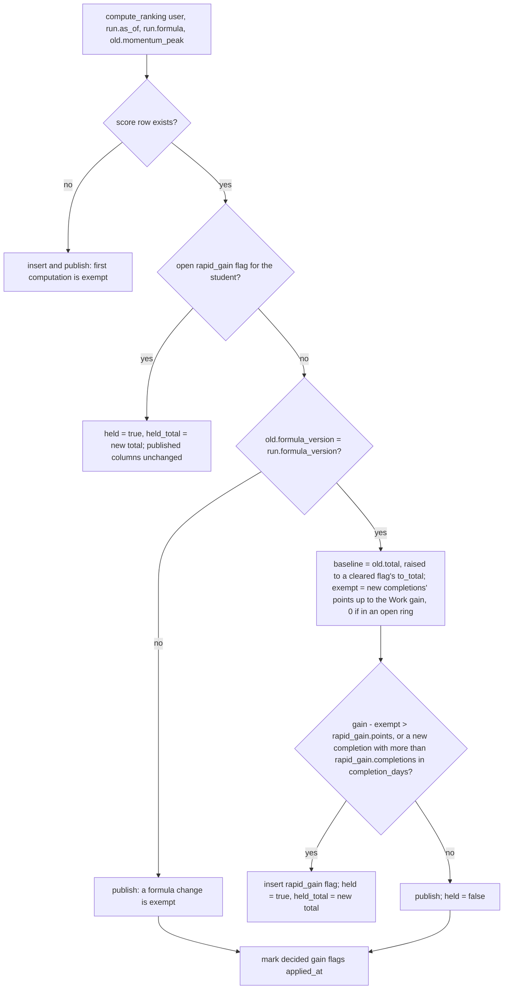

Commit: 06a359d
Covers: supabase/migrations/20261005000000_ranking.sql, supabase/migrations/20261006000000_leaderboard.sql, lib/ranking/, lib/data/ranking.ts, lib/data/tiers.ts, lib/data/ops-ranking.ts, lib/actions/ranking.ts, lib/actions/ops/ranking.ts, components/ranking/, components/ops/ranking-forms.tsx, app/(app)/leaderboard/, app/(app)/me/score/, app/(app)/ops/evidence/ranking/, app/(app)/ops/exam-periods/

# Ranking

## 1. Purpose

Every student gets one score: Proof (Work, verified skills, endorsements, credentials; never decays) plus Momentum (content, consistency, citizenship; decays) plus adjustments (penalties, upheld fast gains) [src: supabase/migrations/20261005000000_ranking.sql#Score = Proof (work, verified skills, endorsements, credentials; never decays) + Momentum].
A nightly SQL state machine computes it, holds suspicious gains for a trust reviewer, assigns platform-wide percentiles and six tiers, and snapshots it on Sundays [src: supabase/migrations/20261005000000_ranking.sql#rings → students (compute, rapid-gain hold, publish) → percentiles and tiers → Sunday].
Others see rank, tier and weekly change on leaderboards and tier badges; only the owner sees points, on `/me/score` [src: supabase/migrations/20261006000000_leaderboard.sql#Others see rank, tier and weekly change, never points].

Where it sits in [architecture/overview.md](../architecture/overview.md): the logic is layer 7 (Postgres `private` definer functions with `public` invoker wrappers) and layer 8 (two pg_cron jobs, no Edge Function); the screens are layer 3 pages reading through `lib/data/ranking.ts`, `lib/data/tiers.ts` and `lib/data/ops-ranking.ts`, and layer 4 server actions in `lib/actions/ranking.ts` and `lib/actions/ops/ranking.ts`. The job timing is also in [background-jobs.md](../architecture/background-jobs.md) ("SQL jobs and the ranking state machine").

Upstream, it reads evidence other subsystems write: completed ventures and contributions (ventures), `github_pull_requests` and `user_skills` (github-skills), endorsements, credentials and code checks (trust-evidence), posts and micro-survey answers (feed-and-posts), join requests, and report decisions (moderation-and-appeals). Downstream, the published tier feeds the CV snapshot, share-link gating, recruiter search and university records (section 5, "Consumers").

## 2. Data model

Column lists, types and indexes are in the generated reference: [schema/ranking.md](../reference/schema/ranking.md) (tables `public.ranking_scores`, `public.ranking_snapshots`, `public.ranking_runs`, `public.anti_gaming_flags`, `public.ranking_adjustments`, `public.exam_periods`, `public.venture_completions`, `public.venture_completion_members`) and [schema/leaderboard.md](../reference/schema/leaderboard.md). This section says what the columns mean.

### The formula: `platform_config` key `ranking.formula`

Every weight, cap and threshold is one jsonb value, inserted as version 1 by the ranking migration [src: supabase/migrations/20261005000000_ranking.sql#('ranking.formula', 1, $json${]. `private.ranking_formula()` returns the newest version whose `effective_at` has passed, and that row's `version` is the formula version [src: supabase/migrations/20261005000000_ranking.sql#order by c.effective_at desc, c.version desc]. The full v1 value is in section 4.1.

Two inputs to the score are configured outside this key, so changing them changes scores without a new formula version: the post quality index reads `feed.score` [src: supabase/migrations/20261005000000_ranking.sql#sc jsonb := coalesce(private.config('feed.score'), '{}'::jsonb);], and a teacher's endorsement weight reads `teacher.limits` `endorsement_weight` (1.5) [src: supabase/migrations/20261012000000_teacher_portal.sql#case when n.endorser_kind = 'teacher' then private.teacher_limit('endorsement_weight')] [src: supabase/migrations/20261012000000_teacher_portal.sql#"endorsement_weight": 1.5].

### Enums

- `ranking_tier`: `raw`, `spark`, `flare`, `shine`, `radiant`, `luminary`. The declaration order is the order `>=` compares in, which the tier code relies on [src: supabase/migrations/20261005000000_ranking.sql#create type public.ranking_tier as enum ('raw', 'spark', 'flare', 'shine', 'radiant', 'luminary')] [src: supabase/migrations/20261005000000_ranking.sql#when x.tier is null or x.met >= x.tier then x.met].
- `anti_gaming_kind`: `ring`, `rapid_gain`; `ranking_adjustment_kind`: `penalty`, `rapid_gain` [src: supabase/migrations/20261005000000_ranking.sql#create type public.anti_gaming_kind as enum ('ring', 'rapid_gain')] [src: supabase/migrations/20261005000000_ranking.sql#create type public.ranking_adjustment_kind as enum ('penalty', 'rapid_gain')].

### `ranking_scores`: the published score, one row per student

- `components` is the whole `compute_ranking` result: points and evidence per component, plus `facts` (what tiers need beyond points). `proof`, `momentum`, `adjustments` and `total` are copied out of it [src: supabase/migrations/20261005000000_ranking.sql#create table public.ranking_scores] [src: supabase/migrations/20261005000000_ranking.sql#set formula_version = p_run.formula_version, components = c, proof = (c->>'proof')::numeric].
- `ranked` is true when the student has at least one peer-verified contribution; unranked students have no tier, no percentile and are on no board [src: supabase/migrations/20261005000000_ranking.sql#At least one peer-verified contribution; others show "not ranked yet".] [src: supabase/migrations/20261005000000_ranking.sql#v_ranked := (c->'facts'->>'peer_verified_entries')::integer >= 1;].
- `tier` is the tier shown; `tier_met` is the highest tier the last run found met; `below_since` is the first run date the student met less than `tier`. The difference between `tier` and `tier_met` is the 14-day drop rule [src: supabase/migrations/20261005000000_ranking.sql#The highest tier met on the last run, before the 14-day drop rule.].
- `percentile` is `percent_rank()` over every ranked student, null for the unranked [src: supabase/migrations/20261005000000_ranking.sql#percent_rank() over (order by total)].
- `momentum_peak` is the highest Momentum earned before decay; the 40% floor is taken from it [src: supabase/migrations/20261005000000_ranking.sql#momentum_peak numeric(8, 2) not null default 0].
- `held` and `held_total`: a computed score waiting on a rapid-gain review. The published columns keep the previous run's values; a check constraint ties `held` to `held_total` being set [src: supabase/migrations/20261005000000_ranking.sql#held_total is a computed score waiting on a] [src: supabase/migrations/20261005000000_ranking.sql#check (held = (held_total is not null))].
- `total >= 0` is a check constraint [src: supabase/migrations/20261005000000_ranking.sql#total numeric(8, 2) not null check (total >= 0)].
- `tier` and `percentile` change only in the tiers stage, so every endorsement in a run is weighed by its endorser's tier from the previous run [src: supabase/migrations/20261005000000_ranking.sql#tier and percentile change only in the tiers stage, so every endorsement in a run is].

### `ranking_snapshots`: weekly history

Primary key `(user_id, week)`; `week` is the Pakistan-time Sunday; `components` holds points per component only, not evidence [src: supabase/migrations/20261005000000_ranking.sql#create table public.ranking_snapshots] [src: supabase/migrations/20261005000000_ranking.sql#Points per component only (the evidence lists stay on ranking_scores).]. Snapshots are the baseline for "this week" on `/me/score` and the weekly rank change on boards.

### `ranking_runs`: one row per Pakistan day

`run_on` is unique, so at most one run per Pakistan date [src: supabase/migrations/20261005000000_ranking.sql#run_on date not null unique]. `as_of` is the moment every student in the run is scored at; `formula` is a copy of the formula taken at start; `stage` is the state (section 3.1); `cursor` is the last `user_id` processed in the students stage; `students`, `held` and `steps` are counters; `error` holds the failing step's message; `finished_at` is set exactly when the stage is `done` or `failed` [src: supabase/migrations/20261005000000_ranking.sql#create table public.ranking_runs] [src: supabase/migrations/20261005000000_ranking.sql#check ((stage in ('done', 'failed')) = (finished_at is not null))].

### `anti_gaming_flags`: rings and fast gains

- `kind = 'rapid_gain'` exactly when `user_id` is set; a ring flag has only `members` and `endorsement_ids` [src: supabase/migrations/20261005000000_ranking.sql#check ((kind = 'rapid_gain') = (user_id is not null))].
- `status` uses `review_flag_status` (`open`, `cleared`, `upheld`, shared with GitHub review flags); `reviewed_at` is null exactly while open [src: supabase/migrations/20261005000000_ranking.sql#check ((status = 'open') = (reviewed_at is null))].
- At most one open rapid-gain flag per student (partial unique index) [src: supabase/migrations/20261005000000_ranking.sql#anti_gaming_flags_one_open_gain].
- `detail` for a rapid gain holds `reason` (`gain` or `completions`), `from_total`, `to_total`, `gain`, `exempt`, `completions`, `run_on`, per-component points before and after, and the counted ventures [src: supabase/migrations/20261005000000_ranking.sql#'from_total', v_baseline, 'to_total', v_total, 'gain', v_total - v_baseline, 'exempt', v_exempt,]. For a ring it holds the window [src: supabase/migrations/20261005000000_ranking.sql#values ('ring', g.members, v_new, jsonb_build_object('window_days', p_f->'rings'->'window_days'))].
- `applied_at` (rapid gain): when a nightly run acted on the decision [src: supabase/migrations/20261005000000_ranking.sql#Rapid gain: when a nightly run acted on the decision.].

### `ranking_adjustments`

A `penalty` row carries a `severity` (`low`, `medium`, `high`) and no points: its points are looked up in the formula at compute time. A `rapid_gain` row carries negative `points` and no severity [src: supabase/migrations/20261005000000_ranking.sql#check ((kind = 'penalty') = (severity is not null))] [src: supabase/migrations/20261005000000_ranking.sql#check ((kind = 'rapid_gain') = (points is not null))] [src: supabase/migrations/20261005000000_ranking.sql#points numeric(8, 2) check (points < 0)]. `case_id` links a penalty to its report case; `flag_id` links an upheld gain to its flag [src: supabase/migrations/20261005000000_ranking.sql#create table public.ranking_adjustments].

### `exam_periods`

One university's dates on which Momentum decay pauses; `reason` is 3 to 500 characters; at most 45 days with both ends included (`ends_on - starts_on < 45`) [src: supabase/migrations/20261005000000_ranking.sql#create table public.exam_periods] [src: supabase/migrations/20261005000000_ranking.sql#check (ends_on >= starts_on and ends_on - starts_on < 45)]. No-overlap is enforced by the writing functions, not by a constraint (section 4.10).

### `venture_completions` and `venture_completion_members`: Work inputs frozen at completion

`venture_completions` keeps, per completed venture, the owner at completion (the creator bonus goes to them), `team_size` (0 to 6), `weeks` from creation to completion, `skill_tags`, `deliverables`, `verified_members`, and `backfilled` for ventures completed before the migration [src: supabase/migrations/20261005000000_ranking.sql#create table public.venture_completions]. `venture_completion_members` keeps each member's units at completion: GitHub days, peer-verified manual entries and unconfirmed entries [src: supabase/migrations/20261005000000_ranking.sql#create table public.venture_completion_members].

### `profiles.leaderboard_opt_out`

Takes the student off every board; the tier still shows elsewhere [src: supabase/migrations/20261006000000_leaderboard.sql#alter table public.profiles add column leaderboard_opt_out boolean not null default false].

## 3. Lifecycles and state machines

### 3.1 The nightly run

`ranking-nightly` (`7 22 * * *` UTC, 03:07 in Pakistan) calls `ranking_start()`; `ranking-step` (every minute) calls `ranking_step()` [src: supabase/migrations/20261005000000_ranking.sql#select cron.schedule('ranking-nightly', '7 22 * * *', $$select private.ranking_start()$$)] [src: supabase/migrations/20261005000000_ranking.sql#select cron.schedule('ranking-step', '* * * * *', $$select private.ranking_step()$$)].

```mermaid
stateDiagram-v2
  [*] --> rings: ranking_start() inserts the run (on conflict (run_on) do nothing), job_run_start('ranking-nightly')
  rings --> students: ranking_step() → detect_rings(formula)
  students --> students: ranking_step() → ranking_apply() for up to batch_size students after cursor
  students --> tiers: ranking_step() processed fewer than batch_size
  tiers --> snapshot: assign_percentiles_and_tiers(); run_on is a Sunday
  tiers --> done: assign_percentiles_and_tiers(); any other day
  snapshot --> done: take_ranking_snapshot(run_on)
  rings --> failed: any error in the step
  students --> failed: any error in the step
  tiers --> failed: any error in the step
  snapshot --> failed: any error in the step
  done --> [*]: job_run_finish(succeeded)
  failed --> [*]: job_run_finish(failed)
```

- `ranking_start(p_as_of)` fixes the Pakistan date, the as-of time and a copy of the formula; it raises SQLSTATE `55000` when no formula is set, and does nothing (returns null) when a run for that date already exists [src: supabase/migrations/20261005000000_ranking.sql#create function private.ranking_start(p_as_of timestamptz default now())] [src: supabase/migrations/20261005000000_ranking.sql#raise exception 'ranking.formula is not set' using errcode = '55000';] [src: supabase/migrations/20261005000000_ranking.sql#on conflict (run_on) do nothing].
- `ranking_step()` locks the oldest unfinished run with `for update skip locked`, so two overlapping cron calls never work the same run [src: supabase/migrations/20261005000000_ranking.sql#select * into r from public.ranking_runs where finished_at is null order by id limit 1 for update skip locked;]. Each call is one transaction and commits its stage, cursor and counters [src: supabase/migrations/20261005000000_ranking.sql#cursor = case when v_stage = 'students' then v_last end,].
- The students stage takes students with `role = 'student'` and onboarding complete, ordered by `user_id`, after the cursor, `batch_size` at a time (default 500) [src: supabase/migrations/20261005000000_ranking.sql#v_batch := coalesce((r.formula->>'batch_size')::integer, 500);] [src: supabase/migrations/20261005000000_ranking.sql#where p.role = 'student' and p.onboarding_complete and (r.cursor is null or p.user_id > r.cursor)]. A batch smaller than `batch_size` ends the stage; when the count is an exact multiple, one extra empty step ends it [src: supabase/migrations/20261005000000_ranking.sql#if v_n < v_batch then].
- The snapshot stage runs only when the run date is a Sunday (`isodow = 7`) [src: supabase/migrations/20261005000000_ranking.sql#v_stage := case when extract(isodow from r.run_on) = 7 then 'snapshot' else 'done' end;].
- Resuming: a step that succeeds commits, so a crash between steps resumes at the next minute from the stored stage and cursor. A step that raises is rolled back to the start of that step, then the run is marked `failed` with the message; the run is never resumed (section 7) [src: supabase/migrations/20261005000000_ranking.sql#exception when others then] [src: supabase/migrations/20261005000000_ranking.sql#set stage = 'failed', error = left(sqlerrm, 2000), finished_at = now(), steps = steps + 1].
- `ranking_run_all(p_as_of)` calls `ranking_start` then `ranking_step` in a loop in one transaction, for pgTAP and manual reruns [src: supabase/migrations/20261005000000_ranking.sql#A whole run in one transaction: for pgTAP and for a manual rerun from the SQL editor.].

### 3.2 One student in the students stage: publish or hold

`ranking_apply(run, user)` locks the student's score row, computes, and then [src: supabase/migrations/20261005000000_ranking.sql#create function private.ranking_apply(p_run public.ranking_runs, p_user uuid)] [src: supabase/migrations/20261005000000_ranking.sql#select * into old from public.ranking_scores where user_id = p_user for update;]:

Code for each branch: [src: supabase/migrations/20261005000000_ranking.sql#The first computation is exempt from the rapid-gain check.] [src: supabase/migrations/20261005000000_ranking.sql#While a rapid-gain flag is open the published score stays at the day before.] [src: supabase/migrations/20261005000000_ranking.sql#A formula change is exempt too: everyone moves in the same recompute.] [src: supabase/migrations/20261005000000_ranking.sql#A gain a reviewer cleared since the last run counts from now on.] [src: supabase/migrations/20261005000000_ranking.sql#if v_gain > (rg->>'points')::numeric or (v_new_ventures > 0 and v_completions > (rg->>'completions')::integer) then]. The formula on held rows is not updated, so a held student keeps the previous run's `components`, `formula_version` and `momentum_peak` [src: supabase/migrations/20261005000000_ranking.sql#update public.ranking_scores set held = true, held_total = v_total, computed_at = now() where user_id = p_user;]. The return value (true when held) feeds the run's `held` counter [src: supabase/migrations/20261005000000_ranking.sql#v_held := v_held + 1;].

### 3.3 Anti-gaming flags

```mermaid
stateDiagram-v2
  [*] --> open: detect_rings() inserts a ring flag / ranking_apply() inserts a rapid_gain flag
  open --> open: claim_ranking_flag(id, true|false) sets or clears claimed_by
  open --> open: detect_rings() updates members and endorsement_ids of an open ring flag
  open --> cleared: review_ranking_flag(id, false, reason) by the claimer
  open --> upheld: review_ranking_flag(id, true, reason) by the claimer
  open --> cleared: detect_rings() closes an open ring flag whose group is no longer a ring (no reviewer)
  cleared --> [*]: rapid_gain: next run counts the gain, sets applied_at
  upheld --> [*]: rapid_gain: adjustment of -gain already written; next run sets applied_at
```

- Claim and release: `claim_ranking_flag` refuses a closed flag (`55000`), a flag that names the reviewer as a member (`42501`), a flag someone else claimed (`55000`), and a release by anyone but the claimer (`55000`); both are written to `ops_audit_log` as `ranking_flag.claim` or `ranking_flag.release` [src: supabase/migrations/20261005000000_ranking.sql#create function private.claim_ranking_flag(p_id uuid, p_claim boolean)] [src: supabase/migrations/20261005000000_ranking.sql#raise exception 'you can''t review a flag about yourself' using errcode = '42501';] [src: supabase/migrations/20261005000000_ranking.sql#case when p_claim then 'ranking_flag.claim' else 'ranking_flag.release' end].
- Decide: `review_ranking_flag` needs a reason of 3 characters or more (`22023`), an open flag and the caller's own claim (`55000`); it sets the status, reviewer, reason, clears the claim, and audits `ranking_flag.clear` or `ranking_flag.uphold` with before and after [src: supabase/migrations/20261005000000_ranking.sql#create function private.review_ranking_flag(p_id uuid, p_uphold boolean, p_reason text)] [src: supabase/migrations/20261005000000_ranking.sql#raise exception 'claim the flag before deciding' using errcode = '55000';]. Upholding a rapid gain with a positive `detail.gain` inserts a `rapid_gain` adjustment of `-gain` [src: supabase/migrations/20261005000000_ranking.sql#if f.kind = 'rapid_gain' and v_status = 'upheld' and v_gain > 0 then].
- Ring decisions take effect through `score_endorsements` at the next run (section 4.4); rapid-gain decisions through `ranking_apply` and `score_adjustments`.
- Ranking flag decisions are not appealable: the appeal subject types are sanction, report case, CV revocation, credential and code check [src: supabase/migrations/20261027000000_sanctions_appeals.sql#create type public.appeal_decision_type as enum ('sanction', 'report_case', 'cv_revocation', 'credential', 'code_check');].

### 3.4 A student's tier

`assign_percentiles_and_tiers(run_on, formula)` computes `tier_met` for every row and moves `tier` and `below_since` [src: supabase/migrations/20261005000000_ranking.sql#create function private.assign_percentiles_and_tiers(p_on date, p_f jsonb)]:

```mermaid
stateDiagram-v2
  state "tier = T, below_since = null" as AT
  state "tier = T, below_since = D (meets less than T since run D)" as BELOW
  state "tier = null" as NONE
  NONE --> AT: ranked; tier = met at once
  AT --> AT: met >= T (rising is immediate)
  AT --> BELOW: met < T; below_since = run date
  BELOW --> AT: met >= T again; below_since cleared
  BELOW --> AT: run date - D >= drop_days (14); tier = met
  AT --> NONE: not ranked (met is null)
  BELOW --> NONE: not ranked
```

Code: [src: supabase/migrations/20261005000000_ranking.sql#tier = case when x.met is null then null] [src: supabase/migrations/20261005000000_ranking.sql#when x.below_since is not null and p_on - x.below_since >= v_drop then x.met] [src: supabase/migrations/20261005000000_ranking.sql#below_since = case when x.met is null or x.tier is null or x.met >= x.tier then null]. With `below_since` set to the date of the first run below, the drop happens on the first run dated at least 14 days later (the 15th consecutive daily run below). Exam periods do not pause this clock [src: supabase/migrations/20261005000000_ranking.sql#tier drops only after 14 straight days failing it, to the highest]. The drop goes straight to the highest tier still met, not one step down (pgTAP 33 "Shine to Spark").

### 3.5 A venture's completion record

When `ventures.status` changes to `completed`, the trigger `ventures_record_completion` calls `record_venture_completion`, which inserts the frozen row once (`on conflict do nothing`) and, only if it inserted, the per-member units [src: supabase/migrations/20261005000000_ranking.sql#create trigger ventures_record_completion after update of status on public.ventures] [src: supabase/migrations/20261005000000_ranking.sql#on conflict (venture_id) do nothing;]. Ventures already completed when the migration ran were recorded with `backfilled = true` [src: supabase/migrations/20261005000000_ranking.sql#select private.record_venture_completion(v.id, true) from public.ventures v where v.status = 'completed';]. The row is never updated afterwards: no function in the repository updates `venture_completions` (only the insert above writes it).

## 4. Algorithms

### 4.1 Constants (formula v1)

All from the `ranking.formula` value [src: supabase/migrations/20261005000000_ranking.sql#"caps": {"work": 1125, "skills": 500, "endorsements": 375, "credentials": 125, "momentum": 375},]:

| Key | v1 value | Used by |
|---|---|---|
| `caps` | work 1125, skills 500, endorsements 375, credentials 125, momentum 375 | every `score_*` |
| `work` | venture_points 150, creator 1.3, member 1.0, unconfirmed_entry 0.25, pr_points 10, pr_cap 200 [src: supabase/migrations/20261005000000_ranking.sql#"work": {"venture_points": 150, "creator": 1.3, "member": 1.0, "unconfirmed_entry": 0.25, "pr_points": 10, "pr_cap": 200},] | `score_work` |
| `complexity` | base 0.8, span 0.5, min_team 2, team_range 4, min_weeks 1, weeks_range 15, max_tags 8, max_extra_deliverables 3 [src: supabase/migrations/20261005000000_ranking.sql#"complexity": {"base": 0.8, "span": 0.5,] | `venture_complexity` |
| `skills` | level_points L2 15, L3 20, L4 25; span_categories 3; span_bonus 0.1 [src: supabase/migrations/20261005000000_ranking.sql#"skills": {"level_points": {"2": 15, "3": 20, "4": 25}, "span_categories": 3, "span_bonus": 0.1},] | `score_skills` |
| `endorsements` | points 15, mutual 0.5, tier_weights none 0.5, raw 0.5, spark 0.7, flare 0.9, shine 1.1, radiant 1.3, luminary 1.5 [src: supabase/migrations/20261005000000_ranking.sql#"endorsements": {"points": 15, "mutual": 0.5, "tier_weights":] | `score_endorsements` |
| `credentials` | points 40, recognised 1.5 [src: supabase/migrations/20261005000000_ranking.sql#"credentials": {"points": 40, "recognised": 1.5},] | `score_credentials` |
| `momentum` | content_cap 175, min_answers 5, min_non_friends 3, consistency_cap 120, week_points 10, weeks 12, citizenship_cap 80, join_points 4, join_cap 40, join_hours 72, confirm_points 2, confirm_cap 40 [src: supabase/migrations/20261005000000_ranking.sql#"momentum": {"content_cap": 175, "min_answers": 5, "min_non_friends": 3,] | `score_momentum` |
| `decay` | grace_days 14, weekly 0.02, floor 0.4 [src: supabase/migrations/20261005000000_ranking.sql#"decay": {"grace_days": 14, "weekly": 0.02, "floor": 0.4},] | `score_momentum` |
| `penalties` | low 50, medium 150, high 300, months 12 [src: supabase/migrations/20261005000000_ranking.sql#"penalties": {"low": 50, "medium": 150, "high": 300, "months": 12},] | `score_adjustments` |
| `tiers` | spark 100, flare 250, shine 500, radiant 1000, luminary 2000, flare_ventures 2, flare_endorsements 3, shine_completed 1, shine_level 3, radiant_top 0.1, luminary_top 0.02, drop_days 14 [src: supabase/migrations/20261005000000_ranking.sql#"tiers": {"spark": 100, "flare": 250, "shine": 500, "radiant": 1000, "luminary": 2000,] | `tier_met`, `assign_percentiles_and_tiers`, `next_tier_requirements` |
| `rings` | window_days 180 [src: supabase/migrations/20261005000000_ranking.sql#"rings": {"window_days": 180},] | `detect_rings` |
| `rapid_gain` | points 150, completions 2, completion_days 7 [src: supabase/migrations/20261005000000_ranking.sql#"rapid_gain": {"points": 150, "completions": 2, "completion_days": 7},] | `ranking_apply` |
| `batch_size` | 500 | `ranking_step` |

Fixed in code, not in the formula: the Pakistan time zone (`Asia/Karachi`) for every date, the teacher weight (above), the post-quality constants from `feed.score`, the 200-id limit of `tiers_for`, the 50-row board page and the 45-day exam-period limit.

### 4.2 `compute_ranking(user, as_of, formula, prev_peak)`

The live definition is the teacher-portal one [src: supabase/migrations/20261012000000_teacher_portal.sql#create or replace function private.compute_ranking(p_user uuid, p_as_of timestamptz default now(), p_f jsonb default null,]. Order of operations:

1. `f` = the formula passed in, or the current one [src: supabase/migrations/20261012000000_teacher_portal.sql#f jsonb := coalesce(p_f, (select value from private.ranking_formula()));].
2. Work, skills, endorsements, credentials (credentials take the Pakistan date of `as_of`), Momentum (with `prev_peak`, defaulting to the stored `momentum_peak`), adjustments [src: supabase/migrations/20261012000000_teacher_portal.sql#v_credentials := private.score_credentials(p_user, f, (p_as_of at time zone 'Asia/Karachi')::date);].
3. `proof` = the sum of the four Proof components' already-rounded points.
4. `facts`: `peer_verified_entries` (count of `verified_entries`), `active_ventures` (distinct in-progress or completed ventures among them), `counting_endorsements` (endorsements with points above 0), `completed_ventures` (ventures counted by Work), `max_level` (highest `user_skills.level`, any level), `teacher_endorsement` (a teacher's endorsement that still has points), and `hire` [src: supabase/migrations/20261012000000_teacher_portal.sql#'teacher_endorsement', exists (select 1 from jsonb_array_elements(v_endorsements->'items') i]. `hire` is the constant `false` [src: supabase/migrations/20261012000000_teacher_portal.sql#'hire', false)].
5. `total = greatest(0, round(proof + momentum + adjustments, 2))` [src: supabase/migrations/20261012000000_teacher_portal.sql#'total', greatest(0, round(v_proof + (v_momentum->>'points')::numeric + (v_adjustments->>'points')::numeric, 2)),].

Rounding: each component rounds to 2 decimals after its cap (`round(least(cap, sum), 2)`), and the total is the sum of those rounded parts. Postgres `round(numeric)` rounds half away from zero, which the reference relies on (118.125 → 118.13) [src: supabase/migrations/20261005000000_ranking.sql#'points', round(least((p_f->'caps'->>'work')::numeric, v_vsum + v_pr_points), 2),].

"As of" is partial. Credentials expiry, every Momentum window and the adjustment window use `as_of`; Work, skills, endorsements (mutual and ring status included), post quality and the friendship test for survey answers read the current data. Recomputing with a past `as_of` therefore does not reproduce a past score.

### 4.3 Work

`score_work` [src: supabase/migrations/20261005000000_ranking.sql#create function private.score_work(p_user uuid, p_f jsonb)]:

1. Take each frozen completion the student is a member of whose venture is still `completed`, and only if `team_size >= 2`, `deliverables >= 1` and `verified_members >= 2` [src: supabase/migrations/20261005000000_ranking.sql#and c.team_size >= 2 and c.deliverables >= 1 and c.verified_members >= 2].
2. Units = `github_days + verified_entries + 0.25 × unconfirmed_entries` [src: supabase/migrations/20261005000000_ranking.sql#m.github_days + m.verified_entries + v_unconf * m.unconfirmed_entries as units]. At recording time a GitHub entry is verified when it was made after the venture started, or when its newest version has a confirmation; a manual entry when its newest version has a confirmation; GitHub entries count once per distinct Pakistan day [src: supabase/migrations/20261005000000_ranking.sql#count(distinct (o.created_at at time zone 'Asia/Karachi')::date) filter (where o.source = 'github' and o.verified),].
3. Median = `percentile_cont(0.5)` of every member's units in that venture [src: supabase/migrations/20261005000000_ranking.sql#(select percentile_cont(0.5) within group (order by x.github_days + x.verified_entries + v_unconf * x.unconfirmed_entries)].
4. Share = 1 if the median is 0 and the student has any units (0 if none); otherwise `min(1, units / median)` [src: supabase/migrations/20261005000000_ranking.sql#case when median = 0 then (case when units > 0 then 1 else 0 end) else least(1, units / median) end as share].
5. Complexity (`venture_complexity`) = `0.8 + 0.5 × (t + w + g + d) / 4` with `t = clamp01((team − 2) / 4)`, `w = clamp01((weeks − 1) / 15)`, `g = min(tags, 8) / 8`, `d = min(max(deliverables − 1, 0), 3) / 3`, so it ranges 0.8 to 1.3 [src: supabase/migrations/20261005000000_ranking.sql#create function private.venture_complexity(p_team integer, p_weeks numeric, p_tags integer, p_deliverables integer, p_f jsonb)]. `weeks` is `(completed_at − created_at)` in seconds / 604800, rounded to 2 decimals, at recording [src: supabase/migrations/20261005000000_ranking.sql#round(greatest(extract(epoch from (v.completed_at - v.created_at)), 0) / 604800.0, 2),].
6. Venture points = `150 × complexity × (1.3 if the student was the owner at completion, else 1.0) × share` [src: supabase/migrations/20261005000000_ranking.sql#mine.owner_id is not distinct from p_user as creator]. Evidence items round complexity to 3 and points to 2 decimals, but the sum uses the unrounded values.
7. Pull requests: `min(200, 10 × count of github_pull_requests where counted)` [src: supabase/migrations/20261005000000_ranking.sql#v_pr_points := least((w->>'pr_cap')::numeric, v_prs * (w->>'pr_points')::numeric);]. Which pull requests are `counted` is decided in github-skills.
8. Points = `round(min(1125, ventures + PRs), 2)`.

Why freezing matters: the inputs are read from the completion row, not the live venture, so members leaving, deliverables removed, confirmations given after completion or an ownership transfer change nothing. A venture that completed with fewer than 2 verified members never counts, even if confirmations arrive later. Completing a venture already requires 2 members, a deliverable and 2 verified contributors in `transition_venture` [src: supabase/migrations/20260928210000_contributions.sql#if private.verified_contributors(p_venture) < 2 then], so the Work filter mainly matters for backfilled rows (reference venture V4). Rapid-gain checks also compare ventures by `venture_id` against the previous published `components`, which only works because each venture's points are stable once recorded.

### 4.4 Verified skills, endorsements, credentials

- **Skills** (`score_skills`): every `user_skills` row at level 2 or more earns `level_points[level]`; the result is multiplied by 1.1 when the counted skills span 3 or more distinct `skills.category` values; then capped at 500 [src: supabase/migrations/20261005000000_ranking.sql#where u.user_id = p_user and u.level >= 2] [src: supabase/migrations/20261005000000_ranking.sql#v_bonus := v_categories >= (s->>'span_categories')::integer;].
- **Endorsements** (`score_endorsements`, teacher-portal definition): for every endorsement of the student that isn't hidden, `15 × weight × (0.5 if the student has endorsed that endorser anywhere) × (0 if the endorsement is in an open or upheld ring flag)`; capped at 375 [src: supabase/migrations/20261012000000_teacher_portal.sql#create or replace function private.score_endorsements(p_user uuid, p_f jsonb)]. Weight is 1.5 for a teacher, otherwise the endorser's published `ranking_scores.tier` looked up in `tier_weights`, with `none` (0.5) for an endorser with no tier [src: supabase/migrations/20261012000000_teacher_portal.sql#else coalesce((e->'tier_weights'->>coalesce(rs.tier::text, 'none'))::numeric, (e->'tier_weights'->>'none')::numeric)]. `counting` is the number of endorsements with points above 0, used by Flare.
- **Credentials** (`score_credentials`): `40 × (1.5 if a recognised issuer is set)` per credential with `status = 'approved'` and no expiry or an expiry on or after the as-of date; capped at 125 [src: supabase/migrations/20261005000000_ranking.sql#where k.user_id = p_user and k.status = 'approved' and (k.expires_on is null or k.expires_on >= p_today)].

### 4.5 Momentum and decay

`score_momentum(user, formula, as_of, prev_peak)` [src: supabase/migrations/20261005000000_ranking.sql#create function private.score_momentum(p_user uuid, p_f jsonb, p_as_of timestamptz, p_prev_peak numeric)]:

1. **Content** (cap 175). A post counts when the student wrote it, it isn't removed, it was created by `as_of`, it had at least 5 survey answers by `as_of`, and at least 3 of them came from someone who is neither the author nor (now) their friend [src: supabase/migrations/20261005000000_ranking.sql#and not private.are_friends(r.user_id, p_user)) >= (m->>'min_non_friends')::integer]. Each counted post's index is `post_quality × 100`. Content = `min(175, average index × log2(1 + n))`, or 0 with no counted post [src: supabase/migrations/20261005000000_ranking.sql#v_content := case when v_n > 0 then least((m->>'content_cap')::numeric, v_avg * log(2::numeric, (1 + v_n)::numeric)) else 0 end;].
   `post_quality` is the feed's Q: `(weighted positives + k × mean) / (weighted answers + k) × (1 − min(credible_penalty_max, credible_penalty_factor × credible cross rate))` over the Informative and Interesting dimensions, with defaults k 10, mean 0.6, penalty max 0.8 and factor 2 when `feed.score` lacks them [src: supabase/migrations/20261005000000_ranking.sql#return (v_pos + v_k * v_mean) / (v_total + v_k)].
2. **Consistency** (cap 120): 10 per distinct Pakistan ISO week, among the current week and the 11 before it, with an original contribution entry, a counted pull request merge or a post that isn't removed [src: supabase/migrations/20261005000000_ranking.sql#and (a.t at time zone 'Asia/Karachi') >= v_week0 - make_interval(weeks => (m->>'weeks')::integer - 1);].
3. **Citizenship** (cap 80): `min(40, 4 × join requests the student accepted or declined within 72 hours of the request)` + `min(40, 2 × contribution confirmations the student gave)`, both all-time up to `as_of` [src: supabase/migrations/20261005000000_ranking.sql#and a.decided_at - a.created_at <= make_interval(hours => (m->>'join_hours')::integer);].
4. `raw = min(375, content + consistency + citizenship)`.
5. **Decay.** Last activity = the latest of: a post not removed, any contribution (corrections included), a confirmation given, a counted pull request merge, a join request decided [src: supabase/migrations/20261005000000_ranking.sql#Decay: the clock restarts with a post, a contribution logged or confirmed, a verified]. With none, there is no decay. Otherwise:
   - `exam = exam_days(university, last_active_day, today)`: distinct days in that university's exam periods after the last active day, up to and including the as-of day [src: supabase/migrations/20261005000000_ranking.sql#create function private.exam_days(p_university uuid, p_after date, p_through date)];
   - `inactive = max(0, (today − last_active_day) − exam)` [src: supabase/migrations/20261005000000_ranking.sql#v_inactive := greatest(0, (v_today - v_last_day) - v_exam);];
   - `weeks = max(0, floor((inactive − 14) / 7))` [src: supabase/migrations/20261005000000_ranking.sql#v_decay_weeks := greatest(0, floor((v_inactive - (dc->>'grace_days')::integer) / 7.0))::integer;];
   - `factor = max(0, 1 − 0.02 × weeks)` [src: supabase/migrations/20261005000000_ranking.sql#v_factor := greatest(0, 1 - (dc->>'weekly')::numeric * v_decay_weeks);].
6. `peak = max(prev_peak, raw)` [src: supabase/migrations/20261005000000_ranking.sql#v_peak := greatest(coalesce(p_prev_peak, 0), v_raw);].
7. `points = round(min(raw, max(raw × factor, 0.4 × peak)), 2)`: never below 40% of the peak, never above what is earned now [src: supabase/migrations/20261005000000_ranking.sql#v_points := round(least(v_raw, greatest(v_raw * v_factor, (dc->>'floor')::numeric * v_peak)), 2);].

The evidence returned includes `decay.exam_today` (an exam period covers the as-of day), which only the score page uses [src: supabase/migrations/20261005000000_ranking.sql#'exam_today', v_university is not null and exists (]. Exam periods change Momentum only through the inactive-day count; they don't freeze points, and a student with no university gets no exam days.

### 4.6 Adjustments

`score_adjustments` sums, up to `as_of`: each `penalty` row from the last 12 months as `−penalties[severity]` (looked up in the formula of this run), and each `rapid_gain` row's stored negative points with no time limit [src: supabase/migrations/20261005000000_ranking.sql#case when a.kind = 'penalty' then -(p_f->'penalties'->>a.severity)::numeric else a.points end as points] [src: supabase/migrations/20261005000000_ranking.sql#and (a.kind <> 'penalty' or a.created_at > p_as_of - make_interval(months => (p_f->'penalties'->>'months')::integer))].

Where they come from:
- **Penalties.** `resolve_case` (live definition in `penalty_rules.sql`) writes a penalty for the content owner whenever the decision carries a severity. Remove and Warn require one; Clear bio and photo and Unlist accept one optionally, and a severity there also adds a Warn sanction; Dismiss never has one [src: supabase/migrations/20261007000000_penalty_rules.sql#if p_action in ('remove', 'warn') and (v_severity is null or v_severity not in ('low', 'medium', 'high')) then] [src: supabase/migrations/20261007000000_penalty_rules.sql#if p_action in ('clear_profile', 'unlist') and v_severity is not null and c.owner_id is not null then] [src: supabase/migrations/20261007000000_penalty_rules.sql#v_severity text := case when p_action = 'dismiss' then null else nullif(p_severity, '') end;].
- **Overturned on appeal.** `overturn_decision` deletes every adjustment tied to the report case [src: supabase/migrations/20261027000000_sanctions_appeals.sql#delete from public.ranking_adjustments where case_id = c.id;]. The score recovers at the next nightly run.
- **Upheld fast gains**: section 3.3.

### 4.7 Rings

`detect_rings(formula)` is the first stage of every run. Since the teacher portal it is a wrapper that also runs `detect_teacher_concentration()` (flags in `teacher_concentration_flags`, covered by the faculty doc) [src: supabase/migrations/20261012000000_teacher_portal.sql#return private.detect_rings_base(p_f) + private.detect_teacher_concentration();]. The ring logic, now `detect_rings_base` [src: supabase/migrations/20261005000000_ranking.sql#create function private.detect_rings(p_f jsonb)]:

1. **Pairs**: two people who endorsed each other with the two endorsements created within 180 days of each other (any skill, any venture) [src: supabase/migrations/20261005000000_ranking.sql#where abs(extract(epoch from (a.created_at - b.created_at))) <= v_window].
2. **Suspicious pairs**: a pair where none of the endorsements between them, in either direction, has outside evidence. Outside evidence for an endorsement = its venture is completed and has a deliverable, or the endorsed person has any GitHub-source contribution in it [src: supabase/migrations/20261005000000_ranking.sql#having not bool_or(private.venture_outside_evidence(e.venture_id, e.endorsee_id))] [src: supabase/migrations/20261005000000_ranking.sql#create function private.venture_outside_evidence(p_venture uuid, p_endorsee uuid)]. The ids collected are every endorsement between the two, not only the ones inside the window.
3. **Groups**: connected components of suspicious pairs (a recursive reachability query), so A–B and B–C are one group even if A and C never endorsed each other.
4. Per group: drop endorsements that a reviewer (or an earlier automatic close) already decided [src: supabase/migrations/20261005000000_ranking.sql#Endorsements a reviewer already decided on stay decided.]. If none is left, skip. If an open ring flag shares a member, it is updated to the group as it is now; otherwise a new flag is inserted [src: supabase/migrations/20261005000000_ranking.sql#An open flag follows the group as it is today.].
5. Every open ring flag not matched this run is set to `cleared` with no reviewer and a fixed reason [src: supabase/migrations/20261005000000_ranking.sql#reason = 'Closed automatically: these endorsements are no longer a ring on their own'].

Effect: endorsements in an `open` or `upheld` ring flag score 0; in a `cleared` one they count again [src: supabase/migrations/20261012000000_teacher_portal.sql#where f.kind = 'ring' and f.status in ('open', 'upheld') and f.endorsement_ids @> array[n.id]) as ring]. Being in an open ring also cancels the new-completion exemption in the rapid-gain check (section 4.8).

### 4.8 Rapid gain

In `ranking_apply`, only when a score row exists, no rapid-gain flag is open and the formula version is unchanged:

1. `baseline` = the published `total`. If a rapid-gain flag was cleared and not yet applied, `baseline = max(baseline, flag.to_total)` and that flag's ventures join the "already known" list [src: supabase/migrations/20261005000000_ranking.sql#v_baseline := greatest(v_baseline, (v_decided.detail->>'to_total')::numeric);].
2. New ventures = counted ventures in the new `work.ventures` not in the previous published `components.work.ventures` (or the cleared flag's list); `new_points` = their points [src: supabase/migrations/20261005000000_ranking.sql#where not exists (select 1 from jsonb_array_elements(v_known) k where k->>'venture_id' = v->>'venture_id');].
3. `exempt = min(new_points, max(0, new Work points − old Work points))`, or 0 when the student is a member of an open ring flag [src: supabase/migrations/20261005000000_ranking.sql#v_exempt := least(v_new_points, greatest(0, (c->'work'->>'points')::numeric - (old.components->'work'->>'points')::numeric));].
4. `completions` = counted ventures completed in the 7 days before the run's `as_of`.
5. Flag when `total − baseline − exempt > 150`, or when there is at least one new venture and `completions > 2` [src: supabase/migrations/20261005000000_ranking.sql#v_gain := v_total - v_baseline - v_exempt;]. The flag stores `gain = total − baseline` (the exempt part included), so upholding it subtracts the whole gain.

"In a day" means "since the previous published score": the check compares against the last publish, so after a missed night it spans two days. A held student's later runs keep the flag's numbers; the hold lasts until a reviewer decides.

### 4.9 Percentiles and tiers

1. `percentile = percent_rank() over (order by total)` across every ranked row, one statement; ties share a value; a single top total gets 1; unranked rows get null [src: supabase/migrations/20261005000000_ranking.sql#from (select user_id, percent_rank() over (order by total) as pr from public.ranking_scores where ranked) r]. Held students take part with their published total.
2. `tier_met(ranked, total, percentile, facts, formula)` returns null when unranked, otherwise the highest tier whose requirements and every lower tier's requirements are met [src: supabase/migrations/20261005000000_ranking.sql#create function private.tier_met(p_ranked boolean, p_total numeric, p_percentile double precision, p_facts jsonb, p_f jsonb)]:

| Tier | Points | Also needs (cumulative) |
|---|---|---|
| Raw | — | ranked |
| Spark | ≥ 100 | ≥ 1 peer-verified entry |
| Flare | ≥ 250 | active in ≥ 2 in-progress or completed ventures, ≥ 3 counting endorsements |
| Shine | ≥ 500 | ≥ 1 counted completed venture, a skill at L3 or above |
| Radiant | ≥ 1,000 | percentile ≥ 0.9 |
| Luminary | ≥ 2,000 | percentile ≥ 0.98, and a counting teacher endorsement or a hire |

   The percentile tests are `percentile >= 1 − top` [src: supabase/migrations/20261005000000_ranking.sql#if p_total < (t->>'radiant')::numeric or v_pct < 1 - (t->>'radiant_top')::numeric then]. Because `facts.hire` is always false, Luminary needs a teacher endorsement.
3. `tier` and `below_since` move as in section 3.4.

`facts` used here are the ones stored with the published components, so a held student's tier is judged on the score shown, not the held one.

### 4.10 Leaderboards

`board(scope, department, batch)` (live definition in `student_portal.sql`) [src: supabase/migrations/20261010000000_student_portal.sql#create or replace function private.board(p_scope text, p_department text, p_batch smallint)]:

1. Scope must be `university` or `global` (`22023` otherwise).
2. Population: ranked, not opted out, `role = 'student'`, onboarding complete, `status <> 'deleting'`; for `university`, the caller's university, graduates only within 12 months of graduating, and the optional department and batch (`graduation_year`) [src: supabase/migrations/20261010000000_student_portal.sql#and (p.status <> 'graduate' or p.graduated_at > now() - interval '12 months')].
3. `rank = rank() over (order by total desc)` (ties share: 1, 2, 2, 4); `place = row_number()` with ties broken by name then id [src: supabase/migrations/20261010000000_student_portal.sql#row_number() over (order by pop.total desc, pop.full_name, pop.user_id) as pos].
4. `previous_rank` = rank among the same population's rows in the latest snapshot before today (`last_snapshot_week`), counting only rows ranked then [src: supabase/migrations/20261006000000_leaderboard.sql#select max(week) from public.ranking_snapshots where week < (now() at time zone 'Asia/Karachi')::date;].

`leaderboard(...)` returns 50 rows after `p_after` (a place, not a cursor), skips people blocked with the caller after ranking (so ranks keep their gaps), shows the photo only where `can_view_profile` allows, and returns `weekly_change = previous_rank − rank` (null = "New") with no points column [src: supabase/migrations/20261006000000_leaderboard.sql#where b.place > greatest(coalesce(p_after, 0), 0)] [src: supabase/migrations/20261006000000_leaderboard.sql#and (b.user_id = v_me or not private.is_blocked_with(b.user_id))]. `leaderboard_me(...)` returns the caller's rank, place, weekly change, board size (blocked people included), their own `total`, tier, `held`, `ranked` and `opted_out` [src: supabase/migrations/20261006000000_leaderboard.sql#create function private.leaderboard_me(p_scope text default 'university', p_department text default null, p_batch smallint default null)].

### 4.11 Next tier requirements

`next_tier_requirements(user)` reads the published row: unranked → next `raw`, needs one peer-verified entry. Otherwise next = the tier after `tier` (Raw when null); it lists the points gap, then every unmet milestone of the next tier and those below it; for Radiant and Luminary, the top share as "top X%" (`round((1 − percentile) × 100, 1)`), and for Luminary the teacher-or-hire signal [src: supabase/migrations/20261006000000_leaderboard.sql#create function private.next_tier_requirements(p_user uuid)]. `REQUIREMENT_LABELS` words each key; `teacher_or_hire` says "coming later" [src: lib/ranking/labels.ts#REQUIREMENT_LABELS] [src: lib/ranking/labels.ts#teacher_or_hire: () =>].

### 4.12 The score page view

`getMyScore` turns `my_score()` into the page model: evidence lines per component with names from `names`, a per-component delta against the last snapshot's points, adjustments linking penalties to `/moderation/[case]`, a decay notice only when decay weeks are above 0 [src: app/(app)/me/score/page.tsx#if (s.decay && s.decay.weeks > 0) {], and the drop date as `below_since + 14 days` (hard-coded, not read from the formula) [src: lib/data/ranking.ts#getMyScore] [src: lib/data/ranking.ts#dropLabel: belowSince ? dayLabel(new Date(Date.parse(belowSince) + 14 * 86_400_000).toISOString()) : null,]. `COMPONENT_INFO` repeats the v1 caps as `max` for the progress bars (also hard-coded) [src: lib/ranking/labels.ts#COMPONENT_INFO].

## 5. Entry points

### Jobs and internal SQL

| Entry point | Caller | Notes |
|---|---|---|
| `ranking-nightly` cron → `private.ranking_start()` | pg_cron | Section 3.1 |
| `ranking-step` cron → `private.ranking_step()` | pg_cron, every minute | Section 3.1 |
| `private.ranking_run_all(as_of)` | SQL editor, pgTAP | Not granted to any API role (`revoke all ... from public`) [src: supabase/migrations/20261005000000_ranking.sql#revoke all on function private.ranking_run_all(timestamptz) from public;] |
| `private.compute_ranking(user, as_of, formula, prev_peak)` | `ranking_apply`, pgTAP | Same revocation [src: supabase/migrations/20261005000000_ranking.sql#revoke all on function private.compute_ranking(uuid, timestamptz, jsonb, numeric) from public;] |
| Trigger `ventures_record_completion` | `ventures.status` update | Section 3.5 |
| Trigger `ranking_scores_analytics_insert` / `_update` | insert, or `tier` change, on `ranking_scores` | Sends the tier to analytics as a person property [src: supabase/migrations/20261104000000_analytics.sql#create trigger ranking_scores_analytics_update after update of tier on public.ranking_scores] |

### RPCs (public `security invoker` wrappers over `private` definers)

| RPC | Granted to | Who passes the check inside |
|---|---|---|
| `leaderboard`, `leaderboard_me`, `my_score`, `tiers_for`, `set_leaderboard_opt_out` | `authenticated` only [src: supabase/migrations/20261006000000_leaderboard.sql#public.my_score() from public, anon;] | Any signed-in user (`require_user`) |
| `leaderboard_filters` | `authenticated` | Returns null unless signed in [src: supabase/migrations/20261006000000_leaderboard.sql#where (select auth.uid()) is not null;] |
| `ranking_flag_queue`, `ranking_flag_case`, `claim_ranking_flag`, `review_ranking_flag` | `authenticated` [src: supabase/migrations/20261005000000_ranking.sql#public.review_ranking_flag(uuid, boolean, text), public.exam_period_list(),] | `require_trust_reviewer`: staff role `trust_reviewer` (or super admin) on an `aal2` session, else `42501` [src: supabase/migrations/20261003000000_credentials.sql#raise exception 'trust reviewers only, with two-factor on' using errcode = '42501';] [src: supabase/migrations/20260927210238_identity.sql#select coalesce((select auth.jwt() ->> 'aal'), '') = 'aal2'] |
| `exam_period_list`, `add_exam_period`, `remove_exam_period` | `authenticated` | `require_accounts`: staff role `accounts` (or super admin) on `aal2` [src: supabase/migrations/20261005000000_ranking.sql#raise exception 'accounts staff only, with two-factor on' using errcode = '42501';] |
| `uni_add_exam_period`, `uni_remove_exam_period` | `authenticated` | University `owner` or `admin` seat (`require_uni`), own university only [src: supabase/migrations/20261018000000_uni_ecosphere.sql#a public.university_admins := private.require_uni(array['owner', 'admin']::public.uni_admin_role[]);] |
| `resolve_case(case, action, reason, severity)` | `authenticated` | `require_moderator`; writes penalties (section 4.6) |

`ranking_flag_case` returns null for an unknown id; the page turns that into a 404 [src: supabase/migrations/20261005000000_ranking.sql#select * into f from public.anti_gaming_flags where id = p_id;].

### Server actions

| Action | RPC | Input checks |
|---|---|---|
| `setLeaderboardOptOut(optOut)` | `set_leaderboard_opt_out` | boolean; revalidates `/settings/privacy` and `/leaderboard` [src: lib/actions/ranking.ts#setLeaderboardOptOut] |
| `claimRankingFlag(id, claim)` | `claim_ranking_flag` | uuid, boolean [src: lib/actions/ops/ranking.ts#claimRankingFlag] |
| `reviewRankingFlag(id, uphold, why)` | `review_ranking_flag` | reason 3 to 2,000 characters [src: lib/actions/ops/ranking.ts#reviewRankingFlag] [src: lib/actions/ops/ranking.ts#const reason = z.string().trim().min(3, "Give a reason.").max(2000, "Keep the reason under 2,000 characters.");] |
| `addExamPeriod({university, starts, ends, why})` | `add_exam_period` | uuid, ISO dates, `ends >= starts`, reason [src: lib/actions/ops/ranking.ts#addExamPeriod] |
| `removeExamPeriod(id, why)` | `remove_exam_period` | uuid, reason [src: lib/actions/ops/ranking.ts#removeExamPeriod] |

The /ops inbox claims a ranking flag through its own action, which calls `claim_ranking_flag` [src: lib/actions/ops/inbox.ts#ranking_flags: { fn: "claim_ranking_flag"]; the flag page's claim button calls `claimRankingFlag` [src: components/ops/trust-forms.tsx#claimRankingFlag(id, !claimed)].

### Pages and reads

| Route | Reads | Guard |
|---|---|---|
| `/leaderboard` | `getLeaderboard`, `getLeaderboardMe`, `getLeaderboardFilters` [src: app/(app)/leaderboard/page.tsx#getLeaderboardMe(f)] | Signed in. Query `scope=global` or `department`, `batch` (1981 to 2099), `after`; department and batch only on the university board [src: app/(app)/leaderboard/page.tsx#batch > 1980 && batch < 2100] |
| `/me/score` | `getMyScore` [src: app/(app)/me/score/page.tsx#getMyScore] | Signed in; always the caller's own score |
| `/settings/privacy` | `LeaderboardToggle` with the profile's opt-out [src: app/(app)/settings/privacy/page.tsx#LeaderboardToggle] | Signed in |
| `/ops/evidence?tab=ranking` and `ranking_reviewed` | `getRankingFlagQueue("open" or "reviewed")`: open flags oldest first, or flags reviewed in the last 30 days, 200 at most [src: app/(app)/ops/evidence/page.tsx#getRankingFlagQueue(status)] [src: supabase/migrations/20261005000000_ranking.sql#or (p_status = 'reviewed' and f.status <> 'open' and f.reviewed_at > now() - interval '30 days')] | 404 unless `trust_reviewer` [src: app/(app)/ops/evidence/page.tsx#if (!(await staffRoles()).has("trust_reviewer")) notFound();], then the SQL check |
| `/ops/evidence/ranking/[id]` | `getRankingFlagCase` | 404 unless the caller holds `trust_reviewer`, then the SQL check [src: app/(app)/ops/evidence/ranking/[id]/page.tsx#if (!(await staffRoles()).has("trust_reviewer")) notFound();] |
| `/ops/exam-periods` | `getExamPeriods`, `getUniversityOptions` | 404 unless `accounts` [src: app/(app)/ops/exam-periods/page.tsx#if (!(await staffRoles()).has("accounts")) notFound();] |

On an upheld flag, the flag page shows a prompt with links to each member's CVs in `/ops/evidence?tab=cvs`, for a manual check and revoke [src: app/(app)/ops/evidence/ranking/[id]/page.tsx#cv-check-prompt]. Nothing revokes CVs automatically.

Tier badges: `getTiers(ids)` calls `tiers_for` once per page with at most 200 distinct ids [src: lib/data/tiers.ts#getTiers]. It is used by profile, post, Explore and venture team data [src: lib/data/posts.ts#getTiers(] [src: lib/data/explore.ts#getTiers(] [src: app/(app)/ventures/[id]/team/page.tsx#getTiers(] [src: app/(app)/profile/[username]/layout.tsx#getTiers(]. `tiers_for` returns tiers only for ranked students not blocked with the caller, and ignores the opt-out [src: supabase/migrations/20261006000000_leaderboard.sql#where s.user_id = any (p_users) and s.ranked and s.tier is not null].

### Consumers outside this subsystem (they read `ranking_scores`)

- CV snapshot: tier and percentile; the percentile shows by default unless the student opted out of leaderboards [src: supabase/migrations/20261103000000_ai_assisted_commits.sql#coalesce(s.show_percentile, not p.leaderboard_opt_out),].
- Share links need tier Spark or above [src: supabase/migrations/20261009000000_cv_control.sql#r.tier >= 'spark'].
- A job's minimum tier is compared with the student's published tier (no score counts as Raw) [src: supabase/migrations/20261015000000_recruiter_jobs.sql#coalesce((select rs.tier from public.ranking_scores rs where rs.user_id = p_student), 'raw') < p_tier]; recruiter talent reads join the tier [src: supabase/migrations/20261014000000_recruiter_talent.sql#'tier', (select rs.tier from public.ranking_scores rs where rs.user_id = p_student),].
- University student records and stats read scores and up to 26 snapshots [src: supabase/migrations/20261021000000_uni_records.sql#from (select * from public.ranking_snapshots x where x.user_id = s.user_id order by x.week desc limit 26) h)].
- The /ops inbox counts open ranking flags for trust reviewers [src: supabase/migrations/20261027000000_sanctions_appeals.sql#select 'ranking_flags', f.id::text, f.kind::text, null, f.created_at, f.claimed_by, '/ops/evidence/ranking/' || f.id].

## 6. RLS and privileges

- All eight tables have RLS on and every grant revoked from `anon` and `authenticated` [src: supabase/migrations/20261005000000_ranking.sql#revoke all on table public.exam_periods, public.venture_completions, public.venture_completion_members,].
- `authenticated` gets `select` on `ranking_scores` and `ranking_snapshots`, with policies `user_id = auth.uid()`: the owner reads only their own rows [src: supabase/migrations/20261005000000_ranking.sql#grant select on table public.ranking_scores, public.ranking_snapshots to authenticated;] [src: supabase/migrations/20261005000000_ranking.sql#create policy ranking_scores_owner_read on public.ranking_scores for select to authenticated] [src: supabase/migrations/20261005000000_ranking.sql#create policy ranking_snapshots_owner_read on public.ranking_snapshots for select to authenticated].
- `authenticated` gets `select` on `exam_periods` where the row is the caller's university or the caller is `accounts` staff on `aal2` [src: supabase/migrations/20261005000000_ranking.sql#using (university_id = (select private.current_university_id()) or (select private.is_staff('accounts')));].
- `venture_completions`, `venture_completion_members`, `anti_gaming_flags`, `ranking_adjustments` and `ranking_runs` have no grants: only definer functions read them [src: supabase/migrations/20261005000000_ranking.sql#ranking_runs: no grants; read only by the functions below.].
- No table has an insert, update or delete policy or grant for API roles; every write is a `security definer` function in `private` with `search_path = ''`.
- Internal functions (`compute_ranking`, every `score_*`, `ranking_apply`, `ranking_start`, `ranking_step`, `ranking_run_all`, `tier_met`, `assign_percentiles_and_tiers`, `take_ranking_snapshot`, `detect_rings`, `next_tier_requirements`, `board`) have `execute` revoked from `public` and are granted to no role [src: supabase/migrations/20261005000000_ranking.sql#revoke all on function private.ranking_step() from public;] [src: supabase/migrations/20261006000000_leaderboard.sql#revoke all on function private.board(text, text, smallint) from public;].
- Staff writes record `ops_audit_log` rows: claim, release, clear and uphold of ranking flags, and add and remove of exam periods, each with before and after since the wrap-up migration [src: supabase/migrations/20261030000000_ops_wrapup.sql#Four functions from phases 4, 8 and 9 recorded only] [src: supabase/migrations/20261030000000_ops_wrapup.sql#CREATE OR REPLACE FUNCTION private.add_exam_period(p_university uuid, p_starts date, p_ends date, p_reason text)]. University admins' exam-period changes go to `university_audit_log` through `uni_audit` [src: supabase/migrations/20261018000000_uni_ecosphere.sql#perform private.uni_audit(a.university_id, 'calendar.exam_add', 'exam_period', v_id::text,].
- What others can learn: rank, tier and weekly change through `leaderboard`, and tier through `tiers_for`; never points, percentile or components. The owner's points also reach `leaderboard_me` [src: supabase/migrations/20261006000000_leaderboard.sql#'total', s.total,].

## 7. Failure modes

| What goes wrong | What the user sees | What the logs and tables show |
|---|---|---|
| A step raises (bad data, a missing formula key, a timeout) | Scores and tiers stay at the last successful run; nothing else | `ranking_runs.stage = 'failed'`, `error` (first 2,000 characters), `job_runs` row `failed` with the message [src: supabase/migrations/20261005000000_ranking.sql#perform public.job_run_finish(r.job_run_id, 'failed', r.students, sqlerrm);]. The batch in progress is rolled back; earlier batches stay published, so that day's scores are partly new and tiers were not reassigned. |
| A failed run is never retried the same day | Same as above until the next night | `ranking_start` for the same Pakistan date does nothing (unique `run_on`), so `ranking_run_all()` with the default `as_of` returns null without work. A rerun needs another date's `as_of` (pgTAP 48 uses `now() + interval '1 day'`) or the failed row removed by hand. |
| No formula row in force | No new scores | `ranking_start` raises `55000`; pg_cron's own log keeps the error; no run row |
| A run is slower than a day (more than about 720,000 students at 500 a minute) | Late scores | The next night's run waits: `ranking_step` always takes the oldest unfinished run |
| One student is held | `/me/score` notice: the score rose to the held total and a reviewer is checking it; total and tier unchanged [src: app/(app)/me/score/page.tsx#so a Skilient reviewer is checking it] | `ranking_scores.held`, an open `rapid_gain` flag, the run's `held` counter |
| Leaderboard or score RPC fails | The `(app)` error boundary: data functions throw with the SQL code [src: lib/data/ranking.ts#leaderboard failed: ${error.code}] [src: app/(app)/error.tsx#RouteError] | Server error with the code |
| Staff action refused | The form shows the SQL message as a sentence for `42501`, `55000`, `22023`, `23514`, `P0002` (for example "this overlaps an exam period already entered for that university") [src: lib/actions/rpc.ts#const code = REFUSALS[error.code ?? ""];] | One JSON line `refused` with the mapped code |
| Any other action error | "Something went wrong on our side. Try again." with the request id [src: lib/actions/rpc.ts#return fail("unavailable", "Something went wrong on our side. Try again.", { requestId: ctx.requestId });] | One JSON line `error` with the SQL code |
| Opted out, unranked or not scored yet | `/leaderboard` pinned box explains each case; `/me/score` empty state before the first run [src: app/(app)/leaderboard/page.tsx#function MyPlace] [src: app/(app)/me/score/page.tsx#No score yet] | — |
| More than 200 ids sent to `tiers_for` | Can't happen from `getTiers`, which trims to 200 [src: lib/data/tiers.ts#.slice(0, 200)] | `22023` otherwise |

## 8. Tests

| Test | What it covers |
|---|---|
| pgTAP `32_ranking_reference` | Builds the ten students of `docs/ranking-reference.md` and checks every component and total of `compute_ranking` as of 9 December 2026 |
| pgTAP `33_ranking_tiers` | 1,000 synthetic students: tier counts, the percentile edges (0.8999 vs 0.9009, 0.97998), cumulative milestones, ties, the 14-day drop and its reset, unranked → no tier |
| pgTAP `34_ranking_nightly` | Committed batches (batch size 5), job_runs, rings found and not found, claim/clear/uphold rules and audit, rapid gain held, cleared, upheld, the completion exemption and the completions rule, formula change without holds, Sunday snapshot, penalties from `resolve_case`, exam periods pausing decay, staff refusals without two-factor, and who reads which table |
| pgTAP `35_leaderboard` | Ranks with ties, opt-out, unranked and other-university exclusion, weekly change and "New", own row, photos, filters, paging, scope check, `leaderboard_me`, `tiers_for` and its 200 limit, `my_score` and `next_tier_requirements`, signed-out refusal |
| pgTAP `36_penalty_rules`, `46_sanctions_appeals` | Severity rules per action; an overturned appeal deletes the penalty |
| pgTAP `39_student_portal` | Graduates leave the university board after 12 months, stay on global |
| pgTAP `40_teacher_portal` | Teacher endorsement weight 1.5 and `facts.teacher_endorsement` |
| pgTAP `43_university_portal` | `uni_add_exam_period` and the 90-day yearly cap; the department filter |
| pgTAP `48_config_metrics` | Saving `ranking.formula` doesn't change published scores; the next run applies the new version to everyone |
| Unit `tests/unit/ranking.test.ts` | `weeklyChangeLabel`, `REQUIREMENT_LABELS`, the caps adding up to 2,500, `points` formatting |
| E2E `tests/e2e/leaderboard.spec.ts` | Board, filters, ties, opt-out, pinned place, score page, tier badges on profile and post, the privacy switch. Scores are inserted directly, not computed |
| E2E `tests/e2e/ranking-ops.spec.ts` | Exam period add, overlap refusal, remove with reason, audit; upholding a fast gain and clearing a ring through the UI. Flags and scores are inserted directly |
| E2E `tests/e2e/csp-sweep.spec.ts` | `/leaderboard`, `/me/score`, `/ops/evidence/ranking/[id]` and `/ops/exam-periods` are in the route sweep [src: tests/e2e/sweep-routes.ts#"/leaderboard", "/me"] [src: tests/e2e/sweep-routes.ts#"/me/cv", "/me/score"] [src: tests/e2e/sweep-routes.ts#"/ops/evidence/ranking/[id]", "/ops/exam-periods"] |

Not covered:
- No E2E runs the nightly job; the UI is only tested against inserted rows.
- A step failure and the "no same-day retry" behaviour of section 7.
- `detect_rings` with groups of three or more connected through different pairs, and an open flag being re-shaped when a group splits or merges (pgTAP 34 has a pair and a triangle).
- `post_quality` changes through `feed.score`, and teacher weight changes through `teacher.limits`, moving scores without a formula version.
- `getMyScore`'s mapping (labels, deltas, decay notice) has no unit test; it is reached only through the E2E.
- The staff `add_exam_period` path has no test of a yearly cap, because it has none (section 10).

## 9. Change guide

**1. Change a weight, cap or threshold.** Save a new version of `ranking.formula` on the `/ops/config/[key]` page [src: app/(app)/ops/config/[key]/page.tsx#export default] (super admin; the value is checked against the key's schema and the expected version) [src: supabase/migrations/20261029000000_config_metrics.sql#create function private.ops_set_config(p_key text, p_value jsonb, p_reason text, p_expected integer)]. It applies at the next nightly run, which copies the formula at start, and the version change exempts everyone from the rapid-gain check [src: supabase/migrations/20261029000000_config_metrics.sql#case when c.key like 'ranking.%' then 'next_nightly' else 'now' end]. If a cap or tier threshold changes, also update `COMPONENT_INFO.max` in `lib/ranking/labels.ts` (and its unit test's 2,500 total) and the 14-day constant in `lib/data/ranking.ts` if `drop_days` changes. Then rework `docs/ranking-reference.md` and pgTAP 32, which pin v1 numbers.

**2. Add a score component or a new evidence source.** In a new migration: write `private.score_<x>(user, formula[, as_of])` returning `{points, ...evidence}`, `create or replace` `compute_ranking` from the teacher-portal definition (the live one) adding it to `proof` or Momentum, add its key to `ranking_points`, and save a formula version with its cap. Then `lib/ranking/labels.ts` (`COMPONENT_INFO`), `lib/data/ranking.ts` (evidence lines; ids need names in `my_score`'s `names`), `/me/score`, the flag page's `POINT_KEYS`, a pgTAP case in 32's style, and the reference page.

**3. Change a tier rule.** `tier_met` (who gets which tier), `next_tier_requirements` (what the page says is missing) and `REQUIREMENT_LABELS` must change together; a new fact goes into `compute_ranking`'s `facts`. Wiring the recruiter hire into Luminary means replacing `'hire', false` there. Re-run pgTAP 33.

**4. Change who is on a board.** `create or replace private.board` from the `student_portal.sql` definition (the live one), then pgTAP 35 and 39; the page filters in `app/(app)/leaderboard/page.tsx` if a new filter is added.

**5. Rerun one student or the whole board.**
- One student, without publishing: `select private.compute_ranking('<user-id>')` in the SQL editor returns the full components for now.
- Whole board: `select private.ranking_run_all();` runs start-to-done in one transaction, but only if no run exists for today's Pakistan date. For a same-day rerun after a failure, pass a later `as_of` (as pgTAP 48 does), knowing it records that date's run, or delete the failed `ranking_runs` row first. There is no function that publishes one student alone.
- Prove a change against the hand-worked reference: run `pnpm db:test` (pgTAP 32 compares every reference student component by component) [src: package.json#"db:test"].

## 10. Open questions

1. **Luminary's hire signal.** `facts.hire` is the constant `false` in the live `compute_ranking`, although recruiter hires exist (`hires`, phase 8). Is wiring it still planned? Until then only a teacher endorsement opens Luminary.
2. **Staff exam periods skip the yearly cap.** `uni_add_exam_period` takes an advisory lock and refuses more than 90 exam days per calendar year [src: supabase/migrations/20261018000000_uni_ecosphere.sql#At most 90 exam days in any calendar year]; the staff `add_exam_period` has neither. Should the cap (and the lock against two concurrent inserts) apply to staff too?
3. **No same-day recovery.** A failed run blocks every other run for that Pakistan date. Should `ranking_start` allow a new run when today's run `failed`?
4. **Upholding includes the exempt part.** The flag stores `gain = total − baseline`, while the test that raises it subtracts the exempt completion points; upholding subtracts the whole gain, completion points included. Is that intended?
5. **Formula inputs outside the formula version.** `feed.score` (post quality) and `teacher.limits.endorsement_weight` change scores without a `ranking.formula` version change, so the formula version on a score doesn't fully describe how it was computed, and such a change can trigger rapid-gain holds.
6. **Outside evidence uses any GitHub entry.** `venture_outside_evidence` accepts any `source = 'github'` contribution of the endorsee, including `before_venture` ones, where decisions.md says "counted GitHub commits".
7. **Automatically closed rings stay decided.** A ring flag closed by `detect_rings` is `cleared`, so its endorsements are excluded from later flags even if the outside evidence later disappears (for example a deliverable removed).
8. **Ranking flags have no appeal.** Students can't appeal an upheld ring or fast gain; should `appeal_decision_type` include them?
